# Language Art · ELA 9–13

목차 HTML과 Word 교재 원문을 통합한 자료입니다. 목차의 번호는 읽기 항목 순서입니다.

## 목차

- [01. The Hobbit (1937)](#item-1) — J. R. R. Tolkien (1892-1973) · 소설·이야기 · Bilbo and Smaug

- [02. ‘The Fish I Didn’t Catch’](#item-2) — John Greenleaf Whittier (1807-1892) · 산문·논픽션

- [03. The Silver Chair (1953)](#item-3) — C. S. Lewis (1898-1963) · 소설·이야기 · Chapter One · Behind the Gym

- [04. Lark Rise (1939)](#item-4) — Flora Thompson (1876-1947) · 산문·논픽션 · Poor People’s Houses

- [05. Great Expectations (1861)](#item-5) — Charles Dickens (1812-1870) · 소설·이야기 · Pip Meets the Escaped Convict

- [06. ‘My Experience in Elocution’](#item-6) — John Neal (1793-1876) · 산문·논픽션

- [07. ‘London’ (1794)](#item-7) — William Blake (1757-1827) · 시

- [08. ‘Composed Upon Westminster Bridge, September 3rd, 1802’](#item-8) — William Wordsworth (1770-1850) · 시

- [09. Surprised by Joy (1955)](#item-9) — C. S. Lewis (1898-1963) · 산문·논픽션

- [10. ‘The Weak Spot’ (1924)](#item-10) — Richmal Crompton (1890-1969) · 소설·이야기

- [11. Romeo and Juliet (1590)](#item-11) — William Shakespeare (1564-1616) · 희곡 · Act 1, Scene 1 · Prince Escalus’ Speech

- [12. ‘My Last Duchess’ (1842)](#item-12) — Robert Browning (1812-1889) · 시

- [13. ‘Adlestrop’ (1917)](#item-13) — Edward Thomas (1878-1917) · 시

- [14. ‘The Road Not Taken’ (1915)](#item-14) — Robert Frost (1874-1963) · 시

- [15. ‘I started Early – Took my Dog’ (1862)](#item-15) — Emily Dickinson (1830-1886) · 시

- [16. Story of a Bad Boy (1870)](#item-16) — Thomas Bailey Aldrich (1836-1907) · 소설·이야기

- [17. American Notes (1842)](#item-17) — Charles Dickens (1812-1870) · 산문·논픽션 · Chapter Two · The Passage Out

- [18. The Magician’s Nephew (1955)](#item-18) — C. S. Lewis (1898-1963) · 소설·이야기 · Chapter One: The Wrong Door

- [19. Smith (1967)](#item-19) — Leon Garfield (1921-1996) · 소설·이야기

- [20. A Christmas Carol (1843)](#item-20) — Charles Dickens (1812-1870) · 소설·이야기 · Stave One · Scrooge and His Nephew Fred

- [21. The Hound of the Baskervilles (1902)](#item-21) — Arthur Conan Doyle (1859-1930) · 소설·이야기 · Chapter One: Mr. Sherlock Holmes

- [22. Macbeth (1606)](#item-22) — William Shakespeare (1564-1616) · 희곡 · Act 1, Scene 3 · Macbeth contemplates murder

- [23. The Lion, the Witch and the Wardrobe (1950)](#item-23) — C. S. Lewis (1898-1963) · 소설·이야기 · Chapter One: Lucy Looks into a Wardrobe

- [24. The Adventures of Tom Sawyer (1876)](#item-24) — Mark Twain (1835-1910) · 소설·이야기

- [25. The Fellowship of the Ring (1954)](#item-25) — J. R. R. Tolkien (1892-1973) · 소설·이야기 · Chapter Two · The Shadow of the Past

- [26. Romeo and Juliet (c. 1591)](#item-26) — William Shakespeare (1564-1616) · 희곡

- [27. The Silver Sword (1956)](#item-27) — Ian Serraillier (1912-1994) · 소설·이야기

- [28. Animal Farm (1945)](#item-28) — George Orwell (1903-1950) · 소설·이야기

- [29. ‘Absence’ (1958)](#item-29) — Elizabeth Jennings (1926-2001) · 시

- [30. 'One Art' (1976)](#item-30) — Elizabeth Bishop (1911-1979) · 시

- [31. ‘Where the Picnic Was’ (1914)](#item-31) — Thomas Hardy (1840-1928) · 시

- [32. Anne of Green Gables (1908)](#item-32) — Lucy Maud Montgomery (1874-1942) · 소설·이야기

- [33. King Arthur and His Knights of the Round Table (1953)](#item-33) — Roger Lancelyn Green (1918-1987) · 소설·이야기 · Sir Gawain and the Green Knight

- [34. I Am David (1963)](#item-34) — Anne Holm (1922-1998) · 소설·이야기

- [35. Heidi (1881)](#item-35) — Johanna Spyri (1827-1901) · 소설·이야기 · From Chapter Two: ‘A New Home with Grandfather’

- [36. A Christmas Carol (1843)](#item-36) — Charles Dickens (1812-1870) · 소설·이야기 · Stave Three · The Riches of the Poor

- [37. The Hobbit (1937)](#item-37) — J. R. R. Tolkien · 소설·이야기 · Chapter Five · Riddles in the Dark

- [38. Macbeth (1606)](#item-38) — William Shakespeare (1564-1616) · 희곡 · Act 1, Scene 7 · Second Thoughts

- [39. Devil in the Fog (1966)](#item-39) — Leon Garfield (1921-1996) · 소설·이야기

- [40. American Notes (1842)](#item-40) — Charles Dickens (1812-1870) · 산문·논픽션 · Chapter Four · An American Railroad. Lowell and Its Factory System.

- [41. Five Children and It (1902)](#item-41) — E. Nesbitt (1858-1924) · 소설·이야기 · Extract from Chapter One: ‘Beautiful As the Day’

- [42. Romeo and Juliet (1590)](#item-42) — William Shakespeare (1564-1616) · 희곡 · Act 3, Scene 5

- [43. The Horse and His Boy (1954)](#item-43) — C. S. Lewis (1898-1963) · 소설·이야기 · From Chapter One: ‘How Shasta Set Out on His Travels’

- [44. ‘Ulysses’](#item-44) — Alfred, Lord Tennyson (1809-1892) · 시

- [45. ‘The Seafarer’](#item-45) — Anonymous · The Exeter Book (late tenth century) · 시

- [46. Tom’s Midnight Garden (1958)](#item-46) — Philippa Pearce (1920-2006) · 소설·이야기

- [47. King Arthur and His Knights of the Round Table (1953)](#item-47) — Roger Lancelyn Green (1918-1987) · 소설·이야기 · Sir Gawain’s First Quest

- [48. What Katy Did (1872)](#item-48) — Susan Coolidge (1835-1905) · 소설·이야기 · Chapter One · The Little Carrs

- [49. ‘William and the Perfect Child’ (1936)](#item-49) — Richmal Crompton (1890-1969) · 소설·이야기 · How Crompton Satirises Mrs. Gladhill

- [50. Farmer Giles of Ham (1949)](#item-50) — J. R. R. Tolkien (1892-1973) · 소설·이야기

- [51. The Voyage of the Dawn Treader (1952)](#item-51) — C. S. Lewis (1898-1963) · 소설·이야기 · Chapter One: ‘The Picture in the Bedroom’

- [52. ‘Ali Baba and the Forty Thieves’](#item-52) — Anonymous · Translated by Edward William Lane; revised by Stanley Lane-Poole · 소설·이야기 · The First Half of the Story

- [53. Pollyanna (1913)](#item-53) — Eleanor H. Porter (1868-1920) · 소설·이야기 · Chapter One · Miss Polly / Chapter Four · The Little Attic Room

- [54. The Railway Children (1905)](#item-54) — E. Nesbit (1858-1924) · 소설·이야기 · From Chapter One: ‘The Beginning of Things’

- [55. ‘Ozymandias’ (1818)](#item-55) — Percy Bysshe Shelley (1792-1822) · 시

- [56. ‘Storm on the Island’ (1966)](#item-56) — Seamus Heaney (1939-2013) · 시

- [57. The Wool-Pack (1951)](#item-57) — Cynthia Harnett (1893-1981) · 소설·이야기 · Chapter One: ‘Along the Skyline’

- [58. The Last Battle (1956)](#item-58) — C. S. Lewis (1898-1963) · 소설·이야기 · Chapter Three: The Ape in Its Glory

- [59. To Kill a Mockingbird (1960)](#item-59) — Harper Lee (1926-2016) · 소설·이야기 · From Chapter Two: Scout Goes to School

- [60. ‘Walking Away’ (1956)](#item-60) — Cecil Day-Lewis (1904-1972) · 시

- [61. ‘Mother, any distance’ (1993)](#item-61) — Simon Armitage (born 1963) · 시

## 교재 원문

English Language Arts Club (Age 9-13)

Textbook

Author: Dr. Anthony Radice

https://lovetheclassics.net/

Name:__________________________

Note: This is a working document. It is regularly amended, updated and improved.

(Image from Wikimedia).

## 01. The Hobbit (1937)

Extract from The Hobbit (1937) by J. R. R. Tolkien (1892-1973)

The hobbit Bilbo Baggins, the novel’s hero, ventures down into the lair of the fearsome dragon Smaug for the second time. He has come with his companions, Thorin and his company of Dwarves, to recover the treasure Smaug stole from Thorin’s grandfather.

The sun was shining when he started, but it was as dark as night in the tunnel. The light from the door, almost closed, soon faded as he went down. So silent was his going that smoke on a gentle wind could hardly have surpassed it, and he was inclined to feel a bit proud of himself as he drew near the lower door. There was only the very faintest glow to be seen.

“Old Smaug is weary and asleep,” he thought. “He can’t see me and he won’t hear me. Cheer up Bilbo!” He had forgotten or had never heard about dragons’ sense of smell. It is also an awkward fact that they can keep half an eye open watching while they sleep, if they are suspicious.

Smaug certainly looked fast asleep, almost dead and dark, with scarcely a snore more than a whiff of unseen steam, when Bilbo peeped once more from the entrance. He was just about to step out onto the floor when he caught a sudden thin and piercing ray of red from under the drooping lid of Smaug’s left eye. He was only pretending to sleep! He was watching the tunnel entrance! Hurriedly Bilbo stepped back and blessed the luck of his ring. Then Smaug spoke.

“Well, thief! I smell you and I feel your air. I hear your breath. Come along! Help yourself again, there is plenty and to spare!”

But Bilbo was not quite so unlearned in dragon-lore as all that, and if Smaug hoped to get him to come nearer so easily he was disappointed. “No thank you, O Smaug the Tremendous!” he replied. “I did not come for presents. I only wished to have a look at you and see if you were truly as great as tales say. I did not believe them.”

“Do you now?” said the dragon, somewhat flattered, even though he did not believe a word of it.

“Truly songs and tales fall utterly short of the reality, O Smaug the Chiefest and Greatest of Calamities,” replied Bilbo.

“You have nice manners for a thief and a liar,” said the dragon. “You seem familiar with my name, but I don’t seem to remember smelling you before. Who are you and where do you come from, may I ask?”

“You may indeed! I come from under the hill, and under the hills and over the hills my paths led. And through the air. I am he that walks unseen.”

“So I can well believe,” said Smaug, “but that is hardly your usual name.”

“I am the clue-finder, the web-cutter, the stinging fly. I was chosen for the lucky number.”

“Lovely titles!” sneered the dragon. “But lucky numbers don’t always come off.”

“I am he that buries his friends alive and drowns them and draws them alive again from the water. I came from the end of a bag, but no bag went over me.”

“These don’t sound so creditable,” scoffed Smaug.

“I am the friend of bears and the guest of eagles. I am Ringwinner and Luckwearer; and I am Barrel-rider,” went on Bilbo beginning to be pleased with his riddling.

“That’s better!” said Smaug. “But don’t let your imagination run away with you!”

This of course is the way to talk to dragons, if you don’t want to reveal your proper name (which is wise), and don’t want to infuriate them by a flat refusal (which is also very wise). No dragon can resist the fascination of riddling talk and of wasting time trying to understand it. There was a lot here which Smaug did not understand at all (though I expect you do, since you know all about Bilbo’s adventures to which he was referring), but he thought he understood enough, and he chuckled in his wicked inside.

“I thought so last night,” he smiled to himself. “Lake-men, some nasty scheme of those miserable tub-trading Lake-men, or I’m a lizard. I haven’t been down that way for an age and an age; but I will soon alter that!”

“Very well, O Barrel-rider!” he said aloud. “Maybe Barrel was your pony’s name; and maybe not, though it was fat enough. You may walk unseen, but you did not walk all the way. Let me tell you I ate six ponies last night and I shall catch and eat all the others before long. In return for the excellent meal I will give you one piece of advice for your good: don’t have more to do with dwarves than you can help!”

“Dwarves!” said Bilbo in pretended surprise.

“Don’t talk to me!” said Smaug. “I know the smell (and taste) of dwarf—no one better. Don’t tell me that I can eat a dwarf-ridden pony and not know it! You’ll come to a bad end, if you go with such friends, Thief Barrel-rider. I don’t mind if you go back and tell them so from me.” But he did not tell Bilbo that there was one smell he could not make out at all, hobbit-smell; it was quite outside his experience and puzzled him mightily.

“I suppose you got a fair price for that cup last night?” he went on. “Come now, did you? Nothing at all! Well, that’s just like them. And I suppose they are skulking outside, and your job is to do all the dangerous work and get what you can when I’m not looking—for them? And you will get a fair share? Don’t you believe it! If you get off alive, you will be lucky.”

Bilbo was now beginning to feel really uncomfortable. Whenever Smaug’s roving eye, seeking for him in the shadows, flashed across him, he trembled, and an unaccountable desire seized hold of him to rush out and reveal himself and tell all the truth to Smaug. In fact he was in grievous danger of coming under the dragon-spell.  But plucking up courage he spoke again.

“You don’t know everything, O Smaug the Mighty,” said he. “Not gold alone brought us hither.”

“Ha! Ha! You admit the ‘us’” laughed Smaug. “Why not say ‘us fourteen’ and be done with it, Mr. Lucky Number? I am pleased to hear that you had other business in these parts besides my gold. In that case you may, perhaps, not altogether waste your time. 

“I don’t know if it has occurred to you that, even if you could steal the gold bit by bit—a matter of a hundred years or so—you could not get it very far? Not much use on the mountain-side? Not much use in the forest? Bless me! Had you never thought of the catch? A fourteenth share, I suppose, or something like it, those were the terms, eh? But what about delivery? What about cartage? What about armed guards and tolls?” And Smaug laughed aloud. He had a wicked and a wily heart, and he knew his guesses were not far out, though he suspected that the Lake-men were at the back of the plans, and that most of the plunder was meant to stop there in the town by the shore that in his young days had been called Esgaroth. 

You will hardly believe it, but poor Bilbo was really very taken aback. So far all his thoughts and energies had been concentrated on getting to the Mountain and finding the entrance. He had never bothered to wonder how the treasure was to be removed, certainly never how any part of it that might fall to his share was to be brought back all the way to Bag-End Under-Hill. 

Now a nasty suspicion began to grow in his mind—had the dwarves forgotten this important point too, or were they laughing in their sleeves at him all the time? That is the effect that dragon-talk has on the inexperienced. Bilbo of course ought to have been on his guard; but Smaug had rather an overwhelming personality. 

“I tell you,” he said, in an effort to remain loyal to his friends and to keep his end up, “that gold was only an afterthought with us. We came over hill and under hill, by wave and wind, for Revenge. Surely, O Smaug the unassessably wealthy, you must realize that your success has made you some bitter enemies?” 

Then Smaug really did laugh—a devastating sound which shook Bilbo to the floor, while far up in the tunnel the dwarves huddled together and imagined that the hobbit had come to a sudden and a nasty end. 

“Revenge!” he snorted, and the light of his eyes lit the hall from floor to ceiling like scarlet lightning. “Revenge! The King under the Mountain is dead and where are his kin that dare seek revenge? Girion Lord of Dale is dead, and I have eaten his people like a wolf among sheep, and where are his sons’ sons that dare approach me? I kill where I wish and none dare resist. I laid low the warriors of old and their like is not in the world today. Then I was but young and tender. Now I am old and strong, strong, strong, Thief in the Shadows!” he gloated. “My armour is like tenfold shields, my teeth are swords, my claws spears, the shock of my tail a thunderbolt, my wings a hurricane, and my breath death!” 

“I have always understood,” said Bilbo in a frightened squeak, “that dragons were softer underneath, especially in the region of the—er—chest; but doubtless one so fortified has thought of that.” 

The dragon stopped short in his boasting. “Your information is antiquated,” he snapped. “I am armoured above and below with iron scales and hard gems. No blade can pierce me.” 

“I might have guessed it,” said Bilbo. “Truly there can nowhere be found the equal of Lord Smaug the Impenetrable. What magnificence to possess a waistcoat of fine diamonds!” 

“Yes, it is rare and wonderful, indeed,” said Smaug, absurdly pleased. He did not know that the hobbit had already caught a glimpse of his peculiar under-covering on his previous visit, and was itching for a closer view for reasons of his own. The dragon rolled over. “Look!” he said. “What do you say to that?” 

“Dazzlingly marvellous! Perfect! Flawless! Staggering!” exclaimed Bilbo aloud, but what he thought inside was: “Old fool! Why, there is a large patch in the hollow of his left breast as bare as a snail out of its shell!” 

Questions on the Extract from The Hobbit (1937) by J. R. R. Tolkien (1892-1973)

1\. Bilbo’s reaction to Smaug’s words is that:

A. He dismisses them as boasting and lies.

B. He begins to suspect there might be a lot of truth in them.

C. He fights back by offering multiple riddles to the dragon.

D. He is rather proud of his ability to respond to the dragon’s talk.

2\. Overall, Smaug’s attitude to Bilbo is best characterised as:

A. A combination of scornful dismissal and distrust.

B. Curiosity about what kind of creature Bilbo is.

C. Refusing to be flattered by his unwanted guest.

D. Critical and humorous.

3\. Smaug’s greatest weak spot is that he:

A. Has never met a hobbit before.

B. Is an evil and selfish creature who enjoys killing others.

C. Is too proud of himself and can be manipulated by flattery.

D. Has a soft, unprotected area on his underside.

Fiction Writing

Use this structure to write a description of a journey to the Lonely Mountain, where Smaug lives:

| Paragraph | Suggested Vocabulary |
| --- | --- |
| Paragraph One: Description of surroundings: wide focus. The desolate landscape stretched as far as the eye could see. | vast, impressive, terrifying, precipices, sharp peaks |
| Paragraph Two: Description of surroundings: narrow focus. One rugged peak towered above all the others. | bare, smoke, smouldering, remains, threatening, menacing, gloomy |
| Paragraph Three: Description of character. He feared that he was leading his comrades to their doom. | nervous, anxious, foreboding, ominous, determined, quest |
| Paragraph Four: Flashback. They had set out on this expedition with such high hopes. | optimistic, energy, sunshine, bright, dreams, wealth, success, treasure |
| Paragraph Five: Jolt back to present. Now it was time to find out whether those hopes would be realised. | fierce, terrifying, powerful, overwhelming, flames, wings, claws |
| Paragraph Six: Conclusion - happy or tragic. Silence settled back down on the mountain. | defeated, hubris, hero, remains, charred  |

## 02. ‘The Fish I Didn’t Catch’

‘The Fish I Didn’t Catch’ by John Greenleaf Whittier (1807-1892)

John Greenleaf Whittier was born near Haverhill, Massachusetts, in 1807, and died at Hampton Falls, New Hampshire, in 1892. His boyhood was passed on a farm, and he received little formal education. From 1833 onwards, he was a prominent abolitionist (campaigner against slavery). He wrote extensively both in prose and verse. As a poet, he ranked among those most highly esteemed and honoured by his countrymen.

Our bachelor uncle who lived with us was a quiet, genial man, much given to hunting and fishing; and it was one of the pleasures of our young life to accompany him on his expeditions to Great Hill, Brandy-brow Woods, the Pond, and, best of all, to the Country Brook. We were quite willing to work hard in the cornfield or the haying lot to finish the necessary day's labor in season for an afternoon stroll through the woods and along the brookside.

I remember my first fishing excursion as if it were but yesterday. I have been happy many times in my life, but never more intensely so than when I received that first fishing pole from my uncle's hand, and trudged off with him through the woods and meadows. It was a still, sweet day of early summer; the long afternoon shadows of the trees lay cool across our path; the leaves seemed greener, the flowers brighter, the birds merrier, than ever before.

My uncle, who knew by long experience where were the best haunts of pickerel, considerately placed me at the most favorable point. I threw out my line as I had so often seen others, and waited anxiously for a bite, moving the bait in rapid jerks on the surface of the water in imitation of the leap of a frog. Nothing came of it. "Try again," said my uncle. Suddenly the bait sank out of sight. "Now for it," thought I; "here is a fish at last."

I made a strong pull, and brought up a tangle of weeds. Again and again I cast out my line with aching arms, and drew it back empty. I looked at my uncle appealingly. "Try once more," he said; "we fishermen must have patience."

Suddenly something tugged at my line, and swept off with it into deep water. Jerking it up, I saw a fine pickerel wriggling in the sun. "Uncle!" I cried, looking back in uncontrollable excitement, "I've got a fish!" "Not yet," said my uncle. As he spoke there was a plash in the water; I caught the arrowy gleam of a scared fish shooting into the middle of the stream; my hook hung empty from the line. I had lost my prize.

We are apt to speak of the sorrows of childhood as trifles in comparison with those of grown-up people; but we may depend upon it the young folks don't agree with us. Our griefs, modified and restrained by reason, experience and self-respect, keep the proprieties, and, if possible, avoid a scene; but the sorrow of childhood, unreasoning and all-absorbing, is a complete abandonment to the passion. The doll's nose is broken, and the world breaks up with it; the marble rolls out of sight, and the solid globe rolls off with the marble.

So, overcome with my great and bitter disappointment, I sat down on the nearest hassock, and for a time refused to be comforted, even by my uncle's assurance that there were more fish in the brook. He refitted my bait, and, putting the pole again in my hands, told me to try my luck once more.

"But remember, boy," he said, with his shrewd smile, "never brag of catching a fish until he is on dry ground. I've seen older folks doing that in more ways than one, and so making fools of themselves. It's no use to boast of anything until it's done, nor then, either, for it speaks for itself."

How often since I have been reminded of the fish that I did not catch. When I hear people boasting of a work as yet undone, and trying to anticipate the credit which belongs only to actual achievement, I call to mind that scene by the brookside, and the wise caution of my uncle in that particular instance takes the form of a proverb of universal application: "NEVER BRAG OF YOUR FISH BEFORE YOU CATCH HIM."

Questions on ‘The Fish I Didn’t Catch’ by John Greenleaf Whittier (1807-1892)

1\. This passage is best characterised as:

A. A dramatic narrative of significant childhood experiences.

B. A humorous anecdote that makes a moral point.

C. A story intended to teach fishing skills.

D. A nostalgic story about the joys of childhood.

2\. Overall, the actions of Whittier’s uncle in paragraphs 3 and 4 are included mainly to show:

A. That the uncle is a skilled fisherman.

B. That the uncle is interested in teaching his nephew.

C. That the uncle is a patient and kind teacher.

D. That the uncle knows how to speak to young boys.

3\. In paragraphs 8 and 9, Whittier’s overall conclusion is that:

A. He should be more patient next time he goes fishing.

B. He should only boast about his achievements once they are completed.

C. People often look foolish when they boast about their achievements before time.

D. His uncle is a wise teacher.

Nonfiction Writing

Describe a time in your life when you didn’t quite achieve your objective.

If you prefer, you can make up the events, rather than basing them on your own life. Or, as many writers do, you could use your experiences but adapt them to make a more interesting piece of writing.

You could use this structure:

| Paragraph | Suggested Vocabulary |
| --- | --- |
| Paragraph One: What went wrong. I watched the glittering fish disappear down the river. | beautiful, perfect, hope, ambition, goal, elation, crushing, disappointment |
| Paragraph Two: How you got here (flashback). I had longed to join my father on his annual fishing expedition for so many years. | envy, older brother, boasting, excitement, patience, waiting, finally, dream |
| Paragraph Three: Back to the present: how it ended. Now I felt like all those years of waiting had been wasted. | comfort, encouragement, advice, perseverance |
| Paragraph Four: What you learned from the experience. I will never forget what my father told me that day. | later, challenges, life lesson, college, work, difficulties, application |

## 03. The Silver Chair (1953)

Extract from Chapter One of The Silver Chair (1953) by C. S. Lewis (1898-1963)

This extract is taken from the beginning of the novel, which is the sixth volume in the Chronicles of Narnia series.

Behind the Gym

It was a dull autumn day and Jill Pole was crying behind the gym.

She was crying because they had been bullying her. This is not going to be a school story, so I shall say as little as possible about Jill's school, which is not a pleasant subject. It was "Co-educational", a school for both boys and girls, what used to be called a "mixed" school; some said it was not nearly so mixed as the minds of the people who ran it. These people had the idea that boys and girls should be allowed to do what they liked. And unfortunately what ten or fifteen of the biggest boys and girls liked best was bullying the others. All sorts of things, horrid things, went on which at an ordinary school would have been found out and stopped in half a term; but at this school they weren't. Or even if they were, the people who did them were not expelled or punished. The Head said they were interesting psychological cases and sent for them and talked to them for hours. And if you knew the right sort of things to say to the Head, the main result was that you became rather a favourite than otherwise.

That was why Jill Pole was crying on that dull autumn day on the damp little path which runs between the back of the gym and the shrubbery. And she hadn't nearly finished her cry when a boy came round the corner to the gym whistling, with his hands in his pockets. He nearly ran into her.

"Can't you look where you're going?" said Jill Pole.

"All right," said the boy, "you needn't start——" and then he noticed her face. "I say, Pole," he said, "what's up?"

Jill only made faces; the sort you make when you're trying to say something but find that if you speak you'll start crying again.

"It's Them, I suppose—as usual," said the boy grimly, digging his hands further into his pockets.

Jill nodded. There was no need for her to say anything, even if she could have said it. They both knew.

"Now, look here," said the boy, "there's no good us all——"

He meant well, but he did talk rather like someone beginning a lecture. Jill suddenly flew into a temper (which is quite a likely thing to happen if you have been interrupted in a cry).

"Oh, go away and mind your own business," she said. "Nobody asked you to come barging in, did they? And you're a nice person to start telling us what we all ought to do, aren't you? I suppose you mean we ought to spend all our time sucking up to Them, and currying favour, and dancing attendance on Them like you do."

"Oh, Lor!" said the boy, sitting down on the grassy bank at the edge of the shrubbery and very quickly getting up again because the grass was soaking wet. His name unfortunately was Eustace Scrubb, but he wasn't a bad sort.

"Pole!" he said, "Is that fair? Have I been doing anything of the sort this term? Didn't I stand up to Carter about the rabbit? And didn't I keep the secret about Spivvins—under torture too? And didn't I——"

"I d-don't know and I don't care," sobbed Jill.

Scrubb saw that she wasn't quite herself yet and very sensibly offered her a peppermint. He had one too. Presently Jill began to see things in a clearer light.

"I'm sorry, Scrubb," she said presently. "I wasn't fair. You have done all that—this term."

"Then wash out last term if you can," said Eustace. "I was a different chap then. I was—gosh! what a little tick I was."

"Well, honestly, you were," said Jill.

"You think there has been a change, then?" said Eustace.

"It's not only me," said Jill. "Everyone's been saying so. They've noticed it. Eleanor Blakiston heard Adela Pennyfather talking about it in our changing room yesterday. She said, 'Someone's got hold of that Scrubb kid. He's quite unmanageable this term. We shall have to attend to him next.'"

Eustace gave a shudder. Everyone at Experiment House knew what it was like being "attended to" by Them.

Both children were quiet for a moment. The drops dripped off the laurel leaves.

"Why were you so different last term?" said Jill presently.

"A lot of queer things happened to me in the hols," said Eustace mysteriously.

"What sort of things?" asked Jill.

Eustace didn't say anything for quite a long time. Then he said:

"Look here, Pole, you and I hate this place about as much as anybody can hate anything, don't we?"

"I know I do," said Jill.

"Then I really think I can trust you."

"Dam' good of you," said Jill.

"Yes, but this is a really terrific secret. Pole, I say, are you good at believing things? I mean things that everyone here would laugh at?"

"I've never had the chance," said Jill, "but I think I would be."

"Could you believe me if I said I'd been right out of the world—outside this world—last hols?"

"I wouldn't know what you meant."

"Well, don't let's bother about worlds then. Supposing I told you I'd been in a place where animals can talk and where there are—er—enchantments and dragons—and—well, all the sorts of things you have in fairy tales." Scrubb felt terribly awkward as he said this and got red in the face.

"How did you get there?" said Jill. She also felt curiously shy.

"The only way you can—by Magic," said Eustace almost in a whisper. "I was with two cousins of mine. We were just—whisked away. They'd been there before."

Now that they were talking in whispers Jill somehow felt it easier to believe. Then suddenly a horrible suspicion came over her and she said (so fiercely that for the moment she looked like a tigress):

"If I find you've been pulling my leg I'll never speak to you again; never, never, never."

"I'm not," said Eustace. "I swear I'm not. I swear by—by everything."

(When I was at school one would have said, "I swear by the Bible." But Bibles were not encouraged at Experiment House.)

"All right," said Jill, "I'll believe you."

"And tell nobody?"

"What do you take me for?"

They were very excited as they said this. But when they had said it and Jill looked round and saw the dull autumn sky and heard the drip off the leaves and thought of all the hopelessness of Experiment House (it was a thirteen-week term and there were still eleven weeks to come) she said:

"But after all, what's the good? We're not there: we're here. And we jolly well can't get there. Or can we?"

"That's what I've been wondering," said Eustace. "When we came back from That Place, Someone said that the two Pevensie kids (that's my two cousins) could never go there again. It was their third time, you see. I suppose they've had their share. But he never said I couldn't. Surely he would have said so, unless he meant that I was to get back? And I can't help wondering, can we—could we?——"

"Do you mean, do something to make it happen?"

Eustace nodded.

"You mean we might draw a circle on the ground—and write things in queer letters in it—and stand inside—and recite charms and spells?"

"Well," said Eustace after he had thought hard for a bit. "I believe that was the sort of thing I was thinking of, though I never did it. But now that it comes to the point, I've an idea that all those circles and things are rather rot. I don't think he'd like them. It would look as if we thought we could make him do things. But really, we can only ask him."

"Who is this person you keep on talking about?"

"They call him Aslan in that place," said Eustace.

"What a curious name!"

"Not half so curious as himself," said Eustace solemnly. "But let's get on. It can't do any harm, just asking. Let's stand side by side, like this. And we'll hold out our arms in front of us with the palms down: like they did in Ramandu's island——"

"Whose island?"

"I'll tell you about that another time. And he might like us to face the east. Let's see, where is the east?"

"I don't know," said Jill.

"It's an extraordinary thing about girls that they never know the points of the compass," said Eustace.

"You don't know either," said Jill indignantly.

"Yes I do, if only you didn't keep on interrupting. I've got it now. That's the east, facing up into the laurels. Now, will you say the words after me?"

"What words?" asked Jill.

"The words I'm going to say, of course," answered Eustace. "Now——"

And he began, "Aslan, Aslan, Aslan!"

"Aslan, Aslan, Aslan," repeated Jill.

"Please let us two go into——"

At that moment a voice from the other side of the gym was heard shouting out, "Pole? Yes. I know where she is. She's blubbing behind the gym. Shall I fetch her out?"

Jill and Eustace gave one glance at each other, dived under the laurels, and began scrambling up the steep, earthy slope of the shrubbery at a speed which did them great credit. (Owing to the curious methods of teaching at Experiment House, one did not learn much French or Maths or Latin or things of that sort; but one did learn a lot about getting away quickly and quietly when They were looking for one.)

After about a minute's scramble they stopped to listen, and knew by the noises they heard that they were being followed.

"If only the door was open again!" said Scrubb as they went on, and Jill nodded. For at the top of the shrubbery was a high stone wall and in that wall a door by which you could get out onto open moor. This door was nearly always locked. But there had been times when people had found it open; or perhaps there had been only one time. But you may imagine how the memory of even one time kept people hoping, and trying the door; for if it should happen to be unlocked it would be a splendid way of getting outside the school grounds without being seen.

Jill and Eustace, now both very hot and very grubby from going along bent almost double under the laurels, panted up to the wall. And there was the door, shut as usual.

"It's sure to be no good," said Eustace with his hand on the handle; and then, "O-o-oh. By Gum!!" For the handle turned and the door opened.

A moment before, both of them had meant to get through that doorway in double quick time, if by any chance the door was not locked. But when the door actually opened, they both stood stock still. For what they saw was quite different from what they had expected.

They had expected to see the grey, heathery slope of the moor going up and up to join the dull autumn sky. Instead, a blaze of sunshine met them. It poured through the doorway as the light of a June day pours into a garage when you open the door. It made the drops of water on the grass glitter like beads and showed up the dirtiness of Jill's tear-stained face. And the sunlight was coming from what certainly did look like a different world—what they could see of it. They saw smooth turf, smoother and brighter than Jill had ever seen before, and blue sky, and, darting to and fro, things so bright that they might have been jewels or huge butterflies.

Although she had been longing for something like this, Jill felt frightened. She looked at Scrubb's face and saw that he was frightened too.

"Come on, Pole," he said in a breathless voice.

"Can we get back? Is it safe?" asked Jill.

At that moment a voice shouted from behind, a mean, spiteful little voice. "Now then, Pole," it squeaked. "Everyone knows you're there. Down you come." It was the voice of Edith Jackle, not one of Them herself but one of their hangers-on and tale-bearers.

"Quick!" said Scrubb. "Here. Hold hands. We mustn't get separated." And before she quite knew what was happening, he had grabbed her hand and pulled her through the door, out of the school grounds, out of England, out of our whole world into That Place.

Questions on the Extract from Chapter One of The Silver Chair (1953) by C. S. Lewis (1898-1963)

1\. Eustace most likely offers Jill a peppermint because:

A. He thinks that Jill will be hungry after her traumatic experience.

B. He recognises that she needs time to recover before talking to him.

C. He wants to persuade her to come over to his side.

D. He wants to break the school rules by eating sweets.

2\. Jill has noticed that Eustace’s behaviour has changed in that:

A. He is more ready to negotiate with the school bullies.

B. He has become more kind and considerate to her.

C. He has stopped cooperating with the bullies.

D. He has begun to work harder at his academic tasks.

Analytical Writing

| Starting Sentence | Quotations | Vocabulary |
| --- | --- | --- |
| C. S. Lewis creates a strong alliance between Eustace and Jill in his opening scene. | ‘There was no need for her to say anything, even if she could have said it. They both knew.’ “you and I hate this place about as much as anybody can hate anything, don't we?" "Then I really think I can trust you." | shared, misery, suffering, oppression, hatred, secret |

Example Paragraph

    C. S. Lewis creates a strong alliance between Eustace and Jill in his opening scene. Their shared misery is made clear by the fact that it does not even need to be described: ‘There was no need for her to say anything \[ . . .\] They both knew’. Everyone at Experiment House is oppressed by the bullies who rule the school, which means that those who suffer can be drawn together in order to resist. Lewis shows how Eustace builds on this shared suffering in order to establish trust with Jill, as a preparation for the adventures which they will share together later in the novel. Eustace does this by appealing to their common hatred of the school: ‘you and I hate this place about as much as anybody can hate anything, don’t we?’ The use of the word ‘we’ clearly establishes that they are part of the same team which is fighting against the tyranny of Experiment House. Once this trust is established, Eustace will be able to share his great secret about Narnia.

## 04. Lark Rise (1939)

Extract from Lark Rise (1939) by Flora Thompson (1876-1947)

Lark Rise is a novel based on the author’s experience of growing up in a hamlet (small village) in rural Oxfordshire in the late nineteenth century.

‘Poor People’s Houses’

The hamlet stood on a gentle rise in the flat, wheat-growing north-east corner of Oxfordshire. We will call it Lark Rise because of the great number of skylarks which made the surrounding fields their springboard and nested on the bare earth between the rows of green corn.

All around, from every quarter, the stiff, clayey soil of the arable fields crept up; bare, brown and windswept for eight months out of the twelve. Spring brought a flush of green wheat and there were violets under the hedges and pussy-willows out beside the brook at the bottom of the 'Hundred Acres'; but only for a few weeks in later summer had the landscape real beauty. Then the ripened cornfields rippled up to the doorsteps of the cottages and the hamlet became an island in a sea of dark gold.

To a child it seemed that it must always have been so; but the ploughing and sowing and reaping were recent innovations. Old men could remember when the Rise, covered with juniper bushes, stood in the midst of a furzy heath—common land, which had come under the plough after the passing of the Enclosure Acts. Some of the ancients still occupied cottages on land which had been ceded to their fathers as 'squatters' rights', and probably all the small plots upon which the houses stood had originally been so ceded. In the eighteen-eighties the hamlet consisted of about thirty cottages and an inn, not built in rows, but dotted down anywhere within a more or less circular group. A deeply rutted cart track surrounded the whole, and separate houses or groups of houses were connected by a network of pathways. Going from one part of the hamlet to another was called 'going round the Rise', and the plural of 'house' was not 'houses', but 'housen'. The only shop was a small general one kept in the back kitchen of the inn. The church and school were in the mother village, a mile and a half away.

A road flattened the circle at one point. It had been cut when the heath was enclosed, for convenience in fieldwork and to connect the main Oxford road with the mother village and a series of other villages beyond. From the hamlet it led on the one hand to church and school, and on the other to the main road, or the turnpike, as it was still called, and so to the market town where the Saturday shopping was done. It brought little traffic past the hamlet. An occasional farm wagon, piled with sacks or square-cut bundles of hay; a farmer on horseback or in his gig; the baker's little old white-tilted van; a string of blanketed hunters with grooms, exercising in the early morning; and a carriage with gentry out paying calls in the afternoon were about the sum of it. No motors, no buses, and only one of the old penny-farthing high bicycles at rare intervals. People still rushed to their cottage doors to see one of the latter come past.

A few of the houses had thatched roofs, whitewashed outer walls and diamond-paned windows, but the majority were just stone or brick boxes with blue-slated roofs. The older houses were relics of pre-enclosure days and were still occupied by descendants of the original squatters, themselves at that time elderly people. One old couple owned a donkey and cart, which they used to carry their vegetables, eggs, and honey to the market town and sometimes hired out at sixpence a day to their neighbours. One house was occupied by a retired farm bailiff, who was reported to have 'well feathered his own nest' during his years of stewardship. Another aged man owned and worked upon about an acre of land. These, the innkeeper, and one other man, a stonemason who walked the three miles to and from his work in the town every day, were the only ones not employed as agricultural labourers.

Some of the cottages had two bedrooms, others only one, in which case it had to be divided by a screen or curtain to accommodate parents and children. Often the big boys of a family slept downstairs, or were put out to sleep in the second bedroom of an elderly couple whose own children were out in the world. Except at holiday times, there were no big girls to provide for, as they were all out in service. Still, it was often a tight fit, for children swarmed, eight, ten, or even more in some families, and although they were seldom all at home together, the eldest often being married before the youngest was born, beds and shakedowns were often so closely packed that the inmates had to climb over one bed to get into another.

But Lark Rise must not be thought of as a slum set down in the country. The inhabitants lived an open-air life; the cottages were kept clean by much scrubbing with soap and water, and doors and windows stood wide open when the weather permitted. When the wind cut across the flat land to the east, or came roaring down from the north, doors and windows had to be closed; but then, as the hamlet people said, they got more than enough fresh air through the keyhole.

There were two epidemics of measles during the decade, and two men had accidents in the harvest field and were taken to hospital; but, for years together, the doctor was only seen there when one of the ancients was dying of old age, or some difficult first confinement baffled the skill of the old woman who, as she said, saw the beginning and end of everybody. There was no cripple or mental defective in the hamlet, and, except for a few months when a poor woman was dying of cancer, no invalid. Though food was rough and teeth were neglected, indigestion was unknown, while nervous troubles, there as elsewhere, had yet to be invented: The very word 'nerve' was used in a different sense to the modern one. 'My word! An' 'aven't she got a nerve!' they would say of any one who expected more than was reasonable.

Questions on the Extract from Lark Rise (1939) by Flora Thompson (1876-1947)

1\. Flora Thompson’s portrayal of the living conditions in Lark Rise mainly shows that:

A. Poor rural people have simple but healthy lives.

B. Poor rural people lack basic healthcare.

C. Poor rural people often suffer from incurable illnesses.

D. Poor rural people have draughty houses.

2\. Penny-farthing bicycles are a source of wonder in Lark Rise because:

A. People in Lark Rise are very interested in the latest technology.

B. People in Lark Rise rarely see modern machinery.

C. People in Lark Rise do not travel often.

D. People in Lark Rise don’t have much leisure time.

3\. Thompson’s description of the scenery around Lark Rise mainly shows that:

A. It is beautiful, unspoilt countryside.

B. There are very few roads in that part of England.

C. It is mostly quite bare, apart from in the summer.

D. It has been enclosed, leading to poverty among rural folk.

Descriptive Writing

Describe a beautiful rural place that you have visited. Include details about what the landscape was like and what kind of houses and people you saw when you visited.

You could use this structure:

## 05. Great Expectations (1861)

| Paragraph | Suggested Vocabulary |
| --- | --- |
| Paragraph One:  It was such a beautiful, peaceful place that I never wanted to leave. | escape, busy, city, calm, countryside |
| Paragraph Two:  The houses of the local people were fascinating. | local, traditional, community, heritage |
| Paragraph Three:  The landscape was also enchanting. | mountains, lakes, forests, nature, beauty, tranquillity |
| Paragraph Four:  I imagined what it would be like to live here. | different, customs, pace, rhythm, seasons |
| Paragraph Five Reluctantly, I accepted that this was not my home. | return, familiar, routine, friends, family, grateful |

Extract from Great Expectations (1861) by Charles Dickens (1812-1870): Pip Meets the Escaped Convict

This extract is taken from very near the beginning of the novel. The hero of the novel, Philip Pirrip, who is known as Pip, is alone in the churchyard where his parents and brothers are buried.

Ours was the marsh country, down by the river, within, as the river wound, twenty miles of the sea. My first most vivid and broad impression of the identity of things seems to me to have been gained on a memorable raw afternoon towards evening. At such a time I found out for certain that this bleak place overgrown with nettles was the churchyard; and that Philip Pirrip, late of this parish, and also Georgiana wife of the above, were dead and buried; and that Alexander, Bartholomew, Abraham, Tobias, and Roger, infant children of the aforesaid, were also dead and buried; and that the dark flat wilderness beyond the churchyard, intersected with dikes and mounds and gates, with scattered cattle feeding on it, was the marshes; and that the low leaden line beyond was the river; and that the distant savage lair from which the wind was rushing was the sea; and that the small bundle of shivers growing afraid of it all and beginning to cry, was Pip.

“Hold your noise!” cried a terrible voice, as a man started up from among the graves at the side of the church porch. “Keep still, you little devil, or I’ll cut your throat!”

A fearful man, all in coarse grey, with a great iron on his leg. A man with no hat, and with broken shoes, and with an old rag tied round his head. A man who had been soaked in water, and smothered in mud, and lamed by stones, and cut by flints, and stung by nettles, and torn by briars; who limped, and shivered, and glared, and growled; and whose teeth chattered in his head as he seized me by the chin.

“Oh! Don’t cut my throat, sir,” I pleaded in terror. “Pray don’t do it, sir.”

“Tell us your name!” said the man. “Quick!”

“Pip, sir.”

“Once more,” said the man, staring at me. “Give it mouth!”

“Pip. Pip, sir.”

“Show us where you live,” said the man. “Pint out the place!”

I pointed to where our village lay, on the flat in-shore among the alder-trees and pollards, a mile or more from the church.

The man, after looking at me for a moment, turned me upside down, and emptied my pockets. There was nothing in them but a piece of bread. When the church came to itself,—for he was so sudden and strong that he made it go head over heels before me, and I saw the steeple under my feet,—when the church came to itself, I say, I was seated on a high tombstone, trembling while he ate the bread ravenously.

“You young dog,” said the man, licking his lips, “what fat cheeks you ha’ got.”

I believe they were fat, though I was at that time undersized for my years, and not strong.

“Darn me if I couldn’t eat ’em,” said the man, with a threatening shake of his head, “and if I han’t half a mind to’t!”

I earnestly expressed my hope that he wouldn’t, and held tighter to the tombstone on which he had put me; partly, to keep myself upon it; partly, to keep myself from crying.

“Now lookee here!” said the man. “Where’s your mother?”

“There, sir!” said I.

He started, made a short run, and stopped and looked over his shoulder.

“There, sir!” I timidly explained. “Also Georgiana. That’s my mother.”

“Oh!” said he, coming back. “And is that your father alonger your mother?”

“Yes, sir,” said I; “him too; late of this parish.”

“Ha!” he muttered then, considering. “Who d’ye live with,—supposin’ you’re kindly let to live, which I han’t made up my mind about?”

“My sister, sir,—Mrs. Joe Gargery,—wife of Joe Gargery, the blacksmith, sir.”

“Blacksmith, eh?” said he. And looked down at his leg.

After darkly looking at his leg and me several times, he came closer to my tombstone, took me by both arms, and tilted me back as far as he could hold me; so that his eyes looked most powerfully down into mine, and mine looked most helplessly up into his.

“Now lookee here,” he said, “the question being whether you’re to be let to live. You know what a file is?”

“Yes, sir.”

“And you know what wittles is?”

“Yes, sir.”

After each question he tilted me over a little more, so as to give me a greater sense of helplessness and danger.

“You get me a file.” He tilted me again. “And you get me wittles.” He tilted me again. “You bring ’em both to me.” He tilted me again. “Or I’ll have your heart and liver out.” He tilted me again.

I was dreadfully frightened, and so giddy that I clung to him with both hands, and said, “If you would kindly please to let me keep upright, sir, perhaps I shouldn’t be sick, and perhaps I could attend more.”

He gave me a most tremendous dip and roll, so that the church jumped over its own weathercock. Then, he held me by the arms, in an upright position on the top of the stone, and went on in these fearful terms:—

“You bring me, to-morrow morning early, that file and them wittles. You bring the lot to me, at that old Battery over yonder. You do it, and you never dare to say a word or dare to make a sign concerning your having seen such a person as me, or any person sumever, and you shall be let to live. You fail, or you go from my words in any partickler, no matter how small it is, and your heart and your liver shall be tore out, roasted, and ate. Now, I ain’t alone, as you may think I am. There’s a young man hid with me, in comparison with which young man I am a Angel. That young man hears the words I speak. That young man has a secret way pecooliar to himself, of getting at a boy, and at his heart, and at his liver. It is in wain for a boy to attempt to hide himself from that young man. A boy may lock his door, may be warm in bed, may tuck himself up, may draw the clothes over his head, may think himself comfortable and safe, but that young man will softly creep and creep his way to him and tear him open. I am a keeping that young man from harming of you at the present moment, with great difficulty. I find it wery hard to hold that young man off of your inside. Now, what do you say?”

I said that I would get him the file, and I would get him what broken bits of food I could, and I would come to him at the Battery, early in the morning.

“Say Lord strike you dead if you don’t!” said the man.

I said so, and he took me down.

“Now,” he pursued, “you remember what you’ve undertook, and you remember that young man, and you get home!”

“Goo-good night, sir,” I faltered.

“Much of that!” said he, glancing about him over the cold wet flat. “I wish I was a frog. Or a eel!”

At the same time, he hugged his shuddering body in both his arms,—clasping himself, as if to hold himself together,—and limped towards the low church wall. As I saw him go, picking his way among the nettles, and among the brambles that bound the green mounds, he looked in my young eyes as if he were eluding the hands of the dead people, stretching up cautiously out of their graves, to get a twist upon his ankle and pull him in.

When he came to the low church wall, he got over it, like a man whose legs were numbed and stiff, and then turned round to look for me. When I saw him turning, I set my face towards home, and made the best use of my legs. But presently I looked over my shoulder, and saw him going on again towards the river, still hugging himself in both arms, and picking his way with his sore feet among the great stones dropped into the marshes here and there, for stepping-places when the rains were heavy or the tide was in.

The marshes were just a long black horizontal line then, as I stopped to look after him; and the river was just another horizontal line, not nearly so broad nor yet so black; and the sky was just a row of long angry red lines and dense black lines intermixed. On the edge of the river I could faintly make out the only two black things in all the prospect that seemed to be standing upright; one of these was the beacon by which the sailors steered,—like an unhooped cask upon a pole,—an ugly thing when you were near it; the other, a gibbet, with some chains hanging to it which had once held a pirate. The man was limping on towards this latter, as if he were the pirate come to life, and come down, and going back to hook himself up again. It gave me a terrible turn when I thought so; and as I saw the cattle lifting their heads to gaze after him, I wondered whether they thought so too. I looked all round for the horrible young man, and could see no signs of him. But now I was frightened again, and ran home without stopping.

Questions on the Extract from Great Expectations (1861) by Charles Dickens (1812-1870): Pip Meets the Escaped Convict

1\. Dickens describes the graveyard and the surrounding scenery mainly in order to:

A. Illustrate the kind of life Pip leads as an orphan.

B. Show how dangerous Pip’s surroundings are.

C. Emphasise how lonely and vulnerable Pip is.

D. Make the appearance of the convict more of a surprise to the reader.

2\. The mention of Pip’s ‘fat cheeks’ is included mainly to:

A. Show that he is well cared for.

B. Create a contrast between Pip and the convict.

C. Illustrate how Pip keeps up his spirits under difficult circumstances.

D. Create a stronger sense of how the convict threatens Pip.

3\. The main aim of the escaped convict is to:

A. Terrify Pip to ensure that he is not given away.

B. Obtain essential items that he needs.

C. Find a way to escape from the marsh country.

D. Find out where the nearest village is.

Analytical Writing

| Starting Sentence | Quotations | Vocabulary |
| --- | --- | --- |
| Charles Dickens creates a terrifying situation for his young hero, Pip. | ‘dark flat wilderness’ ‘the small bundle of shivers growing afraid of it all and beginning to cry’ “Keep still, you little devil, or I’ll cut your throat!” ‘“You young dog,” said the man, licking his lips, “what fat cheeks you ha’ got.”’ ‘After each question he tilted me over a little more, so as to give me a greater sense of helplessness and danger.’ “Or I’ll have your heart and liver out.” “It is in wain for a boy to attempt to hide himself from that young man.” | isolated, vulnerable, lonely, menacing, threatening, violent, believe, intimidating, gibbet |

Example Paragraph

Charles Dickens vividly describes the convict, showing how terrifying he is to Pip. Even before the convict suddenly appears, Pip is extremely isolated and vulnerable. The only company he has are the ‘dead and buried’ members of his family. He is surrounded by wild marshland, and about a mile away from his village, so no one will hear him if he shouts for help. Once the convict appears, he immediately threatens Pip with extreme violence: ‘I’ll cut your throat!’ As Pip is only a young boy, he is likely to believe these bloodthirsty threats to be genuine. The convict goes even further, threatening to eat Pip and ‘licking his lips’ as he does so - a particularly horrifying touch.

Image Information

St. James’ Church, Cooling. It is out in the marshes - a desolate spot.

## 06. ‘My Experience in Elocution’

‘My Experience in Elocution’ by John Neal (1793-1876)

John Neal (1793-1876), a brilliant but eccentric American writer, was born in Portland, Maine. His writings were produced with great rapidity, and with a deliberate disregard of what is known as "classical English.”

In the academy I attended, elocution was taught in a way I shall never forget—never! We had a yearly exhibition, and the favorites of the preceptor were allowed to speak a piece; and a pretty time they had of it. Somehow I was never a favorite with any of my teachers after the first two or three days; and, as I went barefooted, I dare say it was thought unseemly, or perhaps cruel, to expose me upon the platform. And then, as I had no particular aptitude for public speaking, and no relish for what was called oratory, it was never my luck to be called up.

Among my schoolmates, however, was one—a very amiable, shy boy—to whom was assigned, at the first exhibition I attended, that passage in Pope's Homer beginning with,

"Aurora, now, fair daughter of the dawn!"

This the poor boy gave with so much emphasis and discretion, that, to me, it sounded like "O roarer!" and I was wicked enough, out of sheer envy, I dare say, to call him "O roarer!"—a nickname which clung to him for a long while, though no human being ever deserved it less; for in speech and action both, he was quiet, reserved, and sensitive.

My next experience in elocution was still more disheartening, so that I never had a chance of showing what I was capable of in that way till I set up for myself. Master Moody, my next instructor, was thought to have uncommon qualifications for teaching oratory. He was a large, handsome, heavy man, over six feet high; and having understood that the first, second, and third prerequisite in oratory was action, the boys he put in training were encouraged to most vehement and obstreperous manifestations. Let me give an example, and one that weighed heavily on my conscience for many years after the poor man passed away.

Among his pupils were two boys, brothers, who were thought highly gifted in elocution. The master, who was evidently of that opinion, had a habit of parading them on all occasions before visitors and strangers; though one had lost his upper front teeth and lisped badly, and the other had the voice of a penny trumpet. Week after week these boys went through the quarrel of Brutus and Cassius, for the benefit of myself and others, to see if their example would not provoke us to a generous competition for all the honors.

How it operated on the other boys in after life I can not say; but the effect on me was decidedly unwholesome—discouraging, indeed,—until I was old enough to judge for myself, and to carry into operation a system of my own.

On coming to the passage,—

"Be ready, gods, with all your thunderbolts;

Dash him to pieces!"—

the elder of the boys gave it after the following fashion: "Be ready, godths, with all your thunderbolths,—dath him in pietheth!"—bringing his right fist down into his left palm with all his strength, and his lifted foot upon the platform, which was built like a sounding-board, so that the master himself, who had suggested the action and obliged the poor boy to rehearse it over and over again, appeared to be utterly carried away by the magnificent demonstration; while to me—so deficient was I in rhetorical taste—it sounded like a crash of broken crockery, intermingled with chicken peeps.

I never got over it; and to this day cannot endure stamping, nor even tapping of the foot, nor clapping the hands together, nor thumping the table for illustration; having an idea that such noises are not oratory, and that untranslatable sounds are not language.

Questions on ‘My Experience in Elocution’ by John Neal (1793-1876)

1\. The author’s experience of elocution lessons mainly indicates that:

E. They tend to be artificial and lead to ridiculous results.

F. They are very important for building up public speaking confidence.

G. They favour those who are popular with the teacher.

H. They give witty boys the chance to mock each other.

2\. In his second example of elocution lessons, the author mainly aims to show that:

E. The teacher worked hard to help his students improve.

F. The teacher was very proud of his students’ achievements.

G. The teacher was a poor judge of what makes good public speaking.

H. The teacher knew much better than he did how to judge rhetorical talent.

3\. When he writes that he ‘never got over it’, the author’s main point is that:

E. His elocution lessons taught him lessons about life.

F. His elocution lessons furnished him with funny anecdotes.

G. His elocution lessons made an enduring, rather traumatic impression on him.

H. His elocution lessons taught him valuable moral lessons.

Fiction Writing

Write a story about a disastrous public performance, using this structure:

## 07. ‘London’ (1794)

| Paragraph | Suggested Vocabulary |
| --- | --- |
| Paragraph One: In medias res (in the middle of things) As I strode onto the stage, I was filled with confidence. | forgot, embarrassed, embarrassment, humiliation, catastrophe |
| Paragraph Two: Flashback: how we got here I had felt so relaxed the night before the performance. | overconfident, hubris, hubristic, pride, rash decision, late night |
| Paragraph Three: Jolt back to the present Now I was suffering for my foolish pride. | laughter, ridiculous, embarrassed, escape, stage, humiliation |
| Paragraph Four: Struggle with danger or difficulty I felt like I could never go out in public again. | friends, talking, gossip, cruel, remarks, enemies |
| Paragraph Five: Resolution of danger or difficulty (either happy or tragic) In fact, I found out the next day who my true friends were.  | support, comfort, encouragement, consolation, lesson, friendship |

‘London’ from Songs of Innocence and of Experience (1794)

by William Blake (1757-1827)

I wander through each chartered street,

Near where the chartered Thames does flow,

And mark in every face I meet,

Marks of weakness, marks of woe.

In every cry of every man,                5

In every infant's cry of fear,

In every voice, in every ban,

The mind-forged manacles I hear:

How the chimney-sweeper's cry

Every blackening church appals,            10

And the hapless soldier's sigh

Runs in blood down palace-walls.

But most, through midnight streets I hear

How the youthful harlot's curse

Blasts the new-born infant's tear,            15

And blights with plagues the marriage hearse.

Glossary

‘woe’ - great sadness

‘manacles’ - chains for the hands or ankles

‘hapless’ - unfortunate

Summary

Blake presents London as a place of darkness and corruption where innocence is destroyed. Everything is owned by those with power and wealth (‘chartered’), even the river, and the poorer inhabitants of the city are suffering. The ‘cry’ of the ‘chimney sweep’ and the ‘blackening church’ suggest that organised religion is doing nothing to relieve the sufferings of the poor. The church is ‘blackening’ because of the soot from coal fires, suggesting that it too is touched by the dark influence of the city.

Context

William Blake (1757-1827), a pre-Romantic poet who explored many Romantic ideas, lived in London all his life. He believed in the original innocence of humanity, thus rejecting the Christian teaching of original sin. In his Songs of Innocence and of Experience, he aimed to show the ‘two contrary states of the human soul’. He described what he saw as the purity and innocence of childhood, but also the evil and corruption in society which destroyed this innocence.

Published shortly after the French Revolution (1789), with which Blake was sympathetic, ‘London’ may be suggesting that the sufferings of the ordinary people could provoke a similar violent uprising in England.

Questions on ‘London’ from Songs of Innocence and of Experience (1794) by William Blake (1757-1827)

1\. Overall, Blake describes how the people in London are:

A. Unable to earn a proper living.

B. Corrupted by the evils of their environment.

C. Attracted by the promise of the city’s wealth.

D. Obsessed with gaining wealth.

2\. As a Londoner, Blake mainly shows:

A. A great love for his home city.

B. Appreciation of the value of living in the capital.

C. Realism about the dangers of city life.

D. Courage when he walks the streets at night.

## 08. ‘Composed Upon Westminster Bridge, September 3rd, 1802’

‘Composed Upon Westminster Bridge, September 3rd, 1802’

by William Wordsworth (1770-1850)

Earth has not anything to show more fair:

Dull would he be of soul who could pass by

A sight so touching in its majesty:

This City now doth, like a garment, wear

The beauty of the morning; silent, bare,

Ships, towers, domes, theatres, and temples lie

Open unto the fields, and to the sky;

All bright and glittering in the smokeless air.

Never did sun more beautifully steep

In his first splendour, valley, rock, or hill;

Ne'er saw I, never felt, a calm so deep!

The river glideth at his own sweet will:

Dear God! the very houses seem asleep;

And all that mighty heart is lying still!

Glossary

‘Garment’ - item of clothing.

‘Splendour’ - majestic beauty.

Themes: nature, the city, solitude, society, Romanticism

Summary

Wordsworth is known particularly for his nature poetry, which makes the urban theme of this sonnet surprising. However, the cityscape is devoid of human activity. The air is ‘smokeless’, and it is the emptiness which gives the early morning scene its peculiar beauty for Wordsworth. As soon as people awake, the air will be filled with smoke once again, and that purity and stillness which Wordsworth celebrates will be destroyed. Nevertheless, the River Thames, over which Westminster Bridge crosses, cannot be tamed by humanity: Wordsworth asserts that it ‘glideth at its own sweet will’, which may be a direct riposte to the ‘charter’d Thames’ of Blake’s ‘London’.

Context

William Wordsworth (1770-1850) was one of the most important Romantic poets. He initiated the major Romantic period in British literature, along with his friend Samuel Taylor Coleridge, with the 1798 publication of Lyrical Ballads.

In this poem, Wordsworth stands early in the morning on Westminster Bridge. In 1802, the south side of the river was sparsely developed, so that the dense city could be seen in one direction, and mostly fields in the other (see map below).

Questions on ‘Composed Upon Westminster Bridge, September 3rd, 1802’ by William Wordsworth (1770-1850)

1\. William Wordsworth describes the “smokeless air”, which mainly shows how:

A. London is such a quiet and calm place.

B. Londoners avoid burning coal, as it pollutes the air.

C. It is early in the morning, and no one is awake.

D. London is rather like the countryside.

2\. Wordsworth describes the river’s movement “at its own sweet will” mainly because:

A. He wants to show how nature cannot be conquered.

B. He admires the boats on the mighty River Thames.

C. The river looks beautiful despite being polluted.

D. He compares it to rivers in the countryside.

Nonfiction: Is Country or City Life Better?

Write an article giving your point of view on whether it is better to live in the city or in the country. You could use this plan:

## 09. Surprised by Joy (1955)

| Paragraph | Vocabulary |
| --- | --- |
| Introduction: I believe that the countryside has far more to offer than the city. | luxury, essential, quality of life, happiness, peace |
| Paragraph One: Whilst cities offer many eating facilities, these do not really contribute to the best quality of life. | lazy, couch, internet, takeaway, skills, independent, cooking, home-made |
| Paragraph Two: Is fast internet really the most important thing in life? | screens, reality, nature, outside |
| Paragraph Three: The benefits of country living are truly priceless. | fresh air, pollution, health, beauty |
| Paragraph Four: The worst thing about city life is the anonymity. | crime, suspicion, fear, relationships, meaningful, neighbours |
| Conclusion: Think about what matters most in life, and make your choice. | luxury, laziness, health, happiness, peace |

Extract from Surprised by Joy (1955) by C. S. Lewis (1898-1963)

I passed through the ordinary course of training (a mild affair in those days compared with that of the recent war) and was commissioned as a Second Lieutenant in the Somerset Light Infantry, the old XIIIth Foot. I arrived in the front line trenches on my nineteenth birthday (November 1917), saw most of my service in the villages before Arras--Fampoux and Monchy--and was wounded at Mt. Bernenchon, near Lillers, in April 1918.

I am surprised that I did not dislike the Army more. It was, of course, detestable. But the words "of course" drew the sting. That is where it differed from Wyvern. One did not expect to like it. Nobody said you ought to like it. Nobody pretended to like it. Everyone you met took it for granted that the whole thing was an odious necessity, a ghastly interruption of rational life. And that made all the difference. Straight tribulation is easier to bear than tribulation which advertises itself as pleasure. The one breeds camaraderie and even (when intense) a kind of love between the fellow-sufferers; the other, mutual distrust, cynicism, concealed and fretting resentment. And secondly, I found my military elders and betters incomparably nicer than the Wyvern Bloods. This is no doubt because Thirty is naturally kinder to Nineteen than Nineteen is to Thirteen: it is really grown-up and does not need to reassure itself. But I am inclined to think that my face had altered. That "look" which I had so often been told to "take off it" had apparently taken itself off--perhaps when I read Phantastes. There is even some evidence that it had been succeeded by a look which excited either pity or kindly amusement. Thus, on my very first night in France, in a vast marquee or drill hall where about a hundred officers were to sleep on plank beds, two middle-aged Canadians at once took charge of me and treated me, not like a son (that might have given offence) but like a long-lost friend. Blessings upon them! Once, too, in the Officers' Club at Arras where I was dining alone, and quite happy with my book and my wine (a bottle of Heidsieck then cost 8 francs, and a bottle of Perrier Jouet, 12) two immensely senior officers, all covered with ribbons and red tabs, came over to my table towards the end of the meal, and hailing me as "Sunny Jim" carried me off to their own for brandy and cigars. They weren't drunk either; nor did they make me drunk. It was pure good will. And though exceptional, this was not so very exceptional. There were nasty people in the army; but memory fills those months with pleasant, transitory contacts. Every few days one seemed to meet a scholar, an original, a poet, a cheery buffoon, a raconteur, or at the least a man of good will.

\[ . . . \]

Ours was a very nice battalion; a minority of good regulars ruling a pleasantly mixed population of promoted rankers (west country farmers, these), barristers, and university men. You could get as good talk there as anywhere. Perhaps the best of us all was our butt, Wallie. Wallie was a farmer, a Roman Catholic, a passionate soldier (the only man I met who really longed for fighting) and gullible to any degree by the rawest subaltern. The technique was to criticise the Yeomanry. Poor Wallie knew that it was the bravest, the most efficient, the hardest and cleanest corps that ever sat on horses. He knew all that inside, having learned it from an uncle in the Yeomanry when he was a child. But he could not get it out. He stammered and contradicted himself and always came at last to his trump card: "I wish my Uncle Ben was here to talk to you. Uncle Ben’d talk to you. He'd tell you." Mortals must not judge; but I doubt whether any man fought in France who was more likely to go straight to Heaven if he were killed. I would have been better employed cleaning his boots than laughing at him. I may add that I did not enjoy the short time I spent in the company he commanded. Wallie had a genuine passion for killing Germans and a complete disregard of his own or anyone else's safety. He was always striking out bright ideas at which the hair of us subalterns stood on end. Luckily he could be very easily dissuaded by any plausible argument that occurred to us. Such was his valour and innocence that he never for a moment suspected us of any but a military motive. He could never grasp the neighbourly principles which, by the tacit agreement of the troops, were held to govern trench-warfare, and to which I was introduced at once by my sergeant. I had suggested "pooping" a rifle grenade into a German post where we had seen heads moving. "Just as 'ee like, zir," said the sergeant, scratching his head, "but once 'ee start doing that kind of thing, 'ee'll get zummit back, zee?"

I must not paint the war-time army all gold. I met there both the World and the great goddess Nonsense. The world presented itself in a very ridiculous form on that night (my nineteenth birthday) when I first arrived "up the line". As I emerged from the shaft into the dug-out and blinked in the candle-light I noticed that the Captain to whom I was reporting was a master whom I had liked more than I had respected at one of my schools. I ventured to claim acquaintance. He admitted in a low, hurried voice that he had once been a schoolmaster, and the topic was never raised between us again. The impact of the Great Goddess was even funnier, and I met it long before I had reached my own battalion. The troop train from Rouen--that interminable, twelve-mile-an-hour train, in which no two coaches were alike--left at about ten in the evening. Three other officers and I were allotted a compartment. There was no heating; for light we brought our own candles; for sanitation there were the windows. The journey would last about fifteen hours. It was freezing hard. In the tunnel just outside Rouen (all my generation remember it) there was a sudden wrenching and grating noise and one of our doors dropped off bodily into the dark. We sat with chattering teeth till the next stop, where the officer commanding the train came bustling up and demanded what we had done with our door. "It came off, sir," said we. "Don't talk nonsense," said he, "it wouldn't have come off if there hadn't been some horseplay!"--as if nothing were more natural than that four officers (being, of course, provided with screwdrivers) should begin a night journey in midwinter by removing the door of their carriage.

The war itself has been so often described by those who saw more of it than I that I shall here say little about it. Until the great German attack came in the Spring we had a pretty quiet time. Even then they attacked not us but the Canadians on our right, merely "keeping us quiet" by pouring shells into our line about three a minute all day. I think it was that day I noticed how a greater terror overcomes a less: a mouse that I met (and a poor shivering mouse it was, as I was a poor shivering man) made no attempt to run from me. Through the winter, weariness and water were our chief enemies. I have gone to sleep marching and woken again and found myself marching still. One walked in the trenches in thigh gum boots with water above the knee; one remembers the icy stream welling up inside the boot when you punctured it on concealed barbed wire. Familiarity both with the very old and the very recent dead confirmed that view of corpses which had been formed the moment I saw my dead mother. I came to know and pity and reverence the ordinary man: particularly dear Sergeant Ayres, who was (I suppose) killed by the same shell that wounded me. I was a futile officer (they gave commissions too easily then), a puppet moved about by him, and he turned this ridiculous and painful relation into something beautiful, became to me almost like a father. But for the rest, the war--the frights, the cold, the sitting or standing corpses, the landscape of sheer earth without a blade of grass, the boots worn day and night till they seemed to grow to your feet--all this shows rarely and faintly in memory. It is too cut off from the rest of my experience and often seems to have happened to someone else. It is even in a way unimportant. One imaginative moment seems now to matter more than the realities that followed. It was the first bullet I heard--so far from me that it "whined" like a journalist's or a peace-time poet's bullet. At that moment there was something not exactly like fear, much less like indifference: a little quavering signal that said, "This is War. This is what Homer wrote about."

Questions on Surprised by Joy (1955) by C. S. Lewis (1898-1963)

1\. Overall, C. S. Lewis describes his wartime experiences as:

A. Horrific and traumatising memories that haunt him.

B. A mixture of the pleasant, the amusing, the ridiculous and the grotesque.

C. An improvement on life at school.

D. An initiation into adult life.

2\. Overall, C. S. Lewis describes Wallie as:

A. A foolish and annoying officer who almost gets him killed.

B. A man who is very committed to his religion.

C. A very good and courageous man whom he admires.

D. A laughable and poorly educated man.

Fiction Writing

Describe a day in the life of an infantry officer during World War One. Include details of the sufferings of the soldiers, but also the way in which they retain their human spirit.

You could structure your account like this:

## 10. ‘The Weak Spot’ (1924)

| Paragraph | Suggested Vocabulary |
| --- | --- |
| Paragraph One:  Sergeant Smith gave me a prod: it was time to wake up. Bless him - he had brought me some hot coffee! | experienced, tough, lessons, encouragement |
| Paragraph Two:  It was time for my daily inspection of the trenches. | mud, icy water, exhaustion, smiles, jokes, camaraderie |
| Paragraph Three:  Everything had been so routine until that moment. | shell, explosion, deafening, smashed, splintered |
| Paragraph Four: My men showed their character in these desperate circumstances. | injured, rescue, No-Man’s-Land, sacrifice, wounded |
| Paragraph Five:  That day had been one of horror and heroism. | inspiration, ordinary, soldiers, suffering, brothers |

‘The Weak Spot’ (1924) by Richmal Crompton (1890-1969)

This is a slightly abridged version. The full story can be found at this link:

https://www.gutenberg.org/files/66971/66971-h/66971-h.htm#CHAPTER_I

“You see,” said Jameson Jameson, “we’re all human beings. That’s a very important point. You must admit that we’re all human beings?”

Jameson Jameson, aged nineteen and three-quarters, was very eloquent. He paused more for rhetorical effect than because he really needed confirmation on the point. His audience, all under nineteen, agreed hoarsely and unanimously.

They were all human beings. They admitted it.

“Well, then,” Jameson continued, warming to his subject, “as human beings we’re equal. As being equal we’ve got equal rights, I suppose. Anyone deny that?”

Robert Brown, aged seventeen, in whose room the meeting took place, leaned forward eagerly. He was thoroughly enjoying the meeting. The only drawback was the presence of his younger brother, William, aged eleven. By some mistake someone had admitted William, and by some still greater mistake no one had ejected him; and now it was too late. He gave no excuse for ejection. He was sitting motionless, his hands on his knees, his eyes, under their untidy shock of hair, glued on the speaker, his mouth wide open. There was no doubt at all that he was impressed. But Robert wished he wasn’t there. He felt that the presence of a kid was an insult to the mature intelligences round him, most of whom were in their first year at college.

But no one seemed to mind, so he contented himself with sitting so that he could not see William.

“Well,” continued Jameson Jameson, “then why aren’t we equal? Why are some rich and some poor? Why do some work and others not? Tell me that.”

There was no answer—only a gasp of wonder and admiration.

Jameson Jameson (whose parents had perpetrated on him the supreme practical joke of giving him his surname for a Christian name, so that people who addressed him by his full name always seemed to be indulging in some witticism) brought down his fist upon the table with a bang.

“Then it’s somebody’s duty to make us equal. It’s only common justice, isn’t it? You admit that? Those who haven’t money must be given money, and those who have too much must have some taken off them. We want Equality. And no more Tyranny. The working-class must have Freedom. And who’s going to do it?”

He thrust his hand into his coat front in a manner reminiscent of the late Mr. Gladstone and glared at his audience from under scowling brows.

“Ah, who?” gasped the audience.

“It’s here that the Bolshevists come in!”

“Bolshevists?” said Robert, aghast.

“The Bolshevists are very much misjudged and—er—maligned,” retorted Jameson Jameson, with emotion. “Shamefully misjudged and——” he wasn’t sure whether he’d pronounced it right, so he ended feebly, “what I said before. I’m not,” he admitted frankly, “in direct communication with Lenin, but I’ve read about it in a magazine, and I know a bit about it from that. The Bolshevists want to share things out so as we’re equal, and that’s only right, isn’t it? ’Cause we’re all human beings, and as such are equal, and as such have equal rights. Well, that’s clear, isn’t it? Does anyone,” he glared round fiercely, “wish to contradict me?”

No one did. William, who was sitting in a draught, sneezed and was annihilated by a glance from Robert.

“Well,” he continued, “I propose to form a Bolshevist Society, first of all, just to start with. You see, the Bolshevists have gone to extremes, but we’ll join the Bolshevist party and—and purge it of all where it’s wrong now. Now, who’ll join the Society?”

As human beings with equal rights they were all anxious to join. They were all fired to the soul by Jameson Jameson’s eloquence. Even William pressed onward to give in his name, but was sternly ordered away by Robert.

“But I believe all you do,” he pleaded wistfully, “’bout want’n other people’s money an’ thinking we oughtn’t to work.”

“You’ve misunderstood me, my young friend,” said Jameson Jameson, with a sigh, “but we want numbers. There’s no reason why——”

“If that kid belongs, I’m not going to,” said Robert firmly.

“We might have a Junior Branch——” suggested one of them.

So thus it was finally settled. William became the Junior Branch of the Society of Reformed Bolshevists.

\[ . . . After he is ejected from the next meeting, William decides to expand the Junior Branch\]. 

Rubbing the side on which he had descended on the landing, and frowning fiercely, he went downstairs and out into the road. Near the gate was Victor Jameson, Jameson Jameson’s younger brother, gazing up at Robert’s bedroom window, which could be seen through the trees.

“He’s up there talkin’,” he muttered scornfully. “Doesn’t he talk?”

The tone of contempt was oil on the troubled waters of William’s feelings.

“I’ve just bit him hard,” he said modestly.

The two linked arms affectionately and set off down the road. At the corner of the road they fell in with George Bell. William had left Ronald Bell, George’s elder brother, leaning against the mantelpiece in Robert’s room and examining himself in the glass. He was letting his hair grow long, and he hoped it was beginning to show.

“What do they do up at your house?” demanded George with curiosity. “He won’t tell me anything. He says it’s secret. He says no one’s got to know now, but all the world will know some day. That’s what he says.”

“Huh,” said Victor scornfully, “they talk. That’s all they do. They talk.”

“Let’s find a few more,” said William, “an’ I’ll tell you all about it.”

It being Saturday afternoon they soon collected the few more, and the company returned to the summer-house at the end of William’s garden. The company consisted chiefly of younger brothers of the members of the gathering upstairs.

William rose to address them with one hand inside his coat in an attitude copied faithfully from Jameson Jameson.

“They’ve gotter ole society,” he said, “an’ they’ve made me a Branch, so I can make all you Branches. So, now you’re all Branches. See? Well, they say how we’re all ’uman bein’s an’ equal. Well, they say if we’re equal we oughtn’t to have less money an’ things than other folks, and more work to do, an’ all that. That’s wot I heard ’em say.”

Here the cat from next door, drawn by the familiar sound of William’s voice, peered into the summer-house, and was promptly dismissed by a well-aimed stick. It looked reproachfully at William as it departed.

“And to-day they said,” went on William, “that now is the time for Action, an’ how we’d only the mean bit of money our fathers gave us; and then they found me an’ I bit his leg, and they threw me out, an’ I bet I’ve got a big ole bruise on my side, an’ I bet he’s got a bigger ole bite on his leg.”

He sat down, amid applause, and George, acting with a generosity born of a sudden feeling of comradeship, took a stick of rock from his pocket and passed it round for a suck each. This somewhat disturbed the harmony of the meeting, as “Ginger,” William’s oldest friend, was accused of biting a piece off, and the explanation, that it “came off in his mouth,” was not accepted by the irate owner, who was already regretting his generosity. The combatants were parted by William, and peace was sealed by the passing round of a bottle of liquorice water belonging to Victor Jameson.

Then William rose for a second speech.

“Well, we’re all Branches, so let’s do same as them. They’re goin’ to get equal cause they’re ’uman bein’s; so let’s try and get equal too.”

“Equal with what?” demanded Douglas, whose elder brother had joined Jameson Jameson’s society, and had secretly purchased a red tie, which he did not dare to wear in public, but which he donned behind a tree on his way to William’s house, and doffed in the same place on his way from William’s house.

“Equal to them,” said William. “Why, just think of the things they’ve got. They’ve got lots of money, haven’t they?—lots more than what we have, an’ they can buy anything they want, an’ they stay up for dinner always, and go out late at night, an’ eat what they want with no one sayin’ had they better, or cert’nly not, or what happened last time, an’ they smoke an’ don’t go to school, an’ go to the pictures, an’ they’ve got lots more things ’n we’ve got—bicycles an’ grammerphones, an’ fountain-pens, an’ watches, an’ things what we’ve not got. Well, an’ we’re ’uman beings, too, an’ we ought to be equal, an’ why shun’t we be equal?—an’ now’s the time for Action! They said so.”

There was a silence.

“But——” said Douglas slowly, “we can’t just take things, can we?”

“Yes,” said William, “we can if we’re Bolshevists. They said so. An’ we’re all Bolshevist Branches. They made me, an’ I made you. See? So we can take anything to make us equal. See? We’ve got to be equal.”

Here the meeting was stopped by the spectacle of the Senior Bolshevists issuing from the side door wearing frowns of stern determination. Douglas’s brother fingered his red tie ostentatiously; Ronald pulled down his cap over his eyes with the air of a conspirator; Jameson Jameson limped slightly and smiled patiently and forgivingly upon Robert, who was still apologising for William. The words that were wafted across to listening ears upon the Spring breeze were: “Next Tuesday, then.”

Then the Branches turned to a discussion of details. They were nothing if not practical. After about a quarter of an hour they departed, each pulling his cap over his eye and frowning. As they departed they murmured: “Next Tuesday, then.”

Next Tuesday dawned bright and clear, with no hint that it was one of those days on which the world’s fate is decided.

The Senior Bolshevists met in the morning. They discussed the possibility of getting into touch with Lenin, but no one knew his exact address, or the rate of postage to Russia, so no definite step was taken.

During the afternoon Robert followed his father into the library. His face was set and stern.

“Look here, father,” he said, “we’ve been thinking—some of us. Things don’t seem fair. We’re all human beings. It’s time for action. We’ve all agreed to speak to our fathers to-day and point things out to them. They’ve been misjudged and maligned, but we’re going to purge them of all that. You see, we’re all human beings, and it’s time for action. We’re all agreed on that. We’ve got equal rights, because we’re all human beings.”

He paused, inserted a finger between his neck and collar as if he found its pressure intolerable, then smoothed back his hair. He was looking almost apoplectic.

“I don’t know whether I make my meaning clear,” he began again.

“You don’t, old chap, whatever it may be,” said his father soothingly. “Perhaps you feel the heat?—or the Spring? You ought to take something cooling, and then lie down for a few hours.”

“You don’t understand,” said Robert desperately. “It’s life or death to civilisation. You see, we’re all human beings, and all equal, and we’ve got equal rights, and yet some have all the things, and some have none. You see, we thought we’d all start at home and get things made more fair there, and our fathers to divide up the money more fairly and give us our real share, and then we could go round teaching other people to give things up to other people and share things out more fairly. You see, we must begin at home, and then we start fair. We’re all human beings with equal rights.”

“You’re so very modest in your demands,” said Robert’s father. “Would half be enough for you? Are you sure you wouldn’t like a little more?”

Robert waved the suggestion aside.

“No,” he said, “you see, you have the others to keep. But we’ve all decided to ask our fathers to-day, then we can start fair and have some funds to go on. A society without funds seems to be so handicapped. And it would be an example to other fathers all over the world. You see——”

At this moment Robert’s mother came in.

“What a mess your room’s in, Robert! I hope William hasn’t been rummaging in it.”

Robert turned pale.

“William!” he gasped, and fled to investigate.

He returned in a few minutes, almost inarticulate with fury.

“My watch!” he said. “My purse! Both gone! I’m going after him.”

He seized his hat from the hall, and started to the door. His father watched him, leaning easily against the doorpost of the library, and smiling.

From the garden as he passed came a wail.

“My bicycle! Gone too. The shed’s empty!”

In the road he met Jameson Jameson.

“Burglars!” said Jameson Jameson. “All my money’s been taken. And my camera! The wretches! I’m going to scour the country for them.”

Various other members of the Bolshevist Society appeared, filled with wrath and lamenting vanished treasures.

“It can’t be burglars,” said Robert, “because why only us?”

“Do you think someone in the Government found out about us being Bolshevists and is trying to intimidate us?”

Jameson Jameson thought this very likely, and they discussed it excitedly in the middle of the road, some hatless, some hatted, all talking breathlessly. Then at the other end of the road appeared a group of boys. They were happy, rollicking boys. They all carried bags of sweets which they ate lavishly and handed round to their friends equally lavishly. One held a camera—or the remains of a camera—whose mechanism the entire party had just been investigating. One more had a large wrist-watch upon a small wrist. One walked (or rather leapt) upon a silver-topped walking-stick. One, the quietest of the group, was smoking a cigarette. At the side near the ditch about half a dozen rode intermittently upon a bicycle. The descent of the bicycle and its cargo into the ditch was greeted with roars of laughter. They were very happy boys. They sang as they walked.

“We’ve been to the pictures.”

“In the best seats.”

“Bought lots of sweets and a mouth-organ.”

“We’ve got a bicycle, an’ a camera, an’ two watches, an’ a fountain-pen, an’ a razor, an’ a football, an’ lots of things.”

White with fury, the Senior Bolshevists charged down upon them. The Junior Bolshevists stood their ground firmly, with the exception of the one who had been smoking a cigarette, and he, perforce a coward for physical rather than moral reasons, crept quietly home, relinquishing without reluctance his half-smoked cigarette. In the Homeric battle that followed, accusations and justifications were hurled to and fro as the struggle proceeded.

“You beastly little thieves!”

“You said to be equal, an’ why should some people have all the things!”

“You little wretches!”

“We’re ’uman beings an’ got to take things to make equal. You said so.”

“Give it back to me!”

“Why should you have it an’ not me? It was time for Action, you said.”

“You’ve spoilt it.”

“Well, it’s as much mine as yours. We’ve got equal rights. We’re all ’uman beings.”

But the battle was one-sided, and the Junior Branch, having surrendered their booty and received punishment, fled in confusion. The Senior Branch, bending lovingly and sadly over battered treasures, walked slowly and silently up the road.

\*\*\*\*\*

“About your Society——” began Mr. Brown after dinner.

“No,” said Robert, “it’s all off. We’ve given it up, after all. We don’t think there’s much in it, after all. None of us do, now. We feel quite different.”

“But you were so enthusiastic about it this afternoon. Sharing fairly, and all that sort of thing.”

“Yes,” said Robert. “That’s all very well. It’s all right when you can get your share of other people’s things, but when other people try to get their share of your things, then it’s different.”

“Ah,” said Mr. Brown, “that’s the weak spot. I’m glad you found it out.”

Questions on ‘The Weak Spot’

1\. Richmal Crompton’s description of Jameson Jameson’s speech mainly shows that:

A. Jameson is an earnest and enthusiastic young man.

B. Jameson has a few simplistic ideas picked up from magazines.

C. Jameson is very knowledgeable about Leninism.

D. Jameson aims to imitate well-known politicians.

2\. The conclusion to the story is mainly intended to show that:

A. Small boys are not able to understand Communism properly.

B. Older brothers are very jealous of their possessions.

C. Communism is easy to support when it benefits you.

D. Mr. Brown handles the situation calmly and cleverly.

Fiction Writing Based on ‘The Weak Spot’

Write a story about an idealistic plan that went badly wrong in practice. Idealistic plans could include: becoming self-sufficient by growing your own food; students running the school; giving up your car and cycling or walking everywhere; running a sports competition where there are no winners or losers.

You could use this structure:

| Paragraph |
| --- |
| Paragraph One: A hope for the future Describe the idea and why it seemed so good. ‘I had a brilliant idea for how to make the world a better place.’ |
| Paragraph Two: A plan for success Describe the plan for carrying out the idea. |
| Paragraph Three: A triumph Describe how everything seemed to go well at first. |
| Paragraph Four: A setback Describe how things went badly wrong. |
| Paragraph Five: A struggle Describe how you struggled to keep going with your plan. |
| Paragraph Six: Conclusion - happy or tragic Describe what you learned from the failure of your idea. |

Example Answer: The Students Run the School

I had a brilliant idea for how to make the world a better place. I decided that it was time to establish equality in my school. Students needed to learn how to manage their own affairs. No longer should we be told what to do and just follow unthinkingly!

But how could I put this into practice? Nervously, I approached my teacher the next day, and suggested that we try an experiment. For one day, the students would run the classroom. We would decide the topics to be discussed and the work to be done. I was surprised when my teacher replied, saying, “Yes, I think you would all learn a lot from that experience.” I did not know the lessons that I was about to learn . . .

I was so excited as I planned the day with the other students. We formed a committee of those who were most interested in the experiment, and planned some wonderful topics and activities. I was sure that it was going to be an enlightening experience for everyone.

The day arrived, and I walked to the front of the classroom to explain to the other students what we were doing.

“Today, fellow students, we are going to try a unique experiment. The students are going to be in charge! We are going to run our own classroom!”

There was an excited murmur from my classmates. I bent down to pick up the proposed schedule that I had carefully planned with my friends, but before I could begin reading it aloud, a shout erupted from the back of the classroom.

“Why should you tell us what to do? I want to go outside and play football!”

“No, I think we should get on the computers and play Minecraft all day!”

“Who says? I’m older than you! You’re always glued to a screen! Get outside and do something healthy!”

The classroom was soon in a deafening uproar as the students argued loudly for their preferred activity. I turned helplessly to our teacher, clutching my carefully planned proposal. He smiled, and stood up to address the class. The troublemakers quietened down to hear what he had to say.

“I’m glad we tried that experiment, but I think it is time to consign it to the history books. And speaking of history - please open your world history textbook and turn to page twenty. I think now would be a good time to study the Russian Revolution of 1917.”

As I looked around at my classmates, the main expression I saw on their faces was relief. I had learned an important lesson about equality. It sounds like such a good idea, but in reality, someone needs to be in charge.

## 11. Romeo and Juliet (1590)

Prince Escalus’ Speech from Act 1 Scene 1 of Romeo and Juliet (1590) by William Shakespeare (1564-1616)

Prince Escalus, the ruler of Verona, arrives to find the Capulets and Montagues fighting in the streets. The Capulets and Montagues have been feuding for generations, and he has had enough of the violence and disorder caused by their ‘ancient grudge’.

Rebellious subjects, enemies to peace,

Profaners of this neighbour-stained steel,--

Will they not hear? What, ho! you men, you beasts,

That quench the fire of your pernicious rage

With purple fountains issuing from your veins,        5

On pain of torture, from those bloody hands

Throw your mistemper'd weapons to the ground,

And hear the sentence of your moved prince.

Three civil brawls, bred of an airy word,

By thee, old Capulet, and Montague,                10

Have thrice disturb'd the quiet of our streets

And made Verona's ancient citizens

Cast by their grave beseeming ornaments,

To wield old partisans, in hands as old,

Canker'd with peace, to part your canker'd hate:        15

If ever you disturb our streets again,

Your lives shall pay the forfeit of the peace.

Question on Prince Escalus’ Speech from Act 1 Scene 1 of Romeo and Juliet (1590) by William Shakespeare (1564-1616)

1\. Prince Escalus calls the Montagues and Capulets ‘beasts’ because:

A. They have plotted to overthrow him.

B. They have had to part the feuding families.

C. They are acting irrationally.

D. They do not follow his orders.

2\. Prince Escalus stops the Capulets and Montagues from fighting by:

A. Threatening to send them to prison.

B. Threatening them with torture.

C. Pointing out that they are breaking the law.

D. Calling in the other citizens to break up the brawl.

## 12. ‘My Last Duchess’ (1842)

‘My Last Duchess’ (1842) by Robert Browning (1812-1889)

The Duke of Ferrara describes his previous wife to a visitor, who has come to arrange his marriage to the daughter of another nobleman. He became angry because, in his view, she smiled too easily at other men. He refused to discuss his anger with her, preferring to arrange for her to be murdered. He wants complete possession of his wife, and now he has it, because she survives only as a painting behind a curtain. Only he is permitted to draw back the curtain. She is part of the art collection about which he evidently enjoys boasting.

FERRARA

That’s my last Duchess painted on the wall, 

Looking as if she were alive. I call 

That piece a wonder, now; Fra Pandolf’s hands 

Worked busily a day, and there she stands. 

Will’t please you sit and look at her? I said             5

“Fra Pandolf” by design, for never read 

Strangers like you that pictured countenance,

The depth and passion of its earnest glance, 

But to myself they turned (since none puts by 

The curtain I have drawn for you, but I)             10

And seemed as they would ask me, if they durst,

How such a glance came there; so, not the first 

Are you to turn and ask thus. Sir, ’twas not 

Her husband’s presence only, called that spot 

Of joy into the Duchess’ cheek; perhaps             15

Fra Pandolf chanced to say, “Her mantle laps 

Over my lady’s wrist too much,” or “Paint 

Must never hope to reproduce the faint 

Half-flush that dies along her throat.” Such stuff 

Was courtesy, she thought, and cause enough         20

For calling up that spot of joy. She had 

A heart—how shall I say?— too soon made glad, 

Too easily impressed; she liked whate’er 

She looked on, and her looks went everywhere. 

Sir, ’twas all one! My favour at her breast,            25

The dropping of the daylight in the West,

The bough of cherries some officious fool 

Broke in the orchard for her, the white mule 

She rode with round the terrace—all and each 

Would draw from her alike the approving speech,         30

Or blush, at least. She thanked men—good! but thanked 

Somehow—I know not how—as if she ranked 

My gift of a nine-hundred-years-old name 

With anybody’s gift. Who’d stoop to blame 

This sort of trifling? Even had you skill             35

In speech—which I have not—to make your will 

Quite clear to such an one, and say, “Just this 

Or that in you disgusts me; here you miss, 

Or there exceed the mark”—and if she let 

Herself be lessoned so, nor plainly set             40

Her wits to yours, forsooth, and made excuse— 

E’en then would be some stooping; and I choose 

Never to stoop. Oh, sir, she smiled, no doubt, 

Whene’er I passed her; but who passed without 

Much the same smile? This grew; I gave commands;     45

Then all smiles stopped together. There she stands 

As if alive. Will’t please you rise? We’ll meet 

The company below, then. I repeat, 

The Count your master’s known munificence 

Is ample warrant that no just pretense             50

Of mine for dowry will be disallowed; 

Though his fair daughter’s self, as I avowed 

At starting, is my object. Nay, we’ll go 

Together down, sir. Notice Neptune, though, 

Taming a sea-horse, thought a rarity,             55

Which Claus of Innsbruck cast in bronze for me!

Context

Robert Browning (1812-1889) was one of the greatest Victorian poets. He is particularly known for his dramatic monologues.

This poem is set in Renaissance Italy, and the speaker is the Duke of Ferrara - the ruler of a particular part of Italy (which was not united as a nation at this time). The Duke has absolute power over his realm, as is made clear by his total impunity.

Images

Lucrezia de' Medici (14 February 1545 – 21 April 1561), was a member of the House of Medici and by marriage Duchess consort of Ferrara, Modena and Reggio during 1558–1561.

Alfonso II d'Este (24 November 1533 – 27 October 1597) was Duke of Ferrara from 1559 to 1597. He was a member of the House of Este.

Questions on ‘My Last Duchess’ (1842) by Robert Browning (1812-1889)

1\. The Duke of Ferrara wants to show his guest the painting mainly because:

A. He is proud of his art collection.

B. He wants to send a message to his next wife.

C. He can control who sees the painting.

D. It shows how his wife was his property.

2\. The Duke of Ferrara had his wife killed mainly because:

A. She was too friendly to other men.

B. She accepted gifts from other men.

C. She did not show him sufficient honour.

D. She was a very young, inexperienced bride.

Analytical Writing

Compare how Prince Escalus and the Duke of Ferrara use their power.

| Starting Sentence | Quotations | Vocabulary |
| --- | --- | --- |
| Prince Escalus makes stern but reasonable use of his power. | ‘If ever you disturb our streets again, / Your lives shall pay the forfeit of the peace.’ | determined, violence, torture, execution, common, sixteenth century, just, order, peace, duty |
| In contrast, the Duke of Ferrara is a tyrant who abuses his power. | ‘My gift of a nine-hundred-years-old name’ ‘I choose never to stoop’ ‘none puts by / The curtain I have drawn for you, but I’ ‘all smiles stopped together’ | worship, disgrace, control, total power, murder |

Example Answer

Prince Escalus makes stern but reasonable use of his power. He is determined to prevent the violence on the streets of his city. Although a modern audience may find the threat of torture and execution shocking, this was a common practice in the sixteenth century, and most importantly, the prince is using it for just ends. He is using his power to maintain order and peace for his citizens, which is something that is the duty of every ruler.

In contrast, the Duke of Ferrara is a tyrant who abuses his power. He believes that his wife should treat him almost as a god. However, he will not even ‘stoop’ to explain the cause of his anger, preferring to have her killed because he believes that she has brought disgrace to his ‘nine-hundred-years-old name’. Now he has her under his control because he is the only one who pulls back the curtain on her painting. Browning shows how the logical conclusion of the desire for total power over others is murder.

## 13. ‘Adlestrop’ (1917)

‘Adlestrop’ (1917) by Edward Thomas (1878-1917)

Yes. I remember Adlestrop —

The name, because one afternoon

Of heat the express-train drew up there

Unwontedly. It was late June.

The steam hissed. Someone cleared his throat.

No one left and no one came

On the bare platform. What I saw

Was Adlestrop — only the name

And willows, willow-herb, and grass,

And meadowsweet, and haycocks dry,

No whit less still and lonely fair

Than the high cloudlets in the sky.

And for that minute a blackbird sang

Close by, and round him, mistier,

Farther and farther, all the birds

Of Oxfordshire and Gloucestershire.

Summary

The poem is based on a train journey which Thomas took on 24th June 1914, just before the outbreak of World War One. We know from Thomas’ journals that he was actually on a stopping service, but the description of an express train unexpectedly stopping is essential to the poem’s powerful sense of one moment of complete stillness, that comes suddenly and unexpectedly, and draws the poet into the lonely beauty of the ‘high cloudlets in the sky’. The sudden silence, in contrast to the roar of the express train’s usual rapid progress, is also emphasised by the small noises which can be heard: the hiss of the steam and the sound of someone clearing their throat. Thomas’ choice of a small country station in the middle of the Cotswolds creates the idea of being surrounded by huge swathes of open countryside, as one blackbird’s song stands for ‘all the birds of Oxfordshire and Gloucestershire’. The peculiar beauty of the scene largely seems to result from its emptiness: ‘No one left and no one came / On the bare platform’.

Context

Edward Thomas (1878-1917) was killed in action at the Battle of Arras in 1917, and is classed among the poets of the First World War, but his poetry only deals with war indirectly. The natural landscape of southern England is one of his greatest themes, and he can be seen as an inheritor of the Romantic tradition of Wordsworth.

Question on ‘Adlestrop’ (1917) by Edward Thomas (1878-1917)

1\. As he looks from the train carriage, Thomas is mostly struck by:

A. The way that the steam train hisses loudly.

B. The sense of calm and stillness in the countryside.

C. The sounds of his fellow-passengers on the train.

D. The beauty of the Cotswold village and its surroundings.

## 14. ‘The Road Not Taken’ (1915)

‘The Road Not Taken’ (1915) by Robert Frost (1874-1963)

Two roads diverged in a yellow wood,

And sorry I could not travel both

And be one traveler, long I stood

And looked down one as far as I could

To where it bent in the undergrowth;

Then took the other, as just as fair,

And having perhaps the better claim,

Because it was grassy and wanted wear;

Though as for that the passing there

Had worn them really about the same,

And both that morning equally lay

In leaves no step had trodden black.

Oh, I kept the first for another day!

Yet knowing how way leads on to way,

I doubted if I should ever come back.

I shall be telling this with a sigh

Somewhere ages and ages hence:

Two roads diverged in a wood, and I—

I took the one less traveled by,

And that has made all the difference.

Summary

The speaker encounters a branching of the ways in the woods, and spends some time wondering which would be the better path to take. At first, he thinks one of the paths has been used less, but then decides that they are about the same in that respect. Nevertheless, he takes the path that at first appeared to be ‘less traveled by’, and he thinks about how afterwards, he will tell the story of his choice of paths, presenting it as a significant turning point in his life.

Context

Robert Frost (1874-1963) was an American poet who often focused on episodes from rural life in New England, where he lived for most of his life. This poem was written for his friend, the English poet Edward Thomas. Frost claimed it was a joke, written to tease Thomas about his indecisiveness when out on walks, which the two often shared during the period when Frost lived in England. However, Thomas said at the time that people would miss the joke, and take the poem seriously, and this has often turned out to be the case. The last few lines, in particular, have often been read without irony as a celebration of ‘rugged individualism’.

Question on ‘The Road Not Taken’ (1915) by Robert Frost (1874-1963)

1\. Robert Frost’s overall point about the path he took is that:

A. It was the path that others rejected: a lonely path.

B. It was important to make his own decision about the path.

C. He did not know where the path might lead him.

D. His choice was based on very little, but it makes a good story.

## 15. ‘I started Early – Took my Dog’ (1862)

‘I started Early – Took my Dog’ (1862) by Emily Dickinson (1830-1886)

I started Early – Took my Dog –

And visited the Sea –

The Mermaids in the Basement

Came out to look at me –

And Frigates – in the Upper Floor

Extended Hempen Hands –

Presuming Me to be a Mouse –

Aground – upon the Sands –

But no Man moved Me – till the Tide

Went past my simple Shoe –

And past my Apron – and my Belt

And past my Bodice – too –

And made as He would eat me up –

As wholly as a Dew

Upon a Dandelion's Sleeve –

And then – I started – too –

And He – He followed – close behind –

I felt His Silver Heel

Upon my Ankle – Then My Shoes

Would overflow with Pearl –

Until We met the Solid Town –

No One He seemed to know –

And bowing – with a Mighty look –

At me – The Sea withdrew –

Summary

A visit to the coast becomes a journey into a different, strange world, which almost consumes the poet. The sea and its inhabitants (‘mermaids’, ‘frigates’) reach out to her and she is almost completely consumed by the tide, but before she is swallowed, she moves back to ordinary life and dry ground (‘Solid Town’) and the sea must withdraw back to its own strange world, which it does politely with a bow.

Context

Emily Dickinson (1830-1886) lived in obscurity in her native Amherst, Massachusetts, USA. Very few of her poems were published during her lifetime, although they were circulated privately among her friends through the many letters she wrote. She created her own handwritten booklets with pieces of paper, which she stitched together. When the majority of her poems were first published four years after her death, they met with immediate acclaim, and she became highly influential. Dickinson is now regarded as one of the most important American poets of all time.

Question on ‘I started Early – Took my Dog’ (1862) by Emily Dickinson (1830-1886)

1\. Emily Dickinson’s visit to the sea mainly shows that she:

A. Finds a way of becoming one with nature.

B. Longs to be one with nature, but must return to society.

C. Meets a fascinating gentleman on the beach.

D. Enjoys the beauty of the seaside landscape.

Fiction Writing

Write a story about someone who goes exploring in the woods.

You could use this structure (rising and falling action):

## 16. Story of a Bad Boy (1870)

| Paragraph | Suggested Vocabulary |
| --- | --- |
| Paragraph One: A hope for the future The distant, wooded hills had always attracted me. | beautiful, exciting, adventure, escape |
| Paragraph Two: A plan for success My parents forbade my expedition, but I was determined. | dangerous, animals, insects, elements, lost, survive |
| Paragraph Three: A triumph At first, my adventure went perfectly. | autumn, crisp, colourful, exhilarating, energetic |
| Paragraph Four: A setback However, as night fell, a chill entered my soul. | dark, lonely, birds, animals, cries, wilderness, terrified |
| Paragraph Five: A struggle I feared to go on, but I dreaded going home and facing my parents. | guilty, ashamed, humiliated, pride, angry, punishment |
| Paragraph Six: Conclusion - happy or tragic I was so glad that I made the right decision in the end. | repented, forgiveness, relief, welcome, grateful, lesson |

Extract from Story of a Bad Boy (1870) by Thomas Bailey Aldrich (1836-1907)

The narrator and his friends come up with the idea of resurrecting twelve old cannon (‘sogers’)  that are kept outside the town where they live, Rivermouth. As you read, consider whether the activities of the boys, while obviously dangerous and forbidden, also show many good qualities, such as courage, determination, organisation, teamwork, and creativity. Might these boyish escapades have been a good preparation for the successful careers they followed in later life?

It is with these twelve guns that our story has to deal.

The wharf where they reposed was shut off from the street by a high fence—a silent dreamy old wharf, covered with strange weeds and mosses. On account of its seclusion and the good fishing it afforded, it was much frequented by us boys.

There we met many an afternoon to throw out our lines, or play leap-frog among the rusty cannon. They were famous fellows in our eyes. What a racket they had made in the heyday of their unchastened youth! What stories they might tell now, if their puffy metallic lips could only speak! Once they were lively talkers enough; but there the grim sea-dogs lay, silent and forlorn in spite of all their former growlings.

They always seemed to me like a lot of venerable disabled tars, stretched out on a lawn in front of a hospital, gazing seaward, and mutely lamenting their lost youth.

But once more they were destined to lift up their dolorous voices—once more ere they keeled over and lay speechless for all time. And this is how it befell.

Jack Harris, Charley Marden, Harry Blake, and myself were fishing off the wharf one afternoon, when a thought flashed upon me like an inspiration.

“I say, boys!” I cried, hauling in my line hand over hand, “I've got something!”

“What does it pull like, youngster?” asked Harris, looking down at the taut line and expecting to see a big perch at least.

“O, nothing in the fish way,” I returned, laughing; “it's about the old guns.”

“What about them?”

“I was thinking what jolly fun it would be to set one of the old sogers on his legs and serve him out a ration of gunpowder.”

Up came the three lines in a jiffy. An enterprise better suited to the disposition of my companions could not have been proposed.

In a short time we had one of the smaller cannon over on its back and were busy scraping the green rust from the touch-hole. The mould had spiked the gun so effectually, that for a while we fancied we should have to give up our attempt to resuscitate the old soger.

“A long gimlet would clear it out,” said Charley Marden, “if we only had one.”

I looked to see if Sailor Ben's flag was flying at the cabin door, for he always took in the colors when he went off fishing.

“When you want to know if the Admiral's aboard, jest cast an eye to the buntin', my hearties,” says Sailor Ben.

Sometimes in a jocose mood he called himself the Admiral, and I am sure he deserved to be one. The Admiral's flag was flying, and I soon procured a gimlet from his carefully kept tool-chest.

Before long we had the gun in working order. A newspaper lashed to the end of a lath served as a swab to dust out the bore. Jack Harris blew through the touch-hole and pronounced all clear.

Seeing our task accomplished so easily, we turned our attention to the other guns, which lay in all sorts of postures in the rank grass. Borrowing a rope from Sailor Ben, we managed with immense labor to drag the heavy pieces into position and place a brick under each muzzle to give it the proper elevation. When we beheld them all in a row, like a regular battery, we simultaneously conceived an idea, the magnitude of which struck us dumb for a moment.

Our first intention was to load and fire a single gun. How feeble and insignificant was such a plan compared to that which now sent the light dancing into our eyes!

“What could we have been thinking of?” cried Jack Harris. “We'll give 'em a broadside, to be sure, if we die for it!”

We turned to with a will, and before nightfall had nearly half the battery overhauled and ready for service. To keep the artillery dry we stuffed wads of loose hemp into the muzzles, and fitted wooden pegs to the touch-holes.

At recess the next noon the Centipedes met in a corner of the school-yard to talk over the proposed lark. The original projectors, though they would have liked to keep the thing secret, were obliged to make a club matter of it, inasmuch as funds were required for ammunition. There had been no recent drain on the treasury, and the society could well afford to spend a few dollars in so notable an undertaking.

It was unanimously agreed that the plan should be carried out in the handsomest manner, and a subscription to that end was taken on the spot. Several of the Centipedes hadn't a cent, excepting the one strung around their necks; others, however, were richer. I chanced to have a dollar, and it went into the cap quicker than lightning. When the club, in view of my munificence, voted to name the guns Bailey's Battery, I was prouder than I have ever been since over anything.

The money thus raised, added to that already in the treasury, amounted to nine dollars—a fortune in those days; but not more than we had use for. This sum was divided into twelve parts, for it would not do for one boy to buy all the powder, nor even for us all to make our purchases at the same place. That would excite suspicion at any time, particularly at a period so remote from the Fourth of July.

There were only three stores in town licensed to sell powder; that gave each store four customers. Not to run the slightest risk of remark, one boy bought his powder on Monday, the next boy on Tuesday, and so on until the requisite quantity was in our possession. This we put into a keg and carefully hid in a dry spot on the wharf.

Our next step was to finish cleaning the guns, which occupied two afternoons, for several of the old sogers were in a very congested state indeed. Having completed the task, we came upon a difficulty. To set off the battery by daylight was out of the question; it must be done at night; it must be done with fuses, for no doubt the neighbors would turn out after the first two or three shots, and it would not pay to be caught in the vicinity.

Who knew anything about fuses? Who could arrange it so the guns would go off one after the other, with an interval of a minute or so between?

Theoretically we knew that a minute fuse lasted a minute; double the quantity, two minutes; but practically we were at a stand-still. There was but one person who could help us in this extremity—Sailor Ben. To me was assigned the duty of obtaining what information I could from the ex-gunner, it being left to my discretion whether or not to intrust him with our secret.

So one evening I dropped into the cabin and artfully turned the conversation to fuses in general, and then to particular fuses, but without getting much out of the old boy, who was busy making a twine hammock. Finally, I was forced to divulge the whole plot.

The Admiral had a sailor's love for a joke, and entered at once and heartily into our scheme. He volunteered to prepare the fuses himself, and I left the labor in his hands, having bound him by several extraordinary oaths—such as “Hope-I-may-die” and “Shiver-my-timbers”—not to betray us, come what would.

This was Monday evening. On Wednesday the fuses were ready. That night we were to unmuzzle Bailey's Battery.

\[The narrator is chosen by lot for the task of lighting the fuses during the night.\]

At ten o'clock Rivermouth goes to bed. At eleven o'clock Rivermouth is as quiet as a country churchyard. At twelve o'clock there is nothing left with which to compare the stillness that broods over the little seaport.

In the midst of this stillness I arose and glided out of the house like a phantom bent on an evil errand; like a phantom I flitted through the silent street, hardly drawing breath until I knelt down beside the fence at the appointed place.

Pausing a moment for my heart to stop thumping, I lighted the match and shielded it with both hands until it was well under way, and then dropped the blazing splinter on the slender thread of gunpowder.

A noiseless flash instantly followed, and all was dark again. I peeped through the crevice in the fence, and saw the main fuse spitting out sparks like a conjurer. Assured that the train had not failed, I took to my heels, fearful lest the fuse might burn more rapidly than we calculated, and cause an explosion before I could get home. This, luckily, did not happen. There's a special Providence that watches over idiots, drunken men, and boys.

I dodged the ceremony of undressing by plunging into bed, jacket, boots, and all. I am not sure I took off my cap; but I know that I had hardly pulled the coverlid over me, when “BOOM!” sounded the first gun of Bailey's Battery.

I lay as still as a mouse. In less than two minutes there was another burst of thunder, and then another. The third gun was a tremendous fellow and fairly shook the house.

The town was waking up. Windows were thrown open here and there and people called to each other across the streets asking what that firing was for.

“BOOM!” went gun number four.

I sprung out of bed and tore off my jacket, for I heard the Captain feeling his way along the wall to my chamber. I was half undressed by the time he found the knob of the door.

“I say, sir,” I cried, “do you hear those guns?”

“Not being deaf, I do,” said the Captain, a little tartly—any reflection on his hearing always nettled him; “but what on earth they are for I can't conceive. You had better get up and dress yourself.”

“I'm nearly dressed, sir.”

“BOOM! BOOM!”—two of the guns had gone off together.

The door of Miss Abigail's bedroom opened hastily, and that pink of maidenly propriety stepped out into the hall in her night-gown—the only indecorous thing I ever knew her to do. She held a lighted candle in her hand and looked like a very aged Lady Macbeth.

“O Dan'el, this is dreadful! What do you suppose it means?”

“I really can't suppose,” said the Captain, rubbing his ear; “but I guess it's over now.”

“BOOM!” said Bailey's Battery.

Rivermouth was wide awake now, and half the male population were in the streets, running different ways, for the firing seemed to proceed from opposite points of the town. Everybody waylaid everybody else with questions; but as no one knew what was the occasion of the tumult, people who were not usually nervous began to be oppressed by the mystery.

Some thought the town was being bombarded; some thought the world was coming to an end, as the pious and ingenious Mr. Miller had predicted it would; but those who couldn't form any theory whatever were the most perplexed.

In the meanwhile Bailey's Battery bellowed away at regular intervals. The greatest confusion reigned everywhere by this time. People with lanterns rushed hither and thither. The town watch had turned out to a man, and marched off, in admirable order, in the wrong direction. Discovering their mistake, they retraced their steps, and got down to the wharf just as the last cannon belched forth its lightning.

\[ . . . \]

It was many a day before the midnight bombardment ceased to be the town-talk. The trick was so audacious and on so grand a scale that nobody thought for an instant of connecting us lads with it. Suspicion at length grew weary of lighting on the wrong person, and as conjecture—like the physicians in the epitaph—was in vain, the Rivermouthians gave up the idea of finding out who had astonished them.

They never did find out, and never will, unless they read this veracious history. If the selectmen are still disposed to punish the malefactors, I can supply Lawyer Hackett with evidence enough to convict Pepper Whitcomb, Phil Adams, Charley Marden, and the other honorable members of the Centipede Club. But really I don't think it would pay now.

Questions on Story of a Bad Boy by Thomas Bailey Aldrich

1\. Overall, the narrator’s attitude towards his boyhood escapade is that:

A. It was a foolish thing to do, and he now feels ashamed of it.

B. It was a great achievement of which he is still proud.

C. It was a good way of surprising the population of Rivermouth.

D. It was difficult and expensive, but well worth the effort.

In the midst of this stillness I arose and glided out of the house like a phantom bent on an evil errand; like a phantom I flitted through the silent street, hardly drawing breath until I knelt down beside the fence at the appointed place.

2\. The effect of this description is to:

A. Show that the narrator is doing something evil.

B. Show that the narrator is very skilled and mature.

C. Show that the narrator is doing something exciting and forbidden.

D. Show that the narrator is very frightened.

Nonfiction Writing

Write a newspaper article arguing either for or against this statement:

‘Parents today are overprotective. They should let their children take part in adventurous, even risky, activities to prepare them for later life.’

You could use the suggested headline, structure and vocabulary below.

Playing It Safe Is the Greatest Risk

## 17. American Notes (1842)

| Starting Sentence | Vocabulary |
| --- | --- |
| Introduction: In the past, parents accepted that in order to grow and thrive, their children needed to be able to explore the world. | playgrounds, concrete, fields, streets, phones, deserted |
| Paragraph One: Nowadays, children spend their time indoors, in virtual reality. | locked away, dangers, moral, physical |
| Paragraph Two: There is no such thing as a risk-free life. | normal, new people, locked up, indoors, obese, social skills, unhealthy, coffin, deluding, delusion |
| Paragraph Three: Even when parents do allow their children to engage in more adventurous activities, they want a continual connection with them via mobile phones. | focus, present, experiences, photographs, distraction, surveillance, trust |
| Paragraph Four: We need to ask ourselves what we want for our children in the end. | healthy, vigorous, active, develop, physical, mental, suffering, setbacks, real world, experience, fortitude, cushioning, cripple, struggle |
| Conclusion: I urge all parents reading this article to reconsider how they are raising their children. | online, comfort, safe, experience, adventure, risk, indulging, holding back, fear |

Extract from American Notes (1842) by Charles Dickens (1812-1870)

From Chapter Two: ‘The Passage Out’

Dickens describes his experience of bad weather during the crossing of the Atlantic Ocean from Britain to the USA.

It is the third morning.  I am awakened out of my sleep by a dismal shriek from my wife, who demands to know whether there’s any danger.  I rouse myself, and look out of bed.  The water-jug is plunging and leaping like a lively dolphin; all the smaller articles are afloat, except my shoes, which are stranded on a carpet-bag, high and dry, like a couple of coal-barges.  Suddenly I see them spring into the air, and behold the looking-glass, which is nailed to the wall, sticking fast upon the ceiling.  At the same time the door entirely disappears, and a new one is opened in the floor.  Then I begin to comprehend that the state-room is standing on its head.

Before it is possible to make any arrangement at all compatible with this novel state of things, the ship rights.  Before one can say ‘Thank Heaven!’ she wrongs again.  Before one can cry she is wrong, she seems to have started forward, and to be a creature actually running of its own accord, with broken knees and failing legs, through every variety of hole and pitfall, and stumbling constantly.  Before one can so much as wonder, she takes a high leap into the air.  Before she has well done that, she takes a deep dive into the water.  Before she has gained the surface, she throws a summerset.  The instant she is on her legs, she rushes backward.  And so she goes on staggering, heaving, wrestling, leaping, diving, jumping, pitching, throbbing, rolling, and rocking: and going through all these movements, sometimes by turns, and sometimes altogether: until one feels disposed to roar for mercy.

A steward passes.  ‘Steward!’  ‘Sir?’  ‘What is the matter? What do you call this?’  ‘Rather a heavy sea on, sir, and a head-wind.’

A head-wind!  Imagine a human face upon the vessel’s prow, with fifteen thousand Samsons in one bent upon driving her back, and hitting her exactly between the eyes whenever she attempts to advance an inch.  Imagine the ship herself, with every pulse and artery of her huge body swollen and bursting under this maltreatment, sworn to go on or die.  Imagine the wind howling, the sea roaring, the rain beating: all in furious array against her.  Picture the sky both dark and wild, and the clouds, in fearful sympathy with the waves, making another ocean in the air.  Add to all this, the clattering on deck and down below; the tread of hurried feet; the loud hoarse shouts of seamen; the gurgling in and out of water through the scuppers; with, every now and then, the striking of a heavy sea upon the planks above, with the deep, dead, heavy sound of thunder heard within a vault;—and there is the head-wind of that January morning.

I say nothing of what may be called the domestic noises of the ship: such as the breaking of glass and crockery, the tumbling down of stewards, the gambols, overhead, of loose casks and truant dozens of bottled porter, and the very remarkable and far from exhilarating sounds raised in their various state-rooms by the seventy passengers who were too ill to get up to breakfast.  I say nothing of them: for although I lay listening to this concert for three or four days, I don’t think I heard it for more than a quarter of a minute, at the expiration of which term, I lay down again, excessively sea-sick.

Not sea-sick, be it understood, in the ordinary acceptation of the term: I wish I had been: but in a form which I have never seen or heard described, though I have no doubt it is very common.  I lay there, all the day long, quite coolly and contentedly; with no sense of weariness, with no desire to get up, or get better, or take the air; with no curiosity, or care, or regret, of any sort or degree, saving that I think I can remember, in this universal indifference, having a kind of lazy joy—of fiendish delight, if anything so lethargic can be dignified with the title—in the fact of my wife being too ill to talk to me. Nothing would have surprised me.  If, in the momentary illumination of any ray of intelligence that may have come upon me in the way of thoughts of Home, a goblin postman, with a scarlet coat and bell, had come into that little kennel before me, broad awake in broad day, and, apologising for being damp through walking in the sea, had handed me a letter directed to myself, in familiar characters, I am certain I should not have felt one atom of astonishment: I should have been perfectly satisfied.  If Neptune himself had walked in, with a toasted shark on his trident, I should have looked upon the event as one of the very commonest everyday occurrences.

Once—once—I found myself on deck.  I don’t know how I got there, or what possessed me to go there, but there I was; and completely dressed too, with a huge pea-coat on, and a pair of boots such as no weak man in his senses could ever have got into.  I found myself standing, when a gleam of consciousness came upon me, holding on to something.  I don’t know what.  I think it was the boatswain: or it may have been the pump.  I can’t say how long I had been there; whether a day or a minute.  I recollect trying to think about something (about anything in the whole wide world, I was not particular) without the smallest effect.  I could not even make out which was the sea, and which the sky, for the horizon seemed drunk, and was flying wildly about in all directions.  Even in that incapable state, however, I recognised the lazy gentleman standing before me: nautically clad in a suit of shaggy blue, with an oilskin hat.  But I was too imbecile, although I knew it to be he, to separate him from his dress; and tried to call him, I remember, Pilot.  After another interval of total unconsciousness, I found he had gone, and recognised another figure in its place.  It seemed to wave and fluctuate before me as though I saw it reflected in an unsteady looking-glass; but I knew it for the captain; and such was the cheerful influence of his face, that I tried to smile: yes, even then I tried to smile.  I saw by his gestures that he addressed me; but it was a long time before I could make out that he remonstrated against my standing up to my knees in water—as I was; of course I don’t know why.  I tried to thank him, but couldn’t.  I could only point to my boots—or wherever I supposed my boots to be—and say in a plaintive voice, ‘Cork soles:’ at the same time endeavouring, I am told, to sit down in the pool.  Finding that I was quite insensible, and for the time a maniac, he humanely conducted me below.

There I remained until I got better: suffering, whenever I was recommended to eat anything, an amount of anguish only second to that which is said to be endured by the apparently drowned, in the process of restoration to life.  One gentleman on board had a letter of introduction to me from a mutual friend in London.  He sent it below with his card, on the morning of the head-wind; and I was long troubled with the idea that he might be up, and well, and a hundred times a day expecting me to call upon him in the saloon.  I imagined him one of those cast-iron images—I will not call them men—who ask, with red faces, and lusty voices, what sea-sickness means, and whether it really is as bad as it is represented to be.  This was very torturing indeed; and I don’t think I ever felt such perfect gratification and gratitude of heart, as I did when I heard from the ship’s doctor that he had been obliged to put a large mustard poultice on this very gentleman’s stomach.  I date my recovery from the receipt of that intelligence.

It was materially assisted though, I have no doubt, by a heavy gale of wind, which came slowly up at sunset, when we were about ten days out, and raged with gradually increasing fury until morning, saving that it lulled for an hour a little before midnight.  There was something in the unnatural repose of that hour, and in the after gathering of the storm, so inconceivably awful and tremendous, that its bursting into full violence was almost a relief.

The labouring of the ship in the troubled sea on this night I shall never forget.  ‘Will it ever be worse than this?’ was a question I had often heard asked, when everything was sliding and bumping about, and when it certainly did seem difficult to comprehend the possibility of anything afloat being more disturbed, without toppling over and going down.  But what the agitation of a steam-vessel is, on a bad winter’s night in the wild Atlantic, it is impossible for the most vivid imagination to conceive.  To say that she is flung down on her side in the waves, with her masts dipping into them, and that, springing up again, she rolls over on the other side, until a heavy sea strikes her with the noise of a hundred great guns, and hurls her back—that she stops, and staggers, and shivers, as though stunned, and then, with a violent throbbing at her heart, darts onward like a monster goaded into madness, to be beaten down, and battered, and crushed, and leaped on by the angry sea—that thunder, lightning, hail, and rain, and wind, are all in fierce contention for the mastery—that every plank has its groan, every nail its shriek, and every drop of water in the great ocean its howling voice—is nothing.  To say that all is grand, and all appalling and horrible in the last degree, is nothing.  Words cannot express it.  Thoughts cannot convey it.  Only a dream can call it up again, in all its fury, rage, and passion.

Questions on ‘The Passage Out’ from American Notes by Charles Dickens

1\. The description of Dickens’ attempt to venture on deck mainly shows that:

A. The captain is a kind and considerate man.

B. There is a lot of water on the deck.

C. Dickens does not really know where he is or what he is doing.

D. Sea-sick people have a thirst for fresh air.

2\. Dickens is concerned about the letter of introduction mainly because:

A. He wants to preserve his public reputation.

B. He thinks the man is offended by his delay in answering.

C. He hates to think that the man is not suffering from sea-sickness.

D. He is trying to avoid seeing this person.

Images

1840s Atlantic steamer, Britannia, tonnage 1154 (the voyage took about twelve days)

An 1840s steamer in rough weather:

Compare the Titanic, tonnage: 46,328, voyage of about six days (if it had not sunk)

16th century - 6 weeks to 4 months

Boeing 747 - 5 hours

Concorde - 3.5 hours

Fiction Writing

Describe a journey over a stormy sea. You could use this structure:

## 18. The Magician’s Nephew (1955)

| Paragraph | Suggested Vocabulary |
| --- | --- |
| Paragraph One: Description of surroundings: wide focus. Starting sentence: The wind howled, whipping up mountainous waves. | roared, crashed, terrifying |
| Paragraph Two: Description of surroundings: narrow focus. Starting sentence: The ship struggled desperately through the violent storm. | climbing, summit, threatened, struggle, survival |
| Paragraph Three: Description of character. Starting sentence: Alone on deck, the passenger stared wildly out on the crashing waves. | exhausted, desperate, survive, hope, wife, children |
| Paragraph Four: Flashback. Starting sentence: The passenger remembered the day they had set out on this voyage. | sunshine, hope, joy, adventure, calm sea, blue sky |
| Paragraph Five: Jolt back to present. Starting sentence: A slap of salty water jolted him back to reality. | chilling, spray, bitter, salty |
| Paragraph Six: Powerful ending - happy or tragic. Starting sentence: Slowly but surely, the distant coastline came nearer. | safety, refuge, struggle, triumph, firm land, weeping, relief |

Extract from The Magician’s Nephew (1955) by C. S. Lewis (1898-1963)

Context

C. S. Lewis and Digory

The novel’s hero, Digory, reflects aspects of C. S. Lewis’ own life. The novel is set at the time when Lewis was a boy himself, so the descriptions of Digory’s life in 1900 are based upon his own experience. Also, C. S. Lewis lost his own mother when he was a boy, which is something that Digory is facing as the novel begins.

Chapter One: The Wrong Door

This is a story about something that happened long ago when your grandfather was a child. It is a very important story because it shows how all the comings and goings between our own world and the land of Narnia first began.

In those days Mr. Sherlock Holmes was still living in Baker Street and the Bastables were looking for treasure in the Lewisham Road. In those days, if you were a boy you had to wear a stiff Eton collar every day, and schools were usually nastier than now. But meals were nicer; and as for sweets, I won't tell you how cheap and good they were, because it would only make your mouth water in vain. And in those days there lived in London a girl called Polly Plummer.

She lived in one of a long row of houses which were all joined together. One morning she was out in the back garden when a boy scrambled up from the garden next door and put his face over the wall. Polly was very surprised because up till now there had never been any children in that house, but only Mr. Ketterley and Miss Ketterley, a brother and sister, old bachelor and old maid, living together. So she looked up, full of curiosity. The face of the strange boy was very grubby. It could hardly have been grubbier if he had first rubbed his hands in the earth, and then had a good cry, and then dried his face with his hands. As a matter of fact, this was very nearly what he had been doing.

"Hullo," said Polly.

"Hullo," said the boy. "What's your name?"

"Polly," said Polly. "What's yours?"

"Digory," said the boy.

"I say, what a funny name!" said Polly.

"It isn't half so funny as Polly," said Digory.

"Yes it is," said Polly.

"No, it isn't," said Digory.

"At any rate I do wash my face," said Polly. "Which is what you need to do; especially after——" and then she stopped. She had been going to say "After you've been blubbing," but she thought that wouldn't be polite.

"All right, I have then," said Digory in a much louder voice, like a boy who was so miserable that he didn't care who knew he had been crying. "And so would you," he went on, "if you'd lived all your life in the country and had a pony, and a river at the bottom of the garden, and then been brought to live in a beastly Hole like this."

"London isn't a Hole," said Polly indignantly. But the boy was too wound up to take any notice of her, and he went on—

"And if your father was away in India—and you had to come and live with an Aunt and an Uncle who's mad (how would you like that?)—and if the reason was that they were looking after your Mother—and if your Mother was ill and was going to—going to—die." Then his face went the wrong sort of shape as it does if you're trying to keep back your tears.

"I didn't know. I'm sorry," said Polly humbly. And then, because she hardly knew what to say, and also to turn Digory's mind to cheerful subjects, she asked:

"Is Mr. Ketterley really mad?"

"Well either he's mad," said Digory, "or there's some other mystery. He has a study on the top-floor and Aunt Letty says I must never go up there. Well, that looks fishy to begin with. And then there's another thing. Whenever he tries to say anything to me at meal times—he never even tries to talk to her—she always shuts him up. She says, 'Don't worry the boy, Andrew' or 'I'm sure Digory doesn't want to hear about that' or else 'Now, Digory, wouldn't you like to go out and play in the garden'."

"What sort of things does he try to say?"

"I don't know. He never gets far enough. But there's more than that. One night—it was last night in fact—as I was going past the foot of the attic-stairs on my way to bed (and I don't much care for going past them either) I'm sure I heard a yell."

"Perhaps he keeps a mad wife shut up there."

"Yes, I've thought of that."

"Or perhaps he's a coiner."

"Or he might have been a pirate, like the man at the beginning of Treasure Island, and be always hiding from his old shipmates."

"How exciting!" said Polly, "I never knew your house was so interesting."

"You may think it interesting," said Digory. "But you wouldn't like it if you had to sleep there. How would you like to lie awake listening for Uncle Andrew's step to come creeping along the passage to your room? And he has such awful eyes."

That was how Polly and Digory got to know one another; and as it was just the beginning of the summer holidays and neither of them was going away to the sea that year, they met nearly every day.

Their adventures began chiefly because it was one of the wettest and coldest summers there had been for years. That drove them to do indoor things: you might say, indoor exploration. It is wonderful how much exploring you can do with a stump of candle in a big house, or in a row of houses. Polly had discovered long ago that if you opened a certain little door in the box-room attic of her house you would find the cistern and a dark place behind it which you could get into by a little careful climbing. The dark place was like a long tunnel with brick wall on one side and sloping roof on the other. In the roof there were little chinks of light between the slates. There was no floor in this tunnel: you had to step from rafter to rafter, and between them there was only plaster. If you stepped on this you would find yourself falling through the ceiling of the room below. Polly had used the bit of the tunnel just beside the cistern as a smugglers' cave. She had brought up bits of old packing cases and the seats of broken kitchen chairs, and things of that sort, and spread them across from rafter to rafter so as to make a bit of floor. Here she kept a cash-box containing various treasures, and a story she was writing, and usually a few apples. She had often drunk a quiet bottle of ginger-beer in there: the old bottles made it look more like a smugglers' cave.

Digory quite liked the Cave (she wouldn't let him see the story) but he was more interested in exploring.

"Look here," he said. "How long does this tunnel go on for? I mean, does it stop where your house ends?"

"No," said Polly. "The walls don't go out to the roof. It goes on. I don't know how far."

"Then we could get the length of the whole row of houses."

"So we could," said Polly. "And oh, I say!"

"What?"

"We could get into the other houses."

"Yes, and get taken up for burglars! No thanks."

"Don't be so jolly clever. I was thinking of the house beyond yours."

"What about it?"

"Why, it's the empty one. Daddy says it's always been empty ever since we came here."

"I suppose we ought to have a look at it then," said Digory. He was a good deal more excited than you'd have thought from the way he spoke. For of course he was thinking, just as you would have been, of all the reasons why the house might have been empty so long. So was Polly. Neither of them said the word "haunted." And both felt that once the thing had been suggested, it would be feeble not to do it.

"Shall we go and try it now?" said Digory.

"All right," said Polly.

"Don't if you'd rather not," said Digory.

"I'm game if you are," said she.

"How are we to know when we're in the next house but one?"

They decided they would have to go out into the box-room and walk across it taking steps as long as the steps from one rafter to the next. That would give them an idea of how many rafters went to a room. Then they would allow about four more for the passage between the two attics in Polly's house, and then the same number for the maid's bedroom as for the box-room. That would give them the length of the house. When they had done that distance twice they would be at the end of Digory's house; any door they came to after that would let them into an attic of the empty house.

"But I don't expect it's really empty at all," said Digory.

"What do you expect?"

"I expect someone lives there in secret, only coming in and out at night, with a dark lantern. We shall probably discover a gang of desperate criminals and get a reward. It's all rot to say a house would be empty all those years unless there was some mystery."

"Daddy thought it must be the drains," said Polly.

"Pooh! Grown-ups are always thinking of uninteresting explanations," said Digory. Now that they were talking by daylight in the attic instead of by candlelight in the Smugglers' Cave it seemed much less likely that the empty house would be haunted.

When they had measured the attic they had to get a pencil and do a sum. They both got different answers to it at first, and even when they agreed I am not sure they got it right. They were in a hurry to start on the exploration.

"We mustn't make a sound," said Polly as they climbed in again behind the cistern. Because it was such an important occasion they took a candle each (Polly had a good store of these in her cave).

It was very dark and dusty and draughty and they stepped from rafter to rafter without a word except when they whispered to one another, "We're opposite your attic now" or "this must be halfway through our house." And neither of them stumbled and the candles didn't go out, and at last they came where they could see a little door in the brick wall on their right. There was no bolt or handle on this side of it, of course, for the door had been made for getting in, not for getting out; but there was a catch (as there often is on the inside of a cupboard door) which they felt sure they would be able to turn.

"Shall I?" said Digory.

"I'm game if you are," said Polly, just as she had said before. Both felt that it was becoming very serious, but neither would draw back. Digory pushed round the catch with some difficulty. The door swung open and the sudden daylight made them blink. Then, with a great shock, they saw that they were looking, not into a deserted attic, but into a furnished room. But it seemed empty enough. It was dead silent. Polly's curiosity got the better of her. She blew out her candle and stepped out into the strange room, making no more noise than a mouse.

It was shaped, of course, like an attic, but furnished as a sitting-room. Every bit of the walls was lined with shelves and every bit of the shelves was full of books. A fire was burning in the grate (you remember that it was a very cold wet summer that year) and in front of the fireplace with its back towards them was a high-backed arm-chair. Between the chair and Polly, and filling most of the middle of the room, was a big table piled with all sorts of things—printed books, and books of the sort you write in, and ink bottles and pens and sealing-wax and a microscope. But what she noticed first was a bright red wooden tray with a number of rings on it. They were in pairs—a yellow one and a green one together, then a little space, and then another yellow one and another green one. They were no bigger than ordinary rings, and no one could help noticing them because they were so bright. They were the most beautifully shiny little things you can imagine. If Polly had been a very little younger she would have wanted to put one in her mouth.

The room was so quiet that you noticed the ticking of the clock at once. And yet, as she now found, it was not absolutely quiet either. There was a faint—a very, very faint humming sound. If Hoovers had been invented in those days Polly would have thought it was the sound of a Hoover being worked a long way off—several rooms away and several floors below. But it was a nicer sound than that, a more musical tone: only so faint that you could hardly hear it.

"It's all right; there's no one here," said Polly over her shoulder to Digory. She was speaking above a whisper now. And Digory came out, blinking and looking extremely dirty—as indeed Polly was too.

"This is no good," he said. "It's not an empty house at all. We'd better bunk before any one comes."

"What do you think those are?" said Polly, pointing at the coloured rings.

"Oh come on," said Digory. "The sooner——"

He never finished what he was going to say for at that moment something happened. The high-backed chair in front of the fire moved suddenly and there rose up out of it—like a pantomime demon coming up out of a trap-door—the alarming form of Uncle Andrew. They were not in the empty house at all; they were in Digory's house and in the forbidden study! Both children said "O-o-oh" and realised their terrible mistake. They felt that they ought to have known all along that they hadn't gone nearly far enough.

Uncle Andrew was very tall and very thin. He had a long, clean-shaven face with a sharp nose and extremely bright eyes and a great tousled mop of grey hair.

Digory was quite speechless, for Uncle Andrew looked a thousand times more alarming than he had ever looked before. Polly was not so frightened yet; but she soon was. For the very first thing Uncle Andrew did was to walk across to the door of the room, shut it, and turn the key in the lock. Then he turned round, fixed the children with his bright eyes, and smiled, showing all his teeth.

"There!" he said. "Now my fool of a sister can't get at you!"

It was dreadfully unlike anything a grown-up would be expected to do. Polly's heart came into her mouth, and she and Digory started backing towards the little door they had come in by. Uncle Andrew was too quick for them. He got behind them and shut that door too and stood in front of it. Then he rubbed his hands and made his knuckles crack. He had very long, beautifully white, fingers.

"I am delighted to see you," he said. "Two children are just what I wanted."

"Please, Mr. Ketterley," said Polly. "I've got to go home. Will you let us out, please?"

"Not just yet," said Uncle Andrew. "This is too good an opportunity to miss. I wanted two children. You see, I'm in the middle of a great experiment. I've tried it on a guinea-pig and it seemed to work. But then a guinea-pig can't tell you anything. And you can't explain to it how to come back."

"Look here, Uncle Andrew," said Digory, "it really is dinner time and they'll be looking for us in a moment. You must let us out."

"Must?" said Uncle Andrew.

Digory and Polly glanced at one another. They dared not say anything, but the glances meant "Isn't this dreadful?" and "We must humour him."

"If you let us go for our dinner now," said Polly, "we could come back after dinner."

"Ah, but how do I know that you would?" said Uncle Andrew with a cunning smile. Then he seemed to change his mind.

"Well, well," he said, "if you really must go, I suppose you must. I can't expect two youngsters like you to find it much fun talking to an old duffer like me." He sighed and went on. "You've no idea how lonely I sometimes am. But no matter. Go to your dinner. But I must give you a present before you go. It's not every day that I see a little girl in my dingy old study, especially, if I may say so, such a very attractive young lady as yourself."

Polly began to think he might not really be mad after all.

"Wouldn't you like a ring, my dear?" said Uncle Andrew to Polly.

"Do you mean one of those yellow or green ones?" said Polly. "How lovely!"

"Not a green one," said Uncle Andrew. "I'm afraid I can't give the green ones away. But I'd be delighted to give you any of the yellow ones: with my love. Come and try one on."

Polly had now quite got over her fright and felt sure that the old gentleman was not mad; and there certainly was something strangely attractive about those bright rings. She moved over to the tray.

"Why! I declare," she said. "That humming noise gets louder here. It's almost as if the rings were making it."

"What a funny fancy, my dear," said Uncle Andrew with a laugh. It sounded a very natural laugh, but Digory had seen an eager, almost a greedy, look on his face.

"Polly! Don't be a fool!" he shouted. "Don't touch them."

It was too late. Exactly as he spoke, Polly's hand went out to touch one of the rings. And immediately, without a flash or a noise or a warning of any sort, there was no Polly. Digory and his Uncle were alone in the room.

Questions on The Magician’s Nephew (1955) by C. S. Lewis (1898-1963)

1\. When Polly first meets Digory, they get into an argument mainly because:

A. Polly thinks that Digory is wrong about London.

B. Polly is rather thoughtless in her comments to Digory.

C. Digory is trying to pick a fight because he is in a bad mood.

D. Digory has trespassed in Polly’s garden by climbing the wall.

2\. Digory’s attitude to London can best be summarised as:

A. He wishes that he could be with his father in India instead.

B. He doesn’t like living with his mad Uncle.

C. He thinks London compares unfavourably with the country.

D. He can’t understand why the houses in London are so small.

Analytical Writing on The Magician’s Nephew (1955) by C. S. Lewis (1898-1963)

"All right, I have then," said Digory in a much louder voice, like a boy who was so miserable that he didn't care who knew he had been crying. "And so would you," he went on, "if you'd lived all your life in the country and had a pony, and a river at the bottom of the garden, and then been brought to live in a beastly Hole like this."

"London isn't a Hole," said Polly indignantly. But the boy was too wound up to take any notice of her, and he went on—

"And if your father was away in India—and you had to come and live with an Aunt and an Uncle who's mad (how would you like that?)—and if the reason was that they were looking after your Mother—and if your Mother was ill and was going to—going to—die." Then his face went the wrong sort of shape as it does if you're trying to keep back your tears.

| Starting Sentence | Vocabulary |
| --- | --- |
| In the novel’s opening scene, Lewis creates sympathy for Digory. | misery, suffering, contrast, alienated, lonely, pause, control |

Example Paragraph

In the novel’s opening scene, Lewis creates sympathy for Digory. Although it was generally considered unmanly to cry in 1900, when the novel is set, Digory is so ‘miserable’ that ‘he didn’t care who knew he had been crying’. This shows that his misery is so deep that it overcomes his boyish pride in being strong and courageous. Lewis also uses contrast to show how much Digory hates being in London, mentioning details about the happy life which he used to enjoy in the country, such as his ‘pony’ and the natural beauty of the ‘river’, in juxtaposition to the ugly ‘hole’ of London. This reflects Lewis’ own view about where he would rather live, and his own youth spent mostly in country locations. He always upholds natural beauty over the artificial ugliness of modern cities in his novels. This is bad enough, but the worst suffering for Digory comes from his family situation. Digory’s father is far away in India, at a time when many civil servants would spend most of the year away from their families working for the British Empire abroad, so Digory has little hope of seeing much of him in these circumstances. Finally, Digory’s misery is crowned by his fear of losing his mother. When he talks about this, Digory cannot control either his face or his voice, showing how extreme his emotions are: ‘his face went the wrong sort of shape’.

## 19. Smith (1967)

Extract from Smith (1967) by Leon Garfield (1921-1996)

In this extract, which is the opening of the novel, Garfield introduces his hero, the pickpocket Smith, who lives in eighteenth-century London.

He was called "Smith" and was twelve years old. Which in itself was a marvel: for it seemed as if the smallpox, the consumption, brainfever, jailfever, and even the hangman's rope had given him a wide berth for fear of catching something. Or else they weren't quick enough. For Smith had a turn of speed that was remarkable, and a neatness in nipping down an alley or vanishing in a court that had to be seen to be believed. Not that it was often seen: for Smith was rather a sooty spirit of the violent and ramshackle Town, and inhabited the tumbledown mazes about fat St. Paul's like the strong smells and jaundiced air itself. A rat was like a snail beside Smith, and the most his thousand or more victims ever got of him was the powerful whiff of his passing and a cold draft in their dexterously emptied pockets. Only the sanctimonious birds that perched on the Church's dome ever saw Smith's progress entire. As their beady eyes followed him, they chattered savagely, "Pickpocket! Pickpocket! Jug him! Jug-jug-jug him!" as if they'd been appointed by the Town to save it from such as Smith. 

His favourite spot was Ludgate Hill, where the world's coaches, chairs, and curricles were met and locked, from morning to night, in a horrible, blasphemous confusion. And here, in one or other of the ancient doorways, he leaned and grinned while the shouting and the cursing and the scraping and the raging went endlessly, hopelessly, on. Till, sooner or later, something prosperous would come his way. 

At about half past ten of a cold December morning an old gentleman got furiously out of his carriage (in which he'd been trapped for an hour), shook his red fist at his helpless coachman and the roaring but motionless world in general, and began to stump up Ludgate Hill. 

("Pickpocket! Pickpocket!" shrieked the cathedral birds in a fury.) 

A country gentleman, judging by his complexion, his clean, old-fashioned coat, and his broad legged, lumbering walk which bumped out his pockets in a manner most provoking. 

(Smith twitched his nose and nipped neatly along like a shadow . . .) 

The old man's pace was variable: sometimes it was brisk for his years, then he would slow down, hesitate, look about him as if London had changed much since last he'd visited, and he was now no longer confident of his way. He took one turning, then another: stopped, scratched the crisp edge of his wig, then eyed the sallow, seedy city gentry as if to ask the way: till he spied another turn, nodded, briskly took it—and came straight back into Ludgate Hill.

An ancient fellow with a face like the wind had blown its nose on it, eased out of a doorway as if to accost the old man. But did not. He'd glimpsed Smith. Looks had been exchanged, shoulders shrugged—and the old villain gave way to the young one.

On went the old gentleman, confident now of his bearings, but deeper and deeper into the musty, tottering forest of the Town where Smith hunted fastest and best. 

Now a sharpish wind sprang up, and the cathedral birds eyed the leaden sky (which looked too thick and heavy to admit them), screeched, and flew to the lower eminence of the Old Bailey courthouse. Here, they set up a terrific commotion with their legal brethren, till both Church and Law became absorbed in watching the progress of Smith. 

"Pickpocket! Pickpocket! Jug-jug-jug him!" 

The old gentleman was very deep in Smith's country now, and paused many a time to peer down the shambling lanes and alleys. Then he'd shake his head vaguely and touch at his coat pocket—as if a queer, deep sense had warned him of a pair of sharp eyes fairly cutting into the cloth like scissors. At last, he saw something familiar: some landmark he'd remembered. Godliman Street. Yes: he was on Godliman Street. .. 

As suddenly as it had sprung up, the wind died—and the cathedral birds flew back to their dome. 

"Pickpocket! Pickpocket!" 

The old gentleman began to stump very particularly down Godliman Street, eyeing the old, crumbly houses that were lived in by God knew how many quiet, mysterious souls. And as he went his shadow seemed to divide— into itself and a thin, cautious, second shadow that was not so much seen as sensed . .. 

For this was the deepest heart of Smith's forest (hidden even from the cathedral birds), where he hunted at his pleasure—there being no other in his small, dark life. Here, the houses reared and clustered as if to shut out the sky and so promote the growth of the flat, pale, and unhealthy moonfaces of the clerks and scriveners, glimpsed in their dark caves through dusty windows, silent and intent. 

Came a slit between two such properties, a quiet way roofed over at first floor level: Curtis Alley, leading to Curtis Court. 

Framed by the darkness of its alley, Curtis Court presented a grey and peaceful brightness—a neglected clearing in the forest of the Town where nothing grew, and all save one of the enclosed houses had had their eyes put out with bricks—on account of the tax. 

As the old gentleman's steps echoed in the alley, a solitary, dusty raven flew up out of the court with a bitter croak. Suddenly, the old gentleman gave an involuntary shudder, as if someone or something had swiftly passed him by—and thereby made a draft. 

"Someone's walked over me grave!" he muttered, shook his head, and entered Curtis Court. 

"Beg pardon, sir! Beg pardon—" 

Out of a doorway on the left of the court came Smith. Which was the first time the old man had ever laid eyes on him: though all the way from Ludgate Hill there'd never been more than two yards between them! 

He stopped, flustered, about six paces from the end of the alley. Which way was the damned urchin a-going? This way? That way? Angrily, he shifted, and Smith, with a quaint clumsiness, brushed against him, and .. . 

It was done! In an instant Smith had emptied the old gentleman's pocket of— 

He halted. His eyes glittered sharply. Footsteps in the alley! It would be blocked! He changed direction as briefly as a speck in the wind—and vanished back into his doorway! So quickly had this been done that, seconds after he'd disappeared, the old gentleman was still staggering and bewildered. 

Out of the alley came two men in brown. Curious fellows of a very particular aspect: whom Smith knew well. Uneasily he scowled—and wished he might vanish through the crumbling bricks. 

The old gentleman had recovered himself. He stared round angrily, till courtesy got the better of him. 

"Good day to ye, gentlemen!" he said, with an apologetic smile. 

The newcomers glanced quickly across the court toward the house that had kept one window, and grinned . . . 

"And good day to you!" 

They moved very neat—and with no commotion. They were proficient in their trade. The taller came at the old man from the front; the other took on his back. And slid a knife into it! 

The old gentleman's face was fatefully turned toward a certain dark doorway. He seemed to peer very anxiously round the heavy shoulder of the man who was holding him—as if for a better view. His eyes flickered with pain at the knife's quick prick. Then he looked surprised— amazed even—as he felt the cold blade slip into his heart. 

"Oh! Oh! Oh my ..." he murmured, gave a long sigh—and died. 

His last sight on this earth had been of a small, wild, and despairing face whose flooded eyes shone out of the shadows with all the dread and pity they were capable of. 

For Smith was only twelve and, hangings apart, had seen no more than three men murdered in all his life.

Questions on Smith (1967) by Leon Garfield (1921-1996)

1\. Smith reacts with ‘dread and pity’ to the murder of the old gentleman because:

A. He has never seen such things before.

B. He is not experienced in the evil ways of the city.

C. Although he is a criminal, he still finds murder shocking.

D. The two men in brown were very frightening.

2\. Smith likes to spend time at Ludgate Hill because:

A. There are lots of interesting sights to behold.

B. The confusion and crowds provide a good cover.

C. He waits there for wealthy people to come past.

D. The people who work there use very colourful language.

3\. Garfield’s main point about Smith’s age is that:

A. Young boys can run fast and get away with crime.

B. It is shocking that a young boy should be a criminal.

C. It is astonishing that he has survived to this age.

D. London was filled with young criminals in those days.

Fiction Writing

Write a first-person account of a day in the life of a pickpocket in eighteenth-century London. You could structure your account like this:

## 20. A Christmas Carol (1843)

| Paragraph | Suggested Vocabulary |
| --- | --- |
| Paragraph One: Waking up in a cramped and dirty cellar. First sentence: ‘I gradually surfaced from my dreams, to be confronted by the smell of chamber pots, beer pots and my fellow tenants.’ | hungry, dirty, poor, desperate, survival |
| Paragraph Two: Setting out into the crowded streets of London. First sentence: ‘I set out for another day’s work among the ever-shifting crowds of London.’ | horses, carriages, gentlemen, ladies, wealthy |
| Paragraph Three: The pockets you picked. First sentence: ‘It wasn’t long before I saw something very tempting indeed.’ | jewels, watches, finery, purses |
| Paragraph Four: Nearly being caught. First sentence: ‘Perhaps I had become overconfident, after so many years of getting away with it.’ | terror, hanging, gallows, witnesses, judgement, court, trial |
| Paragraph Five: Returning safely to your cellar. Reflecting on the day. First sentence: ‘I sank down upon my bed of straw, my heart pounding, relieved to have escaped the gallows for another day.’ | exhaustion, panic, calm, warmth, comfort |

Extract from A Christmas Carol (1843) by Charles Dickens (1812-1870)

Summary of Chapter One: 'Marley's Ghost'

We meet Ebenezer Scrooge, a miserly old businessman, whose partner Jacob Marley died seven years previously. Scrooge hates Christmas, and expresses his views to his nephew Fred, refusing his invitation to dine; to his clerk Bob Cratchit, who shivers beside a miniscule fire; and to two gentlemen who unsuccessfully request a charitable donation from him. Upon returning home, he is visited by the ghost of his dead business partner Marley, who describes the punishment he suffers for his miserly and uncharitable life. Marley's ghost announces that Scrooge will be visited by three spirits who will seek to convince him of the error of his ways.

From Chapter One ('Marley's Ghost'): Scrooge and His Nephew Fred

“A merry Christmas, uncle! God save you!” cried a cheerful voice. It was the voice of Scrooge’s nephew, who came upon him so quickly that this was the first intimation he had of his approach.

“Bah!” said Scrooge, “Humbug!”

He had so heated himself with rapid walking in the fog and frost, this nephew of Scrooge’s, that he was all in a glow; his face was ruddy and handsome; his eyes sparkled, and his breath smoked again.

“Christmas a humbug, uncle!” said Scrooge’s nephew. “You don’t mean that, I am sure?”

“I do,” said Scrooge. “Merry Christmas! What right have you to be merry? What reason have you to be merry? You’re poor enough.”

“Come, then,” returned the nephew gaily. “What right have you to be dismal? What reason have you to be morose? You’re rich enough.”

Scrooge, having no better answer ready on the spur of the moment, said, “Bah!” again; and followed it up with “Humbug.”

“Don’t be cross, uncle!” said the nephew.

“What else can I be,” returned the uncle, “when I live in such a world of fools as this? Merry Christmas! Out upon merry Christmas! What’s Christmas time to you but a time for paying bills without money; a time for finding yourself a year older, but not an hour richer; a time for balancing your books and having every item in ’em through a round dozen of months presented dead against you? If I could work my will,” said Scrooge indignantly, “every idiot who goes about with ‘Merry Christmas’ on his lips, should be boiled with his own pudding, and buried with a stake of holly through his heart. He should!”

“Uncle!” pleaded the nephew.

“Nephew!” returned the uncle sternly, “keep Christmas in your own way, and let me keep it in mine.”

“Keep it!” repeated Scrooge’s nephew. “But you don’t keep it.”

“Let me leave it alone, then,” said Scrooge. “Much good may it do you! Much good it has ever done you!”

“There are many things from which I might have derived good, by which I have not profited, I dare say,” returned the nephew. “Christmas among the rest. But I am sure I have always thought of Christmas time, when it has come round—apart from the veneration due to its sacred name and origin, if anything belonging to it can be apart from that—as a good time; a kind, forgiving, charitable, pleasant time; the only time I know of, in the long calendar of the year, when men and women seem by one consent to open their shut-up hearts freely, and to think of people below them as if they really were fellow-passengers to the grave, and not another race of creatures bound on other journeys. And therefore, uncle, though it has never put a scrap of gold or silver in my pocket, I believe that it has done me good, and will do me good; and I say, God bless it!”

The clerk in the Tank involuntarily applauded. Becoming immediately sensible of the impropriety, he poked the fire, and extinguished the last frail spark for ever.

“Let me hear another sound from you,” said Scrooge, “and you’ll keep your Christmas by losing your situation! You’re quite a powerful speaker, sir,” he added, turning to his nephew. “I wonder you don’t go into Parliament.”

“Don’t be angry, uncle. Come! Dine with us to-morrow.”

Scrooge said that he would see him—yes, indeed he did. He went the whole length of the expression, and said that he would see him in that extremity first.

“But why?” cried Scrooge’s nephew. “Why?”

“Why did you get married?” said Scrooge.

“Because I fell in love.”

“Because you fell in love!” growled Scrooge, as if that were the only one thing in the world more ridiculous than a merry Christmas. “Good afternoon!”

“Nay, uncle, but you never came to see me before that happened. Why give it as a reason for not coming now?”

“Good afternoon,” said Scrooge.

“I want nothing from you; I ask nothing of you; why cannot we be friends?”

“Good afternoon,” said Scrooge.

“I am sorry, with all my heart, to find you so resolute. We have never had any quarrel, to which I have been a party. But I have made the trial in homage to Christmas, and I’ll keep my Christmas humour to the last. So A Merry Christmas, uncle!”

“Good afternoon!” said Scrooge.

“And A Happy New Year!”

“Good afternoon!” said Scrooge.

His nephew left the room without an angry word, notwithstanding. He stopped at the outer door to bestow the greetings of the season on the clerk, who, cold as he was, was warmer than Scrooge; for he returned them cordially.

“There’s another fellow,” muttered Scrooge; who overheard him: “my clerk, with fifteen shillings a week, and a wife and family, talking about a merry Christmas. I’ll retire to Bedlam.”

Questions on on A Christmas Carol (1843) by Charles Dickens (1812-1870)

1\. Scrooge’s attitude towards his nephew is best summarised as:

A. He thinks his nephew is a good public speaker who should go into politics.

B. He thinks his nephew is mad for celebrating Christmas, and for marrying for love.

C. He rejects his nephew’s invitation to Christmas dinner.

D. He wants to get rid of his nephew, seeing him as a nuisance.

2\. Bob Cratchit realises that he should not applaud Fred’s speech because:

A. He agrees with his employer about what Fred has said.

B. His main focus is keeping his employer happy.

C. He knows that his employer is harsh and cold, and hates Christmas.

D. He is just trying to keep out of the argument between family members.

Analytical Writing on A Christmas Carol (1843) by Charles Dickens (1812-1870)

| Starting Sentence | Quotations | Vocabulary |
| --- | --- | --- |
| In Chapter One, Dickens makes it clear that Scrooge has no interest in loving family relationships. | ‘secret, and self-contained, and solitary as an oyster’ ‘said that he would see him in that extremity first.’ ‘“Because you fell in love!” growled Scrooge, as if that were the only one thing in the world more ridiculous than a merry Christmas.’ | cold, hard, rude, rejection, love, children, family, lonely, miserable, miser |

Example Paragraph

    In Stave One, Dickens makes it clear that Scrooge has no interest in loving family relationships. He is ‘secret, and self-contained, and solitary as an oyster’, and the cold, hard shell of his avarice cuts him off from human sympathy. When his nephew Fred comes to invite him to Christmas dinner, he is extremely rude, exclaiming that he would see his nephew ‘in that extremity’ (meaning hell) first. It seems to be the idea of family that disgusts Scrooge most in his nephew, as he cannot understand why he should have married for love, considering this ‘the only one thing in the world more ridiculous than a merry Christmas’. Scrooge’s rejection of love and therefore of its results – children and family – are among the strongest pieces of evidence that he has devoted himself entirely to avarice and that this has made him lonely and miserable.

## 21. The Hound of the Baskervilles (1902)

Extract from The Hound of the Baskervilles (1902) by Arthur Conan Doyle (1859-1930)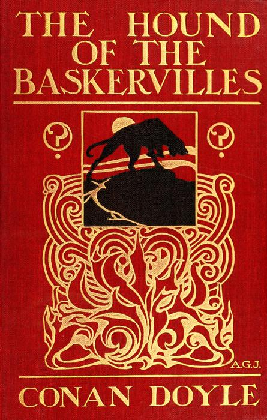

Plot Summary

Chapter One: Mr. Sherlock Holmes

Sherlock Holmes receives a visit from Dr. James Mortimer, a young country doctor from Devon, who has come to consult him about an urgent matter. Mortimer is a rather vague and eccentric man with a keen interest in phrenology, and considers that he needs a man like Holmes for this matter, as Holmes has the reputation of being incomparable as a ‘practical man of affairs’.

Chapter Two: The Curse of the Baskervilles

Mortimer reads to Holmes a document from 1742 which he was given by the late Sir Charles Baskerville, which tells the story of an evil ancestor of Sir Charles, Hugo Baskerville, who was killed on the moor by a huge black hound of diabolical appearance following an evening of particularly dreadful drunkenness and crime. Since the time of Sir Hugo, many Baskervilles have perished in violent and mysterious circumstances, and Sir Charles’ recent death follows this pattern. 

Extract from Chapter Two: The ‘Private Facts’

Dr. Mortimer has just read out the official account of the cause of Sir Charles Baskerville’s death. He now goes on to explain further information about the matter which he has not previously revealed.

Dr. Mortimer refolded his paper and replaced it in his pocket. “Those are the public facts, Mr. Holmes, in connection with the death of Sir Charles Baskerville.”

“I must thank you,” said Sherlock Holmes, “for calling my attention to a case which certainly presents some features of interest. This article, you say, contains all the public facts?”

“It does.”

“Then let me have the private ones.” He leaned back, put his finger-tips together, and assumed his most impassive and judicial expression.

“In doing so,” said Dr. Mortimer, who had begun to show signs of some strong emotion, “I am telling that which I have not confided to anyone. My motive for withholding it from the coroner’s inquiry is that a man of science shrinks from placing himself in the public position of seeming to endorse a popular superstition. I had the further motive that Baskerville Hall, as the paper says, would certainly remain untenanted if anything were done to increase its already rather grim reputation. For both these reasons I thought that I was justified in telling rather less than I knew, since no practical good could result from it, but with you there is no reason why I should not be perfectly frank.

“The moor is very sparsely inhabited, and those who live near each other are thrown very much together. For this reason I saw a good deal of Sir Charles Baskerville. With the exception of Mr. Frankland, of Lafter Hall, and Mr. Stapleton, the naturalist, there are no other men of education within many miles. Sir Charles was a retiring man, but the chance of his illness brought us together, and a community of interests in science kept us so. He had brought back much scientific information from South Africa, and many a charming evening we have spent together discussing the comparative anatomy of the Bushman and the Hottentot.

“Within the last few months it became increasingly plain to me that Sir Charles’s nervous system was strained to the breaking point. He had taken this legend which I have read you exceedingly to heart—so much so that, although he would walk in his own grounds, nothing would induce him to go out upon the moor at night. Incredible as it may appear to you, Mr. Holmes, he was honestly convinced that a dreadful fate overhung his family, and certainly the records which he was able to give of his ancestors were not encouraging. The idea of some ghastly presence constantly haunted him, and on more than one occasion he has asked me whether I had on my medical journeys at night ever seen any strange creature or heard the baying of a hound. The latter question he put to me several times, and always with a voice which vibrated with excitement.

“I can well remember driving up to his house in the evening some three weeks before the fatal event. He chanced to be at his hall door. I had descended from my gig and was standing in front of him, when I saw his eyes fix themselves over my shoulder and stare past me with an expression of the most dreadful horror. I whisked round and had just time to catch a glimpse of something which I took to be a large black calf passing at the head of the drive. So excited and alarmed was he that I was compelled to go down to the spot where the animal had been and look around for it. It was gone, however, and the incident appeared to make the worst impression upon his mind. I stayed with him all the evening, and it was on that occasion, to explain the emotion which he had shown, that he confided to my keeping that narrative which I read to you when first I came. I mention this small episode because it assumes some importance in view of the tragedy which followed, but I was convinced at the time that the matter was entirely trivial and that his excitement had no justification.

“It was at my advice that Sir Charles was about to go to London. His heart was, I knew, affected, and the constant anxiety in which he lived, however chimerical the cause of it might be, was evidently having a serious effect upon his health. I thought that a few months among the distractions of town would send him back a new man. Mr. Stapleton, a mutual friend who was much concerned at his state of health, was of the same opinion. At the last instant came this terrible catastrophe.

“On the night of Sir Charles’s death Barrymore the butler, who made the discovery, sent Perkins the groom on horseback to me, and as I was sitting up late I was able to reach Baskerville Hall within an hour of the event. I checked and corroborated all the facts which were mentioned at the inquest. I followed the footsteps down the yew alley, I saw the spot at the moor-gate where he seemed to have waited, I remarked the change in the shape of the prints after that point, I noted that there were no other footsteps save those of Barrymore on the soft gravel, and finally I carefully examined the body, which had not been touched until my arrival. Sir Charles lay on his face, his arms out, his fingers dug into the ground, and his features convulsed with some strong emotion to such an extent that I could hardly have sworn to his identity. There was certainly no physical injury of any kind. But one false statement was made by Barrymore at the inquest. He said that there were no traces upon the ground round the body. He did not observe any. But I did—some little distance off, but fresh and clear.”

“Footprints?”

“Footprints.”

“A man’s or a woman’s?”

Dr. Mortimer looked strangely at us for an instant, and his voice sank almost to a whisper as he answered.

“Mr. Holmes, they were the footprints of a gigantic hound!”

Questions on The Hound of the Baskervilles

1\. Dr Mortimer is reluctant to believe in the existence of the hound mainly because:

A. He believes that Sir Charles Baskerville is losing his mind.

B. He prefers discussing the shapes of people’s skulls.

C. He thinks that it is merely a local superstition.

D. He does not think that his friend is a reliable witness.

2\. Sir Charles Baskerville is having health problems because:

A. He is very anxious, as he believes that he has a tragic fate.

B. He feels guilty about the bad things his ancestors have done.

C. He spends too much time visiting London.

D. He lives a lonely life out in the countryside at his manor.

Descriptive Writing

Describe a frightening experience in detail. For example:

• a journey through wild and deserted countryside at night;

• an encounter with a wild animal;

• a narrow escape from death.

Use this structure:

| Paragraph | Suggested Vocabulary |
| --- | --- |
| Paragraph One: Description of surroundings: wide focus. Starting sentence: The wind howled over the desolate moor. | rugged, utter darkness, silhouettes, looming, owls, wolves |
| Paragraph Two: Description of surroundings: narrow focus. Starting sentence: On the edge of the moor, lights shone in a lonely house. | glow, comfort, security, protection, inviting |
| Paragraph Three: Description of character. Starting sentence: The solitary traveller scrambled hurriedly over the barren landscape. | terror, menace, vulnerable |
| Paragraph Four: Flashback. Starting sentence: The traveller remembered the story his father had once told him. | mysterious, horrifying, superstition |
| Paragraph Five: Jolt back to present. Starting sentence: He tried desperately to put those thoughts out of his mind. | determination, struggle, persevere, hope |
| Paragraph Six: Powerful ending with a cyclical structure. Has anything changed? Starting sentence: The wind howled over the desolate moor. | safety, relief, triumph |

## 22. Macbeth (1606)

Extract from Macbeth (1606) by William Shakespeare (1564-1616)

Macbeth contemplates murder, after being made Thane of Cawdor (Act One Scene Three, lines 142-155)

\[Aside\] This supernatural soliciting

Cannot be ill, cannot be good: if ill, Why hath it given me earnest of success,            145 Commencing in a truth? I am Thane of Cawdor: If good, why do I yield to that suggestion Whose horrid image doth unfix my hair And make my seated heart knock at my ribs, Against the use of nature? Present fears            150 Are less than horrible imaginings: My thought, whose murder yet is but fantastical, Shakes so my single state of man that function Is smother’d in surmise, and nothing is But what is not.                        155

Context

Macbeth is set in eleventh century Scotland. There was no strict principle of dynastic succession (son succeeding father to the throne) and the noblemen often struggled for power. The play tells the story of how the Scottish nobleman Macbeth murders King Duncan and gains the throne. However, his evil and tyrannical rule ends tragically for him and his wife.

When he speaks this aside, Macbeth has just heard from three witches that he will become Thane (Duke) of Cawdor and later King of Scotland. Soon afterwards, he learns that he has been made Thane of Cawdor, and he begins to have evil thoughts about how he might make the second prophecy come true.

Questions on the Extract from Macbeth

1\. When he realises that the first “prophecy” has come true, Macbeth is mainly

A. Happy that he has gained more power and honour in Scotland.

B. Grateful to have been honoured for his victories in battle.

C. Angry that he does not yet have supreme power.

D. Torn up inside by thoughts of how to gain his ambitious goal.

2\. The thought of murder has the following effect on Macbeth:

A. It makes his heart pound because it is so horrifying.

B. It disgusts him and he rejects it completely.

C. It makes his hair stand on end because he is not used to violence.

D. It tempts him because he likes to do violent things.

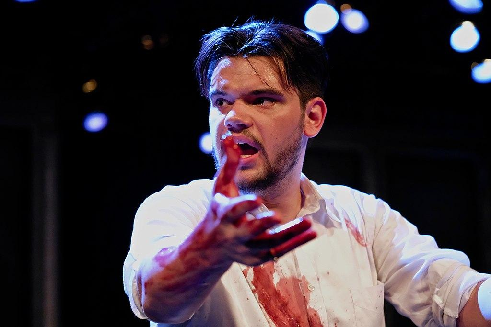

Nonfiction Writing

Write an article explaining how far you agree with this statement: ‘Power always corrupts those who hold it’. You could use this structure:

| Paragraph | Suggested Vocabulary |
| --- | --- |
| Introduction: It is a well-known saying that power corrupts, and absolute power corrupts absolutely. | superior, godlike, tyranny, control, wealth, important |
| Paragraph One: Parents hold power within the family. | natural, responsible, care, love, benefit, rule, discipline, kind, happy, selfish, miserable |
| Paragraph Two: Teachers also have a kind of power. | natural authority, knowledge, order, peace, benefit, education, training, virtue |
| Paragraph Three: Political power is the most problematic kind. | power-hungry, arrogant, corrupt, false, reputation, public servant, patriotic, public good |
| Conclusion: The effect of power on people depends upon many factors. | source, motivation, love, pride, humility |

## 23. The Lion, the Witch and the Wardrobe (1950)

Extract from The Lion, the Witch and the Wardrobe (1950) by C. S. Lewis (1898-1963)

Context

World War Two

The novel is set early in World War Two (1939-1945), during the Blitz, when the German air force was doing terrible damage to British cities. Many children were evacuated from major cities such as London, and went to live with host families in the countryside, while their parents remained in the city.

Chapter One: Lucy Looks into a Wardrobe

Once there were four children whose names were Peter, Susan, Edmund and Lucy. This story is about something that happened to them when they were sent away from London during the war because of the air-raids. They were sent to the house of an old Professor who lived in the heart of the country, ten miles from the nearest railway station and two miles from the nearest post office. He had no wife and he lived in a very large house with a housekeeper called Mrs. Macready and three servants. (Their names were Ivy, Margaret and Betty, but they do not come into the story much.) He himself was a very old man with shaggy white hair, which grew over most of his face as well as on his head, and they liked him almost at once; but on the first evening when he came out to meet them at the front door he was so odd-looking that Lucy (who was the youngest) was a little afraid of him, and Edmund (who was the next youngest) wanted to laugh and had to keep on pretending he was blowing his nose to hide it.

As soon as they had said good night to the Professor and gone upstairs on the first night, the boys came into the girls' room and they all talked it over.

"We've fallen on our feet and no mistake," said Peter. "This is going to be perfectly splendid. That old chap will let us do anything we like."

"I think he's an old dear," said Susan.

"Oh, come off it!" said Edmund, who was tired and pretending not to be tired, which always made him bad-tempered. "Don't go on talking like that."

"Like what?" said Susan; "and anyway, it's time you were in bed."

"Trying to talk like Mother," said Edmund. "And who are you to say when I'm to go to bed? Go to bed yourself."

"Hadn't we all better go to bed?" said Lucy. "There's sure to be a row if we're heard talking here."

"No there won't," said Peter. "I tell you this is the sort of house where no one's going to mind what we do. Anyway, they won't hear us. It's about ten minutes' walk from here down to that dining room, and any amount of stairs and passages in between."

"What's that noise?" said Lucy suddenly. It was a far larger house than she had ever been in before and the thought of all those long passages and rows of doors leading into empty rooms was beginning to make her feel a little creepy.

"It's only a bird, silly," said Edmund.

"It's an owl," said Peter. "This is going to be a wonderful place for birds. I shall go to bed now. I say, let's go and explore to-morrow. You might find anything in a place like this. Did you see those mountains as we came along? And the woods? There might be eagles. There might be stags. There'll be hawks."

"Badgers!" said Lucy.

"Snakes!" said Edmund.

"Foxes!" said Susan.

But when next morning came, there was a steady rain falling, so thick that when you looked out of the window you could see neither the mountains nor the woods nor even the stream in the garden.

"Of course it would be raining!" said Edmund. They had just finished breakfast with the Professor and were upstairs in the room he had set apart for them—a long, low room with two windows looking out in one direction and two in another.

"Do stop grumbling, Ed," said Susan. "Ten to one it'll clear up in an hour or so. And in the meantime we're pretty well off. There's a wireless and lots of books."

"Not for me," said Peter, "I'm going to explore in the house."

Everyone agreed to this and that was how the adventures began. It was the sort of house that you never seem to come to the end of, and it was full of unexpected places. The first few doors they tried led only into spare bedrooms, as everyone had expected that they would; but soon they came to a very long room full of pictures and there they found a suit of armour; and after that was a room all hung with green, with a harp in one corner; and then came three steps down and five steps up, and then a kind of little upstairs hall and a door that led out onto a balcony, and then a whole series of rooms that led into each other and were lined with books—most of them very old books and some bigger than a Bible in a church. And shortly after that they looked into a room that was quite empty except for one big wardrobe; the sort that has a looking-glass in the door. There was nothing else in the room at all except a dead blue-bottle on the window-sill.

"Nothing there!" said Peter, and they all trooped out again—all except Lucy. She stayed behind because she thought it would be worthwhile trying the door of the wardrobe, even though she felt almost sure that it would be locked. To her surprise it opened quite easily, and two moth-balls dropped out.

Looking into the inside, she saw several coats hanging up—mostly long fur coats. There was nothing Lucy liked so much as the smell and feel of fur. She immediately stepped into the wardrobe and got in among the coats and rubbed her face against them, leaving the door open, of course, because she knew that it is very foolish to shut oneself into any wardrobe. Soon she went further in and found that there was a second row of coats hanging up behind the first one. It was almost quite dark in there and she kept her arms stretched out in front of her so as not to bump her face into the back of the wardrobe. She took a step further in—then two or three steps—always expecting to feel woodwork against the tips of her fingers. But she could not feel it.

"This must be a simply enormous wardrobe!" thought Lucy, going still further in and pushing the soft folds of the coats aside to make room for her. Then she noticed that there was something crunching under her feet. "I wonder is that more moth-balls?" she thought, stooping down to feel it with her hands. But instead of feeling the hard, smooth wood of the floor of the wardrobe, she felt something soft and powdery and extremely cold. "This is very queer," she said, and went on a step or two further.

Next moment she found that what was rubbing against her face and hands was no longer soft fur but something hard and rough and even prickly. "Why, it is just like branches of trees!" exclaimed Lucy. And then she saw that there was a light ahead of her; not a few inches away where the back of the wardrobe ought to have been, but a long way off. Something cold and soft was falling on her. A moment later she found that she was standing in the middle of a wood at night-time with snow under her feet and snowflakes falling through the air.

Lucy felt a little frightened, but she felt very inquisitive and excited as well. She looked back over her shoulder and there, between the dark tree-trunks, she could still see the open doorway of the wardrobe and even catch a glimpse of the empty room from which she had set out. (She had, of course, left the door open, for she knew that it is a very silly thing to shut oneself into a wardrobe.) It seemed to be still daylight there. "I can always get back if anything goes wrong," thought Lucy. She began to walk forward, crunch-crunch, over the snow and through the wood towards the other light.

In about ten minutes she reached it and found that it was a lamp-post. As she stood looking at it, wondering why there was a lamp-post in the middle of a wood and wondering what to do next, she heard a pitter patter of feet coming towards her. And soon after that a very strange person stepped out from among the trees into the light of the lamp-post.

He was only a little taller than Lucy herself and he carried over his head an umbrella, white with snow. From the waist upwards he was like a man, but his legs were shaped like a goat's (the hair on them was glossy black) and instead of feet he had goat's hoofs. He also had a tail, but Lucy did not notice this at first because it was neatly caught up over the arm that held the umbrella so as to keep it from trailing in the snow. He had a red woollen muffler round his neck and his skin was rather reddish too. He had a strange, but pleasant little face with a short pointed beard and curly hair, and out of the hair there stuck two horns, one on each side of his forehead. One of his hands, as I have said, held the umbrella: in the other arm he carried several brown paper parcels. What with the parcels and the snow it looked just as if he had been doing his Christmas shopping. He was a Faun. And when he saw Lucy he gave such a start of surprise that he dropped all his parcels.

"Goodness gracious me!" exclaimed the Faun.

Questions on The Lion, the Witch and the Wardrobe (1950) by C. S. Lewis (1898-1963)

1\. Susan’s overall attitude towards Professor Kirke is that:

A. She thinks that he is a foolish old man who will let them do anything.

B. She thinks he is loveable.

C. She tries to have her mother’s attitude towards him.

D. She is worried that he will be angry if they stay up late.

2\. Peter’s overall attitude towards their evacuation from London is that:

A. He is concerned that they have had to go so far from home.

B. He thinks that the countryside will offer them different activities.

C. He is glad that they have left behind the dangers of the Blitz.

D. He thinks that they are lucky to have been evacuated to Professor Kirke’s house.

Analytical Writing on The Lion, the Witch and the Wardrobe (1950) by C. S. Lewis (1898-1963)

| Starting Sentence | Quotations | Vocabulary |
| --- | --- | --- |
| In the novel’s opening scene, Lewis gives many clues about the characters of the Pevensie children. | "We've fallen on our feet and no mistake," said Peter.  "I think he's an old dear," said Susan.  "Oh, come off it!" said Edmund, who was tired and pretending not to be tired, which always made him bad-tempered.  "Like what?" said Susan; "and anyway, it's time you were in bed."  "Trying to talk like Mother," said Edmund. "And who are you to say when I'm to go to bed? Go to bed yourself."  "Hadn't we all better go to bed?" said Lucy. "There's sure to be a row if we're heard talking here."  ‘"No there won't," said Peter.’  "What's that noise?" said Lucy suddenly.  "It's only a bird, silly," said Edmund.  | leader, judgement, mature, bossy, spiteful, short-tempered, anxious, considerate, kind, unkind |

Example Paragraph

In the novel’s opening scene, Lewis gives many clues about the characters of the Pevensie children. Peter is clearly the leader. He gives the first and the final judgement about the place to which they have been evacuated. Having already asserted that they have ‘fallen’ on their ‘feet’ at Professor Kirke’s house, he brings his siblings’ argument to an end by insisting that ‘there won’t’ be any ‘row’ if they stay up late. Susan, in contrast, makes a failed effort to assert her authority as an older sister. She only succeeds in earning Edmund’s dislike when she tries to behave like ‘Mother’ and tell him to go to bed. For his part, Edmund is depicted as short-tempered and spiteful. Although his reaction to Susan is understandable, his retort when Lucy is startled by the sound of an owl shows that he is unkind towards his younger sister, calling her ‘silly’. Lucy is a considerate and kind girl, trying to keep the peace by saying that they should ‘all go to bed’ when Edmund and Susan are arguing about it. Her gentle character makes Edmund’s spiteful treatment all the more distasteful to the reader.

## 24. The Adventures of Tom Sawyer (1876)

Extract from The Adventures of Tom Sawyer (1876) by Mark Twain (1835-1910)

Mark Twain’s The Adventures of Tom Sawyer describes the escapades of a lively, badly behaved boy called Tom Sawyer in a small town in Missouri, USA. This extract is set in the town’s Sunday school, where students get tickets as a reward for memorising Bible verses. When they have memorised two thousand verses, they win a Bible of their own. Tom finds a way of acquiring these tickets not by learning the verses, but by trading with other students to get the tickets they have earned. He hopes to gain the glory of the prize without putting in the effort.

At the door Tom dropped back a step and accosted a Sunday-dressed comrade:

“Say, Billy, got a yaller ticket?”

“Yes.”

“What’ll you take for her?”

“What’ll you give?”

“Piece of lickrish and a fish-hook.”

“Less see ’em.”

Tom exhibited. They were satisfactory, and the property changed hands. Then Tom traded a couple of white alleys for three red tickets, and some small trifle or other for a couple of blue ones. He waylaid other boys as they came, and went on buying tickets of various colors ten or fifteen minutes longer. He entered the church, now, with a swarm of clean and noisy boys and girls, proceeded to his seat and started a quarrel with the first boy that came handy. The teacher, a grave, elderly man, interfered; then turned his back a moment and Tom pulled a boy’s hair in the next bench, and was absorbed in his book when the boy turned around; stuck a pin in another boy, presently, in order to hear him say “Ouch!” and got a new reprimand from his teacher. Tom’s whole class were of a pattern—restless, noisy, and troublesome. When they came to recite their lessons, not one of them knew his verses perfectly, but had to be prompted all along. However, they worried through, and each got his reward—in small blue tickets, each with a passage of Scripture on it; each blue ticket was pay for two verses of the recitation. Ten blue tickets equalled a red one, and could be exchanged for it; ten red tickets equalled a yellow one; for ten yellow tickets the superintendent gave a very plainly bound Bible (worth forty cents in those easy times) to the pupil. How many of my readers would have the industry and application to memorize two thousand verses, even for a Dore Bible? And yet Mary had acquired two Bibles in this way—it was the patient work of two years—and a boy of German parentage had won four or five. He once recited three thousand verses without stopping; but the strain upon his mental faculties was too great, and he was little better than an idiot from that day forth—a grievous misfortune for the school, for on great occasions, before company, the superintendent (as Tom expressed it) had always made this boy come out and “spread himself.” Only the older pupils managed to keep their tickets and stick to their tedious work long enough to get a Bible, and so the delivery of one of these prizes was a rare and noteworthy circumstance; the successful pupil was so great and conspicuous for that day that on the spot every scholar’s heart was fired with a fresh ambition that often lasted a couple of weeks. It is possible that Tom’s mental stomach had never really hungered for one of those prizes, but unquestionably his entire being had for many a day longed for the glory and the eclat that came with it.

In due course the superintendent stood up in front of the pulpit, with a closed hymn-book in his hand and his forefinger inserted between its leaves, and commanded attention. \[ . . . \] He began after this fashion:

“Now, children, I want you all to sit up just as straight and pretty as you can and give me all your attention for a minute or two. There—that is it. That is the way good little boys and girls should do. I see one little girl who is looking out of the window—I am afraid she thinks I am out there somewhere—perhaps up in one of the trees making a speech to the little birds. \[Applausive titter.\] I want to tell you how good it makes me feel to see so many bright, clean little faces assembled in a place like this, learning to do right and be good.” And so forth and so on. It is not necessary to set down the rest of the oration. It was of a pattern which does not vary, and so it is familiar to us all.

The latter third of the speech was marred by the resumption of fights and other recreations among certain of the bad boys, and by fidgetings and whisperings that extended far and wide, washing even to the bases of isolated and incorruptible rocks like Sid and Mary. But now every sound ceased suddenly, with the subsidence of Mr. Walters’ voice, and the conclusion of the speech was received with a burst of silent gratitude.

A good part of the whispering had been occasioned by an event which was more or less rare—the entrance of visitors: lawyer Thatcher, accompanied by a very feeble and aged man; a fine, portly, middle-aged gentleman with iron-gray hair; and a dignified lady who was doubtless the latter’s wife. The lady was leading a child. Tom had been restless and full of chafings and repinings; conscience-smitten, too—he could not meet Amy Lawrence’s eye, he could not brook her loving gaze. But when he saw this small newcomer his soul was all ablaze with bliss in a moment. The next moment he was “showing off” with all his might—cuffing boys, pulling hair, making faces—in a word, using every art that seemed likely to fascinate a girl and win her applause. His exaltation had but one alloy—the memory of his humiliation in this angel’s garden—and that record in sand was fast washing out, under the waves of happiness that were sweeping over it now.

The visitors were given the highest seat of honor, and as soon as Mr. Walters’ speech was finished, he introduced them to the school. The middle-aged man turned out to be a prodigious personage—no less a one than the county judge—altogether the most august creation these children had ever looked upon—and they wondered what kind of material he was made of—and they half wanted to hear him roar, and were half afraid he might, too. He was from Constantinople, twelve miles away—so he had travelled, and seen the world—these very eyes had looked upon the county court-house—which was said to have a tin roof. The awe which these reflections inspired was attested by the impressive silence and the ranks of staring eyes. This was the great Judge Thatcher, brother of their own lawyer. Jeff Thatcher immediately went forward, to be familiar with the great man and be envied by the school. It would have been music to his soul to hear the whisperings:

“Look at him, Jim! He’s a going up there. Say—look! he’s a going to shake hands with him—he is shaking hands with him! By jings, don’t you wish you was Jeff?”

Mr. Walters fell to “showing off,” with all sorts of official bustlings and activities, giving orders, delivering judgments, discharging directions here, there, everywhere that he could find a target. The librarian “showed off”—running hither and thither with his arms full of books and making a deal of the splutter and fuss that insect authority delights in. The young lady teachers “showed off”—bending sweetly over pupils that were lately being boxed, lifting pretty warning fingers at bad little boys and patting good ones lovingly. The young gentlemen teachers “showed off” with small scoldings and other little displays of authority and fine attention to discipline—and most of the teachers, of both sexes, found business up at the library, by the pulpit; and it was business that frequently had to be done over again two or three times (with much seeming vexation). The little girls “showed off” in various ways, and the little boys “showed off” with such diligence that the air was thick with paper wads and the murmur of scufflings. And above it all the great man sat and beamed a majestic judicial smile upon all the house, and warmed himself in the sun of his own grandeur—for he was “showing off,” too.

There was only one thing wanting to make Mr. Walters’ ecstasy complete, and that was a chance to deliver a Bible-prize and exhibit a prodigy. Several pupils had a few yellow tickets, but none had enough—he had been around among the star pupils inquiring. He would have given worlds, now, to have that German lad back again with a sound mind.

And now at this moment, when hope was dead, Tom Sawyer came forward with nine yellow tickets, nine red tickets, and ten blue ones, and demanded a Bible. This was a thunderbolt out of a clear sky. Walters was not expecting an application from this source for the next ten years. But there was no getting around it—here were the certified checks, and they were good for their face. Tom was therefore elevated to a place with the Judge and the other elect, and the great news was announced from headquarters. It was the most stunning surprise of the decade, and so profound was the sensation that it lifted the new hero up to the judicial one’s altitude, and the school had two marvels to gaze upon in place of one. The boys were all eaten up with envy—but those that suffered the bitterest pangs were those who perceived too late that they themselves had contributed to this hated splendor by trading tickets to Tom for the wealth he had amassed in selling whitewashing privileges. These despised themselves, as being the dupes of a wily fraud, a guileful snake in the grass.

The prize was delivered to Tom with as much effusion as the superintendent could pump up under the circumstances; but it lacked somewhat of the true gush, for the poor fellow’s instinct taught him that there was a mystery here that could not well bear the light, perhaps; it was simply preposterous that this boy had warehoused two thousand sheaves of Scriptural wisdom on his premises—a dozen would strain his capacity, without a doubt.

Amy Lawrence was proud and glad, and she tried to make Tom see it in her face—but he wouldn’t look. She wondered; then she was just a grain troubled; next a dim suspicion came and went—came again; she watched; a furtive glance told her worlds—and then her heart broke, and she was jealous, and angry, and the tears came and she hated everybody. Tom most of all (she thought).

Tom was introduced to the Judge; but his tongue was tied, his breath would hardly come, his heart quaked—partly because of the awful greatness of the man, but mainly because he was her parent. He would have liked to fall down and worship him, if it were in the dark. The Judge put his hand on Tom’s head and called him a fine little man, and asked him what his name was. The boy stammered, gasped, and got it out:

“Tom.”

“Oh, no, not Tom—it is—”

“Thomas.”

“Ah, that’s it. I thought there was more to it, maybe. That’s very well. But you’ve another one I daresay, and you’ll tell it to me, won’t you?”

“Tell the gentleman your other name, Thomas,” said Walters, “and say sir. You mustn’t forget your manners.”

“Thomas Sawyer—sir.”

“That’s it! That’s a good boy. Fine boy. Fine, manly little fellow. Two thousand verses is a great many—very, very great many. And you never can be sorry for the trouble you took to learn them; for knowledge is worth more than anything there is in the world; it’s what makes great men and good men; you’ll be a great man and a good man yourself, some day, Thomas, and then you’ll look back and say, It’s all owing to the precious Sunday-school privileges of my boyhood—it’s all owing to my dear teachers that taught me to learn—it’s all owing to the good superintendent, who encouraged me, and watched over me, and gave me a beautiful Bible—a splendid elegant Bible—to keep and have it all for my own, always—it’s all owing to right bringing up! That is what you will say, Thomas—and you wouldn’t take any money for those two thousand verses—no indeed you wouldn’t. And now you wouldn’t mind telling me and this lady some of the things you’ve learned—no, I know you wouldn’t—for we are proud of little boys that learn. Now, no doubt you know the names of all the twelve disciples. Won’t you tell us the names of the first two that were appointed?”

Tom was tugging at a button-hole and looking sheepish. He blushed, now, and his eyes fell. Mr. Walters’ heart sank within him. He said to himself, it is not possible that the boy can answer the simplest question—why did the Judge ask him? Yet he felt obliged to speak up and say:

“Answer the gentleman, Thomas—don’t be afraid.”

Tom still hung fire.

“Now I know you’ll tell me,” said the lady. “The names of the first two disciples were—”

“David and Goliath!”

Let us draw the curtain of charity over the rest of the scene.

Questions on The Adventures of Tom Sawyer (1876) by Mark Twain (1835-1910)

1\. Tom Sawyer’s Sunday school prize is precious to him because:

A. He wants to impress his teacher.

B. He wants to show how hard he has studied.

C. He has found a clever way of getting hold of tickets.

D. He wants to impress Judge Thatcher’s daughter. 

2\. The reaction to Judge Thatcher is best summarised as:

A. A universal attempt to impress the illustrious visitor.

B. Silence caused by his awe-inspiring presence.

C. Curiosity about someone who has come from far away.

D. Whispering and gossiping about the important personage.

Fiction Writing

Write a story about a clever plan that went wrong in a humiliating way. You could use this structure:

| Paragraph | Suggested Vocabulary |
| --- | --- |
| Paragraph One: A hope for the future I was tired of failing my grammar tests. | memory, cramming, mastered, defeated |
| Paragraph Two: A plan for success I came up with a plan so that I would never fail again. | teacher, textbook, desk, photograph, answer key |
| Paragraph Three: A triumph I put my plan into action without delay. | sneaking, break, noises, exhilaration, success |
| Paragraph Four: A setback I realised that evening that I still faced the challenge of memorising the answers. | persevere, motivated, dream, hope, sweet moment |
| Paragraph Five: Apparent success I was so excited when the grammar test came round. | scribbled, answers, suspicion, one hundred percent |
| Paragraph Six: Tragic conclusion As the weeks rolled by, I scored perfectly time after time. | impressed, prodigy, principal, questions, panic, punishment, lesson |

Example Answer

I was tired of failing my grammar tests. Every week, I would spend a desperate half hour trying to cram my mind with verbs, tenses, syntax . . . to no avail. My memory just didn’t seem to be capable of retaining this information. I would test myself and think I had it mastered, only to be defeated once again the following morning when I faced the real thing.

I came up with a plan to make sure this would never happen again. I knew where the teacher kept the teacher’s edition of the grammar textbook in his desk. I had seen him take it out on test mornings week after week, my heart pounding as I faced yet another humiliation. All I needed to do, I told myself, was to sneak into the classroom at break time when no one was around, and take a quick photograph of the test pages that were coming up.

I put my plan into action without delay. I knew that our teacher spent his break time drinking coffee in the staff room, and did not return to the classroom until just before lessons were due to start again. Still, I was nervous, and it took some courage to go creeping into the empty classroom on my nefarious mission, while all my friends were happily shouting and running around outside, oblivious to the drama that was taking place indoors. I kept starting at the slightest noise as I made my way towards the teachers desk and carefully opened it, hoping it would not creak or squeak. I felt a triumphant exhilaration as I slipped out the books and took photos of all of the test pages that were coming up in the next few months. The textbook had an answer key. Now I was ready to excel in grammar!

Having procured the photographs, I realised that evening that I still faced the challenge of memorising the answers. I couldn’t look at the photographs during the test. I had to commit the answers to memory, which was quite an effort. Still, I knew that I was learning exactly the things which we would be asked the next day, so I persevered with strong motivation, looking forward to the sweet moment when the test scores would come back with one hundred percent written on mine.

I was so excited when the grammar test came round. What a contrast to my usual feelings of anxiety and trepidation! I scribbled down the correct answers from memory, taking care not to write them before the questions were asked, lest I should excite suspicion. And sure enough, I scored one hundred percent. I glowed with happiness at the praise of the teacher, although I felt just a little uncomfortable as he spoke to the rest of the class about how my example showed that hard work paid off in the end . . .

As the weeks rolled by, I scored perfectly time after time. The teacher was amazed at my abilities. After two months of perfect scores, he approached me after class and said that he would like to take me to the headmaster to receive a special reward. I was delighted. I had never been recognised for my academic achievements like this before - perhaps because I had never achieved anything much!

The headmaster sat smiling in his study, with a beautifully bound book on his desk. I was thrilled to see that I was going to be given a reward that I could show off to my peers and to my parents. I did not know that disaster was about to strike.

“Well, I am delighted to have such a grammar prodigy in my school,” said the headmaster, smiling all the time. “Just for my own enjoyment, I’m going to ask you a few grammar questions. Firstly, can you tell me the subject, the verb, the direct object and the indirect object in this sentence . . . “

But the headmaster never had time to ask his question. I panicked and dashed from the room. I knew that my punishment was near, but I hoped to delay it by at least an hour or so. I hid in the toilets, trembling with fear. This was the last time I would ever cheat on a test, I told myself.

## 25. The Fellowship of the Ring (1954)

The Fellowship of the Ring (1954) by J. R. R. Tolkien (1892-1973): Volume One of The Lord of the Rings

Summary of the First Two Chapters

Chapter One: A Long-Expected Party

Bilbo Baggins celebrates his 111th birthday at Bag-End, but surprises all his guests by suddenly putting on his ring and disappearing at the end of his speech. He intends to leave the Shire, and is bequeathing all his property to his nephew and heir, Frodo, who turns 33 on the same day, and therefore comes of age. Before he leaves, Bilbo discusses his plans with Gandalf, who insists that Bilbo give up the ring, which has taken a hold of him. Gandalf has to be very stern with him to persuade him to give it up.

Once Bilbo has left, Frodo and Gandalf discuss events, and Gandalf announces that he has to leave immediately, despite his previous plans to stay longer. He urgently needs to investigate something, a matter which seems to be weighing him down as he departs. Gandalf warns Frodo to use the ring seldom, if at all, and to keep it secret and safe. He believes that it may have other powers apart from making you disappear.

Chapter Two: The Shadow of the Past

Frodo lives peacefully in the Shire until he is nearing his fiftieth birthday. Although he remains at Bag-End, he gathers news of how the power of the Dark Lord is growing, and how he has rebuilt his Dark Tower in Mordor. Gandalf returns, bringing alarming news: the ring is the One Ring, the Master Ring, crafted by Sauron many ages before. When Sauron was defeated, Isildur took it, but he was killed by orcs, and the ring was lost in the River Anduin. It was found again by Gollum, then called Smeagol, who killed his friend to possess it. The keeper of the ring does not age. If he uses it, he will eventually pass under the power of the Dark Lord. Sauron is now searching for it, and he has learned from Gollum that it is in the Shire, in the possession of a Baggins. If he gains possession of it, he will have the power to cover the world in a second darkness. When Frodo wishes that Bilbo had killed Gollum when he had the chance, Gandalf replies that Bilbo’s pity is what saved him from being enslaved by the ring, and that he believes Gollum still has a part to play in the destiny of the ring.

Gandalf explains that the only way to destroy the ring and protect Middle Earth from the Dark Lord’s power is to cast it into the Cracks of Doom, deep within Orodruin, the Fire-mountain, in Mordor. Frodo wishes that he had never seen the ring, and offers it to Gandalf, who refuses it, explaining that he would not be able to resist using it if he possessed it, and that if he did this, he would become like the Dark Lord himself. Frodo himself must carry the ring out of the Shire. Sam Gamgee, Frodo’s gardener, who has been eavesdropping on the conversation, is chosen by Gandalf as a travelling companion for Frodo.

Extract from Chapter Two: The Shadow of the Past

Gandalf tells of how he tracked down Gollum.

‘The trail was long cold when I took it up again, after Bilbo left here. And my search would have been in vain, but for the help that I had from a friend: Aragorn, the greatest traveller and huntsman of this age of the world. Together we sought for Gollum down the whole length of Wilderland, without hope, and without success. But at last, when I had given up the chase and turned to other paths, Gollum was found. My friend returned out of great perils bringing the miserable creature with him. 

‘What he had been doing he would not say. He only wept and called us cruel, with many a gollum in his throat; and when we pressed him he whined and cringed, and rubbed his long hands, licking his fingers as if they pained him, as if he remembered some old torture. But I am afraid there is no possible doubt: he had made his slow, sneaking way, step by step, mile by mile, south, down at last to the Land of Mordor.’ 

A heavy silence fell in the room. Frodo could hear his heart beating. Even outside everything seemed still. No sound of Sam’s shears could now be heard. 

‘Yes, to Mordor,’ said Gandalf. ‘Alas! Mordor draws all wicked things, and the Dark Power was bending all its will to gather them there. The Ring of the Enemy would leave its mark, too, leave him open to the summons. And all folk were whispering then of the new Shadow in the South, and its hatred of the West. There were his fine new friends, who would help him in his revenge! 

‘Wretched fool! In that land he would learn much, too much for his comfort. And sooner or later as he lurked and pried on the borders he would be caught, and taken—for examination. That was the way of it, I fear. When he was found he had already been there long, and was on his way back. On some errand of mischief. But that does not matter much now. His worst mischief was done. 

‘Yes, alas! Through him the Enemy has learned that the One has been found again. He knows where Isildur fell. He knows where Gollum found his ring. He knows that it is a Great Ring, for it gave long life. He knows that it is not one of the Three, for they have never been lost, and they endure no evil. He knows that it is not one of the Seven, or the Nine, for they are accounted for. He knows that it is the One. And he has at last heard, I think, of hobbits and the Shire. 

‘The Shire—he may be seeking for it now, if he has not already found out where it lies. Indeed, Frodo, I fear that he may even think that the long-unnoticed name of Baggins has become important.’ 

‘But this is terrible!’ cried Frodo. ‘Far worse than the worst that I imagined from your hints and warnings. O Gandalf, best of friends, what am I to do? For now I am really afraid. What am I to do? What a pity that Bilbo did not stab that vile creature, when he had a chance!’ 

‘Pity? It was Pity that stayed his hand. Pity, and Mercy: not to strike without need. And he has been well rewarded, Frodo. Be sure that he took so little hurt from the evil, and escaped in the end, because he began his ownership of the Ring so. With Pity.’ 

‘I am sorry,’ said Frodo. ‘But I am frightened; and I do not feel any pity for Gollum.’ 

‘You have not seen him,’ Gandalf broke in.

‘No, and I don’t want to,’ said Frodo. ‘I can’t understand you. Do you mean to say that you, and the Elves, have let him live on after all those horrible deeds? Now at any rate he is as bad as an Orc, and just an enemy. He deserves death.’

‘Deserves it! I daresay he does. Many that live deserve death. And some that die deserve life. Can you give it to them? Then do not be too eager to deal out death in judgement. For even the very wise cannot see all ends. I have not much hope that Gollum can be cured before he dies, but there is a chance of it. And he is bound up with the fate of the Ring. My heart tells me that he has some part to play yet, for good or ill, before the end; and when that comes, the pity of Bilbo may rule the fate of many—yours not least. In any case we did not kill him: he is very old and very wretched. The Wood-elves have him in prison, but they treat him with such kindness as they can find in their wise hearts.’ 

‘All the same,’ said Frodo, ‘even if Bilbo could not kill Gollum, I wish he had not kept the Ring. I wish he had never found it, and that I had not got it! Why did you let me keep it? Why didn’t you make me throw it away, or, or destroy it?’ 

‘Let you? Make you?’ said the wizard. ‘Haven’t you been listening to all that I have said? You are not thinking of what you are saying. But as for throwing it away, that was obviously wrong. These Rings have a way of being found. In evil hands it might have done great evil. Worst of all, it might have fallen into the hands of the Enemy. Indeed it certainly would; for this is the One, and he is exerting all his power to find it or draw it to himself. 

‘Of course, my dear Frodo, it was dangerous for you; and that has troubled me deeply. But there was so much at stake that I had to take some risk—though even when I was far away there has never been a day when the Shire has not been guarded by watchful eyes. As long as you never used it, I did not think that the Ring would have any lasting effect on you, not for evil, not at any rate for a very long time. And you must remember that nine years ago, when I last saw you, I still knew little for certain.’ 

‘But why not destroy it, as you say should have been done long ago?’ cried Frodo again. ‘If you had warned me, or even sent me a message, I would have done away with it.’ 

‘Would you? How would you do that? Have you ever tried?’ 

‘No. But I suppose one could hammer it or melt it.’ 

‘Try!’ said Gandalf. ‘Try now!’ 

Frodo drew the Ring out of his pocket again and looked at it. It now appeared plain and smooth, without mark or device that he could see. The gold looked very fair and pure, and Frodo thought how rich and beautiful was its colour, how perfect was its roundness. It was an admirable thing and altogether precious. When he took it out he had intended to fling it from him into the very hottest part of the fire. But he found now that he could not do so, not without a great struggle. He weighed the Ring in his hand, hesitating, and forcing himself to remember all that Gandalf had told him; and then with an effort of will he made a movement, as if to cast it away—but he found that he had put it back in his pocket. 

Gandalf laughed grimly. ‘You see? Already you too, Frodo, cannot easily let it go, nor will to damage it. And I could not “make” you—except by force, which would break your mind. But as for breaking the Ring, force is useless. Even if you took it and struck it with a heavy sledge-hammer, it would make no dint in it. It cannot be unmade by your hands, or by mine. 

‘Your small fire, of course, would not melt even ordinary gold. This Ring has already passed through it unscathed, and even unheated. But there is no smith’s forge in this Shire that could change it at all. Not even the anvils and furnaces of the Dwarves could do that. It has been said that dragon-fire could melt and consume the Rings of Power, but there is not now any dragon left on earth in which the old fire is hot enough; nor was there ever any dragon, not even Ancalagon the Black, who could have harmed the One Ring, the Ruling Ring, for that was made by Sauron himself. 

‘There is only one way: to find the Cracks of Doom in the depths of Orodruin, the Fire-mountain, and cast the Ring in there, if you really wish to destroy it, to put it beyond the grasp of the Enemy forever.’ 

‘I do really wish to destroy it!’ cried Frodo. ‘Or, well, to have it destroyed. I am not made for perilous quests. I wish I had never seen the Ring! Why did it come to me? Why was I chosen?’ 

‘Such questions cannot be answered,’ said Gandalf. ‘You may be sure that it was not for any merit that others do not possess: not for power or wisdom, at any rate. But you have been chosen, and you must therefore use such strength and heart and wits as you have.’ 

‘But I have so little of any of these things! You are wise and powerful. Will you not take the Ring?’

‘No!’ cried Gandalf, springing to his feet. ‘With that power I should have power too great and terrible. And over me the Ring would gain a power still greater and more deadly.’ His eyes flashed and his face was lit as by a fire within. ‘Do not tempt me! For I do not wish to become like the Dark Lord himself. Yet the way of the Ring to my heart is by pity, pity for weakness and the desire of strength to do good. Do not tempt me! I dare not take it, not even to keep it safe, unused. The wish to wield it would be too great for my strength. I shall have such need of it. Great perils lie before me.’ 

He went to the window and drew aside the curtains and the shutters. Sunlight streamed back again into the room. Sam passed along the path outside whistling. ‘And now,’ said the wizard, turning back to Frodo, ‘the decision lies with you. But I will always help you.’ He laid his hand on Frodo’s shoulder. ‘I will help you bear this burden, as long as it is yours to bear. But we must do something, soon. The Enemy is moving.’

Questions

1\. Gandalf’s overall attitude to Gollum is that:

A. He is an evildoer who ought to be severely punished.

B. He has suffered greatly from possessing the Ring for so long.

C. He should be kept imprisoned so that he does no more harm.

D. Although he has done evil, he cannot be completely condemned.

2\. Gandalf’s attitude to the Ring is that:

A. He is not powerful enough to use it well.

B. He could use it to do good and help others.

C. Even though he has good intentions, he would be corrupted by it.

D. He is glad that Frodo has the task of bearing it.

The Fellowship of the Ring (1954) by J. R. R. Tolkien (1892-1973): Volume One of The Lord of the Rings

Chapter Two: The Shadow of the Past

Analytical Writing

| Starting Sentence | Quotations | Vocabulary |
| --- | --- | --- |
| Gandalf rejects Frodo’s condemnation of Gollum. | Frodo: “What a pity that Bilbo did not stab that vile creature, when he had a chance!” Gandalf: “Pity, and Mercy: not to strike without need.” “Be sure that he took so little hurt from the evil, and escaped in the end, because he began his ownership of the Ring so.” Frodo: “he is as bad as an Orc, and just an enemy. He deserves death.” Gandalf: “I have not much hope that Gollum can be cured before he dies, but there is a chance of it.” | hobbits, kindness, cruelty, evil, hope, redemption |
| For his part, Frodo does not want to be the ring-bearer. | Frodo: “I wish I had never seen the Ring! Why did it come to me? Why was I chosen?” “You are wise and powerful. Will you not take the Ring?’ Gandalf: “Do not tempt me! For I do not wish to become like the Dark Lord himself. Yet the way of the Ring to my heart is by pity, pity for weakness and the desire of strength to do good. Do not tempt me! I dare not take it, not even to keep it safe, unused. The wish to wield it would be too great for my strength.” | wisdom, recognises, temptation, power, good intentions, corruption |

The Fellowship of the Ring (1954) by J. R. R. Tolkien (1892-1973): Volume One of The Lord of the Rings

Chapter Two: The Shadow of the Past

Example Paragraphs

    Gandalf rejects Frodo’s condemnation of Gollum. He explains how Bilbo’s possession of the Ring began with an act of pity and mercy, and this is why he was able to avoid enslavement by it, and even, as no one else has, to give it up: “Be sure that he took so little hurt from the evil, and escaped in the end, because he began his ownership of the Ring so.” This seems to be an example of the peculiar fitness of a hobbit to be the ring-bearer. Kindness and the avoidance of cruelty are natural to them. They do not want to “strike without need”, so the power of the Ring is less likely to destroy them. Furthermore, Gandalf points out that Frodo has no right to condemn Gollum to death, and that even he might be cured. He is not “as bad as an Orc”, a completely evil creature beyond redemption. 

    For his part, Frodo does not want to be the ring-bearer. This is in itself a sign that he is the right person to carry it. Gandalf wisely recognises that he himself could not accomplish the task, that he, as a powerful wizard, would not be able to resist the temptation to gain a power still more marvelous: “The wish to wield it would be too great for my strength”. He would end up “like the Dark Lord himself” if he took the Ring. This is despite his initial good intentions, his “pity for weakness” and his desire to use the Ring for good, to use it to protect creatures like the helpless hobbits. Good intentions are no protection in the end from the corrupting power of the One Ring.

## 26. Romeo and Juliet (c. 1591)

Extract from Romeo and Juliet (c. 1591) by William Shakespeare (1564-1616)

The following extract is from Act 3 Scene 1. At this point in the play, Mercutio has been carried off stage, mortally wounded by Tybalt following Romeo’s efforts to prevent a fight.

ROMEO

This gentleman, the prince's near ally,

My very friend, hath got his mortal hurt

In my behalf; my reputation stain'd

With Tybalt's slander,--Tybalt, that an hour

Hath been my kinsman! O sweet Juliet,

Thy beauty hath made me effeminate

And in my temper soften'd valour's steel!

Re-enter BENVOLIO

BENVOLIO

O Romeo, Romeo, brave Mercutio's dead!

That gallant spirit hath aspired the clouds,

Which too untimely here did scorn the earth.

ROMEO

This day's black fate on more days doth depend;

This but begins the woe, others must end.

BENVOLIO

Here comes the furious Tybalt back again.

ROMEO

Alive, in triumph! and Mercutio slain!

Away to heaven, respective lenity,

And fire-eyed fury be my conduct now!

Questions on Romeo and Juliet (c. 1591) by William Shakespeare (1564-1616)

1\. Romeo’s attitude towards Juliet in this scene is that:

A. He is upset that he has killed her cousin Tybalt

B. He is determined not to fight Tybalt out of love for Juliet.

C. He believes that his love for Juliet has made him less of a man.

D. He hopes to prove to Juliet that he is a real man by fighting.

2\. In the end, Romeo decides that he should:

A. Overcome his anger towards Tybalt because that is the Christian thing to do.

B. Forget about being kind to Tybalt and take revenge.

C. Allow fate to take its course. 

D. Ask Benvolio, his cousin, for advice on what to do.

Analytical Writing on Romeo and Juliet (c. 1591) by William Shakespeare (1564-1616)

| Starting Sentence | Quotations | Vocabulary |
| --- | --- | --- |
| After his friend Mercutio is killed, Romeo abandons any attempt to make peace with Tybalt for Juliet’s sake. | Romeo: ‘O sweet Juliet, / Thy beauty hath made me effeminate’ ‘This day’s black fate’ ‘fire-eyed fury be my conduct now!’  | motivated, love, honour, revenge, metaphor, passionate anger, violence, choice |

Example Paragraph

    After his friend Mercutio is killed, Romeo abandons any attempt to make peace with Tybalt for Juliet’s sake. Romeo laments that Juliet’s beauty has made him ‘effeminate’. Because he is so absorbed by his love for Juliet, and consequently so reluctant to fight her cousin Tybalt, Romeo has compromised his honour and allowed his reputation to be ‘stain’d / With Tybalt’s slander’. But in the end, it is not defence of his honour which motivates Romeo to fight back, but the desire for revenge. He was prepared to allow himself to be insulted by Tybalt without retaliating, but he cannot bear to allow Mercutio’s death to remain unavenged. It is after Benvolio brings the news of Mercutio’s death that Romeo’s attitude switches suddenly from peacemaking to violence. Shakespeare uses a vivid image to emphasise how far behind Romeo has left his thoughts of love and peace: ‘fire-eyed fury be my conduct now!’. The alliteration and the powerful metaphor of fire emphasise how Romeo is being carried away by his passionate anger.

## 27. The Silver Sword (1956)

Extract from The Silver Sword (1956) by Ian Serraillier (1912-1994)

This novel tells the story of a Polish family from Warsaw who are separated following the German invasion of Poland during World War Two. At this point in the story, the father, Joseph, has escaped from a Nazi concentration camp and returned to Warsaw seeking his wife and children.

It took Joseph four and a half weeks to walk to Warsaw. He had lived in the city all his life and knew it well. But now, on his return, there was hardly a street he recognized and not an undamaged building anywhere. The place was as bleak and silent as the craters of the moon. Instead of proud homes, he found crumbling walls; instead of streets, tracks of rubble between mountains of bricks. Windows were charred and glassless. Public buildings were burnt-out shells.

In this wilderness people still managed to go on living. Joseph saw them wander, pale and hungry-eyed, and vanish down paths of their own into the ruins. They had made their homes in cellars or had dug caves in the rubble. A few had even tried to make them look gay. A bomb gash in a cellar wall was draped with bright curtains. In another hole there was a window-box full of purple crocuses. Here and there a tree that had escaped blast damage sprouted with spring leaves.

But the only really lively place was the railway. The Nazis had to keep this clear, whatever the cost. Never had Joseph seen railway lines gleam as these did — eight lines of polished steel along which, day and night, the busy trains poured. Eastwards, with carriages of troops and trucks of ammunition, they carried war to Russia. Westwards they brought back the wounded to Germany, and sometimes rich plunder from the Ukraine.

Joseph spent three days finding the street where he used to live. The school and schoolhouse — his home — had disappeared.

There was a house opposite with a sign marked POLISH WELFARE. He made some inquiries there, but the people were new and could not help him. At another house he had better luck. He knew the woman who lived there — a Mrs Krause, who had had a child at his school some years ago. In a small back room he questioned her eagerly about his family.

“The Nazis destroyed your school,” she said.

"What happened to my wife?”

“They came for her in January last year, during the night. It was just after Dr Frank called for a million foreign workers to go to Germany. She's in Germany, probably working on the land. I'm a member of the Polish Council for Protection and we tried to trace her, but without success.”

“And the children — did they go with her?” asked Joseph.

Mrs Krause turned away. “I don't know anything about them,” she said. Joseph felt that she was hiding unpleasant news. He begged her to speak.

“I know nothing,” she said.

“That's not true,” he said. “As a member of the Council, you must have found out something.”

At last, with a weary sigh, she told him all she knew. “On the night your wife was taken away, someone fired at the van from the attic of your house. A tyre was punctured and one of the Nazi soldiers was hit in the arm. But they got away with the van all the same. An hour later they sent a truckload of soldiers with explosives. They blew the whole place up. The children have not been seen since.”

Joseph was too dazed to grasp all this at once, and Mrs Krause had to repeat it. She told him of the efforts made to trace them, but it was obvious that she believed them to be dead.

Without a word Joseph got up and went out into the street.

For the rest of the day he wandered among the ruins, too dazed to think. He spent the night in the burnt-out shell of a bus station. In spite of the rain which fell through the roof, he slept.

He spent the next few days searching among the ruins for his children, with a kind of hopeless despair. At night he returned to the home of the Krauses, who fed him and gave him a bed.

One night Mrs Krause said to him, “It's no use your going on like this. Your children are not alive. The house was locked before the soldiers left, and they must have died in the explosion. If you want to go on searching, search for your wife.”

“Germany's a large place,” said Joseph. “What hope should I have of finding her?”

“She might escape, as you did,” said Mrs Krause. “You must have known that something like this might happen. Did you never make any plans? Did you never fix a meeting place?”

Joseph thought for a moment. “Yes, as a matter of fact we did. We arranged that, if we were separated, we would try to make for Switzerland. My wife is Swiss, and her parents live there still.”

Mrs Krause took his hands in hers and smiled. “There's your answer, then. Go to Switzerland, and with God's help you will find her there.”

“But the children - they may still be here,” said Joseph.

He spent several more days looking for them.

One afternoon, while he was poking among the rubble of his old home, he found a tiny silver sword. About five inches long, it had a brass hilt engraved with a dragon breathing fire. It was a paper knife that he had once given to his wife for a birthday present.

While he was cleaning the blade on his jersey, he noticed that he was not alone. A small ragged boy sat watching him keenly. He had fair wispy hair and unnaturally bright eyes. Under one arm he had a wooden box, under the other a bony grey kitten.

For a moment Joseph thought it was his son, Edek. Then he realised that he was too small for Edek.

He walked over and stroked the kitten. “What's his name?” he asked.

“He hasn't got a name. He's just mine,” said the boy.

“What's your name?” said Joseph.

The boy pouted and hugged the wooden box under his arm. His eyes were shrewdly summing Joseph up. After a while, “Give me that sword,” he said.

“But it's mine,” said Joseph.

“You found it on my pitch. This is my place.”

Joseph explained about his house and how this rubble was all that was left of it.

“I'll give you food for it,” said the boy, and he offered Joseph a cheese sandwich.

“I have plenty,” said Joseph. He put his hand into his pocket, but it was empty. He looked again at the boy's sandwich and saw it was one that Mrs Krause had given him that morning, only rather grubby now.

“You little pickpocket!” he laughed. But before he could grab it back, the boy had swallowed most of it himself and given the rest to the cat, which was now purring contentedly.

After a while Joseph said, “I'm looking for my family. Ruth is the eldest — she'd be fifteen now, and tall and fair. Then Edek, he'd be thirteen. Bronia is the youngest — she'd be five.” He described them briefly, told him what he knew of their fate and asked if the boy had seen them.

The boy shrugged his shoulders. “Warsaw is full of lost children,” he said. “They're dirty and starving and they all look alike.”

His words made him sound indifferent. But Joseph noticed that the boy had listened carefully and seemed to be storing up everything in the back of his mind.

“I'll give you this sword on one condition,” said Joseph, “I'm not sure that my children are dead. If ever you see Ruth or Edek or Bronia, you must tell them about our meeting. Tell them I'm going to Switzerland to find their mother. To their grandparents' home. Tell them to follow as soon as they can.”

The boy grabbed the sword before Joseph had time to change his mind. He popped it into the little wooden box, picked up the cat and ran off.

“I'll tell you more about them tomorrow,” Joseph called after him. “Meet you here in the morning - and don't let me down.”

The boy vanished.

Questions on The Silver Sword (1956) by Ian Serraillier (1912-1994)

1\. When Joseph hears that his house was destroyed by the Nazis, he:

A. Gives up all hope of finding his children.

B. Continues to search for them, despite Mrs Krause’s attitude.

C. Is determined to get revenge on the Germans.

D. Is so stunned that he just gives in to despair.

2\. The boy whom Joseph meets in the ruins is best described as:

A. Very good at stealing food from other people.

B. Fond of his pet kitten, and uncaring about people.

C. Tough and mysterious, but interested in Joseph’s story.

D. Unwilling to tell Joseph his name.

Fiction Writing

Write about a day in the life of Jan, the boy whom Joseph meets in the ruins of Warsaw. You could use this structure:

## 28. Animal Farm (1945)

| Paragraph | Suggested Vocabulary |
| --- | --- |
| Paragraph One: I woke up in the cellar which I call my home. | taken, furniture, food, shelter, survival |
| Paragraph Two:  My only companion was my kitten. | warmth, soft, comfort, consolation, friend |
| Paragraph Three: I spent my day looking for food, as usual. | rubble, ruins, stash, hidden, freight train, slowly, bend |
| Paragraph Four: But that day turned out to be different. | father, children, treasure, kindness, love |
| Paragraph Five: I decided that I would do what I could for this man. | pity, help, suffering, intrigued, mystery |

Extract from Animal Farm (1945) by George Orwell (1903-1950)

Old Major’s Revolutionary Speech

All the farm animals have gathered in the barn to hear a speech from an old pig, Major. He explains to them that they must fight against the tyranny of human beings.

"Now, comrades, what is the nature of this life of ours? Let us face it: our lives are miserable, laborious, and short. We are born, we are given just so much food as will keep the breath in our bodies, and those of us who are capable of it are forced to work to the last atom of our strength; and the very instant that our usefulness has come to an end we are slaughtered with hideous cruelty. No animal in England knows the meaning of happiness or leisure after he is a year old. No animal in England is free. The life of an animal is misery and slavery: that is the plain truth.

"But is this simply part of the order of nature? Is it because this land of ours is so poor that it cannot afford a decent life to those who dwell upon it? No, comrades, a thousand times no! The soil of England is fertile, its climate is good, it is capable of affording food in abundance to an enormously greater number of animals than now inhabit it. This single farm of ours would support a dozen horses, twenty cows, hundreds of sheep--and all of them living in a comfort and a dignity that are now almost beyond our imagining. Why then do we continue in this miserable condition? Because nearly the whole of the produce of our labour is stolen from us by human beings. There, comrades, is the answer to all our problems. It is summed up in a single word--Man. Man is the only real enemy we have. Remove Man from the scene, and the root cause of hunger and overwork is abolished forever.

"Man is the only creature that consumes without producing. He does not give milk, he does not lay eggs, he is too weak to pull the plough, he cannot run fast enough to catch rabbits. Yet he is lord of all the animals. He sets them to work, he gives back to them the bare minimum that will prevent them from starving, and the rest he keeps for himself. Our labour tills the soil, our dung fertilises it, and yet there is not one of us that owns more than his bare skin. You cows that I see before me, how many thousands of gallons of milk have you given during this last year? And what has happened to that milk which should have been breeding up sturdy calves? Every drop of it has gone down the throats of our enemies. And you hens, how many eggs have you laid in this last year, and how many of those eggs ever hatched into chickens? The rest have all gone to market to bring in money for Jones and his men. And you, Clover, where are those four foals you bore, who should have been the support and pleasure of your old age? Each was sold at a year old--you will never see one of them again. In return for your four confinements and all your labour in the fields, what have you ever had except your bare rations and a stall?

"And even the miserable lives we lead are not allowed to reach their natural span. For myself I do not grumble, for I am one of the lucky ones. I am twelve years old and have had over four hundred children. Such is the natural life of a pig. But no animal escapes the cruel knife in the end. You young porkers who are sitting in front of me, every one of you will scream your lives out at the block within a year. To that horror we all must come--cows, pigs, hens, sheep, everyone. Even the horses and the dogs have no better fate. You, Boxer, the very day that those great muscles of yours lose their power, Jones will sell you to the knacker, who will cut your throat and boil you down for the foxhounds. As for the dogs, when they grow old and toothless, Jones ties a brick round their necks and drowns them in the nearest pond.

"Is it not crystal clear, then, comrades, that all the evils of this life of ours spring from the tyranny of human beings? Only get rid of Man, and the produce of our labour would be our own. Almost overnight we could become rich and free. What then must we do? Why, work night and day, body and soul, for the overthrow of the human race! That is my message to you, comrades: Rebellion! I do not know when that Rebellion will come, it might be in a week or in a hundred years, but I know, as surely as I see this straw beneath my feet, that sooner or later justice will be done. Fix your eyes on that, comrades, throughout the short remainder of your lives! And above all, pass on this message of mine to those who come after you, so that future generations shall carry on the struggle until it is victorious.

"And remember, comrades, your resolution must never falter. No argument must lead you astray. Never listen when they tell you that Man and the animals have a common interest, that the prosperity of the one is the prosperity of the others. It is all lies. Man serves the interests of no creature except himself. And among us animals let there be perfect unity, perfect comradeship in the struggle. All men are enemies. All animals are comrades."

At this moment there was a tremendous uproar. While Major was speaking four large rats had crept out of their holes and were sitting on their hindquarters, listening to him. The dogs had suddenly caught sight of them, and it was only by a swift dash for their holes that the rats saved their lives. Major raised his trotter for silence.

"Comrades," he said, "here is a point that must be settled. The wild creatures, such as rats and rabbits--are they our friends or our enemies? Let us put it to the vote. I propose this question to the meeting: Are rats comrades?"

The vote was taken at once, and it was agreed by an overwhelming majority that rats were comrades. There were only four dissentients, the three dogs and the cat, who was afterwards discovered to have voted on both sides. Major continued:

"I have little more to say. I merely repeat, remember always your duty of enmity towards Man and all his ways. Whatever goes upon two legs is an enemy. Whatever goes upon four legs, or has wings, is a friend. And remember also that in fighting against Man, we must not come to resemble him. Even when you have conquered him, do not adopt his vices. No animal must ever live in a house, or sleep in a bed, or wear clothes, or drink alcohol, or smoke tobacco, or touch money, or engage in trade. All the habits of Man are evil. And, above all, no animal must ever tyrannise over his own kind. Weak or strong, clever or simple, we are all brothers. No animal must ever kill any other animal. All animals are equal.”

Questions on Animal Farm (1945) by George Orwell (1903-1950)

1\. Major’s overall argument about human beings is that they:

A. Need to cooperate with animals and be more kind to them.

B. Do not give enough respect to animals.

C. Are worthless tyrants who must be utterly defeated.

D. Are much too fond of drinking and smoking.

2\. Major wants the animals to:

A. Share out the job of fighting tyranny, giving the clever animals leadership.

B. Only work with the tame animals.

C. Come to an agreement with human beings.

D. Be completely equal with no distinctions of rank whatsoever.

3\. According to Major, the animals have the bare minimum to eat because:

A. Almost all of the food they produce goes to profit humans.

B. The land is not very fertile, so there is little to eat.

C. They do not work hard enough.

D. A lot of the food goes to waste.

Nonfiction Writing

Write a speech for an audience of young people in which you explain your views on this statement: ‘Equality sounds like a great idea, but it never works in practice’.

You could use this structure:

## 29. ‘Absence’ (1958)

| Paragraph | Suggested Vocabulary |
| --- | --- |
| Introduction: Fellow students, you may have heard it said that we should all be equal, but can this work in practice? | idealistic, realistic, talents, roles |
| Paragraph One: Would equality work in a family? | parents, children, love, care, discipline, spoiled, obnoxious, miserable |
| Paragraph Two: Would equality work in a classroom? | order, knowledge, ignorance, expert |
| Paragraph Three: Would equality work in a business? | productive, leadership, organise, benefit |
| Conclusion: I hope I have made clear to you, fellow students, that inequality is actually essential. | order, happiness, peace, metaphor, body, head |

‘Absence’ (1958) by Elizabeth Jennings (1926-2001)

I visited the place where we last met.

Nothing was changed, the gardens were well-tended,

The fountains sprayed their usual steady jet;

There was no sign that anything had ended

And nothing to instruct me to forget.

The thoughtless birds that shook out of the trees,

Singing an ecstasy I could not share,

Played cunning in my thoughts. Surely in these

Pleasures there could not be a pain to bear

Or any discord shake the level breeze.

It was because the place was just the same

That made your absence seem a savage force,

For under all the gentleness there came

An earthquake tremor: fountain, birds and grass

Were shaken by my thinking of your name.

Summary

The speaker revisits the place where she last met someone. Because everything is the same, it heightens the pain of the person’s absence. The harmony and beauty of the place does not fit the pain of loss she is experiencing. Its calm contrasts to her inner earthquake. The place appears to her to be shaken by the memories which cause her so much anguish.

Context

Elizabeth Jennings (1926-2001) spent most of her life in Oxford, where she worked at the Central Library after graduating from Oxford University. Although she is associated with the ‘Movement’ poets such as Philip Larkin, her work lacks the irony, satire and agnosticism typical of them. A devout Catholic, Jennings wrote poetry that was traditional in content and structure, often focusing on spiritual and religious themes.

Question on ‘Absence’ (1958) by Elizabeth Jennings (1926-2001)

1\. Jennings’ attitude to the garden is best summarised as:

A. She takes comfort from visiting this familiar place.

B. She expects nature to match her own feelings of loss.

C. She finds it painful that the garden is unchanged, unlike herself.

D. She notices how the garden trembles when she thinks of a loved one.

## 30. 'One Art' (1976)

'One Art' (1976) by Elizabeth Bishop (1911-1979)

The art of losing isn’t hard to master;

so many things seem filled with the intent

to be lost that their loss is no disaster.

Lose something every day. Accept the fluster

of lost door keys, the hour badly spent.

The art of losing isn’t hard to master.

Then practice losing farther, losing faster:

places, and names, and where it was you meant

to travel. None of these will bring disaster.

I lost my mother’s watch. And look! my last, or

next-to-last, of three loved houses went.

The art of losing isn’t hard to master.

I lost two cities, lovely ones. And, vaster,

some realms I owned, two rivers, a continent.

I miss them, but it wasn’t a disaster.

—Even losing you (the joking voice, a gesture

I love) I shan’t have lied. It’s evident

the art of losing’s not too hard to master

though it may look like (Write it!) like disaster.

Overview

The poet insists, with increasing irony, that losing isn’t difficult to handle. The poem builds up from small everyday losses to ever greater ones, culminating in the worst loss of all - a person.

Context

The author had a very unstable life. During her childhood, she moved between different homes of relatives in Canada and the USA after her father died and  her mother began to suffer from mental illness. Later, she would travel widely and spend much of her life living abroad. At the time of writing this poem, Bishop was nearing the end of her life and suffering from the absence of a great friend.

This poem is a villanelle: a nineteen-line poetic form consisting of five tercets followed by a quatrain. There are two refrains and two repeating rhymes, with the first and third line of the first tercet repeated alternately at the end of each subsequent stanza until the last stanza, which includes both repeated lines.

Bishop sticks to the villanelle form quite closely until the last stanza, where it breaks down, expressing the difficulty of maintaining control over the emotions caused by deep personal loss.

Question on 'One Art' (1976) by Elizabeth Bishop (1911-1979)

1\. Overall, Bishop’s attitude towards loss is that:

A. However experienced you are, it never gets any easier.

B. You learn to cope with it better as you get more practice.

C. Loss is just part of life, and you need to get used to it.

D. Loss continues to be difficult and painful, especially losing people.

## 31. ‘Where the Picnic Was’ (1914)

‘Where the Picnic Was’ (1914) by Thomas Hardy (1840-1928)

Where we made the fire

In the summer time

Of branch and briar

On the hill to the sea,

I slowly climb

Through winter mire,

And scan and trace

The forsaken place

Quite readily.

Now a cold wind blows,

And the grass is grey,

But the spot still shows

As a burnt circle – aye,

And stick-ends, charred,

Still strew the sward

Whereon I stand,

Last relic of the band

Who came that day!

Yes, I am here

Just as last year,

And the sea breathes brine

From its strange straight line

Up hither, the same

As when we four came.

– But two have wandered far

From this grassy rise

Into urban roar

Where no picnics are,

And one – has shut her eyes

For evermore.

Context

Although more famous for his novels, Thomas Hardy (1840-1928) has come to be regarded as one of the most important poets of the twentieth century. Hardy’s poetry, like his fiction, often deals with the subject of loss. This poem was written following the death of his first wife, Emma, and has a strongly elegiac tone. The other two guests at the picnic were famous literary men, Sir Henry Newbolt and W. B. Yeats. But Hardy makes clear that his most important memory of the picnic is the presence of his late wife. Hardy felt guilty that he had often excluded her from his literary life, as she was not his intellectual equal, and so this poem is a form of expiation for that neglect.

Summary

Hardy revisits the place on a hillside where he once picnicked in summertime with his wife and two friends. It is now wintry, cold and muddy, and the place is empty of human life (‘forsaken’), and yet traces remain of their former festivities, in the burnt grass and the charred sticks from the fire. Hardy ends by reflecting on how the sea is unchanging, while people move on and leave behind their former lives, or leave this life entirely.

Question on ‘Where the Picnic Was’ (1914) by Thomas Hardy (1840-1928)

1\. When he visits the place where he picnicked with his wife and friends, Hardy mainly feels:

A. Happy that his wife is now peacefully at rest.

B. Sad that his wife has gone, and that he did not appreciate her.

C. Lonely because his friends have gone back to the city.

D. Cold and miserable because it is winter time.

Fiction Writing

Write a story about someone who revisits a place that is haunted by memories.

You could use this structure:

| Paragraph | Suggested Vocabulary |
| --- | --- |
| Paragraph One: The skyscrapers towered above the busy streets. | noise, shouts, horns, busy, activity, rush |
| Paragraph Two: In the midst of this frenetic activity, there was an oasis of peace. | park, green, trees, lake, ducks, strolling, playground, families |
| Paragraph Three: An old lady sat on a park bench, watching the children playing. | joy, excitement, innocence, energy |
| Paragraph Four: She remembered all those years ago, when she had played here. | friends, group, games, together, close, shared, childhood |
| Paragraph Five: Now she was the only one left of that happy group. | lost, mourning, bereaved, precious |
| Paragraph Six: A young boy ran up to her, smiling cheerfully. | grandmother, future, generations, past, hope |

## 32. Anne of Green Gables (1908)

Extract from Anne of Green Gables (1908) by Lucy Maud Montgomery (1874-1942)

Matthew and Marilla Cuthbert, a brother and sister who have never married and are getting on in years, have decided to adopt an orphan boy to help Matthew with the farm work. But their request to the orphanage has somehow been misunderstood, and a girl has arrived instead: Anne Shirley. As this extract begins, Anne is travelling back with Matthew from the railway station to the Cuthberts’ home, Green Gables. Matthew has not yet broken the news that they were looking for a boy, and so will have to send her back to the orphanage.

When they had driven up the further hill and around a corner Matthew said:

“We’re pretty near home now. That’s Green Gables over—”

“Oh, don’t tell me,” she interrupted breathlessly, catching at his partially raised arm and shutting her eyes that she might not see his gesture. “Let me guess. I’m sure I’ll guess right.”

She opened her eyes and looked about her. They were on the crest of a hill. The sun had set some time since, but the landscape was still clear in the mellow afterlight. To the west a dark church spire rose up against a marigold sky. Below was a little valley and beyond a long, gently-rising slope with snug farmsteads scattered along it. From one to another the child’s eyes darted, eager and wistful. At last they lingered on one away to the left, far back from the road, dimly white with blossoming trees in the twilight of the surrounding woods. Over it, in the stainless southwest sky, a great crystal-white star was shining like a lamp of guidance and promise.

“That’s it, isn’t it?” she said, pointing.

Matthew slapped the reins on the sorrel’s back delightedly.

“Well now, you’ve guessed it! But I reckon Mrs. Spencer described it so’s you could tell.”

“No, she didn’t—really she didn’t. All she said might just as well have been about most of those other places. I hadn’t any real idea what it looked like. But just as soon as I saw it I felt it was home. Oh, it seems as if I must be in a dream. Do you know, my arm must be black and blue from the elbow up, for I’ve pinched myself so many times today. Every little while a horrible sickening feeling would come over me and I’d be so afraid it was all a dream. Then I’d pinch myself to see if it was real—until suddenly I remembered that even supposing it was only a dream I’d better go on dreaming as long as I could; so I stopped pinching. But it is real and we’re nearly home.”

With a sigh of rapture she relapsed into silence. Matthew stirred uneasily. He felt glad that it would be Marilla and not he who would have to tell this waif of the world that the home she longed for was not to be hers after all. They drove over Lynde’s Hollow, where it was already quite dark, but not so dark that Mrs. Rachel could not see them from her window vantage, and up the hill and into the long lane of Green Gables. By the time they arrived at the house Matthew was shrinking from the approaching revelation with an energy he did not understand. It was not of Marilla or himself he was thinking or of the trouble this mistake was probably going to make for them, but of the child’s disappointment. When he thought of that rapt light being quenched in her eyes he had an uncomfortable feeling that he was going to assist at murdering something—much the same feeling that came over him when he had to kill a lamb or calf or any other innocent little creature.

The yard was quite dark as they turned into it and the poplar leaves were rustling silkily all round it.

“Listen to the trees talking in their sleep,” she whispered, as he lifted her to the ground. “What nice dreams they must have!”

Then, holding tightly to the carpet-bag which contained “all her worldly goods,” she followed him into the house.

Marilla came briskly forward as Matthew opened the door. But when her eyes fell on the odd little figure in the stiff, ugly dress, with the long braids of red hair and the eager, luminous eyes, she stopped short in amazement.

“Matthew Cuthbert, who’s that?” she ejaculated. “Where is the boy?”

“There wasn’t any boy,” said Matthew wretchedly. “There was only her.”

He nodded at the child, remembering that he had never even asked her name.

“No boy! But there must have been a boy,” insisted Marilla. “We sent word to Mrs. Spencer to bring a boy.”

“Well, she didn’t. She brought her. I asked the station-master. And I had to bring her home. She couldn’t be left there, no matter where the mistake had come in.”

“Well, this is a pretty piece of business!” ejaculated Marilla.

During this dialogue the child had remained silent, her eyes roving from one to the other, all the animation fading out of her face. Suddenly she seemed to grasp the full meaning of what had been said. Dropping her precious carpet-bag she sprang forward a step and clasped her hands.

“You don’t want me!” she cried. “You don’t want me because I’m not a boy! I might have expected it. Nobody ever did want me. I might have known it was all too beautiful to last. I might have known nobody really did want me. Oh, what shall I do? I’m going to burst into tears!”

Burst into tears she did. Sitting down on a chair by the table, flinging her arms out upon it, and burying her face in them, she proceeded to cry stormily. Marilla and Matthew looked at each other deprecatingly across the stove. Neither of them knew what to say or do. Finally Marilla stepped lamely into the breach.

“Well, well, there’s no need to cry so about it.”

“Yes, there is need!” The child raised her head quickly, revealing a tear-stained face and trembling lips. “You would cry, too, if you were an orphan and had come to a place you thought was going to be home and found that they didn’t want you because you weren’t a boy. Oh, this is the most tragical thing that ever happened to me!”

Something like a reluctant smile, rather rusty from long disuse, mellowed Marilla’s grim expression.

“Well, don’t cry any more. We’re not going to turn you out-of-doors to-night. You’ll have to stay here until we investigate this affair. What’s your name?”

The child hesitated for a moment.

“Will you please call me Cordelia?” she said eagerly.

“Call you Cordelia? Is that your name?”

“No-o-o, it’s not exactly my name, but I would love to be called Cordelia. It’s such a perfectly elegant name.”

“I don’t know what on earth you mean. If Cordelia isn’t your name, what is?”

“Anne Shirley,” reluctantly faltered forth the owner of that name, “but, oh, please do call me Cordelia. It can’t matter much to you what you call me if I’m only going to be here a little while, can it? And Anne is such an unromantic name.”

“Unromantic fiddlesticks!” said the unsympathetic Marilla. “Anne is a real good plain sensible name. You’ve no need to be ashamed of it.”

“Oh, I’m not ashamed of it,” explained Anne, “only I like Cordelia better. I’ve always imagined that my name was Cordelia—at least, I always have of late years. When I was young I used to imagine it was Geraldine, but I like Cordelia better now. But if you call me Anne please call me Anne spelled with an E.”

“What difference does it make how it’s spelled?” asked Marilla with another rusty smile as she picked up the teapot.

“Oh, it makes such a difference. It looks so much nicer. When you hear a name pronounced can’t you always see it in your mind, just as if it was printed out? I can; and A-n-n looks dreadful, but A-n-n-e looks so much more distinguished. If you’ll only call me Anne spelled with an E I shall try to reconcile myself to not being called Cordelia.”

“Very well, then, Anne spelled with an E, can you tell us how this mistake came to be made? We sent word to Mrs. Spencer to bring us a boy. Were there no boys at the asylum?”

“Oh, yes, there was an abundance of them. But Mrs. Spencer said distinctly that you wanted a girl about eleven years old. And the matron said she thought I would do. You don’t know how delighted I was. I couldn’t sleep all last night for joy. Oh,” she added reproachfully, turning to Matthew, “why didn’t you tell me at the station that you didn’t want me and leave me there? If I hadn’t seen the White Way of Delight and the Lake of Shining Waters it wouldn’t be so hard.”

“What on earth does she mean?” demanded Marilla, staring at Matthew.

“She—she’s just referring to some conversation we had on the road,” said Matthew hastily. “I’m going out to put the mare in, Marilla. Have tea ready when I come back.”

“Did Mrs. Spencer bring anybody over besides you?” continued Marilla when Matthew had gone out.

“She brought Lily Jones for herself. Lily is only five years old and she is very beautiful and has nut-brown hair. If I was very beautiful and had nut-brown hair would you keep me?”

“No. We want a boy to help Matthew on the farm. A girl would be of no use to us. Take off your hat. I’ll lay it and your bag on the hall table.”

Anne took off her hat meekly. Matthew came back presently and they sat down to supper. But Anne could not eat. In vain she nibbled at the bread and butter and pecked at the crab-apple preserve out of the little scalloped glass dish by her plate. She did not really make any headway at all.

“You’re not eating anything,” said Marilla sharply, eyeing her as if it were a serious shortcoming. Anne sighed.

“I can’t. I’m in the depths of despair. Can you eat when you are in the depths of despair?”

“I’ve never been in the depths of despair, so I can’t say,” responded Marilla.

“Weren’t you? Well, did you ever try to imagine you were in the depths of despair?”

“No, I didn’t.”

“Then I don’t think you can understand what it’s like. It’s a very uncomfortable feeling indeed. When you try to eat a lump comes right up in your throat and you can’t swallow anything, not even if it was a chocolate caramel. I had one chocolate caramel once two years ago and it was simply delicious. I’ve often dreamed since then that I had a lot of chocolate caramels, but I always wake up just when I’m going to eat them. I do hope you won’t be offended because I can’t eat. Everything is extremely nice, but still I cannot eat.”

“I guess she’s tired,” said Matthew, who hadn’t spoken since his return from the barn. “Best put her to bed, Marilla.”

Questions on Anne of Green Gables by Lucy Maud Montgomery

1\. As they approach Green Gables, Matthew Cuthbert mostly feels:

A. Uncomfortable about the disappointment that Anne will experience.

B. Annoyed at the mistake made by the orphanage.

C. Concerned about the reaction of his sister Marilla.

D. Impressed by Anne’s imaginative conversation.

2\. When Anne arrives, Marilla’s first reaction can best be described as:

A. Trying to spare Anne’s feelings.

B. Bluntly revealing the truth about Anne’s situation.

C. Starting to like Anne despite herself.

D. Telling Matthew off for bringing Anne home.

Fiction Writing

Write a story about a neglected orphan who finally finds happiness and security.

You could use this structure:

| Paragraph | Suggested Vocabulary |
| --- | --- |
| Paragraph One: Description of surroundings: wide focus. The sunset lit up the beautiful farmlands. | springtime, blossom, green shoots, lambs, daffodils |
| Paragraph Two: Description of surroundings: narrow focus. A small cart made its way slowly across the landscape. | chestnut mare, farmer, elderly, kind, jingling harness, rough, simple, slow, appreciate |
| Paragraph Three: Description of character. The child was filled with intense happiness. | orphan, lonely, homeless, insecure, fresh start, springtime, joy |
| Paragraph Four: Flashback. She remembered with a shudder the place she had left behind. | orphanage, hungry, poor, neglected, miserable |
| Paragraph Five: Jolt back to present. Now she was starting on a new life. | farmhouse, gate, garden, peace, order, serenity |
| Paragraph Six: As she snuggled under the eiderdown, she felt so grateful. | plain, simple, cosy, window, blossom, aroma |

## 33. King Arthur and His Knights of the Round Table (1953)

King Arthur and His Knights of the Round Table (1953)

by Roger Lancelyn Green (1918-1987)

‘Sir Gawain and the Green Knight’

Roger Lancelyn Green was a friend of C. S. Lewis, the author of The Chronicles of Narnia, and of J. R. R. Tolkien, author of The Hobbit and The Lord of the Rings. He shared their deep interest in old legends and folklore, and a desire to bring these to life for modern readers. Lancelyn Green published many books retelling legends from different eras and cultures.

Summary of Book Two, Chapter One: Sir Gawain and the Green Knight

The Green Knight challenges a knight to give him a blow and come to receive one in return in a year and a day. Sir Gawain accepts the challenge. He beheads the Green Knight, who picks up his head, and restates the challenge. Gawain goes to seek the Green Knight a year later. He stays at a castle where the lady tempts him. He resists her seduction, but accepts some green lace from her, which he keeps a secret from the lord of the castle, even though he promised that he would exchange anything he won. He goes to meet the Green Knight, who misses his head twice, but wounds him once as penance for the broken promise. It turns out that the Green Knight is the lord of the castle. Gawain, having withstood temptation, returns to Camelot to take his place at the Round Table.

Extract from Book Two, Chapter One: Sir Gawain and the Green Knight

Three days were spent in feasting and in Christmas rejoicings - dancing and carol-singing, and much merriment. And even the lady of the castle sat by Gawain, and sang to him and talked with him, and attended to his comfort.

“Tarry with me longer,” said the lord of the castle on the evening of the fourth day. "For while I live I shall be held the worthier because so brave and courteous a knight as Sir Gawain has been my guest.”

“I thank you, good sir,” answered Gawain, 'but I must away to-morrow on my high quest. For I must be at the Green Chapel upon the New Year's Day, and I would rather keep mine oath than be ruler of all this land. Moreover as yet I have found none who can instruct me as to where the Green Chapel is.”

The lord of the castle laughed happily. “This is indeed good news!” he cried. “Here then you may stay until the very day of your quest's ending. For not two hours' ride from this castle you shall find the Green Chapel - a man of mine shall bring you to it upon the first day of the new year.”

Then Gawain was glad, and he too laughed joyously. “I thank you, sir, for this news - and greatly also for your kindness. Now that my quest is achieved, I will dwell here in all joy and do what you will.”

“Then these three days,” said the lord of the castle, “I will ride out hunting in the forest. But you, who have travelled far and endured many things, shall abide in my castle and rest at your ease. And my wife shall attend on you, and entertain you with her company when I am out hunting.”

“I thank you indeed,” said Gawain. “And in no other wise could I pass with greater joy the three days before my meeting with the Green Knight.”

"Well,” said the lord of the castle, “so let it be. And as this yet is the festive season of game and jest, let us make a merry bargain together, I vowing each day to give you whatever I may win in the wood, and you giving in exchange anything that may come to you here in the castle. Let us swear to make this exchange, for worse or for better, whatever may happen.”

“With all my heart,” laughed Gawain. And so the oath was sworn.

Next morning the lord of the castle hunted the deer through the forests of Wirral and Delamere; and many a hart and hind fell to his keen arrows.

But Gawain slept long in a soft bed hung about with curtains, and dreamt of many things 'twixt waking and sleeping, until the lady of the castle, stepping silently as a sunbeam, came and sat upon his bed and talked with him merrily. Long they spoke together, and many words of love did the lady utter; but Gawain turned them all with jest and courtesy, as a true knight should who speaks with the lady of his host.

“Now God save you, fair sir,” she said at length, “and reward you for your merry words. But that you are really Sir Gawain I misdoubt me greatly!”

“Wherefore do you doubt?” asked the knight anxiously, fearing that he had failed in some point of courtesy.

“So true a knight as Gawain,” answered the lady, “and one so gentle and courteous unto damsels would never have tarried so long with a lady and not begged a kiss of her in parting.”

“Faith, fair lady,” said Gawain, “and you bid me to it, I will indeed ask a kiss of you: but a true knight asks not otherwise, for fear to displease you.”

So the lady kissed him sweetly, and blessed him and departed; and Gawain rose from his bed and called for the chamberlain to clothe him. And thereafter he ate and drank, and passed his day quietly in the castle until the lord of it came home in the grey evening, bearing the spoils of the chase.

“What think you of this game, Sir Knight?” he cried. “I deserve thanks for my skill as a huntsman, do I not - for all of this is yours, according to our bargain!”

“I thank you,” answered Gawain, “and I take the gift as we agreed. And I will give to you all that I won within these walls.” And with that he put his hands on the lord of the castle's shoulders and kissed him, saying: “Take here my spoils, for I have won nothing but this: if more had been mine, as freely would I have given it to you.”

“It is good,” said his host, “and much do I thank you for it. Yet would I like to know whence came your kiss, and how did you win it?”

“Not so,” answered Gawain, “that was no part of the bargain!” And thereupon they laughed merrily and sat down to a fine dinner.

Next morning the lord of the castle went forth down the hillside and along the deep valley-bottoms to seek out and slay the wild boar in the marshes.

But Gawain abode in his bed, and the lady came once more to sit by him; and ever she strove to wheedle him into speaking to her words of love unseemly for the lady of a knight. But Gawain the courteous turned all into jest, and defended himself so well by his wit that he won no more than two kisses, given by the lady ere she left him laughing.

“And now, Sir Gawain,” said the lord of the castle when he came home that night and laid the boar's head at his feet, “here is my spoil of the day which I give you according to our bargain: now what have you won to give me in exchange?”

“I thank you,” said Gawain, “for your just dealing in this game. As truly will I give you all that I have gained this day.”

Thereat he took the lord of the castle by the shoulders and gave him two kisses, saying: “Now are we quits - for this and no more have I got me to-day.”

“By St Giles!” laughed the lord of the castle, “you will be rich in a short time if we drive such bargains!” Then they went to the feast, and sat late over their meat and wine, while the lady strove ever to please Gawain, making fair, secret glances at him which, for his honour, he must not return.

The morrow would be the last day of the year. Gawain was eager to ride forth in quest of the Green Knight; but the lord of the castle stayed him with hospitable words:

“I swear by mine honour as a true knight that upon New Year's Day you shall come to the Green Chapel long ere the hour of noon. So stay in your bed tomorrow and rest in my castle. I will up with morning and ride to hunt the fox: so let us make once again our bargain to exchange all the winnings that may be ours tomorrow. For twice have I tried you and found you true; but the next is the third time, and that shall be the best.”

So once more they swore the oath, and while the lord of the castle went forth with his huntsmen and his pack of music-mouthed hounds, Gawain lay asleep, dreaming of the terrible meeting with the Green Knight so close before him. Presently the lady came in, blithe as a bird; she flung up the window so that the clear, frosty sunshine streamed into the room, roused Gawain from his slumbers and claimed of him a kiss.

She was fairer than the sunshine itself that morning, her hair falling each side of her lovely face, and her neck whiter than the snow gleaming between the fur of her gown. Sweetly she kissed Gawain and chid him for a sluggard.

“Surely you are a very man of ice that you take but one kiss! Or is it that you have a lady waiting for you in Camelot?”

“Not so,” answered Gawain gravely, “no lady yet had my love. But it may not be yours, for you have a lord already - a far nobler knight than ever I shall be!”

“But this one day we may love,” she said. “Surely it may be so? Then all my life-days I may remember that Gawain held me in his arms.”

“Nay, for the sake of mine oath of knighthood and the glory of Logres, I may not do so – for such were shame indeed.”

Then she blamed him and besought him, but ever he turned aside her words courteously, and ever held true to his honour as a knight of Logres should. At last she sighed sweetly, and kissed him a second time, saying: “Sir Gawain, you are a true knight, the noblest ever. So give me but a gift whereby to remember you, that by thinking of my knight I lessen my mourning.”

“Alas,” said Sir Gawain, “I have nothing to give. For I travel without baggage on this dangerous quest.”

“Then I will give you this green lace from my girdle,” said the lady. “Wear that for my sake at least.”

“It may not be so,” answered Gawain, “for I cannot be your knight and wear your favour.”

“It is but a little thing,” she said, “and you may wear it hidden. Take it, I pray you, for it is a magic lace and while a man wears it he may not be slain, not even by all the magic upon earth. But I charge you to hide it, and tell not my lord.”

This proved too great a temptation for Gawain, and, mindful of his ordeal with the Green Knight next day, he took the lace and promised never to reveal it. Then the lady kissed him for the third time, and went quickly away.

That evening the lord of the castle came home from the hunt bearing with him the skin of one fox. In the bright hall where the fire shone warmly and the tables were all laid richly for dinner, Gawain met him merrily:

“I come with my winnings, and I will be the first giver this night!” he cried gaily; and with that he kissed him solemnly three times.

“By my faith,” cried the lord of the castle, “you are a good merchant indeed: you give me three such kisses - and I have only a foul fox-skin to give you in return!”

Then with laughter and jests they sat down to the feast, and were merrier that night than on any of the others. But Gawain spoke no word of the green lace which the lady had given him.

Questions on King Arthur and His Knights of the Round Table (1953) by Roger Lancelyn Green (1918-1987)

1\. Sir Gawain decides to stay longer at the castle because:

A. He has already completed his quest, so he can afford to rest.

B. He is near to completing his quest, and is reluctant to face the final stage.

C. He has decided not to complete his quest after all.

D. It would not be chivalrous to refuse the invitation of the lord of the castle.

2\. Sir Gawain refuses most of the lady’s advances because:

A. He already has a lady love back at Camelot.

B. He is more interested in completing his quest.

C. He is more interested in resting and dreaming.

D. He must not do anything dishonourable.

3\. Sir Gawain accepts the green lace from the lady because:

A. He believes it will protect him from harm.

B. He wants to show how much he admires the lady.

C. He can keep it a secret from the lady’s husband.

D. She offers it with such sweet words of persuasion.

Fiction Writing

Write about a character who faces a difficult moral challenge. You could use this structure:

## 34. I Am David (1963)

| Paragraph | Suggested Vocabulary |
| --- | --- |
| Paragraph One: A hope for the future I had always wanted to be a medical doctor. | idealistic, inspired, films, heroes, glamorous |
| Paragraph Two: A plan for success I had my whole career path planned out. | examinations, strive, struggle, top student |
| Paragraph Three: A triumph I was filled with excitement as I travelled to college. | bright future, fellow students, elite |
| Paragraph Four: A setback It wasn’t long before I realised something was seriously amiss. | treatment, protocol, dangerous, profits, corrupt |
| Paragraph Five: A struggle It was the most difficult decision I had ever made. | career, money, prestige, morality |
| Paragraph Six: Conclusion - happy or tragic I often tell my children about the day I made that choice. | humble, simple, happy, peaceful |

Extract from I Am David (1963) by Anne Holm (1922-1998)

This novel tells the story of a boy who has lived his whole life in a communist concentration camp in Eastern Europe, until he escapes at the age of twelve. In this extract, David has just arrived in Italy by swimming from a boat on which he had stowed away.

But there was no one to disturb his sleep that night, and when he woke he was no longer tired. He was not even cold - he was pleasantly warm, in fact. He lay awake for a while with his eyes shut, basking in the warmth of his own body while he listened as usual for sounds about him. But all was quiet. Then opening his eyes he sat up and looked.

David was familiar only with various tones of grey and brown, and of course the blue of the sky. Well, yes, he had once seen a little red flower that had strayed inside the camp wall. Apart from that, colour was something he had only heard of: he had seen only a pale and muddied reflection of it - in the ugliness of the camp and the equally ugly quarters of the guards.

He did not know how long he stayed there on the mountainside, sitting motionless, just gazing . . . Only when everything grew strangely misty did he discover that he was crying.

Far below him lay the sea, a sea bluer than any sky he had ever seen. The land curved in and out along its edge: in and out, up and down, all green and golden, with here and there the red of flowers too far off to be clearly seen. Down by the sea, a road ran along the foot of the mountain, and near it lay villages whose bright colours gleamed dazzlingly. There were trees with many changing tints of green, and over it all shone the warming sun - not white-hot and spiteful and scorching, as the sun had shone upon the camp in the summertime, but with a warm golden loveliness.

Beauty. David had once heard Johannes use the word. It must have been something like this he meant . . . perhaps that was why he had come back and gone with him to Salonica, so that he, David, could sail across the sea till he came to a place where things were beautiful.

His tears continued to flow, faster and faster, and he brushed them angrily away so that the mist before his eyes should not veil that beauty from him.

Suddenly he knew that he did not want to die.

He did not want to be caught, he did not want to die. His legs had carried him to the place where the van stood waiting, and when the weight of loneliness had grown too much for him Johannes had kept him company to Salonica. The strange man with the black head of hair had helped him to reach land with a lifebelt. And now that he had learned about beauty he wanted to live . . .

For a long time David continued to sit and gaze upon the beautiful scenery that lay before him. He looked again and again upon the blueness of the sea, upon the coastline curving along its shore: he saw the colours of the landscape, its many kinds of green intermingled with gold and red, fade into one another towards the horizon until everything melted into the blue of sea and sky far away over the mountains.

David looked down at his own hand lying in the grass and knew at once what he was going to do first. The grass was green although summer was far advanced; there must be water not very far away

He looked first at the sun, then at his compass, and then at the sun again: it was very early . . . he still had a good hour before he need find a hiding-place for the day. He took hold of his bundle and jumped up. And there was water: a lazy little brook glinting in the sunlight in the midst of a much wider river-bed which wound among trees and bushes where he could hide if anyone came along. David had his clothes off in no time: he had only a shirt and a pair of trousers kept up with string. He laid his trousers in the water and put a stone on top to prevent them from floating away. Then he soaked his shirt thoroughly and opened his bundle.

He stood there a moment, soap in hand. Sometimes when they first arrived in camp they were quite white and clean all over with no smell about them . . . He hardly dared try — then he made an attempt, beginning with his hands.

It worked . . . almost. David scrubbed away until he was in a sweat; he picked up his shirt to rub himself with and then he got on much better. He really thought dirt was much more difficult to get off. Then he remembered the sea: being wet through all night must have helped considerably. His head was a bit of a problem, but David would not give up: he was going to get all that dirt off, all that reminded him of the camp and smelt of it.

He lay right down, dipping his head in the water so that his hair was thoroughly wet, rubbed soap all over it until his arms grew tired, then ducked again and rubbed away with his shirt until his hair no longer felt sticky. He turned cold but he took no notice; his one thought was to be quite, quite clean. His shirt gradually took on a brighter colour, and then he set about his trousers as well. They, too, became brighter. Finally he sat down with his knife and whittled away at a twig until he had a sharp point of clean wood. He pricked himself a couple of times in the process, but in the end even his toenails were clean.

The sun glistened on a drop of water as it fell from his hand to his knee. David wiped it off but it left no tide-mark: there was no more dirt to rub away. He took a deep breath and shivered. He was David. Everything else was washed away, the camp, its smell, its touch — and now he was David, his own master, free - free as long as he could remain so.

David took a look round — it would not do to go on sitting where he was. A little higher up the hill he caught sight of a house among the trees, and a little farther down lay the road. There would soon be people about and he must first find a safe hiding-place.

He followed the stream a little way, then turned off and went straight down towards the coast. The going was steep, but David's thick soles were used to finding places where he could get a good foothold, and his body was lithe and quick and he found no difficulty in keeping his balance. Just before he came to the road, he stopped irresolutely: he could hide in the undergrowth down there. But that meant he would have to lie flat all day, and when he was not sleeping it would be very irksome to lie in roughly the same position all the time.

Now that he was close to the road, he could see that there were houses at regular intervals along both sides of it — not right on it, but a little above or below with gates leading on to it. Beautiful houses, pink and pale yellow and white, with gaily painted doors and green trees and climbing plants growing on their walls. But where there were houses there were people.

A little farther on, the ground fell away so steeply from the road that there were no houses for some distance . . . it looked as if he would have to cross over.

His heart began to beat quickly. The road wound among the hills and you could not see much of it at one time because it kept bending sharply round the spurs. Even if he were certain the road was clear at the moment, someone might come along just as he began to cross. Not cars, nor people walking on the hard surface, for David's hearing was good; but he would not be able to hear anyone walking on the grass verge until he was right on top of him. Was it all to last only a single morning, all the beauty, all his desire to live? Was it all to be taken from him again by a single stranger, now or in half an hour's time?

But if he stayed where he was, his danger would be just as great. Among the trees something was growing low on the ground in long rows: it must have been planted there to grow in such straight lines, and someone might come along to tend it. Something brightly coloured, not yellow nor red but both at once, caught his eye in the green grass. It was round and rather soft. David picked it up without thinking and walked the last few yards to the road.

The morning was still young and everywhere was quiet in the sunlight; there was no one to be seen. He crossed the road. Not slowly, nor hurriedly. Afterwards when his heart had stopped beating so fast, he realised that his decision had changed everything. Ever since the night he had found the bundle lying under the tree as the man had told him it would be, his feet had carried him along, deciding the way for him.

This time it was he who had made the decision. His feet had not wanted to take the risk of crossing the road, and he had mastered them and forced them to do it. The thought gave David a good warm feeling of strength and freedom. From now on he would think for himself and make his own decisions, and his feet and hands and body would be his servants to do his bidding.

Questions on I Am David (1963) by Anne Holm (1922-1998)

1\. When David wakes up, the main thing he notices is:

A. That he has had to sleep out in the open.

B. That the air is warm.

C. That he is surrounded by beauty.

D. That he is very dirty.

2\. David works hard to get himself clean because:

A. He wants to remove all traces of the camp.

B. He wants to wash off the grime of his journey.

C. He enjoys the cool water of the brook.

D. He is used to being clean.

3\. When David crosses the road, he notices that:

A. He has always followed instructions before.

B. He has begun to make his own decisions.

C. He is proud of himself for escaping.

D. He needs to find somewhere to hide from people.

Analytical Writing

Explain how David discovers his dignity as a free human being. Use the structure below to guide your writing.

| Starting Sentence | Quotations | Vocabulary |
| --- | --- | --- |
| When David arrives safely in Italy, he begins to discover what it truly is to be a free human being. Firstly, he discovers the beauty of the world outside the camp. | ‘pale and muddy reflection’ ‘tiny red flower’ ‘spiteful and scorching’ ‘warm golden loveliness’ ‘he knew that he did not want to die.’  | contrast, camp, outside, abundance, friendly, appreciation, value, life |
| Secondly, David seizes the opportunity to cleanse himself. | ‘Sometimes when they first arrived in camp they were quite white and clean all over’ ‘get all that dirt off’ ‘reminded him of the camp’ ‘even his toenails’ | detail, inspired, memory, newcomers, dirt, symbolises, corruption, determined, free |
| Thirdly, the newly cleansed David makes a free act. | ‘he realised that his decision had changed everything’ ‘his feet had carried him along’ ‘His feet had not wanted to take the risk of crossing the road, and he had mastered them and forced them to do it.’ | thinks, assesses, knowledge, reason, will, instinct, fear, liberated, tyranny |

David Discovers His Human Dignity

Example Paragraphs

When David arrives safely in Italy, he begins to discover what it truly is to be a free human being. Firstly, he discovers the beauty of the world outside the camp. Previously, he had only seen a ‘pale and muddy reflection’ of the beauty of the world, but now he sees it in all its glory. He had only seen one ‘tiny red flower’, but now he sees them in abundance. He discovers that the summer sun can be friendly and create a ‘warm golden loveliness’, not like the ‘spiteful and scorching’ experience of the sun in a concentration camp. David’s appreciation of beauty gives him an understanding of the value of life, which had been considered so worthless in the camp: ‘he knew that he did not want to die.’

Secondly, David seizes the opportunity to cleanse himself. The first thing he does after realising that he wants to live is to wash himself. Holm describes in detail how David goes to great lengths to ‘get all that dirt off’ because it ‘reminded him of the camp’. He is inspired by the memory of newcomers by the camp, who were ‘quite white and clean all over’. The dirt which accumulates on the prisoners, and which has accumulated on David over many years, symbolises the poisonous moral influence of the camp as it takes away the dignity of the prisoners. Thanks to his determined efforts, David succeeds in becoming quite free of it, ‘even his toenails’.

Thirdly, the newly cleansed David makes a free act. Holm describes how he assesses his situation, looking around him at the houses and thinking about the danger of being discovered. Having weighed everything up, he decides to cross the road. It is a simple act, but it ‘changed everything’ because it was ‘his decision’. In the camp, he had not made decisions for himself, and since his escape, he has been acting instinctively, without thinking: ‘his feet had carried him along’. But this time, although his instinctive fear said otherwise (‘his feet had not wanted to take the risk’), he has used his reason and his will to overcome his fear: ‘he had mastered them’. To be truly human is to act freely upon the basis of knowledge, and this simple crossing of a road shows that David is stepping into a new life, liberated from the tyranny of the camp.

## 35. Heidi (1881)

Extract from Heidi (1881) by Johanna Spyri (1827-1901)

This novel tells the story of Heidi, a five-year-old orphan who has been in the care of her selfish and scolding Aunt Dete for four years. When Dete gets a new job, Heidi is too much of an inconvenience, so she decides to hand her orphaned niece over to her grandfather, who lives by himself in a hut in the Swiss Alps and spends his time looking after his goats. Heidi’s grandfather has a fearsome reputation with the nearby villagers, who are shocked that he never attends church. However, Heidi soon begins to conquer him with her simple, joyous good nature.

From Chapter Two: ‘A New Home with Grandfather’

As soon as Dete had disappeared the old man went back to his bench, and there he remained seated, staring at the ground without uttering a sound, while thick curls of smoke floated upward from his pipe. Heidi, meanwhile, was enjoying herself in her new surroundings; she looked about till she found a shed, built against the hut, where the goats were kept; she peeped in, and saw it was empty. She continued her search but presently came back to where her grandfather was sitting. Seeing that he was in exactly the same position as when she left him, she went and placed herself in front of the old man and said:

"I want to see what you have inside the house."

"Come then!" and the grandfather rose and went before her towards the hut.

"Bring your bundle of clothes in with you," he bid her as she was following.

"I shan't want them any more," was her prompt answer.

The old man turned and looked searchingly at the child, whose dark eyes were sparkling in delighted anticipation of what she was going to see inside. "She is certainly not wanting in intelligence," he murmured to himself. "And why shall you not want them any more?" he asked aloud.

"Because I want to go about like the goats with their thin light legs."

"Well, you can do so if you like," said her grandfather, "but bring the things in; we must put them in the cupboard."

Heidi did as she was told. The old man now opened the door and Heidi stepped inside after him; she found herself in a good-sized room, which covered the whole ground floor of the hut. A table and a chair were the only furniture; in one corner stood the grandfather's bed, in another was the hearth with a large kettle hanging above it; and on the further side was a large door in the wall—this was the cupboard. The grandfather opened it; inside were his clothes. On a second shelf were some plates and cups and glasses, and on a higher one still, a round loaf, smoked meat, and cheese, for everything that Alm-Uncle needed for his food and clothing was kept in this cupboard. Heidi thrust in her bundle of clothes, as far back behind her grandfather's things as possible, so that they might not easily be found again. She then looked carefully round the room, and asked, "Where am I to sleep, Grandfather?"

"Wherever you like," he answered.

Heidi was delighted, and began at once to examine all the nooks and corners to find out where it would be pleasantest to sleep. In the corner near her grandfather's bed she saw a short ladder against the wall; up she climbed and found herself in the hay-loft. There lay a large heap of fresh, sweet-smelling hay, while through a round window in the wall she could see right down the valley.

"I shall sleep up here, Grandfather," she called down to him, "it's lovely, up here. Come up and see how lovely it is!"

"Oh, I know all about it," he called up in answer.

"I am getting the bed ready now," she called down again, as she went busily to and fro at her work, "but I shall want you to bring me up a sheet; you can't have a bed without a sheet; you want it to lie upon."

"All right," said the grandfather, and presently he went to the cupboard, and after rummaging about inside for a few minutes he drew out a long, coarse piece of stuff, which was all he had to do duty for a sheet. He carried it up to the loft, where he found Heidi had already made quite a nice bed. She had put an extra heap of hay at one end for a pillow, and had so arranged it that, when in bed, she would be able to see comfortably out through the round window.

"That is capital," said her grandfather; "now we must put on the sheet."

They spread it over the bed, and where it was too long or too broad, Heidi quickly tucked it in under the hay. It looked as tidy and comfortable a bed as you could wish for, and Heidi stood gazing thoughtfully at her handiwork.

"We have forgotten something now, Grandfather," she said after a short silence.

"What's that?" he asked.

"A coverlid; when you get into bed, you have to creep in between the sheet and the coverlid."

"Oh, that's the way, is it? But suppose I have not got a coverlid?" said the old man.

"Well, never mind, Grandfather," said Heidi in a consoling tone of voice, "I can take some more hay to put over me," and she was turning quickly to fetch another armful from the heap, when her grandfather stopped her. "Wait a moment," he said, and he climbed down the ladder again and went towards his bed. He returned to the loft with a large, thick sack, made of flax, which he laid tidily over the bed.

"That is a splendid coverlid," said Heidi, "and the bed looks lovely altogether! I wish it was night, so that I might get inside it at once."

"I think we had better go down and have something to eat first," said the grandfather.

While the kettle was boiling the old man held a large piece of cheese on a long iron fork over the fire, turning it round and round till it was toasted a nice golden yellow colour on each side. Heidi watched all that was going on with eager curiosity. Suddenly some new idea seemed to come into her head, for she turned and ran to the cupboard, and then began going busily backwards and forwards. Presently the grandfather got up and came to the table with a jug and the cheese, and there he saw it already tidily laid with the round loaf and two plates and two knives each in its right place.

"Ah, that's right," said the grandfather, "I am glad to see that you have some ideas of your own," and as he spoke he laid the toasted cheese on a layer of bread, "but there is still something missing."

Heidi looked at the jug that was steaming away invitingly, and ran quickly back to the cupboard. At first she could only see a small bowl left on the shelf, but she was not long in perplexity, for a moment later she caught sight of two glasses further back, and without an instant's loss of time she returned with these and the bowl and put them down on the table.

"Good, I see you know how to set about things; but what will you do for a seat?" The grandfather himself was sitting on the only chair in the room. Heidi flew to the hearth, and dragging the three-legged stool up to the table, sat herself down upon it.

The grandfather filled the bowl with milk, and pushed it in front of Heidi. Then he brought her a large slice of bread and a piece of the golden cheese, and told her to eat. Heidi lifted the bowl with both hands and drank without pause till it was empty, for the thirst of all her long, hot journey had returned upon her. Then she drew a deep breath—in the eagerness of her thirst she had not stopped to breathe—and put down the bowl.

"Was the milk nice?" he asked.

"I never drank any so good before," answered Heidi.

"Then you must have some more," and the old man filled her bowl again to the brim and set it before the child, who was now hungrily beginning her bread, having first spread it with the cheese, which after being toasted was soft as butter. The meal being over, the grandfather went outside to put the goat-shed in order, and Heidi watched with interest while he first swept it out, and then put fresh straw for the goats to sleep upon. Then he went to the little well-shed, and there he cut some long, round sticks, and a small, round board; in this he bored some holes and stuck the sticks into them, and there, as if made by magic, was a three-legged stool just like her grandfather's, only higher. Heidi stood and looked at it, speechless with astonishment.

"What do you think that is?" asked her grandfather.

"It's my stool, I know, because it is such a high one; and it was made all of a minute," said the child, still lost in wonder and admiration.

"She understands what she sees, her eyes are in the right place," remarked the grandfather to himself.

And so the time passed happily on till evening. Then the wind began to roar louder than ever through the old fir trees; Heidi listened with delight to the sound, and it filled her heart so full of gladness that she skipped and danced round the old trees, as if some unheard of joy had come to her. The grandfather stood and watched her from the shed.

Questions on Heidi (1881) by Johanna Spyri (1827-1901)

1\. When Heidi does things of her own initiative, her grandfather is mainly:

A. Surprised that a young girl should be so proactive.

B. Happy that he doesn’t have to do the work himself.

C. Impressed with her intelligence and energy.

D. Annoyed that she is interfering with his domestic arrangements.

2\. When Heidi encounters an obstacle, her response is:

A. She gets frustrated that everything is so difficult.

B. She energetically finds a way around the problem.

C. She always wants her grandfather to do everything for her.

D. She wishes she could be with her Aunt Dete again.

Fiction Writing

Describe a happy homecoming after many years of struggle and suffering.

You could use this structure:

## 36. A Christmas Carol (1843)

| Paragraph | Suggested Vocabulary |
| --- | --- |
| Paragraph One: The majestic mountains glowed in the soft evening sun. | rugged peaks, soft pasture, goats, goatherd, bells, forests, lakes |
| Paragraph Two:  The simple hut stood on the steep mountain side. | chimney, woodsmoke, lamplight, cosy, welcoming |
| Paragraph Three: A single figure slowly climbed towards the hut. | exhausted, hopes, fears, welcome, rejection |
| Paragraph Four: He had journeyed for so many years. | war, imprisoned, exiled, poor, desperate, longing |
| Paragraph Five: Now, at last, he was coming home. | familiar, childhood, memories, joy, smile |
| Paragraph Six: It was even better than he had ever hoped. | embrace, love, reunion, peace, security, rest |

Extracts from A Christmas Carol (1843) by Charles Dickens (1812-1870)

From Stave Three ('The Second of the Three Spirits'): The Riches of the Poor

Extract One: The Cratchit Christmas Dinner

The Ghost of Christmas Present takes the miser Ebenezer Scrooge to see how his poorly-paid employee, Bob Cratchit, celebrates Christmas with his family.

And perhaps it was the pleasure the good Spirit had in showing off this power of his, or else it was his own kind, generous, hearty nature, and his sympathy with all poor men, that led him straight to Scrooge’s clerk’s; for there he went, and took Scrooge with him, holding to his robe; and on the threshold of the door the Spirit smiled, and stopped to bless Bob Cratchit’s dwelling with the sprinkling of his torch. Think of that! Bob had but fifteen “Bob” a-week himself; he pocketed on Saturdays but fifteen copies of his Christian name; and yet the Ghost of Christmas Present blessed his four-roomed house!

Then up rose Mrs. Cratchit, Cratchit’s wife, dressed out but poorly in a twice-turned gown, but brave in ribbons, which are cheap and make a goodly show for sixpence; and she laid the cloth, assisted by Belinda Cratchit, second of her daughters, also brave in ribbons; while Master Peter Cratchit plunged a fork into the saucepan of potatoes, and getting the corners of his monstrous shirt collar (Bob’s private property, conferred upon his son and heir in honour of the day) into his mouth, rejoiced to find himself so gallantly attired, and yearned to show his linen in the fashionable Parks. And now two smaller Cratchits, boy and girl, came tearing in, screaming that outside the baker’s they had smelt the goose, and known it for their own; and basking in luxurious thoughts of sage and onion, these young Cratchits danced about the table, and exalted Master Peter Cratchit to the skies, while he (not proud, although his collars nearly choked him) blew the fire, until the slow potatoes bubbling up, knocked loudly at the saucepan-lid to be let out and peeled.

“What has ever got your precious father then?” said Mrs. Cratchit. “And your brother, Tiny Tim! And Martha warn’t as late last Christmas Day by half-an-hour?”

“Here’s Martha, mother!” said a girl, appearing as she spoke.

“Here’s Martha, mother!” cried the two young Cratchits. “Hurrah! There’s such a goose, Martha!”

“Why, bless your heart alive, my dear, how late you are!” said Mrs. Cratchit, kissing her a dozen times, and taking off her shawl and bonnet for her with officious zeal.

“We’d a deal of work to finish up last night,” replied the girl, “and had to clear away this morning, mother!”

“Well! Never mind so long as you are come,” said Mrs. Cratchit. “Sit ye down before the fire, my dear, and have a warm, Lord bless ye!”

“No, no! There’s father coming,” cried the two young Cratchits, who were everywhere at once. “Hide, Martha, hide!”

So Martha hid herself, and in came little Bob, the father, with at least three feet of comforter exclusive of the fringe, hanging down before him; and his threadbare clothes darned up and brushed, to look seasonable; and Tiny Tim upon his shoulder. Alas for Tiny Tim, he bore a little crutch, and had his limbs supported by an iron frame!

“Why, where’s our Martha?” cried Bob Cratchit, looking round.

“Not coming,” said Mrs. Cratchit.

“Not coming!” said Bob, with a sudden declension in his high spirits; for he had been Tim’s blood horse all the way from church, and had come home rampant. “Not coming upon Christmas Day!”

Martha didn’t like to see him disappointed, if it were only in joke; so she came out prematurely from behind the closet door, and ran into his arms, while the two young Cratchits hustled Tiny Tim, and bore him off into the wash-house, that he might hear the pudding singing in the copper.

“And how did little Tim behave?” asked Mrs. Cratchit, when she had rallied Bob on his credulity, and Bob had hugged his daughter to his heart’s content.

“As good as gold,” said Bob, “and better. Somehow he gets thoughtful, sitting by himself so much, and thinks the strangest things you ever heard. He told me, coming home, that he hoped the people saw him in the church, because he was a cripple, and it might be pleasant to them to remember upon Christmas Day, who made lame beggars walk, and blind men see.”

Bob’s voice was tremulous when he told them this, and trembled more when he said that Tiny Tim was growing strong and hearty.

His active little crutch was heard upon the floor, and back came Tiny Tim before another word was spoken, escorted by his brother and sister to his stool before the fire; and while Bob, turning up his cuffs—as if, poor fellow, they were capable of being made more shabby—compounded some hot mixture in a jug with gin and lemons, and stirred it round and round and put it on the hob to simmer; Master Peter, and the two ubiquitous young Cratchits went to fetch the goose, with which they soon returned in high procession.

Such a bustle ensued that you might have thought a goose the rarest of all birds; a feathered phenomenon, to which a black swan was a matter of course—and in truth it was something very like it in that house. Mrs. Cratchit made the gravy (ready beforehand in a little saucepan) hissing hot; Master Peter mashed the potatoes with incredible vigour; Miss Belinda sweetened up the apple-sauce; Martha dusted the hot plates; Bob took Tiny Tim beside him in a tiny corner at the table; the two young Cratchits set chairs for everybody, not forgetting themselves, and mounting guard upon their posts, crammed spoons into their mouths, lest they should shriek for goose before their turn came to be helped. At last the dishes were set on, and grace was said. It was succeeded by a breathless pause, as Mrs. Cratchit, looking slowly all along the carving-knife, prepared to plunge it in the breast; but when she did, and when the long expected gush of stuffing issued forth, one murmur of delight arose all round the board, and even Tiny Tim, excited by the two young Cratchits, beat on the table with the handle of his knife, and feebly cried Hurrah!

Extract Two: The Miners' Christmas

The Ghost of Christmas Present takes Scrooge to see how a family of poor miners celebrate Christmas.

And now, without a word of warning from the Ghost, they stood upon a bleak and desert moor, where monstrous masses of rude stone were cast about, as though it were the burial-place of giants; and water spread itself wheresoever it listed, or would have done so, but for the frost that held it prisoner; and nothing grew but moss and furze, and coarse rank grass. Down in the west the setting sun had left a streak of fiery red, which glared upon the desolation for an instant, like a sullen eye, and frowning lower, lower, lower yet, was lost in the thick gloom of darkest night.

“What place is this?” asked Scrooge.

“A place where Miners live, who labour in the bowels of the earth,” returned the Spirit. “But they know me. See!”

A light shone from the window of a hut, and swiftly they advanced towards it. Passing through the wall of mud and stone, they found a cheerful company assembled round a glowing fire. An old, old man and woman, with their children and their children’s children, and another generation beyond that, all decked out gaily in their holiday attire. The old man, in a voice that seldom rose above the howling of the wind upon the barren waste, was singing them a Christmas song—it had been a very old song when he was a boy—and from time to time they all joined in the chorus. So surely as they raised their voices, the old man got quite blithe and loud; and so surely as they stopped, his vigour sank again.

Questions on A Christmas Carol (1843) by Charles Dickens (1812-1870)

1\. The attitude of the Cratchit family can best be described as:

A. Determined to cope with their grinding poverty.

B. Filled with joy and love despite their lack of wealth.

C. Joking and playful.

D. Wanting to show off their fine clothes.

2\. Dickens’ main point about the miners’ singing is that:

A. They make a loud noise because there are so many of them.

B. They know some very old songs.

C. They are very skilled at singing, almost like professionals.

D. The singing brings them together as a loving family.

The Riches of the Poor: Analytical Writing

| Starting Sentence | Quotations | Vocabulary |
| --- | --- | --- |
| Although they do not have much materially, Dickens shows how the Cratchit family are rich in moral gifts. | ‘Master Peter mashed the potatoes with incredible vigour; Miss Belinda sweetened up the apple-sauce’ | enthusiasm, joy, unity, team, wealthier, servants, poor, morally richer |
| This idea is further emphasised by the other examples of poor families united in their festive celebrations. | ‘So surely as they raised their voices, the old man got quite blithe and loud; and so surely as they stopped, his vigour sank again.’ | life, energy, joyful, unity, happiness, money |

The Riches of the Poor in Stave Three: Example Paragraphs

    Although they do not have much materially, Dickens shows how the Cratchit family are rich in moral gifts. Dickens describes how every member of the family has a role in getting the dinner on the table: ‘Master Peter mashed the potatoes with incredible vigour; Miss Belinda sweetened up the apple-sauce’ and so on. Peter’s ‘incredible vigour’ expresses the joy and enthusiasm of making a contribution to the family festivities. Wealthier families would have servants to do such tasks, but the fact that the Cratchits must work on it together creates a strong unity as the family work as a team to make the best Christmas celebration that they can. Dickens implies through this that poorer families tend to be richer morally than wealthier ones.

    This idea is further emphasised by the other examples of poor families united in their festive celebrations. For example, the family of miners sing together, giving strength to their oldest member when their voices are joined, but when he sings alone, ‘his vigour sank again’. Again, Dickens uses the word ‘vigour’ to express the life and energy of poor people working together to make their Christmas as joyful as possible. The need to provide their own entertainment in this way brings them together, creating a strong family bond. The lesson for Scrooge is clear: a loving family brings a kind of happiness that money cannot buy.

## 37. The Hobbit (1937)

Extract from The Hobbit (1937) by J. R. R. Tolkien

Tolkien’s famous fantasy novel, The Hobbit, tells of how the home-loving Bilbo Baggins discovers his adventurous side when he is persuaded to accompany thirteen dwarves on their dangerous expedition into the Western Wild, where they aim to recover the treasure which was stolen from their ancestors by the evil dragon Smaug.

In this extract from Chapter Five, ‘Riddles in the Dark’, Bilbo has just won a riddle competition with the evil creature Gollum, whom he met deep under the Misty Mountains after escaping from the goblins. Gollum retreats to his lair, on an island in the middle of an underground lake, planning to fetch his ring of invisibility so that he can return and kill and eat Bilbo. There, he discovers to his horror that the ring has gone: he dropped it, and it was found earlier in the chapter by Bilbo.

Suddenly he heard a screech. It sent a shiver down his back. Gollum was cursing and wailing away in the gloom, not very far off by the sound of it. He was on his island, scrabbling here and there, searching and seeking in vain. 

“Where iss it? Where iss it?” Bilbo heard him crying. “Losst it is, my precious, lost, lost! Curse us and crush us, my precious is lost!” 

“What’s the matter?” Bilbo called. “What have you lost?”

“It mustn’t ask us,” shrieked Gollum. “Not its business, no, gollum! It’s losst, gollum, gollum, gollum.”

“Well, so am I,” cried Bilbo, “and I want to get unlost. And I won the game, and you promised. So come along! Come and let me out, and then go on with your looking!” Utterly miserable as Gollum sounded, Bilbo could not find much pity in his heart, and he had a feeling that anything Gollum wanted so much could hardly be something good. “Come along!” he shouted. 

“No, not yet, precious!” Gollum answered. “We must search for it, it’s lost, gollum.”

“But you never guessed my last question, and you promised,” said Bilbo.

“Never guessed!” said Gollum. Then suddenly out of the gloom came a sharp hiss. “What has it got in its pocketses? Tell us that. It must tell first.” 

As far as Bilbo knew, there was no particular reason why he should not tell. Gollum’s mind had jumped to a guess quicker than his; naturally, for Gollum had brooded for ages on this one thing, and he was always afraid of its being stolen. But Bilbo was annoyed at the delay. After all, he had won the game, pretty fairly, at a horrible risk. “Answers were to be guessed not given,” he said. 

“But it wasn’t a fair question,” said Gollum. “Not a riddle, precious, no.”

“Oh well, if it’s a matter of ordinary questions,” Bilbo replied, “then I asked one first. What have you lost? Tell me that!”

“What has it got in its pocketses?” The sound came hissing louder and sharper, and as he looked towards it, to his alarm Bilbo now saw two small points of light peering at him. As suspicion grew in Gollum’s mind, the light of his eyes burned with a pale flame. 

“What have you lost?” Bilbo persisted.

But now the light in Gollum’s eyes had become a green fire, and it was coming swiftly nearer. Gollum was in his boat again, paddling wildly back to the dark shore; and such a rage of loss and suspicion was in his heart that no sword had any more terror for him. 

Bilbo could not guess what had maddened the wretched creature, but he saw that all was up, and that Gollum meant to murder him at any rate. Just in time he turned and ran blindly back up the dark passage down which he had come, keeping close to the wall and feeling it with his left hand. 

“What has it got in its pocketses?” he heard the hiss loud behind him, and the splash as Gollum leapt from his boat. “What have I, I wonder?” he said to himself, as he panted and stumbled along. He put his left hand in his pocket. The ring felt very cold as it quietly slipped on to his groping forefinger. 

The hiss was close behind him. He turned now and saw Gollum’s eyes like small green lamps coming up the slope. Terrified, he tried to run faster, but suddenly he struck his toes on a snag in the floor, and fell flat with his little sword under him. 

In a moment Gollum was on him. But before Bilbo could do anything, recover his breath, pick himself up, or wave his sword, Gollum passed by, taking no notice of him, cursing and whispering as he ran. 

What could it mean? Gollum could see in the dark. Bilbo could see the light of his eyes palely shining even from behind. Painfully he got up, and sheathed his sword, which was now glowing faintly again, then very cautiously he followed. There seemed nothing else to do. It was no good crawling back down to Gollum’s water. Perhaps if he followed him, Gollum might lead him to some way of escape without meaning to. 

“Curse it! curse it! curse it!” hissed Gollum. “Curse the Baggins! It’s gone! What has it got in its pocketses? Oh we guess, we guess, my precious. He’s found it, yes he must have. My birthday-present.” 

Bilbo pricked up his ears. He was at last beginning to guess himself. He hurried a little, getting as close as he dared behind Gollum, who was still going quickly, not looking back, but turning his head from side to side, as Bilbo could see from the faint glimmer on the walls. 

“My birthday-present! Curse it! How did we lose it, my precious? Yes, that’s it. When we came this way last, when we twisted that nassty young squeaker. That’s it. Curse it! It slipped from us, after all these ages and ages! It’s gone, gollum.” 

Suddenly Gollum sat down and began to weep, a whistling and gurgling sound horrible to listen to. Bilbo halted and flattened himself against the tunnel-wall. After a while Gollum stopped weeping and began to talk. He seemed to be having an argument with himself. 

“It’s no good going back there to search, no. We doesn’t remember all the places we’ve visited. And it’s no use. The Baggins has got it in its pocketses; the nassty noser has found it, we says.” 

“We guesses, precious, only guesses. We can’t know till we find the nassty creature and squeezes it. But it doesn’t know what the present can do, does it? It’ll just keep it in its pocketses. It doesn’t know, and it can’t go far. It’s lost itself, the nassty nosey thing. It doesn’t know the way out. It said so.” 

“It said so, yes; but it’s tricksy. It doesn’t say what it means. It won’t say what it’s got in its pocketses. It knows. It knows a way in, it must know a way out, yes. It’s off to the back-door. To the back-door, that’s it.”

“The goblinses will catch it then. It can’t get out that way, precious.”

“Ssss, sss, gollum! Goblinses! Yes, but if it’s got the present, our precious present, then goblinses will get it, gollum! They’ll find it, they’ll find out what it does. We shan’t ever be safe again, never, gollum! One of the goblinses will put it on, and then no one will see him. He’ll be there but not seen. Not even our clever eyeses will notice him; and he’ll come creepsy and tricksy and catch us, gollum, gollum!” 

“Then let’s stop talking, precious, and make haste. If the Baggins has gone that way, we must go quick and see. Go! Not far now. Make haste!” 

With a spring Gollum got up and started shambling off at a great pace. Bilbo hurried after him, still cautiously, though his chief fear now was of tripping on another snag and falling with a noise. His head was in a whirl of hope and wonder. It seemed that the ring he had was a magic ring: it made you invisible! He had heard of such things, of course, in old old tales; but it was hard to believe that he really had found one, by accident. Still there it was: Gollum with his bright eyes had passed him by, only a yard to one side. 

On they went, Gollum flip-flapping ahead, hissing and cursing; Bilbo behind going as softly as a hobbit can. Soon they came to places where, as Bilbo had noticed on the way down, side-passages opened, this way and that. Gollum began at once to count them. 

“One left, yes. One right, yes. Two right, yes, yes. Two left, yes, yes.” And so on and on.

As the count grew he slowed down, and he began to get shaky and weepy; for he was leaving the water further and further behind, and he was getting afraid. Goblins might be about, and he had lost his ring. At last he stopped by a low opening, on their left as they went up. 

“Seven right, yes. Six left, yes!” he whispered. “This is it. This is the way to the back-door, yes. Here’s the passage!”

He peered in, and shrank back. “But we dursn’t go in, precious, no we dursn’t. Goblinses down there. Lots of goblinses. We smells them. Ssss!” 

“What shall we do? Curse them and crush them! We must wait here, precious, wait a bit and see.”

So they came to a dead stop. Gollum had brought Bilbo to the way out after all, but Bilbo could not get in! There was Gollum sitting humped up right in the opening, and his eyes gleamed cold in his head, as he swayed it from side to side between his knees. 

Bilbo crept away from the wall more quietly than a mouse; but Gollum stiffened at once, and sniffed, and his eyes went green. He hissed softly but menacingly. He could not see the hobbit, but now he was on the alert, and he had other senses that the darkness had sharpened: hearing and smell. He seemed to be crouched right down with his flat hands splayed on the floor, and his head thrust out, nose almost to the stone. Though he was only a black shadow in the gleam of his own eyes, Bilbo could see or feel that he was tense as a bowstring, gathered for a spring. 

Bilbo almost stopped breathing, and went stiff himself. He was desperate. He must get away, out of this horrible darkness, while he had any strength left. He must fight. He must stab the foul thing, put its eyes out, kill it. It meant to kill him. No, not a fair fight. He was invisible now. Gollum had no sword. Gollum had not actually threatened to kill him, or tried to yet. And he was miserable, alone, lost. A sudden understanding, a pity mixed with horror, welled up in Bilbo’s heart: a glimpse of endless unmarked days without light or hope of betterment, hard stone, cold fish, sneaking and whispering. All these thoughts passed in a flash of a second. He trembled. And then quite suddenly in another flash, as if lifted by a new strength and resolve, he leaped. 

No great leap for a man, but a leap in the dark. Straight over Gollum’s head he jumped, seven feet forward and three in the air; indeed, had he known it, he only just missed cracking his skull on the low arch of the passage. 

Gollum threw himself backwards, and grabbed as the hobbit flew over him, but too late: his hands snapped on thin air, and Bilbo, falling fair on his sturdy feet, sped off down the new tunnel. He did not turn to see what Gollum was doing. There was a hissing and cursing almost at his heels at first, then it stopped. All at once there came a blood-curdling shriek, filled with hatred and despair. Gollum was defeated. He dared go no further. He had lost: lost his prey, and lost, too, the only thing he had ever cared for, his precious. The cry brought Bilbo’s heart to his mouth, but still he held on. Now faint as an echo, but menacing, the voice came behind: 

“Thief, thief, thief! Baggins! We hates it, we hates it, we hates it forever!”

Questions on The Hobbit Chapter Five: ‘Riddles in the Dark’

1\. When Gollum chases him, Bilbo puts on the ring, because:

A. He wants to remain invisible and avoid the attack.

B. He wants to make sure that Gollum doesn’t get the ring.

C. He is just curious about what he has in his pocket.

D. He wants to hide and attack Gollum.

2\. Bilbo decides against killing Gollum mainly because:

A. He is not sure that he will win the fight.

B. The fight is too easy.

C. It is not necessary to kill Gollum in order to escape.

D. He feels pity for Gollum and has mercy on him.

Fiction Writing

Write about the experience of losing something that is very precious. You could use this structure:

## 38. Macbeth (1606)

| Paragraph | Suggested Vocabulary |
| --- | --- |
| Paragraph One: A hope for the future I had always dreamed of winning that tennis tournament. | hope, ambition, excellence, superstar |
| Paragraph Two: A plan for success I spent years preparing for the great moment. | training, daily, hard work, self-mastery |
| Paragraph Three: A triumph My first few matches went smoothly. | performance, crowds, cheering, satisfaction |
| Paragraph Four: A setback Disaster struck on the morning before my biggest match yet. | faithful companion, trusted, emotional, depended, lucky, superstitious |
| Paragraph Five: A struggle I didn’t believe I could do it without my trusty racquet. | volley, muscles straining, relief, realisation, triumph |
| Paragraph Six: Conclusion - happy or tragic As I walked off the court, I reflected on what I had learned that day. | inner strength, character, possessions, superstition, trust |

From Macbeth (1606) by William Shakespeare (1564-1616)

Context

Macbeth is set in eleventh century Scotland. There was no strict principle of dynastic succession (son succeeding father to the throne) and the noblemen often struggled for power. The play tells the story of how the Scottish nobleman Macbeth murders King Duncan and gains the throne. However, his evil and tyrannical rule ends tragically for him and his wife.

Act One: The Prophecies and the Murder Plot

Scene Seven: Second Thoughts

Summary: Although Macbeth decides against murdering Duncan while he stays at their castle, his wife persuades him to go through with it. As Act One ends, Macbeth resolves to carry out the deed.

SCENE VII. Macbeth's castle.

Hautboys and torches. Enter a Sewer, and divers Servants with dishes and service, and pass over the stage. Then enter MACBETH

MACBETH

If it were done when 'tis done, then 'twere well It were done quickly: if the assassination Could trammel up the consequence, and catch With his surcease success; that but this blow Might be the be-all and the end-all here, But here, upon this bank and shoal of time, We'd jump the life to come. But in these cases We still have judgement here; that we but teach Bloody instructions, which, being taught, return To plague the inventor: this even-handed justice Commends the ingredients of our poison'd chalice To our own lips. He's here in double trust; First, as I am his kinsman and his subject, Strong both against the deed; then, as his host, Who should against his murderer shut the door, Not bear the knife myself. Besides, this Duncan Hath borne his faculties so meek, hath been So clear in his great office, that his virtues Will plead like angels, trumpet-tongued, against The deep damnation of his taking-off; And pity, like a naked new-born babe, Striding the blast, or heaven's cherubim, horsed Upon the sightless couriers of the air, Shall blow the horrid deed in every eye, That tears shall drown the wind. I have no spur To prick the sides of my intent, but only Vaulting ambition, which o'erleaps itself And falls on the other.

Enter LADY MACBETH

How now! what news?

LADY MACBETH

He has almost supp'd: why have you left the chamber?

MACBETH

Hath he ask'd for me?

LADY MACBETH

Know you not he has?

MACBETH

We will proceed no further in this business: He hath honour'd me of late; and I have bought Golden opinions from all sorts of people, Which would be worn now in their newest gloss, Not cast aside so soon.

LADY MACBETH

Was the hope drunk Wherein you dress'd yourself? hath it slept since? And wakes it now, to look so green and pale At what it did so freely? From this time Such I account thy love. Art thou afeard To be the same in thine own act and valour As thou art in desire? Wouldst thou have that Which thou esteem'st the ornament of life, And live a coward in thine own esteem, Letting 'I dare not' wait upon 'I would,' Like the poor cat i' the adage?

MACBETH

Prithee, peace: I dare do all that may become a man; Who dares do more is none.

LADY MACBETH

What beast was't, then, That made you break this enterprise to me? When you durst do it, then you were a man; And, to be more than what you were, you would Be so much more the man.

Questions on Macbeth (1606) by William Shakespeare (1564-1616)

1\. When he is alone, Macbeth decides not to murder King Duncan mainly because:

A. He is afraid that he might fail.

B. He has just been honoured by King Duncan.

C. His wife is not there to encourage him.

D. It would be an act worthy of damnation.

2\. Lady Macbeth’s main way of persuading Macbeth is:

A. To encourage him by saying that they will definitely succeed.

B. To accuse him of being a coward.

C. To soothe his fears and help him plan the murder.

D. To show him how much she loves him.

Shakespeare’s Depiction of Macbeth and Lady Macbeth in Act One Scene Seven

Analytical Writing

Explain why Macbeth decides not to murder King Duncan, and how his wife manipulates him into doing the evil deed.

| Starting Sentence  | Quotations  | Vocabulary  |
| --- | --- | --- |
| At the start of Act One Scene Seven, Shakespeare makes clear through a long soliloquy that Macbeth is far from decided. | ‘deep damnation’ ‘the life to come’ ‘so clear in his great office’ ‘his virtues will plead like angels’ ‘horrid deed in every eye’  | afterlife, eternity, Catholic, hidden guilt, Day of Judgement, revealed |
| After wrestling with his conscience, Macbeth makes up his mind against carrying out the murder and tells his wife that ‘We will proceed no further with this business’. | Macbeth: ‘I dare do all that may become a man; / Who dares do more is none’ Lady Macbeth: ‘When you durst do it, then you were a man’ Lady Macbeth in I.5: ‘Chastise with the valour of my tongue’ Macbeth: ‘I am resolved’  | utterly ruthless, skilled, manipulative, stings his pride, inhuman, coward, sharp tongue |

Shakespeare’s Depiction of Macbeth and Lady Macbeth in Act One Scene Seven: Exemplar Paragraphs

    At the start of Act One Scene Seven, Shakespeare makes clear through a long soliloquy that Macbeth is far from decided. Macbeth considers many reasons why it would be an act worthy of ‘deep damnation’ to murder King Duncan. Macbeth’s consideration of the afterlife as well as more immediate consequences makes clear that he is very conscious, as a Catholic, of eternity, and therefore reluctant to risk ‘the life to come’. He considers how Duncan is a ‘meek’ king who has many ‘virtues’, which will make the ‘deed’ of murdering him particularly ‘horrid’. He is conscious not only of the judgement of God but of men, as he thinks of his foul murder appearing before ‘every eye’. Shakespeare may also be suggesting the Day of Judgement in this passage, on which Catholics believe that any hidden guilt will be completely revealed.

    After wrestling with his conscience, Macbeth makes up his mind against carrying out the murder and tells his wife that ‘We will proceed no further with this business’. Through their argument following this line, Shakespeare again presents Lady Macbeth as utterly ruthless, and he adds a dimension of manipulation that shows she is clever as well as determined. Shakespeare plays on two meanings of the word ‘man’. In Macbeth’s interpretation, when he says ‘who dares to more is none \[not a man\]’, he means that the murder would be an inhuman act, and therefore prove that he is not a man, ‘man’ here meaning a human person who follows a moral code, as opposed to an animal, who only follows instinct. But Lady Macbeth throws this back at him, with ‘When you durst do it, then you were a man’. Her definition is much more simple: a man is someone who shows courage, and Macbeth’s refusal to go through with the murder is therefore presented not as a moral choice that ‘become\[s\] a man’, but as cowardice that proves he is more the timid ‘cat’ than the brave warrior. By refusing even to consider any moral objections, and focusing entirely on stinging her husband’s pride, Lady Macbeth shows that she is very skilled at whipping him into action: at ‘chastis\[ing\] with the valour of \[her\] tongue’. Her sharp tongue achieves its objective, and by the end of the scene, Macbeth resolves to carry out the deed, ‘bend\[ing\] up each corporal agent to this terrible feat’.

## 39. Devil in the Fog (1966)

Extract from Devil in the Fog (1966) by Leon Garfield (1921-1996)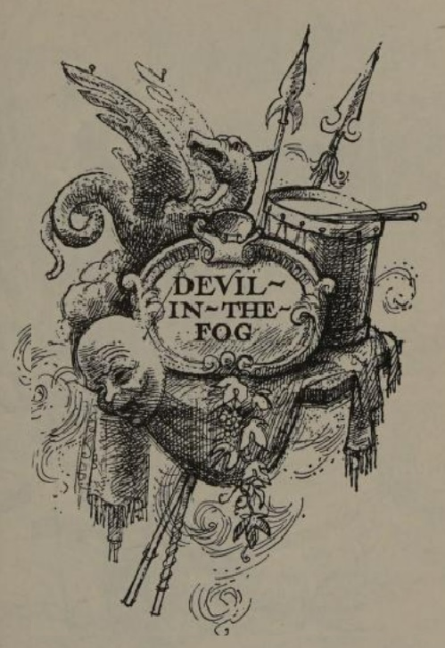

This novel is set in the eighteenth century. It is narrated by the hero, George Treet, who belongs to a family of travelling performers. Our extract is taken from the beginning of the novel.

My father is put in the stocks again! Oh! The injustice of it! My father is a genius—as are all of we Treets. A grand man, as great in mind as he is in body, for he's a large man who bears himself with more dignity than all the Justices in Kent put together. Except when the Stranger calls; and then his spirit seems to flicker and sink somewhat . . . as if the Stranger was something dark and devilish, and there was an unwholesome bargain eating away at my father's soul . . .

He comes on the third day of June and November—to Rye or Sandwich (it used to be Faversham, but that's changed, now)—and is always unseasonable . . . though fog and damp suits him better than high summer. Not that he's ever been seen in the sun. After dark: always. Between nine and ten o'clock, when the lesser Treets are abed and the inn parlour's empty of all save my father and me. We sit by the fire (if there is one), and wait, and my father's grand spirit begins to flicker. A strained look comes over his powerful face, and all his thoughts seem sunk in his boots. Gone's the bright look of invention in his eyes, and the mind that's produced the most remarkable stage-effects our age has known, is no more lively than stale beer. Then the Stranger comes, with his cold, uncanny stare at me; the business is done—and he goes off into the night. My father bids me "goodnight"—even blesses me—and a bad day's done. On the next morning, he's Mr. Thomas Treet again, and the world's a better place for that.

All our lives, this man's been coming—till there were times when we Treets thought it as natural to have a Stranger in the family as a hole in one's stocking: by which I mean, everyone's had one, but no one boasts about it.

Sometimes, on the road, we'd see some grim-faced, watery-eyed gentleman in brown or black, sitting formidably in a fast coach, and say:

"There goes someone else's Stranger! Worse than ours, ain't he!"

Then we'd trundle on and forget him entirely in the eternal excitement of our triumphs to come.

We travelled from town to town and from inn to inn in a grand canvas waggon: a snuff-coloured world under a snuff-coloured sky. Six within, and two without—depending on the weather: when it rained, and we were between towns, in some sodden old Kentish lane, then there'd be eight within—among the hoists and jars and baskets and crucibles . . . with Otway's head coming in at the back, like a gentleman amazed by geniuses. (Otway was our horse.)

Then, while the rain rattled and thumped down on our sky fit to burst it—Mr. Treet would talk of the bright future . . . of enormous glory, even on the London stage. Of which he was never for a moment in doubt. For it was so much a part of my father's nature and spirit always to look forward, and never behind . . .

"Treets," he'd say. "Never look backward! Never brood upon the past, my dears. For the past's but material for to build the rich future. Would you ever have heard Sir Christopher Wren (God rest his memory!) gazing at his fine churches and saying: 'Ah! but you should have seen the bricks! They was beautiful!?’"

Yes, indeed, we're a family with a golden future! I remember once while we were halted by Bodiam Castle, between Tenterden and Rye, and the rain was coming down like grapeshot, a drenched highwayman demanded shelter. He thumped on the waggon's side, then stuck his head in at the back like an uprooted bush with two red berries for eyes.

"Wagrants!" he said disgustedly and climbed, unasked, inside.

At first he was surly and blustering and inclined to offer his pistol—which, if he'd fired it, would have discharged no more than half a pint of rain-water.

"What's them poles an' ropes an' pulleys for?"

"Sir: they are flying machines."

He grunted contemptuously, but, nonetheless, looked curiously at the hoists.

"How do they work?"

"'They're constructed after the principles of Archimedes, sir, and with certain improvements of my own. They are, so to speak, a cage for the forces of Nature."

He sniffed and stared round into the mysterious gloom—meeting with more pairs of cool, proud eyes than he'd bargained for.

"What's in them baskets?"

"Books, sir, and the properties of our art."

"What properties?" (Was he thinking of robbing us?)

"Wings and crowns and angels' robes and devils' horns . . . in short, sir—the properties of genius."

Again he sniffed with a show of contempt, but he was somewhat reduced by now—and plainly wondering what manner of world had pocketed him up.

"And what's in them great fat jars—with bellies on 'em like your own?"

Our father is a great man—and greatly built. But not over stout. The highwayman's jibe came more from a need to show himself as terrible, than from a just observation.

"In those jars, sir, are all the mysteries and wonders of the natural world. Oil of Sugar! Berlin Syrup! Crystals of Violet! Salts of Fire! Even Crystals of Lemon—dangerous, sir! Fierce and deadly as a tiger! Pilfer but one—even lay your hand on it!—and you'll be frizzled like a burnt-out sausage, together with much prosperous smoke besides!"

This was too much for him. He took a last look round at the extraordinary family perched among their dark and solemn paraphernalia—and fled for his miserable life!

Then, when he'd gone—and it was certain he wasn't coming back—our father ventured a tremendous smile. He creaked forward on his basket and gently rubbed his ankles and calves (for he wasn't long out of the stocks at Tenterden).

"Treets," he said. "Consider. If that fierce scoundrel was amazed half out of his wits by only hearing of our genius, think, my dears, of the roar and acclaim when we're on the London Stage! The magnificence to come, Treets! It dazzles me!"

This was on June the first. On June third—to the Mermaid in Rye—came the Stranger. Nine o'clock in the evening. Bringing a smell of fog and mist and mildewed damp with him. . . And for that day and the next, my father was in his most sombre dumps . . .

It was then, for the first time, I asked him outright what was the Stranger to us. For his gloom had seemed deeper than ever before: even as his previous dreams had been brighter. He turned to me sadly, laid his hand on my shoulder, and said:

"George, my eldest son . . . George, my first-born: never ask me that."

He spoke with such solemnity—even tragic dignity—that I was reminded of his performance as the Patriarch Abraham when I played Isaac in the Miracle Play; and Hotspur Treet (the youngest genius of us all) came down from heaven on father's flying machine for to stay the sacrificial hand; while Jane Treet, garbed in curly wool, bleated like a ram from a thicket of father's designing.

The last time we played it, was in St. John's Church at Faversham, two years ago when I was twelve and Hotspur was five. And my father was put in the stocks on account of Hotspur's having gone through a window very dear to the church. We've never played in Faversham since ... which is a sadness to us all, for it was in Faversham our mother died, and is buried there these past seven years. My father—who'd taken a deal of mulled ale at the funeral feast (she died in November: everything disquieting happens in June or November)—remarked sadly to us all that: "She flies—ah, she flies with better machines than mine, now, my dears!"

From which I received a distinct notion that heaven was filled with a golden profusion of hoists, that never broke, nor stuck, nor poked young Treets through stained-glass windows.

Not that flying hoists is my father's chief achievement. Cascades and Fountains: Visions and Apparitions: Dragons and Cherubs: 'Lucifer's Smoke’ and the 'Devil's Fire' . . . there's nothing his spacious mind ain't turned itself to, save flattering the Justices and humbling himself before the landlord. A very proud disposition—like all we Treets—which makes his wretchedness before the Stranger even more sinister . . . and it reaches its darkest when he takes the purse of guineas off him like it was filled with poisonous spiders.

Yet at all other times, even in the stocks, he's as proud as St. Paul's. He sits there, hands on hips, and surveys the idle gapers like he's holding court. One would never suspect the anchored feet with their patched soles belonged to the grand man upon the other side of the locked boards. Vagrant? Disturber of the peace? Mountebank? Who but a mealy-mouthed, jumped-up Justice could call him so?

Questions on Devil in the Fog (1966) by Leon Garfield (1921-1996)

1\. George’s attitude to his father’s punishments is that:

A. It brings shame upon the Treet family.

B. It is deserved because of the damage caused.

C. His father can do no wrong.

D. His father stands proudly in the stocks.

2\. The highwayman flees from the Treets’ wagon because:

A. Mr. Treet threatens him with a pistol.

B. They all react so coolly to him, as if they are not afraid.

C. His gun is too wet to function correctly.

D. The Treet family is so strange and mysterious that he is overwhelmed.

Fiction Writing

Write a story about someone who receives an unjust punishment. You could use this structure:

| Paragraph | Suggested Vocabulary |
| --- | --- |
| Paragraph One: My ankles ached and my face burned with shame as I sat, imprisoned in the stocks. | disgrace, family, injustice, humiliation |
| Paragraph Two: It all began when my friend suggested a little trespassing. | excitement, danger, orchard, delicious, fruit, stealing, lies, blame |
| Paragraph Three: I returned to my present sufferings as something unpleasant just missed my face. | rotten, missiles, insults, laughter, mocking |
| Paragraph Four: The hours dragged on through that seemingly endless day. | burning, heat, thirst, exhaustion, mercy, drink, grateful |
| Paragraph Five: Finally, it was over, and I knew who my true friends were. | unforgettable, lesson, loyalty, love, friendship |

## 40. American Notes (1842)

Extract from American Notes (1842) by Charles Dickens (1812-1870)

From Chapter Four: ‘An American Railroad. Lowell and Its Factory System.’

Dickens describes his experience of travelling on an American railroad for the first time, comparing it with British railways, and his arrival in the young city of Lowell.

There are no first and second class carriages as with us; but there is a gentleman’s car and a ladies’ car: the main distinction between which is that in the first, everybody smokes; and in the second, nobody does. 

The cars are like shabby omnibuses, but larger: holding thirty, forty, fifty, people.  The seats, instead of stretching from end to end, are placed crosswise.  Each seat holds two persons.  There is a long row of them on each side of the caravan, a narrow passage up the middle, and a door at both ends.  In the centre of the carriage there is usually a stove, fed with charcoal or anthracite coal; which is for the most part red-hot.  It is insufferably close; and you see the hot air fluttering between yourself and any other object you may happen to look at, like the ghost of smoke.

In the ladies’ car, there are a great many gentlemen who have ladies with them.  There are also a great many ladies who have nobody with them: for any lady may travel alone, from one end of the United States to the other, and be certain of the most courteous and considerate treatment everywhere.  The conductor or check-taker, or guard, or whatever he may be, wears no uniform.  He walks up and down the car, and in and out of it, as his fancy dictates; leans against the door with his hands in his pockets and stares at you, if you chance to be a stranger; or enters into conversation with the passengers about him.  A great many newspapers are pulled out, and a few of them are read.  Everybody talks to you, or to anybody else who hits his fancy.  If you are an Englishman, he expects that that railroad is pretty much like an English railroad.  If you say ‘No,’ he says ‘Yes?’ (interrogatively), and asks in what respect they differ.  You enumerate the heads of difference, one by one, and he says ‘Yes?’ (still interrogatively) to each.  Then he guesses that you don’t travel faster in England; and on your replying that you do, says ‘Yes?’ again (still interrogatively), and it is quite evident, doesn’t believe it.  After a long pause he remarks, partly to you, and partly to the knob on the top of his stick, that ‘Yankees are reckoned to be considerable of a go-ahead people too;’ upon which you say ‘Yes,’ and then he says ‘Yes’ again (affirmatively this time); and upon your looking out of window, tells you that behind that hill, and some three miles from the next station, there is a clever town in a smart lo-ca-tion, where he expects you have concluded to stop.  Your answer in the negative naturally leads to more questions in reference to your intended route (always pronounced rout); and wherever you are going, you invariably learn that you can’t get there without immense difficulty and danger, and that all the great sights are somewhere else.

If a lady take a fancy to any male passenger’s seat, the gentleman who accompanies her gives him notice of the fact, and he immediately vacates it with great politeness.  Politics are much discussed, so are banks, so is cotton.  Quiet people avoid the question of the Presidency, for there will be a new election in three years and a half, and party feeling runs very high: the great constitutional feature of this institution being, that directly the acrimony of the last election is over, the acrimony of the next one begins; which is an unspeakable comfort to all strong politicians and true lovers of their country: that is to say, to ninety-nine men and boys out of every ninety-nine and a quarter.

Except when a branch road joins the main one, there is seldom more than one track of rails; so that the road is very narrow, and the view, where there is a deep cutting, by no means extensive.  When there is not, the character of the scenery is always the same.  Mile after mile of stunted trees: some hewn down by the axe, some blown down by the wind, some half fallen and resting on their neighbours, many mere logs half hidden in the swamp, others mouldered away to spongy chips.  The very soil of the earth is made up of minute fragments such as these; each pool of stagnant water has its crust of vegetable rottenness; on every side there are the boughs, and trunks, and stumps of trees, in every possible stage of decay, decomposition, and neglect.  Now you emerge for a few brief minutes on an open country, glittering with some bright lake or pool, broad as many an English river, but so small here that it scarcely has a name; now catch hasty glimpses of a distant town, with its clean white houses and their cool piazzas, its prim New England church and school-house; when whir-r-r-r! almost before you have seen them, comes the same dark screen: the stunted trees, the stumps, the logs, the stagnant water—all so like the last that you seem to have been transported back again by magic.

The train calls at stations in the woods, where the wild impossibility of anybody having the smallest reason to get out, is only to be equalled by the apparently desperate hopelessness of there being anybody to get in.  It rushes across the turnpike road, where there is no gate, no policeman, no signal: nothing but a rough wooden arch, on which is painted ‘When the bell rings, look out for the Locomotive.’  On it whirls headlong, dives through the woods again, emerges in the light, clatters over frail arches, rumbles upon the heavy ground, shoots beneath a wooden bridge which intercepts the light for a second like a wink, suddenly awakens all the slumbering echoes in the main street of a large town, and dashes on haphazard, pell-mell, neck-or-nothing, down the middle of the road.  There—with mechanics working at their trades, and people leaning from their doors and windows, and boys flying kites and playing marbles, and men smoking, and women talking, and children crawling, and pigs burrowing, and unaccustomed horses plunging and rearing, close to the very rails—there—on, on, on—tears the mad dragon of an engine with its train of cars; scattering in all directions a shower of burning sparks from its wood fire; screeching, hissing, yelling, panting; until at last the thirsty monster stops beneath a covered way to drink, the people cluster round, and you have time to breathe again.

I was met at the station at Lowell by a gentleman intimately connected with the management of the factories there; and gladly putting myself under his guidance, drove off at once to that quarter of the town in which the works, the object of my visit, were situated.  Although only just of age—for if my recollection serve me, it has been a manufacturing town barely one-and-twenty years—Lowell is a large, populous, thriving place.  Those indications of its youth which first attract the eye, give it a quaintness and oddity of character which, to a visitor from the old country, is amusing enough.  It was a very dirty winter’s day, and nothing in the whole town looked old to me, except the mud, which in some parts was almost knee-deep, and might have been deposited there, on the subsiding of the waters after the Deluge.  In one place, there was a new wooden church, which, having no steeple, and being yet unpainted, looked like an enormous packing-case without any direction upon it.  In another there was a large hotel, whose walls and colonnades were so crisp, and thin, and slight, that it had exactly the appearance of being built with cards.  I was careful not to draw my breath as we passed, and trembled when I saw a workman come out upon the roof, lest with one thoughtless stamp of his foot he should crush the structure beneath him, and bring it rattling down.  The very river that moves the machinery in the mills (for they are all worked by water power), seems to acquire a new character from the fresh buildings of bright red brick and painted wood among which it takes its course; and to be as light-headed, thoughtless, and brisk a young river, in its murmurings and tumblings, as one would desire to see.  One would swear that every ‘Bakery,’ ‘Grocery,’ and ‘Bookbindery,’ and other kind of store, took its shutters down for the first time, and started in business yesterday.  The golden pestles and mortars fixed as signs upon the sun-blind frames outside the Druggists’, appear to have been just turned out of the United States’ Mint; and when I saw a baby of some week or ten days old in a woman’s arms at a street corner, I found myself unconsciously wondering where it came from: never supposing for an instant that it could have been born in such a young town as that.

Questions on American Notes (1842) by Charles Dickens (1812-1870)

1\. Dickens’ main point about American politics is that:

A. Americans do not like to discuss politics very much.

B. Americans love the constant battle of their political system.

C. Elections happen too frequently in America.

D. The president is very widely respected in America.

2\. Dickens calls the American train a ‘mad dragon’ mainly because:

A. It races past people and animals with very few safety measures.

B. It goes much faster than British trains.

C. It violently invades the quiet, peaceful countryside.

D. It pours out flames like a dragon.

3\. When he first arrives in Lowell, Dickens is mainly struck by:

A. How the buildings are not properly finished.

B. How the factories are powered by watermills.

C. How everything is very muddy.

D. How everything seems extremely fresh and new.

Nonfiction Writing

Write about a time when you had to make a difficult journey.

You could structure your writing like this:

| Paragraph | Suggested Vocabulary |
| --- | --- |
| Introduction: I will never forget that terrible journey. | challenges, accidents, difficulties |
| Paragraph One: It started so smoothly, but problems soon began to emerge. | confident, hopeful, setback, disappointment |
| Paragraph Two: The worst was yet to come. | shock, surprise, disaster |
| Paragraph Three: Things finally began to improve after that. | persevere, determined, success, destination |
| Conclusion: I had been through some tough times that day, but I had learned important lessons too. | overcome, teamwork, support, friendship, family |

## 41. Five Children and It (1902)

Five Children and It (1902) by E. Nesbitt (1858-1924)

This novel tells the story of five children (Cyril, Anthea, Robert, Jane, and their baby brother, known as "the Lamb") who discover a Psammead, or sand-fairy, who can grant wishes.

Extract from Chapter One: ‘Beautiful As the Day’

I daresay you have often thought what you would do if you had three wishes given you, and have despised the old man and his wife in the black-pudding story, and felt certain that if you had the chance you could think of three really useful wishes without a moment's hesitation. These children had often talked this matter over, but, now the chance had suddenly come to them, they could not make up their minds.

'Quick,' said the Sand-fairy crossly. No one could think of anything; only Anthea did manage to remember a private wish of her own and Jane's which they had never told the boys. She knew the boys would not care about it - but still it was better than nothing.

'I wish we were all as beautiful as the day,' she said in a great hurry.

The children looked at each other, but each could see that the others were not any better-looking than usual. The Psammead pushed out its long eyes, and seemed to be holding its breath and swelling itself out till it was twice as fat and furry as before. Suddenly it let its breath go in a long sigh.

'I'm really afraid I can't manage it,' it said apologetically; 'I must be out of practice.'

The children were horribly disappointed.

'Oh, DO try again!' they said.

'Well,' said the Sand-fairy, 'the fact is, I was keeping back a little strength to give the rest of you your wishes with. If you'll be contented with one wish a day amongst the lot of you I daresay I can screw myself up to it. Do you agree to that?'

'Yes, oh yes!' said Jane and Anthea. The boys nodded. They did not believe the Sand-fairy could do it. You can always make girls believe things much easier than you can boys.

It stretched out its eyes farther than ever, and swelled and swelled and swelled.

'I do hope it won't hurt itself,' said Anthea.

'Or crack its skin,' Robert said anxiously.

Everyone was very much relieved when the Sand-fairy, after getting so big that it almost filled up the hole in the sand, suddenly let out its breath and went back to its proper size.

'That's all right,' it said, panting heavily. 'It'll come easier tomorrow.'

'Did it hurt much?' asked Anthea.

'Only my poor whisker, thank you,' said he, 'but you're a kind and thoughtful child. Good day.'

It scratched suddenly and fiercely with its hands and feet, and disappeared in the sand. Then the children looked at each other, and each child suddenly found itself alone with three perfect strangers, all radiantly beautiful.

They stood for some moments in perfect silence. Each thought that its brothers and sisters had wandered off, and that these strange children had stolen up unnoticed while it was watching the swelling form of the Sand-fairy. Anthea spoke first —

'Excuse me,' she said very politely to Jane, who now had enormous blue eyes and a cloud of russet hair, 'but have you seen two little boys and a little girl anywhere about?'

'I was just going to ask you that,' said Jane. And then Cyril cried:

'Why, it's YOU! I know the hole in your pinafore! You ARE Jane, aren't you? And you're the Panther; I can see your dirty handkerchief that you forgot to change after you'd cut your thumb! Crikey! The wish has come off, after all. I say, am I as handsome as you are?'

'If you're Cyril, I liked you much better as you were before,' said Anthea decidedly. 'You look like the picture of the young chorister, with your golden hair; you'll die young, I shouldn't wonder. And if that's Robert, he's like an Italian organ-grinder. His hair's all black.'

'You two girls are like Christmas cards, then — that's all — silly Christmas cards,' said Robert angrily. 'And Jane's hair is simply carrots.'

It was indeed of that Venetian tint so much admired by artists.

'Well, it's no use finding fault with each other,' said Anthea; 'let's get the Lamb and lug it home to dinner. The servants will admire us most awfully; you'll see.'

Baby was just waking when they got to him, and not one of the children but was relieved to find that he at least was not as beautiful as the day, but just the same as usual.

'I suppose he's too young to have wishes naturally,' said Jane. 'We shall have to mention him specially next time.'

Anthea ran forward and held out her arms.

'Come to own Panther, ducky,' she said.

The Baby looked at her disapprovingly, and put a sandy pink thumb in his mouth. Anthea was his favourite sister.

'Come then,' she said.

'G'way long!' said the Baby.

'Come to own Pussy,' said Jane.

'Wants my Panty,' said the Lamb dismally, and his lip trembled.

'Here, come on, Veteran,' said Robert, 'come and have a yidey on Yobby's back.'

'Yah, narky narky boy,' howled the Baby, giving way altogether.

Then the children knew the worst. THE BABY DID NOT KNOW THEM!

They looked at each other in despair, and it was terrible to each, in this dire emergency, to meet only the beautiful eyes of perfect strangers, instead of the merry, friendly, commonplace, twinkling, jolly little eyes of its own brothers and sisters.

'This is most truly awful,' said Cyril when he had tried to lift up the Lamb, and the Lamb had scratched like a cat and bellowed like a bull. 'We've got to MAKE FRIENDS with him! I can't carry him home screaming like that. Fancy having to make friends with our own baby! — it's too silly.'

That, however, was exactly what they had to do. It took over an hour, and the task was not rendered any easier by the fact that the Lamb was by this time as hungry as a lion and as thirsty as a desert.

At last he consented to allow these strangers to carry him home by turns, but as he refused to hold on to such new acquaintances he was a dead weight and most exhausting.

'Thank goodness, we're home!' said Jane, staggering through the iron gate to where Martha, the nursemaid, stood at the front door, shading her eyes with her hand and looking out anxiously. 'Here! Do take Baby!'

Martha snatched the Baby from her arms.

'Thanks be, HE'S safe back,' she said. 'Where are the others, and whoever to goodness gracious are all of you?'

'We're US, of course,' said Robert.

'And who's US, when you're at home?' asked Martha scornfully.

'I tell you it's US, only we're beautiful as the day,' said Cyril. 'I'm Cyril, and these are the others, and we're jolly hungry. Let us in, and don't be a silly idiot.'

Martha merely dratted Cyril's impudence and tried to shut the door in his face.

'I know we LOOK different, but I'm Anthea, and we're so tired, and it's long past dinner-time.'

'Then go home to your dinners, whoever you are; and if our children put you up to this playacting you can tell them from me they'll catch it, so they know what to expect!' With that she did bang the door. Cyril rang the bell violently. No answer. Presently cook put her head out of a bedroom window and said:

'If you don't take yourselves off, and that precious sharp, I'll go and fetch the police.' And she slammed down the window.

'It's no good,' said Anthea. 'Oh, do, do come away before we get sent to prison!'

The boys said it was nonsense, and the law of England couldn't put you in prison for just being as beautiful as the day, but all the same they followed the others out into the lane.

'We shall be our proper selves after sunset, I suppose,' said Jane.

'I don't know,' Cyril said sadly; 'it mayn't be like that now - things have changed a good deal since Megatherium times.'

'Oh,' cried Anthea suddenly, 'perhaps we shall turn into stone at sunset, like the Megatheriums did, so that there mayn't be any of us left over for the next day.'

She began to cry; so did Jane. Even the boys turned pale. No one had the heart to say anything.

It was a horrible afternoon. There was no house near where the children could beg a crust of bread or even a glass of water. They were afraid to go to the village, because they had seen Martha go down there with a basket, and there was a local constable. True, they were all as beautiful as the day, but that is a poor comfort when you are as hungry as a hunter and as thirsty as a sponge.

Three times they tried in vain to get the servants in the White House to let them in and listen to their tale. And then Robert went alone, hoping to be able to climb in at one of the back windows and so open the door to the others. But all the windows were out of reach, and Martha emptied a toilet-jug of cold water over him from a top window, and said:

'Go along with you, you nasty little Eyetalian monkey."

It came at last to their sitting down in a row under the hedge, with their feet in a dry ditch, waiting for sunset, and wondering whether, when the sun did set, they would turn into stone, or only into their own old natural selves; and each of them still felt lonely and among strangers, and tried not to look at the others, for, though their voices were their own, their faces were so radiantly beautiful as to be quite irritating to look at.

'I don't believe we SHALL turn to stone,' said Robert, breaking a long miserable silence, 'because the Sand-fairy said he'd give us another wish to-morrow, and he couldn't if we were stone, could he?'

The others said 'No,' but they weren't at all comforted.

Another silence, longer and more miserable, was broken by Cyril's suddenly saying, 'I don't want to frighten you girls, but I believe it's beginning with me already. My foot's quite dead. I'm turning to stone, I know I am, and so will you in a minute.'

'Never mind,' said Robert kindly, 'perhaps you'll be the only stone one, and the rest of us will be all right, and we'll cherish your statue and hang garlands on it.'

But when it turned out that Cyril's foot had only gone to sleep through his sitting too long with it under him, and when it came to life in an agony of pins and needles, the others were quite cross.

'Giving us such a fright for nothing!' said Anthea.

The third and miserablest silence of all was broken by Jane. She said: 'If we DO come out of this all right, we'll ask the Sammyadd to make it so that the servants don't notice anything different, no matter what wishes we have.'

The others only grunted. They were too wretched even to make good resolutions.

At last hunger and fright and crossness and tiredness - four very nasty things - all joined together to bring one nice thing, and that was sleep. The children lay asleep in a row, with their beautiful eyes shut and their beautiful mouths open. Anthea woke first. The sun had set, and the twilight was coming on.

Anthea pinched herself very hard, to make sure, and when she found she could still feel pinching she decided that she was not stone, and then she pinched the others. They, also, were soft.

'Wake up,' she said, almost in tears of joy; 'it's all right, we're not stone. And oh, Cyril, how nice and ugly you do look, with your old freckles and your brown hair and your little eyes. And so do you all!' she added, so that they might not feel jealous.

Questions on Five Children and It (1902) by E. Nesbitt (1858-1924)

1\. Anthea wishes that they would all be beautiful as the day mainly because:

A. That is what she has always wanted more than anything.

B. Boys are not interested in wishes like that.

C. She can’t think of anything else to wish for at that moment.

D. She and her sister have often longed to be beautiful.

2\. When they return to the White House, the children:

A. Manage to persuade the servants to let them in.

B. Believe that the law is on their side.

C. Are not recognised by their baby brother.

D. Are sent away by the angry servants.

3\. Overall, being stunningly beautiful makes the children realise that:

A. Looks are not the most important thing.

B. Being granted wishes is not all that they had hoped for.

C. It matters more to be yourself than to be beautiful.

D. The wishes do not affect their baby brother.

Fiction Writing

Write a story about someone who is granted a wish, but it goes unexpectedly wrong. You could use this structure:

## 42. Romeo and Juliet (1590)

| Paragraph | Suggested Vocabulary |
| --- | --- |
| Paragraph One: I often dreamed about what I would do with three wishes. | wealth, beauty, fame, glory, happiness |
| Paragraph Two: Then one day, I met a strange creature while walking in the forest. | fairy, reluctant, persuaded, one wish, excited |
| Paragraph Three: It was just one wish, so it had to be good. | riches, billions, dream, luxury |
| Paragraph Four: Now I had as much money as I could ever use. | apartment, Ferrari, designer clothes, fancy restaurants |
| Paragraph Five: As the years wore on, I began to feel depressed. | old friends, abandoned, new life, lonely, longing |
| Paragraph Six: I decided that there was only one way to solve this. | donation, charity, happy, peace, value, friendship, family |

Romeo and Juliet (1590) by William Shakespeare (1564-1616)

Extract from Act Three Scene Five

After having previously told Paris (a cousin of Prince Escalus, the ruler of Verona) that Juliet (who is not quite fourteen) is too young to marry him yet, Lord Capulet has now hastily agreed to the marriage. He hopes to restore his family’s wounded honour following his nephew Tybalt’s murder of the Prince’s cousin Mercutio. However, Juliet cannot and will not marry Paris, as she has already secretly married Romeo. In fact, they have just had their wedding night when her mother comes to bring her the news of her father’s decision.

LADY CAPULET

But now I'll tell thee joyful tidings, girl.

JULIET

And joy comes well in such a needy time:

What are they, I beseech your ladyship?

LADY CAPULET

Well, well, thou hast a careful father, child;

One who, to put thee from thy heaviness,

Hath sorted out a sudden day of joy,

That thou expect'st not nor I look'd not for.

JULIET

Madam, in happy time, what day is that?

LADY CAPULET

Marry, my child, early next Thursday morn,

The gallant, young and noble gentleman,

The County Paris, at Saint Peter's Church,

Shall happily make thee there a joyful bride.

JULIET

Now, by Saint Peter's Church and Peter too,

He shall not make me there a joyful bride.

I wonder at this haste; that I must wed

Ere he, that should be husband, comes to woo.

I pray you, tell my lord and father, madam,

I will not marry yet; and, when I do, I swear,

It shall be Romeo, whom you know I hate,

Rather than Paris. These are news indeed!

LADY CAPULET

Here comes your father; tell him so yourself,

And see how he will take it at your hands.

Enter LORD CAPULET and Nurse

LORD CAPULET

When the sun sets, the air doth drizzle dew;

But for the sunset of my brother's son

It rains downright.

How now! a conduit, girl? What, still in tears?

Evermore showering? How now, wife!

Have you deliver'd to her our decree?

LADY CAPULET

Ay, sir; but she will none, she gives you thanks.

I would the fool were married to her grave!

LORD CAPULET

Soft! take me with you, take me with you, wife.

How! Will she none? Doth she not give us thanks?

Is she not proud? Doth she not count her blest,

Unworthy as she is, that we have wrought

So worthy a gentleman to be her bridegroom?

JULIET

Not proud, you have; but thankful, that you have:

Proud can I never be of what I hate;

But thankful even for hate, that is meant love.

LORD CAPULET

How now, how now, chop-logic! What is this?

'Proud,' and 'I thank you,' and 'I thank you not;'

And yet 'not proud,' mistress minion, you,

Thank me no thankings, nor, proud me no prouds,

But fettle your fine joints 'gainst Thursday next,

To go with Paris to Saint Peter's Church,

Or I will drag thee on a hurdle thither.

Out, you green-sickness carrion! Out, you baggage!

You tallow-face!

LADY CAPULET

Fie, fie! What, are you mad?

JULIET

Good father, I beseech you on my knees,

Hear me with patience but to speak a word.

LORD CAPULET

Hang thee, young baggage! Disobedient wretch!

I tell thee what: get thee to church o' Thursday,

Or never after look me in the face:

Speak not, reply not, do not answer me;

My fingers itch. Wife, we scarce thought us blest

That God had lent us but this only child;

But now I see this one is one too much,

And that we have a curse in having her:

Out on her, hilding!

NURSE

God in heaven bless her!

You are to blame, my lord, to rate her so.

LORD CAPULET

And why, my lady wisdom? hold your tongue,

Good prudence; smatter with your gossips, go.

NURSE

I speak no treason.

LORD CAPULET

O, God ye god-den.

NURSE

May not one speak?

LORD CAPULET

Peace, you mumbling fool!

Utter your gravity o'er a gossip's bowl;

For here we need it not.

LADY CAPULET

You are too hot.

LORD CAPULET

God's bread! it makes me mad:

Day, night, hour, tide, time, work, play,

Alone, in company, still my care hath been

To have her match'd: and having now provided

A gentleman of noble parentage,

Of fair demesnes, youthful, and nobly train'd,

Stuff'd, as they say, with honourable parts,

Proportion'd as one's thought would wish a man;

And then to have a wretched puling fool,

A whining mammet, in her fortune's tender,

To answer 'I'll not wed; I cannot love,

I am too young; I pray you, pardon me.'

But, as you will not wed, I'll pardon you:

Graze where you will, you shall not house with me:

Look to't, think on't, I do not use to jest.

Thursday is near; lay hand on heart, advise:

An you be mine, I'll give you to my friend;

An you be not, hang, beg, starve, die in the streets,

For, by my soul, I'll ne'er acknowledge thee,

Nor what is mine shall never do thee good:

Trust to't, bethink you; I'll not be forsworn.

Exit

JULIET

Is there no pity sitting in the clouds,

That sees into the bottom of my grief?

O, sweet my mother, cast me not away!

Delay this marriage for a month, a week;

Or, if you do not, make the bridal bed

In that dim monument where Tybalt lies.

LADY CAPULET

Talk not to me, for I'll not speak a word:

Do as thou wilt, for I have done with thee.

Exit

JULIET

O God!--O nurse, how shall this be prevented?

My husband is on earth, my faith in heaven;

How shall that faith return again to earth,

Unless that husband send it me from heaven

By leaving earth? comfort me, counsel me.

Alack, alack, that heaven should practise stratagems

Upon so soft a subject as myself!

What say'st thou? hast thou not a word of joy?

Some comfort, nurse.

NURSE

Faith, here it is.

Romeo is banish'd; and all the world to nothing,

That he dares ne'er come back to challenge you;

Or, if he do, it needs must be by stealth.

Then, since the case so stands as now it doth,

I think it best you married with the county.

O, he's a lovely gentleman!

Romeo's a dishclout to him: an eagle, madam,

Hath not so green, so quick, so fair an eye

As Paris hath. Beshrew my very heart,

I think you are happy in this second match,

For it excels your first: or if it did not,

Your first is dead; or 'twere as good he were,

As living here and you no use of him.

JULIET

Speakest thou from thy heart?

NURSE

And from my soul too;

Or else beshrew them both.

JULIET

Amen!

NURSE

What?

JULIET

Well, thou hast comforted me marvellous much.

Go in: and tell my lady I am gone,

Having displeased my father, to Laurence' cell,

To make confession and to be absolved.

NURSE

Marry, I will; and this is wisely done.

Exit

JULIET

Ancient damnation! O most wicked fiend!

Is it more sin to wish me thus forsworn,

Or to dispraise my lord with that same tongue

Which she hath praised him with above compare

So many thousand times? Go, counsellor;

Thou and my bosom henceforth shall be twain.

I'll to the friar, to know his remedy:

If all else fail, myself have power to die.

Exit

Questions on Romeo and Juliet (1590) by William Shakespeare (1564-1616)

1\. Juliet refuses to marry Paris because:

A. He is not as attractive as Romeo.

B. She has already fallen in love with Romeo.

C. She is a disobedient daughter.

D. It is impossible, as she has already married Romeo.

2\. Lord Capulet’s reaction to Juliet’s refusal mainly shows that he:

A. Is more interested in family honour than following moral principles.

B. Is a bad-tempered, cruel father.

C. Has worked hard to arrange a suitable marriage for his daughter.

D. Rushes into things without thinking them through.

3\. Juliet’s nurse tries to help her by suggesting that:

A. She should go to get advice from Friar Laurence.

B. She should run away with Romeo in secret.

C. She should simply marry Paris, as he is a better match than Romeo.

D. She should obey her father in everything.

Analytical Writing

Explain how and why Lord Capulet has changed his attitude to Juliet’s marriage to Paris, and why he is wrong to behave as he does in Act Three Scene Five.

| Starting Sentence | Quotations | Vocabulary |
| --- | --- | --- |
| In Act One Scene Two, Lord Capulet behaves as a good Catholic father should. | “My child is yet a stranger in the world; / She hath not seen the change of fourteen years, / Let two more summers wither in their pride, / Ere we may think her ripe to be a bride.” “But woo her, gentle Paris, get her heart, / My will to her consent is but a part” | free will, forced marriage, arranged marriage |
| However, by Act Three Scene Five, Lord Capulet has turned his back on Catholic morality and is acting like a tyrant. | “My fingers itch.” “go with Paris to Saint Peter's Church, / Or I will drag thee on a hurdle thither.” | restore family honour, Prince Escalus’ cousin, violent, traitor, tyrant, pride |

Example Answer

In Act One Scene Two, Lord Capulet behaves as a good Catholic father should. He explains to Paris that Juliet is still too young to marry, being “but a stranger in the world”, and that Paris should therefore wait “two more summers”. Most importantly, he insists that Paris should “woo her” and “get her heart”. He wants Paris to persuade Juliet to marry him, so that she can enter into the union of her own free will: she must “consent”. It is not just about his “will”. Although he is working to arrange the match, this is not the same as forcing it, something which is forbidden by the Catholic Church.

However, by Act Three Scene Five, Lord Capulet has turned his back on Catholic morality and is acting like a tyrant. Following Tybalt’s murder of Mercutio, Prince Escalus’ cousin, he is eager to repair the wounded reputation of his family, and hastens the marriage to Paris, who is also part of the royal family. He therefore confidently assures Paris that Juliet will marry him on Thursday, just two days hence. When Juliet, who has just spent her wedding night with Romeo, refuses to do this impossible thing, he is enraged, threatening her with violence: “my fingers itch”. He tells her that he will “drag” her “on a hurdle” to “Saint Peter’s Church” if she will not go there voluntarily. A hurdle was used to drag traitors to the place where they were executed, a sight well-known to Shakespeare’s Elizabethan audience. Many Catholic priests were dragged through London’s streets for refusing to adopt the queen’s official religion before being hanged, drawn and quartered. The mention of “Saint Peter’s Church” is a clear reminder of the Catholic religion, which Lord Capulet claims to follow, and which forbids forced marriage. But he now recognises no limits to his authority, and, acting like a true tyrant, he believes that he can force his will upon his daughter by the use of violence, just as Queen Elizabeth I did to her subjects.

## 43. The Horse and His Boy (1954)

The Horse and His Boy (1954) by C. S. Lewis (1898-1963)

From Chapter One: ‘How Shasta Set Out on His Travels’

This is the story of an adventure that happened in Narnia and Calormen and the lands between, in the Golden Age when Peter was High King in Narnia and his brother and his two sisters were King and Queens under him.

In those days, far south in Calormen on a little creek of the sea, there lived a poor fisherman called Arsheesh, and with him there lived a boy who called him Father. The boy's name was Shasta. On most days Arsheesh went out in his boat to fish in the morning, and in the afternoon he harnessed his donkey to a cart and loaded the cart with fish and went a mile or so southward to the village to sell it. If it had sold well he would come home in a moderately good temper and say nothing to Shasta, but if it had sold badly he would find fault with him and perhaps beat him. There was always something to find fault with for Shasta had plenty of work to do, mending and washing the nets, cooking the supper, and cleaning the cottage in which they both lived.

Shasta was not at all interested in anything that lay south of his home because he had once or twice been to the village with Arsheesh and he knew that there was nothing very interesting there. In the village he only met other men who were just like his father—men with long, dirty robes, and wooden shoes turned up at the toe, and turbans on their heads, and beards, talking to one another very slowly about things that sounded dull. But he was very interested in everything that lay to the north because no one ever went that way and he was never allowed to go there himself. When he was sitting out of doors mending the nets, and all alone, he would often look eagerly to the north. One could see nothing but a grassy slope running up to a level ridge and beyond that the sky with perhaps a few birds in it.

Sometimes if Arsheesh was there Shasta would say, "O my Father, what is there beyond that hill?" And then if the fisherman was in a bad temper he would box Shasta's ears and tell him to attend to his work. Or if he was in a peaceable mood he would say, "O my son, do not allow your mind to be distracted by idle questions. For one of the poets has said, 'Application to business is the root of prosperity, but those who ask questions that do not concern them are steering the ship of folly towards the rock of indigence.'"

Shasta thought that beyond the hill there must be some delightful secret which his father wished to hide from him. In reality, however, the fisherman talked like this because he didn't know what lay to the north. Neither did he care. He had a very practical mind.

One day there came from the south a stranger who was unlike any man that Shasta had seen before. He rode upon a strong dappled horse with flowing mane and tail and his stirrups and bridle were inlaid with silver. The spike of a helmet projected from the middle of his silken turban and he wore a shirt of chain mail. By his side hung a curving scimitar, a round shield studded with bosses of brass hung at his back, and his right hand grasped a lance. His face was dark, but this did not surprise Shasta because all the people of Calormen are like that; what did surprise him was the man's beard which was dyed crimson, and curled and gleaming with scented oil. But Arsheesh knew by the gold ring on the stranger's bare arm that he was a Tarkaan or great lord, and he bowed kneeling before him till his beard touched the earth and made signs to Shasta to kneel also.

The stranger demanded hospitality for the night, which of course the fisherman dared not refuse. All the best they had was set before the Tarkaan for supper (and he didn't think much of it) and Shasta, as always happened when the fisherman had company, was given a hunk of bread and turned out of the cottage. On these occasions he usually slept with the donkey in its little thatched stable. But it was much too early to go to sleep yet, and Shasta, who had never learned that it is wrong to listen behind doors, sat down with his ear to a crack in the wooden wall of the cottage to hear what the grown-ups were talking about. And this is what he heard.

"And now, O my host," said the Tarkaan, "I have a mind to buy that boy of yours."

"O my master," replied the fisherman (and Shasta knew by the wheedling tone the greedy look that was probably coming into his face as he said it), "what price could induce your servant, poor though he is, to sell into slavery his only child and his own flesh? Has not one of the poets said, 'Natural affection is stronger than soup and offspring more precious than carbuncles?'"

"It is even so," replied the guest drily. "But another poet has likewise said, 'He who attempts to deceive the judicious is already baring his own back for the scourge.' Do not load your aged mouth with falsehoods. This boy is manifestly no son of yours, for your cheek is as dark as mine but the boy is fair and white like the accursed but beautiful barbarians who inhabit the remote north."

"How well it was said,'' answered the fisherman, "that Swords can be kept off with shields but the Eye of Wisdom pierces through every defence! Know then, O my formidable guest, that because of my extreme poverty I have never married and have no child. But in that same year in which the Tisroc (may he live forever) began his august and beneficent reign, on a night when the moon was at her full, it pleased the gods to deprive me of my sleep. Therefore I arose from my bed in this hovel and went forth to the beach to refresh myself with looking upon the water and the moon and breathing the cool air. And presently I heard a noise as of oars coming to me across the water and then, as it were, a weak cry. And shortly after, the tide brought to the land a little boat in which there was nothing but a man lean with extreme hunger and thirst who seemed to have died but a few moments before (for he was still warm), and an empty water skin, and a child, still living. 'Doubtless,' said I, 'these unfortunates have escaped from the wreck of a great ship, but by the admirable designs of the gods, the elder has starved himself to keep the child alive and has perished in sight of land.' Accordingly, remembering how the gods never fail to reward those who befriend the destitute, and being moved by compassion (for your servant is a man of tender heart)——"

"Leave out all these idle words in your own praise," interrupted the Tarkaan. "It is enough to know that you took the child—and have had ten times the worth of his daily bread out of him in labour, as anyone can see. And now tell me at once what price you put on him, for I am wearied with your loquacity."

"You yourself have wisely said," answered Arsheesh, "that the boy's labour has been to me of inestimable value. This must be taken into account in fixing the price. For if I sell the boy I must undoubtedly either buy or hire another to do his work."

"I'll give you fifteen crescents for him," said the Tarkaan.

"Fifteen!" cried Arsheesh in a voice that was something between a whine and a scream. "Fifteen! For the prop of my old age and the delight of my eyes! Do not mock my grey beard, Tarkaan though you be. My price is seventy."

At this point Shasta got up and tiptoed away. He had heard all he wanted, for he had often listened when men were bargaining in the village and knew how it was done. He was quite certain that Arsheesh would sell him in the end for something much more than fifteen crescents and much less than seventy, but that he and the Tarkaan would take hours in getting to an agreement.

You must not imagine that Shasta felt at all as you and I would feel if we had just overheard our parents talking about selling us for slaves. For one thing, his life was already little better than slavery; for all he knew, the lordly stranger on the great horse might be kinder to him than Arsheesh. For another, the story about his own discovery in the boat had filled him with excitement and with a sense of relief. He had often been uneasy because, try as he might, he had never been able to love the fisherman, and he knew that a boy ought to love his father. And now, apparently, he was no relation to Arsheesh at all. That took a great weight off his mind. "Why, I might be anyone!" he thought. "I might be the son of a Tarkaan myself—or the son of the Tisroc (may he live forever)—or of a god!"

He was standing out in the grassy place before the cottage while he thought these things. Twilight was coming on apace and a star or two was already out, but the remains of the sunset could still be seen in the west. Not far away the stranger's horse, loosely tied to an iron ring in the wall of the donkey's stable, was grazing. Shasta strolled over to it and patted its neck. It went on tearing up the grass and took no notice of him.

Then another thought came into Shasta's mind. "I wonder what sort of a man that Tarkaan is," he said out loud. "It would be splendid if he was kind. Some of the slaves in a great lord's house have next to nothing to do. They wear lovely clothes and eat meat every day. Perhaps he'd take me to the wars and I'd save his life in a battle and then he'd set me free and adopt me as his son and give me a palace and a chariot and a suit of armour. But then he might be a horrid, cruel man. He might send me to work on the fields in chains. I wish I knew. How can I know? I bet this horse knows, if only he could tell me."

The horse had lifted its head. Shasta stroked its smooth-as-satin nose and said, "I wish you could talk, old fellow."

And then for a second he thought he was dreaming, for quite distinctly, though in a low voice, the Horse said, "But I can."

Shasta stared into its great eyes and his own grew almost as big, with astonishment.

"How ever did you learn to talk?" he asked.

"Hush! Not so loud," replied the Horse. "Where I come from, nearly all the animals talk."

"Where ever is that?" asked Shasta.

"Narnia," answered the Horse. "The happy land of Narnia—Narnia of the heathery mountains and the thymy downs, Narnia of the many rivers, the plashing glens, the mossy caverns and the deep forests ringing with the hammers of the Dwarfs. Oh the sweet air of Narnia! An hour's life there is better than a thousand years in Calormen." It ended with a whinny that sounded very like a sigh.

"How did you get here?" said Shasta.

"Kidnapped," said the Horse. "Or stolen, or captured—whichever you like to call it. I was only a foal at the time. My mother warned me not to range the southern slopes, into Archenland and beyond, but I wouldn't heed her. And by the Lion's Mane I have paid for my folly. All these years I have been a slave to humans, hiding my true nature and pretending to be dumb and witless like their horses."

"Why didn't you tell them who you were?"

"Not such a fool, that's why. If they'd once found out I could talk, they would have made a show of me at fairs and guarded me more carefully than ever. My last chance of escape would have been gone."

"And why——" began Shasta, but the Horse interrupted him.

"Now look," it said, "we mustn't waste time on idle questions. You want to know about my master, the Tarkaan Anradin. Well, he's bad. Not too bad to me, for a war horse costs too much to be treated very badly. But you'd better be lying dead tonight than go to be a human slave in his house tomorrow."

"Then I'd better run away," said Shasta, turning very pale.

"Yes, you had," said the Horse. "But why not run away with me?"

"Are you going to run away too?" said Shasta.

"Yes, if you'll come with me," answered the Horse. "This is the chance for both of us. You see, if I run away without a rider, everyone who sees me will say 'Stray horse' and be after me as quick as he can. With a rider I've a chance to get through. That's where you can help me. On the other hand, you can't get very far on those two silly legs of yours (what absurd legs humans have!) without being overtaken. But on me you can outdistance any other horse in this country. That's where I can help you.”

Questions about The Horse and His Boy (1954) by C. S. Lewis (1898-1963)

1\. Arsheesh decided to adopt Shasta because:

A. He had pity upon him.

B. He thought that the gods would want him to do so.

C. He knew that he could get lots of work out of him.

D. He intended to sell him as a slave.

2\. Shasta’s reaction to hearing about being sold as a slave is best described as:

A. He is shocked that his father could do such a thing.

B. He is relieved that Arsheesh is not his real father, and hopeful about the Tarkaan.

C. He decides that he needs to run away.

D. He knows about how his father will bargain for hours over the price.

Fiction Writing

Write a story where a child makes a surprising discovery about his or her family.

You could use this structure:

## 44. ‘Ulysses’

| Paragraph | Suggested Vocabulary |
| --- | --- |
| Paragraph One:  The city market was crowded with all kinds of people. | noise, stench, horses, shouts, curses, spices |
| Paragraph Two: At one market stall, a young boy worked with his father. | struggle, survival, poor, hardworking |
| Paragraph Three: The crowds parted, making way for the king’s carriage. | trumpets, calls, splendid, white horses, royal robes |
| Paragraph Four: The boy was astonished to see the carriage stop at his stall. | delight, reunion, lost, rediscovered, years |
| Paragraph Five:  As he rode beside the king, the boy asked himself if this was all a dream. | rags, robes, riches, splendour |
| Paragraph Six:  He would never forget the man he had called father for so many years. | grateful, simple, lessons, rule, help, poor |

‘Ulysses’ by Alfred, Lord Tennyson (1809-1892)

It little profits that an idle king,

By this still hearth, among these barren crags,

Match'd with an aged wife, I mete and dole

Unequal laws unto a savage race,

That hoard, and sleep, and feed, and know not me.

I cannot rest from travel: I will drink

Life to the lees: All times I have enjoy'd

Greatly, have suffer'd greatly, both with those

That loved me, and alone, on shore, and when

Thro' scudding drifts the rainy Hyades

Vext the dim sea: I am become a name;

For always roaming with a hungry heart

Much have I seen and known; cities of men

And manners, climates, councils, governments,

Myself not least, but honour'd of them all;

And drunk delight of battle with my peers,

Far on the ringing plains of windy Troy.

I am a part of all that I have met;

Yet all experience is an arch wherethro'

Gleams that untravell'd world whose margin fades

For ever and forever when I move.

How dull it is to pause, to make an end,

To rust unburnish'd, not to shine in use!

As tho' to breathe were life! Life piled on life

Were all too little, and of one to me

Little remains: but every hour is saved

From that eternal silence, something more,

A bringer of new things; and vile it were

For some three suns to store and hoard myself,

And this grey spirit yearning in desire

To follow knowledge like a sinking star,

Beyond the utmost bound of human thought.

         This is my son, mine own Telemachus,

To whom I leave the sceptre and the isle,—

Well-loved of me, discerning to fulfil

This labour, by slow prudence to make mild

A rugged people, and thro' soft degrees

Subdue them to the useful and the good.

Most blameless is he, centred in the sphere

Of common duties, decent not to fail

In offices of tenderness, and pay

Meet adoration to my household gods,

When I am gone. He works his work, I mine.

There lies the port; the vessel puffs her sail:

There gloom the dark, broad seas. My mariners,

Souls that have toil'd, and wrought, and thought with me—

That ever with a frolic welcome took

The thunder and the sunshine, and opposed                

Free hearts, free foreheads—you and I are old;

Old age hath yet his honour and his toil;

Death closes all: but something ere the end,

Some work of noble note, may yet be done,

Not unbecoming men that strove with gods.                

The lights begin to twinkle from the rocks:

The long day wanes: the slow moon climbs: the deep

Moans round with many voices. Come, my friends,

'Tis not too late to seek a newer world.

Push off, and sitting well in order smite                

The sounding furrows; for my purpose holds

To sail beyond the sunset, and the baths

Of all the western stars, until I die.

It may be that the gulfs will wash us down:

It may be we shall touch the Happy Isles,                

And see the great Achilles, whom we knew.

Tho' much is taken, much abides; and tho'

We are not now that strength which in old days

Moved earth and heaven, that which we are, we are;

One equal temper of heroic hearts,                    

Made weak by time and fate, but strong in will

To strive, to seek, to find, and not to yield.

Context

The great Victorian poet Tennyson wrote ‘Ulysses’ from the perspective of a character in ancient mythology, originally called ‘Odysseus’ in the ancient Greek poet Homer’s epic The Odyssey. After a long and difficult journey, Ulysses has returned from the Trojan Wars to his home on the island of Ithaca and to his wife Penelope and his son Telemachus. However, he longs for more adventure, and the conclusion of the poem depicts his contemplating further voyages across the sea.

Questions on ‘Ulysses’ by Alfred, Lord Tennyson (1809-1892)

1\. Ulysses’ attitude to old age is best summarised as:

A. He believes that you should prepare well for death.

B. He believes that you should pass on your wisdom to the younger generation.

C. He believes that you should carry on living life intensely because it will soon be over.

D. He believes that the elderly are best placed to rule and make decisions.

2\. Ulysses’ overall attitude to his subjects is that:

A. He wants to exert his authority strongly over them.

B. They need to be ruled with very strict laws.

C. They are rough and uncivilised, making it hard work to rule them.

D. He has lost touch with them after so many years of adventures.

## 45. ‘The Seafarer’

Extract from ‘The Seafarer’, from The Exeter Book (late tenth century)

And who could believe, knowing but

The passion of cities, swelled proud with wine

And no taste of misfortune, how often, how wearily,

I put myself back on the paths of the sea.

Night would blacken; it would snow from the north;            5

Frost bound the earth and hail would fall,

The coldest seeds. And how my heart

Would begin to beat, knowing once more

The salt waves tossing and the towering sea!

The time for journeys would come, and my soul            10

Called me eagerly out, sent me over

The horizon, seeking foreigners’ homes.

Questions on ‘The Seafarer’

1\. The speaker wishes to set off on new journeys because:

A. He aims to conquer new territories.

B. He hopes to increase his wealth.

C. He finds exploration inspiring and thrilling.

D. He finds cities boring.

2\. The speaker’s main point about those who stay at home is that:

A. They are lazy and immoral.

B. They cannot understand what it is like to explore the world.

C. They spend their time indulging in luxuries.

D. They find journeys difficult and uncomfortable.

Original Text

| Old English | Modern Transliteration |
| --- | --- |
| Forþon him gelyfeð lyt, | Indeed he credits it little, |
| se þe ah lifes wyn | the one who has the joys of life, |
| gebiden in burgum, | dwells in the city, |
| bealosiþa hwon, | far from terrible journey, |
| wlonc ond wingal, | proud and wanton with wine, |
| hu ic werig oft | how I, weary, often |
| in brimlade | have had to endure |
| bidan sceolde. | in the sea-paths. |
| Nap nihtscua, | The shadows of night darkened, |
| norþan sniwde, | it snowed from the north, |
| hrim hrusan bond, | frost bound the ground, |
| hægl feol on eorþan, | hail fell on the earth, |
| corna caldast. | coldest of grains. |
| Forþon cnyssað nu | Indeed, now they are troubled, |
| heortan geþohtas | the thoughts of my heart, |
| þæt ic hean streamas, | that I myself should strive with |
| sealtyþa gelac | the high streams, |
| sylf cunnige -- | the tossing of salt waves -- |
| monað modes lust | the wish of my heart urges |
| mæla gehwylce | all the time |
| ferð to feran, | my spirit to go forth, |
| þæt ic feor heonan | that I, far from here, |
| elþeodigra | should seek the homeland |
| eard gesece -- | of a foreign people -- |

Fiction Writing

Describe a journey across the sea to find new lands from the perspective of an explorer in ancient times.

You could use this structure:

## 46. Tom’s Midnight Garden (1958)

| Paragraph | Suggested Vocabulary |
| --- | --- |
| Paragraph One: Setting out I had had enough of the stifling comfort of city life: it was time for another adventure! | luxury, excitement, freedom |
| Paragraph Two: Meeting danger The waves towered over me and the wind howled fiercely. | roared, crashed, mountainous |
| Paragraph Three: Facing setbacks I was determined to reach a land that no one had ever explored before, but the wind was against me. | threatened, struggle, exhausted |
| Paragraph Four: Overcoming setbacks to achieve a goal At last, I reached the new land and began to explore. | exhilaration, sunshine, blue sky,  triumph |
| Paragraph Five: The journey home I wondered if anyone would believe what I had seen. | astonishing, wonders, expanse, new territory |
| Paragraph Six: The return - how the hero has changed / what they have learned I had done what no one had accomplished before. |  satisfaction, thirst, adventure, discovery |

Extract from Tom’s Midnight Garden (1958) by Philippa Pearce (1920-2006)

The hero of this novel, Tom Long, has been sent to stay with his uncle and aunt, Alan and Gwen Kitson, after his brother Peter catches measles. They live in a beautiful old mansion that has been converted into small apartments, and which is now surrounded by a modern housing estate. At one time, it was the home of wealthy people, and had beautiful gardens.

Tom is struggling to sleep at night due to being in quarantine and unable to exercise, and the rich food which his aunt feeds him. After having been caught by his uncle wandering around at night, Tom has promised that he will stay in bed for ten hours. But he thinks again when he hears the old grandfather clock in the hall striking thirteen.

Thirteen? Tom's mind gave a jerk: had it really struck thirteen? Even mad old clocks never struck that. He must have imagined it. Had he not been falling asleep, or already sleeping? But no, awake or dozing, he had counted up to thirteen. He was sure of it.

He was uneasy in the knowledge that this happening made some difference to him: he could feel that in his bones. The stillness had become an expectant one; the house seemed to hold its breath; the darkness pressed up to him, pressing him with a question: Come on, Tom, the clock has struck thirteen—what are you going to do about it?

“Nothing,” said Tom aloud. And then, as an afterthought: “Don't be silly!”

What could he do, anyway? He had to stay in bed, sleeping or trying to sleep, for ten whole hours, as near as might be, from nine o'clock at night to seven o'clock the next morning. That was what he had promised when his uncle had reasoned with him.

Uncle Alan had been so sure of his reasoning; and yet Tom now began to feel that there had been some flaw in it ... Uncle Alan, without discussing the idea, had taken for granted that there were twenty-four hours in a day—twice twelve hours. But suppose, instead, there were twice thirteen? Then, from nine at night to seven in the morning—with the thirteenth hour somewhere between—was more than ten hours: it was eleven. He could be in bed for ten hours, and still have an hour to spare—an hour of freedom.

But steady, steady! This was ridiculous: there simply were not thirteen hours in a half day, everyone knew that. But why had the clock said there were, then? You couldn't get round that. Yes, but everyone knew the grandfather clock struck the hours at the wrong times of day—one o'clock when it was really five, and so on. Admittedly, argued the other Tom—the one that would never let the sleepy Tom go to sleep—admittedly the clock struck the hours at the wrong time; but, all the same, they were hours—real hours—hours that really existed. Now the clock had struck thirteen, affirming that—for this once at least—there was an extra, thirteenth hour.

“But it just can't be true,” said Tom aloud. The house, which appeared to have been following the argument, sighed impatiently. “At least, I think it isn't true; and anyway it's muddling.” Meanwhile you're missing your chance, whispered the house. “I can't honourably take it,” said Tom, “because I don't believe the grandfather clock was telling the truth when it struck thirteen.” Oh, said the house coldly, so it's a liar, is it?

Tom sat up in bed, a little angry in his turn. “Now,” he said, “I'm going to prove this, one way or the other. I'm going to see what the clock fingers say. I'm going down to the hall.”

This was a real expedition. Tom put on his bedroom slippers, but decided against his dressing-gown: after all, it was summer. He closed his bedroom door carefully behind him, so that it should not bang in his absence. Outside the front door of the flat he took off one of his slippers; he laid it on the floor against the door jamb and then closed the door on to it, as on to a wedge. That would keep the door open for his return.

The lights on the first-floor landing and in the hall were turned out, for the tenants were all in bed and asleep, and Mrs Bartholomew was asleep and dreaming. The only illumination was a sideways shaft of moonlight through the long window part way up the stairs. Tom felt his way downstairs and into the hall.

Here he was checked. He could find the grandfather clock—a tall and ancient figure of black in the lesser blackness—but he was unable to read its face. If he opened its dial-door and felt until he found the position of the clock-hands, then his sense of touch would tell him the time. He fumbled first at one side of the door, then at the other; but there seemed no catch—no way in. He remembered how the pendulum-case door had not yielded to him either, on that first day. Both must be kept locked.

Hurry! hurry! the house seemed to whisper round him. The hour is passing ... passing ...!

Tom turned from the clock to feel for the electric-light switch. Where had it been? His fingers swept the walls in vain: nowhere.

Light—light: that was what he needed! And the only light was the moonbeam that glanced sideways through the stairway window and spent itself at once and uselessly on the wall by the window-sill.

Tom studied the moonbeam, with an idea growing in his mind. From the direction in which the beam came, he saw that the moon must be shining at the back of the house. Very well, then, if he opened the door at the far end of the hall—at the back of the house, that is—he would let that moonlight in. With luck there might be enough light for him to read the clock-face.

He moved down the hall to the door at its far end. It was a door he had never seen opened—the Kitsons used the door at the front. They said that the door at the back was only a less convenient way to the street, through a backyard—a strip of paving where dustbins were kept and where the tenants of the ground floor back flat garaged their car under a tarpaulin.

Never having had occasion to use the door, Tom had no idea how it might be secured at night. If it were locked, and the key kept elsewhere . . . But it was not locked, he found; only bolted. He drew the bolt and, very slowly, to make no sound, turned the door-knob.

Hurry! whispered the house; and the grandfather clock at the heart of it beat an anxious tick, tick.

Tom opened the door wide and let in the moonlight. It flooded in, as bright as daylight—the white daylight that comes before the full rising of the sun. The illumination was perfect, but Tom did not at once turn to see what it showed him of the clock-face. Instead he took a step forward on to the doorstep. He was staring, at first in surprise, then with indignation, at what he saw outside. That they should have deceived him—lied to him—like this! They had said, “It's not worth your while going out at the back, Tom.” So carelessly they had described it: “A sort of back-yard, very poky, with rubbish bins. Really, there's nothing to see.”

Nothing ... Only this: a great lawn where flower-beds bloomed; a towering fir-tree, and thick, beetle browed yews that humped their shapes down two sides of the lawn; on the third side, to the right, a greenhouse almost the size of a real house; from each corner of the lawn, a path that twisted away to some other depths of garden, with other trees.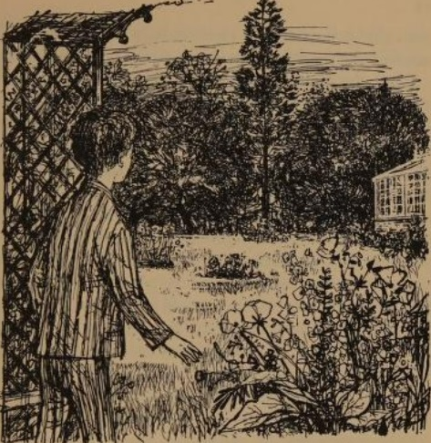

Tom had stepped forward instinctively, catching his breath in surprise; now he let his breath out in a deep sigh. He would steal out here tomorrow, by daylight. They had tried to keep this from him, but they could not stop him now—not his aunt, nor his uncle, nor the back flat tenants, nor even particular Mrs Bartholomew. He would run full tilt over the grass, leaping the flower-beds; he would peer through the glittering panes of the greenhouse—perhaps open the door and go in; he would visit each alcove and archway clipped in the yew-trees—he would climb the trees and make his way from one to another through thickly interlacing branches. When they came calling him, he would hide, silent and safe as a bird, among this richness of leaf and bough and tree-trunk.

The scene tempted him even now: it lay so inviting and clear before him—clear-cut from the stubby leaf-pins of the nearer yew-trees to the curled-back petals of the hyacinths in the crescent-shaped corner beds. Yet Tom remembered his ten hours and his honour. Regretfully he turned from the garden, back indoors to read the grandfather clock.

He re-crossed the threshold, still absorbed in the thought of what he had seen outside. For that reason, perhaps, he could not at once make out how the hall had become different: his eyes informed him of some shadowy change; his bare foot was trying to tell him something . . .

The grandfather clock was still there, anyway, and must tell him the true time. It must be either twelve or one: there was no hour between. There is no thirteenth hour.

Tom never reached the clock with his inquiry, and may be excused for forgetting, on this occasion, to check its truthfulness. His attention was distracted by the opening of a door down the hall-the door of the ground-floor front flat. A maid trotted out.

Tom had seen housemaids only in pictures, but he recognized the white apron, cap and cuffs, and the black stockings. (He was not expert in fashions, but the dress seemed to him to be rather long for her.) She was carrying paper, kindling wood and a box of matches.

He had only a second in which to observe these things. Then he realised that he ought to take cover at once; and there was no cover to take. Since he must be seen, Tom determined to be the first to speak-to explain himself.

He did not feel afraid of the maid: as she came nearer, he saw that she was only a girl. To warn her of his presence without startling her, Tom gave a cough; but she did not seem to hear it. She came on. Tom moved forward into her line of vision; she looked at him, but looked through him, too, as though he were not there. Tom's heart jumped in a way he did not understand. She was passing him.

“I say!” he protested loudly, but she paid not the slightest attention. She passed him, reached the front door of the ground floor back flat, turned the door handle and went in. There was no bell-ringing or unlocking of the door.

Tom was left gaping; and, meanwhile, his senses began to insist upon telling him of experiences even stranger than this encounter. His one bare foot was on cold flagstone, he knew; yet there was a contradictory softness and warmth to this flagstone. He looked down and saw that he was standing on a rug—a tiger-skin rug. There were other rugs down the hall. His eyes now took in the whole of the hall—a hall that was different. No laundry box, no milk bottles, no travel posters on the walls. The walls were decorated with a rich variety of other objects instead: a tall Gothic barometer, a fan of peacock feathers, a huge engraving of a battle (hussars and horses and shot-riddled banners) and many other pictures. There was a big dinner gong, with its wash-leathered gong-stick hanging beside it. There was a large umbrella stand holding umbrellas and walking-sticks and a parasol and an air-gun and what looked like the parts of a fishing-rod. Along the wall projected a series of bracket-shelves, each table-high. They were of oak, except for one towards the middle of the hall, by the grandfather clock. That was of white marble, and it was piled high with glass cases of stuffed birds and animals. Enacted on its chilly surface were scenes of hot bloodshed: an owl clutched a mouse in its claws; a ferret looked up from the killing of its rabbit; in a case in the middle a red fox slunk along with a gamefowl hanging from its jaws.

In all that crowded hall, the only object that Tom recognized was the grandfather clock. He moved towards it, not to read its face, but simply to touch it—to reassure himself that this at least was as he knew it.

His hand was nearly upon it, when he heard a little breath behind him that was the maid passing back the way she had come. For some reason, she did not seem to make as much sound as before. He heard her call only faintly: “I've lit the fire in the parlour.”

She was making for the door through which she had first come, and, as Tom followed her with his eyes, he received a curious impression: she reached the door, her hand was upon the knob, and then she seemed to go. That was it exactly: she went, but not through the door. She simply thinned out, and went.

Even as he stared at where she had been, Tom became aware of something going on furtively and silently about him. He looked round sharply, and caught the hall in the act of emptying itself of furniture and rugs and pictures. They were not positively going, perhaps, but rather beginning to fail to be there. The Gothic barometer, for instance, was there, before he turned to look at the red fox; when he turned back, the barometer was still there, but it had the appearance of something only sketched against the wall, and the wall was visible through it; meanwhile the fox had slunk into nothingness, and all the other creatures were going with him; and, turning back again swiftly to the barometer, Tom found that gone already.

In a matter of seconds the whole hall was as he had seen it on his first arrival. He stood dumbfounded.

Questions on Tom’s Midnight Garden (1958) by Philippa Pearce (1920-2006)

1\. Tom decides that he will get out of bed mainly because:

A. He is finding it difficult to sleep.

B. He is unconcerned about the promise he has made to his uncle.

C. He wants to find out why the clock has struck thirteen.

D. He hopes to find out what is in the garden.

2\. When Tom sees the beautiful garden in the moonlight, his reaction is best described as:

A. He is frightened that something so strange is happening.

B. He is partly delighted, partly angry.

C. He immediately rushes into the garden.

D. He is interested in climbing the trees.

Nonfiction Writing

Write an article giving your opinion on this statement: ‘Beautiful old buildings should be preserved for future generations. It is a crime to convert them for modern use.’

You could use this structure:

| Paragraph | Suggested Vocabulary |
| --- | --- |
| Introduction: It is such a tragedy to see ancient beauty misused. | inheritance, value, respect, honour, intended |
| Paragraph One: Imagine how those buildings were in their days of glory. | splendid, magnificent, proud, impressive, gracious |
| Paragraph Two: And now, they have been dragged into the modern, dreary world. | mundane, ugly, offices, workers, desks, cramped |
| Paragraph Three: Doesn’t this prove that we don’t know how to appreciate the past? | cultural, decline, barbaric, reject, tradition |
| Conclusion: Instead of abusing these beautiful old buildings, we must preserve them intact for future generations. | rediscover, order, harmony, grace, precious, treasure |

## 47. King Arthur and His Knights of the Round Table (1953)

King Arthur and His Knights of the Round Table (1953)

by Roger Lancelyn Green (1918-1987)

Roger Lancelyn Green was a friend of C. S. Lewis, the author of The Chronicles of Narnia, and of J. R. R. Tolkien, author of The Hobbit and The Lord of the Rings. He shared their deep interest in old legends and folklore, and a desire to bring these to life for modern readers. Lancelyn Green published many books retelling legends from different eras and cultures.

Summary of Book One, Chapter Three: The First Quest of the Round Table

    Arthur marries Guinevere and sets up his court at Camelot, where Merlin reveals the Round Table with seats (‘sieges’) appointed for each knight. Gawain’s first quest teaches him that he must show mercy. Pellinore’s first quest teaches him that he must first help ladies in distress, before attending to anything else. Merlin makes a solemn speech about chivalry to all the knights of the Round Table. They must be virtuous and merciful, and they must always help and protect ladies. They make a solemn oath to uphold the code of chivalry, which they will renew every year at Pentecost. Having made this speech and approved this oath, Merlin departs with the Lady Nimue for his ‘long sleep’.

Extract: Sir Gawain’s First Quest

They came at last to the banqueting hall, and there Merlin awaited them, standing before a great round table of stone and wood which filled it almost from side to side.

“Hail, King and Queen of Logres!” cried Merlin. “Your places wait you at the table, and seats also for one hundred and fifty knights - the Knights of the Round Table. Upon every siege - for so the seats at this table are called - you shall find in letters of gold the name of the knight whose place it is. And when a knight is slain in battle or dies, when you have made a new knight, his name shall appear in the siege. But the name of the dead man shall fade when the man dies. Yet the names of the Knights of the Round Table shall live forever. Sit down all of you, for at a round table no man may complain that he is set at the lowest end, or that another is placed above him . . . But of the high honour of the Table you shall hear before long”

\[ . . . \]

Then the great banquet began: but before it was ended Merlin stood up in the midst of the feasters, and all were silent as he spoke.

“Today,” said Merlin, “is the day of the first Quest. Many strange adventures in the years to come shall begin as you sit at meat here about the Round Table: but I shall not be here to see them . . . But now be still, for you shall see a strange and marvellous thing.”

As they sat, waiting in silence, a white hart came running into the hall, and behind it a white brachet or small hunting dog, and behind them a pack of sixty great black hounds baying loudly. Round the table ran the white hart, and as it drew near the door again, the brachet came up behind and snapped fiercely at its flank, so that it gave a great leap to one side, knocking over a knight called Sir Abelleus who sat eating at a small table. At once the knight seized the brachet and strode quickly out of the hall, where he took his horse and rode away still carrying it. The black hounds went away into the forest after the white hart; but before the bell of their baying had died away in the distance, there came riding into the hall a damsel on a white palfrey, and cried aloud to King Arthur, saying:

“My lord King, suffer me not to be robbed in this way; for the brachet is mine which yonder knight has taken with him!”

“But this is no affair of ours!” said King Arthur, who feared very much that he himself might be called upon to ride after Sir Abelleus, then and there on his wedding day.

Hardly had he spoken when a stranger knight, fully armed and riding a great horse, came into the hall and by force led the damsel away with him, however loudly she cried and complained.

Arthur was glad when she had gone, for she had made such a noise. But Merlin rebuked him:

“You may not let this pass so lightly,” he said. “Such an adventure must be followed to the end—else it were shame to Logres, and to you and your knights.”

“I will do as you advise me,” said King Arthur.

“Then send Sir Gawain to bring back the white hart,” directed Merlin. “And Sir Tor to bring the brachet and the knight, if the knight be not slain by him. And let King Pellinore bring the damsel, and the knight, living or dead, who forced her away. For these three knights shall have marvellous adventures ere they come again. And when they return, I will have more to tell you concerning the Round Table. But after that, I must go from you, for the damsel is the Lady Nimue, who calls me to my long sleep . . . !”

The three new knights, on receiving each their orders as to their quest, armed and mounted and rode away into the forest.

Sir Gawain took with him his young brother Gaheris to be his squire, and before they had gone far, they found two knights on horseback fighting fiercely with their swords.

“Stay!” cried Gawain, riding between them. “For what cause are you fighting?”

“Sir,” answered one of the knights, “a white hart came by not long ago, with a cry of black hounds close behind it. Now we knew, my brother and I, that this was an adventure made for the high feast of King Arthur's wedding, and each of us desired greatly to follow the Quest of the White Hart. Then we fell to quarrelling as to which of us was the better knight, and of that quarrel grew many blows . . .”

“Shame be upon you, brothers and knights, thus to fight!” cried Gawain. “Go now and render yourselves prisoners to King Arthur.”

“And if we do not?” said the younger knight.

“Why then, I will fight you until you do, or lie dead!” cried Gawain.

“We will go straightway to King Arthur,” they said, “and tell him that the knight who follows the Quest of the White Hart has sent us!” Then they bowed to him and departed towards Camelot: but Sir Gawain went forward on his Quest.

Deep into the forest he went, with Gaheris riding close behind him; and before long they could hear the bell of the black hounds in front of them, and knew that they were going in the right direction.

Presently they came out of the forest, onto the banks of a wide river, and saw the white hart swimming across it, with the hounds still following. And as Sir Gawain would have ridden into the water, a knight rode up on the further side and shouted:

“You there! Come not over after the white hart, unless you want to fight with me!”

“I do not fear to do that,” answered Gawain. “Fight I will, rather than turn aside from my quest!”

He splashed across the river, and on the further side they drew apart and came together in so mad a rush that Gawain smote the knight over his horse's tail.

“Yield you now!” cried Gawain.

“Not I!” answered the knight, struggling to his feet. “I am Sir Allardyne of the Outer Isles, and never will I yield with life to a raw young knight like you!”

So Gawain leapt down from his horse, and to it they went with their swords, striking mighty blows. But in a little while Gawain smote Allardyne of the Outer Isles such a slash across the head that his helmet split in half, and his head also—and that was the end of him.

“Ah,” said Gaheris proudly. “That was indeed a mighty stroke for so young a knight!”

After the white hart they went, following six of the black hounds which still were hot on its trail. And at length they came into a great castle, and in the courtyard the hounds overtook and slew the white hart. Then the Lord of the Castle, a mighty man with an evil face, came out of his chamber, roaring with rage, and began slashing at the hounds with his sword, crying:

“Alas for the white hart that I gave to my lady and I kept so badly! A cruel death shall they die who have killed you!”

“Cease from this!” cried Gawain, angrily. “Satisfy your anger upon me rather than upon dumb beasts - for the hounds did only what their nature prompted!”

“You speak the truth!” yelled the Lord of the Castle. “I have killed your curs - now only the cur their master remains to slay!”

Then he and Gawain set to fiercely with their swords, the Lord of the Castle striking many cowardly strokes which angered Gawain sorely. But at last, after several wounds given on either side, Gawain struck so hard that the other came clattering down at his feet, crying for mercy and calling Gawain a sweet, gentle knight instead of the unpleasant names he had used a little while before.

“You shall die!” cried Gawain, mad with rage, and he whirled round his sword and struck at the Lord of the Castle, meaning to cut off his head. But at that moment the Lady of the Castle, who had been watching the battle, ran out and flung herself upon her husband's body. And her neck came in the way of Gawain's whirling sword, so that before he could stop he had smitten off her head instead of his enemy’s.

Then Gawain was filled with horror and shame for what he had done, and he let the Lord of the Castle rise unhurt, and said that he would spare his life.

“I would not mind if you killed me now,” he said, “for you have slain my lady love whom I loved better than anything in the world!”

“What is your name?” asked Gawain.

“I am Sir Blamoure of the Marsh,” was the answer.

“Then go you to King Arthur's court: tell him truly all that has happened. Say that the Knight of the White Hart sent you.”

Sir Blamoure mounted his horse and rode away; but Gawain went sadly into the castle with Gaheris.

“I am a shamed knight,” he said, “for I have slain a lady. Had I been merciful to Sir Blamoure, this would not have happened!”

“We are in danger here,” said Gaheris. And even as he spoke, four armed knights came striding into the hall and attacked Gawain fiercely. “You, a new-made knight,” they cried, “have shamed your knighthood! A knight without mercy is dishonoured: but to kill a fair lady is shame unto the world's end! Doubt not that you shall have great need of mercy before you depart from us!” Then they made at Gawain so fiercely that in the end they wounded him sorely, and took him and Gaheris prisoner.

They would have been slain there and then, had not four fair ladies come and begged for their lives.

“Now what cheer, Sir Knight?” one of the ladies asked Gawain.

“Not good!” he answered.

“Why so? The fault is your own, for you did a passing foul deed in slaying this lady . . . But tell me, are you not of King Arthur's court?”

“Yes, truly. I am Sir Gawain, son of King Lot of Orkney, and my mother is Morgawse, the sister of King Arthur!”

“Get you back in peace to the Court,” said the ladies, “but we lay this penance upon you, that you bear the body of the lady whom you slew, and her head also: tell King Arthur all that has come to pass, and give her honourable burial!”

So Gawain and Gaheris rode sadly back towards Camelot.

Questions on King Arthur and His Knights of the Round Table (1953)

by Roger Lancelyn Green (1918-1987)

1\. When the lady begs for King Arthur’s help, he:

A. Tells Sir Gawain to go on a quest to help her.

B. Tries to keep out of the affair, because he is thinking of his wedding night.

C. Is struck with wonder and fear at the strange events.

D. Sets off on a quest to help the damsel in distress.

2\. Sir Gawain rides ‘sadly’ back to Camelot because:

A. He has failed to achieve the quest which Arthur gave him.

B. He is only an inexperienced knight and lacks wisdom.

C. He is ashamed of having killed a lady.

D. He has lost his knighthood through his evil deeds.

Fiction Writing

Write a story about a quest during which the hero learns an important lesson. You could use this structure:

## 48. What Katy Did (1872)

| Paragraph | Suggested Vocabulary |
| --- | --- |
| Paragraph One: I rode into the forest as the sun was setting. | confidence, excitement, ambition |
| Paragraph Two: It was not long before I met my first challenge. | robbers, ruthless, battle, victory |
| Paragraph Three: Flushed with triumph, I rode on. | campfire, rest, preparation |
| Paragraph Four: The greatest challenge still lay before me. | dragon, terror, destruction, charred, stumps, wilderness |
| Paragraph Five: It seemed like I would fail on my first ever quest. | fellow knight, assistance, rescue, humiliation |
| Paragraph Six: I rode back to Camelot, reflecting on what I had learned. | hubris, pride, glory, help, humility |

What Katy Did (1872) by Susan Coolidge (1835-1905)

This classic novel tells the story of Katy Carr and her five siblings, who live in the fictional lakeside town of Burnet, Ohio, USA. Katy longs to be graceful, virtuous and beautiful, but as a twelve-year-old, her many good resolutions never seem to get her anywhere nearer her goal.

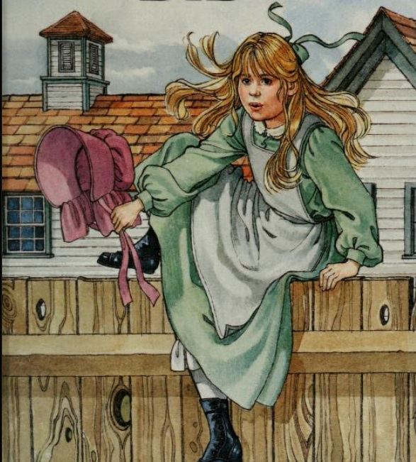

From Chapter One, ‘The Little Carrs’

     Katy's name was Katy Carr. She lived in the town of Burnet, which wasn't a very big town, but was growing fast. The house she lived in stood on the edge of the town. It was a large square house, white, with green blinds, and had a porch in front, over which roses and clematis made a thick bower. Four tall locust trees shaded the gravel path which led to the front gate. On one side of the house was an orchard; on the other side were wood piles and barns, and an ice-house. Behind was a kitchen garden sloping to the south; and behind that a pasture with a brook in it, and butternut trees, and four cows - two red ones, a yellow one with sharp horns tipped with tin, and a dear little white one named Daisy.

There were six of the Carr children - four girls and two boys. Katy, the oldest, was twelve years old; little Phil, the youngest, was four, and the rest fitted in between.

Dr. Carr, their papa, was a dear, kind, busy man, who was away from home all day, and sometimes all night, too, taking care of sick people. The children hadn't any mamma. She had died when Phil was a baby, four years before my story began. Katy could remember her pretty well; to the rest she was but a sad, sweet name, spoken on Sunday, and at prayer times, or when Papa was specially gentle and solemn.

In place of this mamma, whom they recollected so dimly, there was Aunt Izzie, Papa's sister, who came to take care of them when Mamma went away on that long journey, from which, for so many months, the little ones kept hoping she might return. Aunt Izzie was a small woman, sharp-faced and thin, rather old looking, and very neat and particular about everything. She meant to be kind to the children, but they puzzled her much, because they were not a bit like herself when she was a child. Aunt Izzie had been a gentle, tidy little thing, who loved to sit as Curly Locks did, sewing long seams in the parlour, and to have her head patted by older people, and be told that she was a good girl; whereas Katy tore her dress every day, hated sewing, and didn't care a button about being called "good", while Clover and Elsie shied off like restless ponies when anyone tried to pat their heads. It was very perplexing to Aunt Izzie, and she found it hard to quite forgive the children for being so "strange", and so little like the good boys and girls in Sunday-school memoirs, who were the young people she liked best, and understood most about.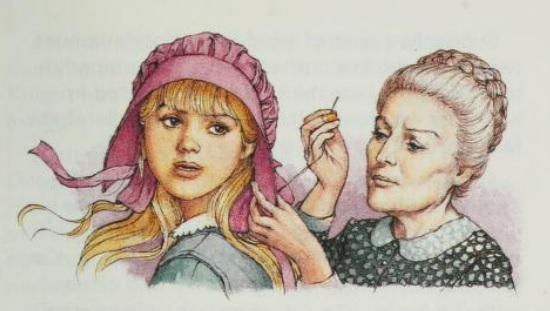

Then Dr. Carr was another person who worried her. He wished to have the children hardy and bold, and encouraged climbing and rough-plays, in spite of the bumps and ragged clothes which resulted. In fact, there was just one half-hour of the day when Aunt Izzie was really satisfied about her charges, and that was the half-hour before breakfast, when she had made a law that they were all to sit in their little chairs and learn the Bible verse for the day. At this time she looked at them with pleased eyes; they were all so spick and span, with such nicely brushed jackets and such neatly combed hair. But the moment the bell rang her comfort was over. From that time on, they were what she called "not fit to be seen". The neighbours pitied her very much. They used to count the sixty stiff white pantalette legs hung out to dry every Monday morning, and say to each other what a sight of washing those children made, and what a trouble it must be for poor Miss Carr to keep them so nice. But poor Miss Carr didn't think them at all nice: that was the worst of it.

"Clover, go upstairs and wash your hands! Dorry, pick your hat off the floor and hang it on the nail! Not that nail - the third nail from the corner!" These were the kind of things Aunt Izzie was saying all day long. The children minded her pretty well, but they didn't exactly love her, I fear. They called her "Aunt Izzie" always, never "Aunty". Boys and girls will know what that meant. I want to show you the little Carrs, and I don't know that I could ever have a better chance than one day when five out of the six were perched on top of the ice-house, like chickens on a roost. This ice-house was one of their favourite places. It was only a low roof set over a hole in the ground and, as it stood in the middle of the side-yard, it always seemed to the children that the shortest road to every place was up one of its slopes and down the other. They also liked to mount to the ridgepole, and then, still keeping the sitting position, to let go, and scrape slowly down over the warm shingles to the ground. It was bad for their shoes and trousers, of course, but what of that? Shoes and trousers, and clothes generally, were Aunt Izzie's affair; theirs was to slide and enjoy themselves.

Clover, next in age to Katy, sat in the middle. She was a fair, sweet dumpling of a girl, with thick pigtails of light brown hair, and short-sighted blue eyes, which seemed to hold tears, just ready to fall from under the blue. Really, Clover was the jolliest little thing in the world; but these eyes, and her soft cooing voice, always made people feel like petting her and taking her part. Once, when she was very small, she ran away with Katy's doll, and when Katy pursued, and tried to take it from her, Clover held fast and would not let go. Dr. Carr, who wasn't attending particularly, heard nothing but the pathetic tone of Clover's voice, as she said, "Me won't! Me want dolly," and, without stopping to inquire, he called out sharply, "For shame, Katy! Give your sister her doll at once!", which Katy, much surprised, did; while Clover purred in triumph, like a satisfied kitten. Clover was sunny and sweet-tempered, a little indolent, and very modest about herself, though in fact she was particularly clever in all sorts of games, and extremely droll and funny in a quiet way. Everybody loved her, and she loved everybody, especially Katy, whom she looked up to as one of the wisest people in the world.

Pretty little Phil sat next on the roof to Clover, and she held him tight with her arm. Then came Elsie, a thin, brown child of eight, with beautiful dark eyes, and crisp, short curls covering the whole of her small head. Poor little Elsie was the "odd one" among the Carrs. She didn't seem to belong exactly to either the older or the younger children. The great desire and ambition of her heart was to be allowed to go about with Katy and Clover and Cecy Hall, and to know their secrets, and be permitted to put notes into the little post offices they were forever establishing in all sorts of hidden places. But they didn't want Elsie, and used to tell her to "run away and play with the children," which hurt her feelings very much. When she wouldn't run away, I am sorry to say they ran away from her, which, as their legs were longest, was easy to do. Poor Elsie, left behind, would cry bitter tears, and, as she was too proud to play much with Dorry and John, her principal comfort was tracking the older ones about and discovering their mysteries, especially the post offices, which were her greatest grievance. Her eyes were bright and quick as a bird's. She would peep and peer, and follow and watch, till at last, in some odd, unlikely place—the crotch of a tree, the middle of the asparagus bed, or perhaps on the very top step of the scuttle ladder—she spied the little paper box, with its load of notes, all ending with "Be sure and not let Elsie know." Then she would seize the box, and, marching up to wherever the others were, she would throw it down, saying, defiantly, "There's your old post office!" but feeling all the time just like crying. Poor little Elsie! In almost every big family there is one of these unmated, left-out children. Katy, who had the finest plans in the world for being "heroic", and of use, never saw, as she drifted on her heedless way, that here, in this lonely little sister, was the very chance she wanted for being a comfort to somebody who needed comfort very much. She never saw it, and Elsie's heavy heart went uncheered.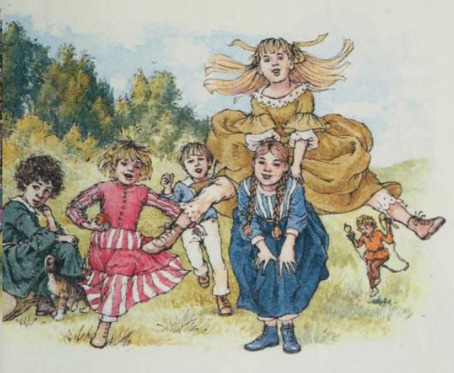

Dorry and Joanna sat on the two ends of the ridgepole. Dorry was six years old: a pale, pudgy boy, with rather a solemn face, and smears of molasses on the sleeve of his jacket. Joanna, whom the children called "John" and "Johnnie", was a square, splendid child, a year younger than Dorry; she had big brave eyes and a wide rosy mouth, which always looked ready to laugh. These two were great friends, though Dorry seemed like a girl who had got into boy's clothes by mistake, and Johnnie like a boy who, in a fit of fun, had borrowed his sister's frock. And now, as they all sat there chattering and giggling, the window above opened, a glad shriek was heard, and Katy's head appeared. In her hand she held a heap of stockings, which she waved triumphantly.

"Hurray!" she cried, "all done, and Aunt Izzie says we may go. Are you tired out waiting? I couldn't help it, the holes were so big, and took so long. Hurry up, Clover, and get the things! Cecy and I will be down in a minute."

The children jumped up gladly, and slid down the roof. Clover fetched a couple of baskets from the woodshed. Elsie ran for her kitten. Dorry and John loaded themselves with two great faggots of green boughs. Just as they were ready, the side door banged, and Katy and Cecy Hall came into the yard.

I must tell you about Cecy. She was a great friend of the children's, and lived in a house next door. The yards of the houses were only separated by a green hedge, with no gate, so that Cecy spent two-thirds of her time at Dr. Carr's, and was exactly like one of the family. She was a neat, dapper, pink-and-white girl, modest and prim in manner, with light shiny hair, which always kept smooth, and slim hands, which never looked dirty. How different from my poor Katy! Katy's hair was forever untidy; her gowns were always catching on nails and "tearing themselves"; and, in spite of her age and size, she was as heedless and innocent as a child of six. Katy was the longest girl that was ever seen. What she did to make herself grow so, nobody could tell; but there she was—up above Papa's ear, and half a head taller than poor Aunt Izzie. Whenever she stopped to think about her height, she became very awkward, and felt as if she were all legs and elbows, and angles and joints. Happily, her head was so full of other things, of plans and schemes and fancies of all sorts, that she didn't often take time to remember how tall she was. She was a dear, loving child, for all her careless habits, and made bushels of good resolutions every week of her life, only unluckily she never kept any of them. She had fits of responsibility about the other children, and longed to set them a good example, but when the chance came, she generally forgot to do so. Katy's days flew like the wind; for when she wasn't studying lessons, or sewing and darning with Aunt Izzie, which she hated extremely, there were always so many delightful schemes rioting in her brains, that all she wished for was ten pairs of hands to carry them out. These same active brains got her into perpetual scrapes. She was fond of building castles in the air, and dreaming of the time when something she had done would make her famous, so that everybody would hear of her, and want to know her. I don't think she had made up her mind what this wonderful thing was to be; but while thinking about it, she often forgot to learn a lesson, or to lace her boots, and then she had a bad mark, or a scolding from Aunt Izzie. At such times she consoled herself with planning how, by and by, she would be beautiful and beloved, and amiable as an angel. A great deal was to happen to Katy before that time came. Her eyes, which were black, were to turn blue; her nose was to lengthen and straighten, and her mouth, quite too large at present to suit the part of a heroine, was to be made over into a sort of rosy button. Meantime, and until these charming changes should take place, Katy forgot her features as much as she could, though still, I think, the person on earth whom she most envied was that lady on the outside of the Tricopherous bottles with the wonderful hair which sweeps the ground.

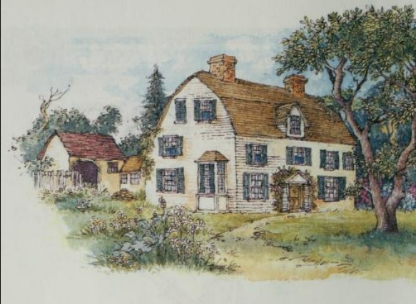

Questions on What Katy Did (1872) by Susan Coolidge (1835-1905)

1\. Katy Carr’s character is best summed up as:

A. Selfish and uncaring about her siblings.

B. Always dreaming, but never doing anything.

C. Loving and kind, but rather careless and immature.

D. Rough and untidy.

2\. Aunt Izzie has trouble with the Carr children mainly because:

A. They never listen to what she tells them.

B. They enjoy rough, energetic games, instead of quiet activities.

C. They do not want to learn their Bible verses.

D. They resent her presence and miss their mother.

Fiction Writing

Write a story about a misfit.

You could structure your writing like this:

| Paragraph | Suggested Vocabulary |
| --- | --- |
| Paragraph One: All I wanted was to have friends, like other people. | outcast, sad, lonely, unloved |
| Paragraph Two: I decided that I needed to make a completely fresh start. | attitude, confidence, change, renew |
| Paragraph Three: At first, it seemed to be going well. | surprised, welcomed, success, acceptance |
| Paragraph Four: I hadn’t counted on the resentment of the most popular student in the class. | lies, slander, malicious, cruel, crushed  |
| Paragraph Five:  I had to make a choice about how to deal with this. | revenge, forgiveness, patience, perseverance |
| Paragraph Six:  I was so glad that I had not taken the path of revenge. | happiness, true friendship, loyalty |

## 49. ‘William and the Perfect Child’ (1936)

‘William and the Perfect Child’ (1936) by Richmal Crompton (1890-1969)

In the first section of this story, William and his friends befriend a horse and lead it to their den in an old barn. As our extract begins, William is being taken by his mother to hear a speech given by a famous lady at the Women’s Guild.

"I do hope, dear," Mrs. Brown was saying, "that you'll sit very quietly through the speech."

"What's it going to be about?” said William.

"I really don't know, dear," said Mrs. Brown. "I suppose I must have had a notice." She burrowed among the papers on her writing-desk. "Oh, here it is! ‘The Upbringing of Children’, by Mrs. Gladhill."

"Gosh!" said William. "Who's she?"

"I don't know, dear. I believe she's written books and things. I expect she hasn't got any children. They generally haven't.” She sighed. "It's so much easier to know how to bring them up, if you haven't got any."

But it turned out that Mrs. Gladhill had. Or rather she had one—a dainty, docile, beautifully mannered little girl of seven called Frances Mary. And Frances Mary was at the Vicarage with her mother. It would have been foolish indeed of her mother to leave her behind, for Frances Mary was a living, breathing, moving testimony to the success of the methods advocated by her mother. She was, as it were, her stock in trade, for Mrs. Gladhill made quite a good thing out of her lectures and books. The Mothers' Vade Mecum was in its sixth edition, and Frances Mary and Her Mother, published last month, had been sold out before publication. Frances Mary herself was quite a cult among childless elderly ladies, and many a mother had copied the large butterfly bow that adorned Frances Mary's golden curls. There were those who called her "smug" and "priggish," and even used such hard words as "impossible" and "intolerable," but perfection always has its detractors.

The two had arrived at the Vicarage for lunch, a meal at which Frances Mary had displayed, with much unction, the table manners for which she was justly famous, and at which Mrs. Gladhill had carefully pointed out to the rest of the company any of the more attractive traits of the child that might otherwise have escaped notice. Soon after lunch the members of the Women's Guild began to arrive. As the day was warm and sunny, the meeting was to be held on the lawn. Mrs. Gladhill went out to her audience accompanied by the Perfect Child. She introduced the Perfect Child to them, then said: "And now, Frances Mary, go back to the drawing-room and stay there quietly. Mrs. Monks will kindly let you look at her photograph albums." She flashed her brilliant smile at her audience. "I never let Frances Mary listen to my lectures. A child's brain should not be over-strained."

Frances Mary smiled sweetly at the gathering, then trotted off into the house. The accustomed murmur of admiration followed her. Mrs. Gladhill threw a benign glance around, cleared her throat, and began majestically: "Fellow mothers ..."

She was well under way when Mrs. Brown and William arrived. There had been a slight hitch in their preparations, owing to William's having been discovered to be wearing odd shoes—both for the same foot—when they were half-way there. William protested passionately that it didn't matter, that he never kept his shoes for special feet, anyway, that he always wore any shoe on any foot, and both shoes and feet were used to it. He said that no one would notice the fact that they were of different pattern unless they were balmy, and then it didn't matter what they thought. But Mrs. Brown was determined that for once in his life William should do her credit. So, by the time they had returned home, found the missing shoe, put it on, and made their way again to the Vicarage, Mrs. Gladhill was just beginning the exposition of her third rule for the upbringing of the Perfect Child.

There was an unusually large attendance of members, most of whom had come in a spirit of curiosity in order to see the much advertised Perfect Child at close quarters. It had even been rumoured that she would recite a poem of her own composition after tea.

Fortunately, however, there were two empty seats, one in the back row and the other in the middle. William hastily claimed the one in the back row, and Mrs. Brown, throwing him an anxious glance, but feeling assured that there was no possibility of his getting into mischief, hemmed in as he was on one side by the churchwarden's wife and on the other by the postmistress, made her way to the other seat. William sat for two minutes, giving his whole attention to the speech, before he came to the conclusion that it wasn't worth it. He looked round furtively and began to consider the possibilities of a large bush that grew just behind his chair. The possibilities were, he decided, more worthy of his attention than the speech. Slowly, and by degrees, he edged his chair back towards it. Whenever he did this his neighbours turned to look at him, but always when they did so he was sitting motionless, his eyes fixed earnestly on the speaker. At last he had edged it back so far as to be practically outside their range of vision. And then, quite suddenly, he vanished. When next his neighbours turned to look at him, he wasn't there. Without sound, without movement, as it seemed, he had disappeared—disappeared as completely as if the earth had swallowed him up. They were slightly puzzled, then dismissed the subject from their minds and gave their attention once more to the lecture. He wasn't their business, and the lecture was. They'd paid for their tickets and they meant to get their money's worth, boy or no boy.

William emerged from the shrubbery at the other side of the Vicarage and heaved a sigh of relief. He couldn't have gone on listening to that awful stuff a moment longer. It would be all right. He'd be back in his place by the time she'd finished, and his mother would never know he'd been away. He might even have time to slip over to the old barn and see how the horse was getting on. Ginger and Douglas and Henry would be having rides on it. It was jolly hard lines on him, not being able to be there, too. Well, it wouldn't do any harm to go and watch them just for a minute or two and then come back. He wouldn't stay long. Suddenly, he became aware of a little girl watching him from an open French window. She was a definitely attractive little girl, with golden hair, blue eyes, and rosy cheeks. She looked at him with interest and distinct favour. Though not of prepossessing appearance, William, fresh from his mother's hands, was radiantly neat and clean, his hair sleeked back, his collar shining, his tie in place, his stockings well gartered, his shoes decorously tied and a-gleam with polish. Definitely a nice little boy, such as her mother had no objection to her knowing.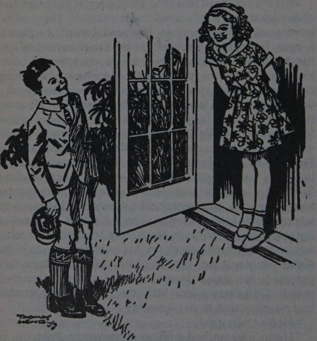

"Hello," she said.

"Hello," he replied with an ingratiating smile.

“What's your name?"

“William. What's yours?"

"Frances Mary . . . What are you doing here?”

"Me?” he said vaguely. "Oh, I'm jus' sort of walkin' round a bit."

"Have you come to the meeting?" she asked.

"Oh, yes ... yes. I've been to the meeting. I've jus' come from it."

"Why've you come from it?" said the little girl. “It's not over, is it?"

"No, it's not over," admitted William, "but I've gotter go an' have a look at a horse of mine."

The little girl stared at him, obviously impressed. "Have you got a horse?” she said.

"Me?” said William. "Oh, yes, I've got a horse all right." He gave a short laugh implying that the idea of his not having a horse was ludicrous in the extreme. “Course I've gotter horse."

"Of your very own?" said the little girl, still in an awestruck voice.

"’Course," said William, momentarily disallowing the claims of Ginger, Douglas and Henry to their joint property. “Like to come and have a look at it?”

"I'd love to," said the little girl, "but I don't think mother would like me to."

"Oh, yes, she would," persisted William, "I'm sure she would. Why shouldn't she? She likes you havin' a good time, doesn't she?"

"Oh, yes, but I've got to go out there and have tea with them all as soon as she's finished speaking. I'm going to recite, too. Something I've made up myself."

She spoke with pride, but there was a certain undercurrent of humility. After all, even the reciting of a piece of one's own composition paled before the possession of a real live horse.

"Oh, well, I've gotter be back for tea, too," said William. "It won't take two minutes to go an' look at this horse of mine. It's only across a field. We'll be back long before it's time for tea."

The little girl obviously weakened.

“Well, I could just come and look at it, anyway," she said. "After all, it's natural history—isn't it?—and mother thinks that's very important."

"Oh, yes, it's that all right," said William.

“Yes, I'll come," said the little girl. “P'raps I'll be able to make up a poem about it afterwards."

"Oh, yes, I bet you will,” said William. “It's a jolly good horse."

She came out of the French windows and walked sedately with William across the lawn to the gates. In the distance could be heard the clipped emphatic tones of the speaker.

"She can speak for a whole hour without stopping, except to take drinks of water," said the little girl proudly.

"This horse of mine," said William, "can run for hours and hours without drinks of water at all."

"She's been to America," went on the little girl.

"This horse of mine's been everywhere,” said William

They had reached the old barn now. The big horse was ambling good-naturedly across the field with Ginger on his back. Douglas and Henry walked proudly on either side, holding the bridle.

William stopped. “That's my horse," he said casually. Frances Mary was impressed.

"What a lovely one!" she said. “Isn't it big! Who are those boys?"

"Oh, they're jus' friends of mine," said William. "I said they could ride on my horse while I was away. I say"—he turned to her—"would you like a ride?”

Her eyes shone. "Oo, I'd love it."

"All right," he said generously. "You have one. You have as many as you like. Hi, Ginger! Get off my horse."

They stared at him, so much impressed by his immaculate appearance and the beauty and daintiness of his escort, that they did not even dispute his claim of sole ownership.

William introduced his new friend with an airy wave of his hand.

"She's called Frances Mary, an' she wants a ride."

Ginger scrambled down obediently, and they stood round Frances Mary, looking from her to the horse.

"How's she goin' to get up?” said Douglas.

"Oh, we'll push her up," said William. "Come on!"

Willing hands pushed the excited Frances Mary on to the saddle. She held on for one ecstatic moment, then, as soon as the horse took a step forward, fell off on the other side. The fall did not hurt her, as the ground was soft and muddy, but it altered her appearance to a considerable extent.

She got up laughing. "Again! Again!" she cried. "Help me up again!"

Again willing hands pushed her up on to the saddle. Again, at the first step forward of the grey horse, she rolled off on the other side. Again she leapt up, muddy and laughing.

"Isn't it fun?” she said. "Do it again."

The Outlaws' admiration for her increased. They called her a sport. They hoisted her up again and again. Again and again she fell off. Her frock was torn and grimy, her hair ribbon came off, her hair fell about her face, her face was covered with mud. She was laughing and shouting in a way in which the Perfect Child had never laughed and shouted in her life before.

\[The horse eventually runs away with Frances Mary on its back, and ends up trotting into the Vicarage garden, where Mrs. Gladhill is just finishing her speech.\]

Mrs. Gladhill was drawing to the close of her lecture. She had described the method of bringing up children in much detail and emphasised its success in the case of her own child. "Several of you have remarked to me today," she said, "on the beautiful manners and behaviour of my own little girl. They are not some freak of nature, but merely the result of correct upbringing." She then invited questions. A woman in a purple hat in the second row got up and, with a side glance at Mrs. Brown, asked how one could counteract the contaminating influence of other children. She went on to say that certain children in the village had a most pernicious influence over other children. Again she glanced at Mrs. Brown. Mrs. Brown assumed an air of lofty detachment. At least, she assured herself, no one could have anything against William this afternoon, because she'd seen him herself, nicely settled in a chair in the back row, looking the picture of cleanliness and good behaviour. No, no one could have anything against William this afternoon, at any rate. Patiently, Mrs. Gladhill replied that it was all a question of the right method. Any child brought up on the right method would be an influence for good among other children. "I could trust my little girl," she ended with a bright smile, "among any children."

It was at this moment that the grey horse entered the garden and galloped clumsily across the lawn, upsetting several of the tables laid for tea. He was ridden by a crumpled, torn, dirty little girl who yelled and screamed with delight. "It's running! It's running! And I'm staying on!"

She had by now accustomed herself to the horse's motion, and was sitting more or less upright, and using the reins. But suddenly the horse recognised his own field across the hedge of the Vicarage. He leapt forward, shooting the little girl off his back, and, cantering through the side gate that someone had obligingly left open, disappeared from view.

The little girl sat, still laughing, on the lawn, where he had thrown her, the centre of a horrified group. She was, indeed, hardly recognisable as the Perfect Child. But her mother knew her. Her mother gazed at her, growing paler and paler as she took in each detail of her dishevelment.

"Frances Mary," she faltered at last, "what have you been doing?”

Frances Mary laughed up at her through her mask of mud and tangled curls.

"I've been having a simply lovely time," she said.

Mrs. Brown glanced round fearfully for some trace of William.

The empty seat in the back row was all she could find.

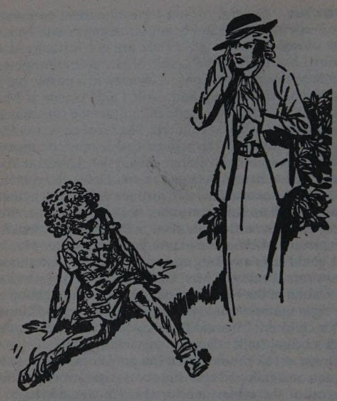

Questions on ‘William and the Perfect Child’ (1936) by Richmal Crompton (1890-1969)

1\. Frances Mary agrees to go with William mainly because:

A. She likes to disobey her mother.

B. She is bored of being the Perfect Child.

C. She is curious about William’s horse.

D. William is such a smart boy.

2\. When Frances Mary returns, Richmal Crompton mainly aims to show:

A. How Mrs. Gladhill manages in a difficult situation.

B. How Mrs. Gladhill’s pride has been punctured.

C. How William’s mother is horrified by his behaviour.

D. How other mothers criticise Mrs. Brown.

Analytical Writing on ‘William and the Perfect Child’ by Richmal Crompton

How Crompton Satirises Mrs. Gladhill

How does Richmal Crompton make Mrs. Gladhill look ridiculous and mock her “expert” methods for raising children?

| Starting Sentence | Quotations | Vocabulary |
| --- | --- | --- |
| Crompton satirises Mrs. Gladhill by showing how she uses her daughter. | ‘She was, as it were, her stock in trade, for Mrs. Gladhill made quite a good thing out of her lectures and books.’ ‘Mrs. Gladhill had carefully pointed out to the rest of the company any of the more attractive traits of the child that might otherwise have escaped notice.’  | commercial, profitable, business, marketing tool |
| Having established Mrs. Gladhill’s pride and success, Crompton creates a dramatic fall.  | ‘"Several of you have remarked to me today," she said, "on the beautiful manners and behaviour of my own little girl. They are not some freak of nature, but merely the result of correct upbringing."’ ‘"I could trust my little girl," she ended with a bright smile, "among any children."’ ‘a crumpled, torn, dirty little girl’ ‘hardly recognisable as the Perfect Child’ ‘"I've been having a simply lovely time"’ | claiming, credit, boasting, humiliation, riotous, delight, ordinary child, artificial display, product |

Example Answer

Crompton satirises Mrs. Gladhill by showing how she uses her daughter as part of a successful commercial operation. Frances Mary is described as her ‘stock in trade’, and we learn that she takes her daughter with her on her profitable speaking engagements which promote the books that sell many copies, such as her ‘Mother’s Vade Mecum’, which has reached its ‘sixth edition’. At lunch, Mrs. Gladhill spends her time drawing everyone’s attention to her child’s ‘attractive traits’. She is evidently a highly effective marketing tool for Mrs. Gladhill’s business.

Having established Mrs. Gladhill’s pride and success, Crompton creates a dramatic fall. Mrs. Gladhill has just been asserting that Frances Mary’s ‘beautiful manners and behaviour’ are all a result of ‘correct upbringing’, thereby claiming all the credit for herself (and the method she is marketing), and boasted of how her daughter can be trusted in any company. This sets Mrs. Gladhill up for complete humiliation, as her daughter returns from a riotous time with William and his friends. She is described as ‘a crumpled, torn, dirty little girl’, and, far from being ashamed at her antics, she is filled with delight, laughing and saying ‘I’ve been having a simply lovely time’. As readers, we are pleased to see her pompous mother’s humiliation, and glad to see that she has had the opportunity to enjoy herself like an ordinary child, instead of remaining an artificial display to support her mother’s business.

## 50. Farmer Giles of Ham (1949)

Extract from Farmer Giles of Ham (1949) by J. R. R. Tolkien (1892-1973)

This light-hearted fable by the author of The Hobbit and The Lord of the Rings tells the tale of a farmer who achieves fame and wealth despite being a very unlikely hero.

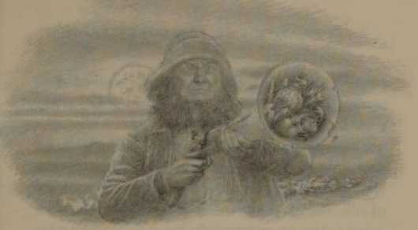

Ægidius de Hammo was a man who lived in the midmost parts of the Island of Britain. In full his name was Ægidius Ahenobarbus Julius Agricola de Hammo; for people were richly endowed with names in those days, now long ago, when this island was still happily divided into many kingdoms. There was more time then, and folk were fewer, so that most men were distinguished. However, those days are now over, so I will in what follows give the man his name shortly, and in the vulgar form: he was Farmer Giles of Ham, and he had a red beard. Ham was only a village, but villages were proud and independent still in those days.

Farmer Giles had a dog. The dog's name was Garm. Dogs had to be content with short names in the vernacular: the Book-Latin was reserved for their betters. Garm could not talk even dog-Latin; but he could use the vulgar tongue (as could most dogs of his day) either to bully or to brag or to wheedle in. Bullying was for beggars and trespassers, bragging for other dogs, and wheedling for his master. Garm was both proud and afraid of Giles, who could bully and brag better than he could.

The time was not one of hurry or bustle. But bustle has very little to do with business. Men did their work without it; and they got through a deal both of work and of talk. There was plenty to talk about, for memorable events occurred very frequently. But at the moment when this tale begins nothing memorable had, in fact, happened in Ham for quite a long time. Which suited Farmer Giles down to the ground: he was a slow sort of fellow, rather set in his ways, and taken up with his own affairs. He had his hands full (he said) keeping the wolf from the door: that is, keeping himself as fat and comfortable as his father before him. The dog was busy helping him. Neither of them gave much thought to the Wide World outside their fields, the village, and the nearest market.

But the Wide World was there. The forest was not far off, and away west and north were the Wild Hills, and the dubious marches of the mountain-country. And among other things still at large there were giants: rude and uncultured folk, and troublesome at times. There was one giant in particular, larger and more stupid than his fellows. I find no mention of his name in the histories, but it does not matter. He was very large, his walking stick was like a tree, and his tread was heavy. He brushed elms aside like tall grasses; and he was the ruin of roads and the desolation of gardens, for his great feet made holes in them as deep as wells; if he stumbled into a house, that was the end of it. And all this damage he did wherever he went, for his head was far above the roofs of houses and left his feet to look after themselves. He was near-sighted and also rather deaf. Fortunately he lived far off in the Wild, and seldom visited the lands inhabited by men, at least not on purpose. He had a great tumbledown house away up in the mountains; but he had very few friends, owing to his deafness and his stupidity, and the scarcity of giants. He used to go out walking in the Wild Hills and in the empty regions at the feet of the mountains, all by himself.

One fine summer's day this giant went out for a walk, and wandered aimlessly along, doing a great deal of damage in the woods. Suddenly he noticed that the sun was setting, and felt that his supper-time was drawing near; but he discovered that he was in a part of the country that he did not know at all and had lost his way. Making a wrong guess at the right direction he walked and he walked until it was dark night. Then he sat down and waited for the moon to rise. Then he walked and walked in the moonlight, striding out with a will, for he was anxious to get home. He had left his best copper pot on the fire, and feared that the bottom would be burned. But his back was to the mountains, and he was already in the lands inhabited by men. He was, indeed, now drawing near to the farm of Ægidius Ahenobarbus Julius Agricola and the village called (in the vulgar tongue) Ham.

It was a fine night. The cows were in the fields, and Farmer Giles's dog had got out and gone for a walk on his own account. He had a fancy for moonshine, and rabbits. He had no idea, of course, that a giant was also out for a walk. That would have given him a good reason for going out without leave, but a still better reason for staying quiet in the kitchen. At about two o'clock the giant arrived in Farmer Giles's fields, broke the hedges, trampled on the crops, and flattened the mowing-grass. In five minutes he had done more damage than the royal foxhunt could have done in five days.

Garm heard a thump-thump coming along the riverbank, and he ran to the west side of the low hill on which the farmhouse stood, just to see what was happening. Suddenly he saw the giant stride right across the river and tread upon Galathea, the farmer's favourite cow, squashing the poor beast as flat as the farmer could have squashed a black beetle.

That was more than enough for Garm. He gave a yelp of fright and bolted home. Quite forgetting that he was out without leave, he came and barked and yammered underneath his master's bedroom window. There was no answer for a long time. Farmer Giles was not easily wakened.

“Help! help! help!” cried Garm.

The window opened suddenly and a well-aimed bottle came flying out.

“Ow!” said the dog, jumping aside with practised skill. “Help! help! help!”

Out popped the farmer's head. “Drat you, dog! What be you a-doing?” said he.

“Nothing,” said the dog.

“I'll give you nothing! I'll flay the skin off you in the morning,” said the farmer, slamming the window.

“Help! help! help!” cried the dog.

Out came Giles's head again. “I'll kill you, if you make another sound,” he said. “What's come to you, you fool?”

“Nothing,” said the dog; “but something's come to you.”

“What d'you mean?” said Giles, startled in the midst of his rage. Never before had Garm answered him saucily.

“There's a giant in your fields, an enormous giant; and he's coming this way,” said the dog. “Help! help! He is trampling on your sheep. He has stamped on poor Galathea, and she's as flat as a doormat. Help! help! He's bursting all your hedges, and he's crushing all your crops. You must be bold and quick, master, or you will soon have nothing left. Help!” Garm began to howl.

“Shut up!” said the farmer, and he shut the window. “Lord-a-mercy!” he said to himself; and though the night was warm, he shivered and shook.

“Get back to bed and don't be a fool!” said his wife. “And drown that dog in the morning. There is no call to believe what a dog says; they'll tell any tale, when caught truant or thieving.”

“Maybe, Agatha,” said he, “and maybe not. But there's something going on in my fields, or Garm's a rabbit. That dog was frightened. And why should he come yammering in the night when he could sneak in at the back door with the milk in the morning?”

“Don't stand there arguing!” said she. “If you believe the dog, then take his advice: be bold and quick!”

“Easier said than done,” answered Giles; for, indeed, he believed quite half of Garm's tale. In the small hours of the night giants seem less unlikely.

Still, property is property; and Farmer Giles had a short way with trespassers that few could outface. So he pulled on his breeches, and went down into the kitchen and took his blunderbuss from the wall. Some may well ask what a blunderbuss was. Indeed, this very question, it is said, was put to the Four Wise Clerks of Oxenford, and after thought they replied: “A blunderbuss is a short gun with a large bore firing many balls or slugs, and capable of doing execution within a limited range without exact aim. (Now superseded in civilised countries by other firearms.)”

However, Farmer Giles's blunderbuss had a wide mouth that opened like a horn, and it did not fire balls or slugs, but anything that he could spare to stuff in. And it did not do execution, because he seldom loaded it, and never let it off. The sight of it was usually enough for his purpose. And this country was not yet civilised, for the blunderbuss was not superseded: it was indeed the only kind of gun that there was, and rare at that. People preferred bows and arrows and used gunpowder mostly for fireworks.

Well then, Farmer Giles took down the blunderbuss, and he put in a good charge of powder, just in case extreme measures should be required; and into the wide mouth he stuffed old nails and bits of wire, pieces of broken pot, bones and stones and other rubbish. Then he drew on his top-boots and his overcoat, and he went out through the kitchen garden.

The moon was low behind him, and he could see nothing worse than the long black shadows of bushes and trees, but he could hear a dreadful stamping-stumping coming up the side of the hill. He did not feel either bold or quick, whatever Agatha might say; but he was more anxious about his property than his skin. So, feeling a bit loose about the belt, he walked towards the brow of the hill.

Suddenly up over the edge of it the giant's face appeared, pale in the moonlight, which glittered in his large round eyes. His feet were still far below, making holes in the fields. The moon dazzled the giant and he did not see the farmer; but Farmer Giles saw him and was scared out of his wits. He pulled the trigger without thinking, and the blunderbuss went off with a staggering bang. By luck it was pointed more or less at the giant's large ugly face. Out flew the rubbish, and the stones and the bones, and the bits of crock and wire, and half a dozen nails. And since the range was indeed limited, by chance and no choice of the farmer's many of these things struck the giant: a piece of pot went in his eye, and a large nail stuck in his nose.

“Blast!” said the giant in his vulgar fashion. “I'm stung!” The noise had made no impression on him (he was rather deaf), but he did not like the nail. It was a long time since he had met any insect fierce enough to pierce his thick skin; but he had heard tell that away East, in the Fens, there were dragonflies that could bite like hot pincers. He thought that he must have run into something of the kind.

“Nasty unhealthy parts, evidently,” said he. “I shan't go any further this way tonight.”

So he picked up a couple of sheep off the hill-side, to eat when he got home, and went back over the river, making off about nor-nor-west at a great pace. He found his way home again in the end, for he was at last going in the right direction; but the bottom was burned off his copper pot.

As for Farmer Giles, when the blunderbuss went off, it knocked him over flat on his back; and there he lay looking at the sky and wondering if the giant's feet would miss him as they passed by. But nothing happened, and the stamping-stumping died away in the distance. So he got up, rubbed his shoulder, and picked up the blunderbuss. Then suddenly he heard the sound of people cheering.

Questions on Farmer Giles of Ham (1949) by J. R. R. Tolkien (1892-1973)

1\. Farmer Giles comes out with his blunderbuss mainly because:

A. He trusts that Garm is telling him the truth.

B. He partly believes Garm, and he hates trespassers.

C. His wife tells him to go and fight the giant.

D. He often fires at people with his blunderbuss.

2\. Farmer Giles defeats the giant because:

A. He kills it with his powerful gun.

B. He bravely faces up to the giant and wins in battle.

C. He fires without thinking, and annoys the giant.

D. The giant has been stung by a huge insect.

Fiction Writing

Write a story about an unlikely hero.

You could use this structure:

## 51. The Voyage of the Dawn Treader (1952)

| Paragraph | Suggested Vocabulary |
| --- | --- |
| Paragraph One: I was the last person anyone would look to for help. | weak, thin, unpopular, despised |
| Paragraph Two: I often spent my days alone, outside the village, in my favourite perch. | tree, gazing, distance, hills, wondering, practising, archery |
| Paragraph Three: One day, I saw something in the distance, approaching steadily. | dust, chariots, cries, warriors, terrifying, raiders |
| Paragraph Four: I ran desperately into the village to warn the people. | disbelief, persuade, pleading, fear |
| Paragraph Five: They would not listen to me, so I took matters into my own hands. | tree, perch, shot, leader, fatal, wound |
| Paragraph Six: By the time our warriors charged out of the village, the battle was more than half won. | demoralised, discouraged, rout, hero, congratulations, honour, feast |

The Voyage of the Dawn Treader (1952) by C. S. Lewis (1898-1963)

Usually numbered five in the series of seven books, this novel tells of how Edmund and Lucy Pevensie, who once reigned as king and queen in Narnia (see The Lion, the Witch and the Wardrobe for more on this), return for their third visit to this magical land, and join their old friend King Caspian as he journeys into unknown seas aboard the Dawn Treader. They are joined by an unwelcome and unwilling third person, their obnoxious cousin Eustace.

Chapter One: ‘The Picture in the Bedroom’

There was a boy called Eustace Clarence Scrubb, and he almost deserved it. His parents called him Eustace Clarence and masters called him Scrubb. I can't tell you how his friends spoke to him, for he had none. He didn't call his Father and Mother "Father" and "Mother", but Harold and Alberta. They were very up-to-date and advanced people. They were vegetarians, non-smokers and teetotallers and wore a special kind of underclothes. In their house there was very little furniture and very few clothes on the beds and the windows were always open.

Eustace Clarence liked animals, especially beetles, if they were dead and pinned on a card. He liked books if they were books of information and had pictures of grain elevators or of fat foreign children doing exercises in model schools.

Eustace Clarence disliked his cousins the four Pevensies, Peter, Susan, Edmund and Lucy. But he was quite glad when he heard that Edmund and Lucy were coming to stay. For deep down inside him he liked bossing and bullying; and, though he was a puny little person who couldn't have stood up even to Lucy, let alone Edmund, in a fight, he knew that there are dozens of ways to give people a bad time if you are in your own home and they are only visitors.

Edmund and Lucy did not at all want to come and stay with Uncle Harold and Aunt Alberta. But it really couldn't be helped. Father had got a job lecturing in America for sixteen weeks that summer, and Mother was to go with him because she hadn't had a real holiday for ten years. Peter was working very hard for an exam and he was to spend the holidays being coached by old Professor Kirke in whose house these four children had had wonderful adventures long ago in the war years. If he had still been in that house he would have had them all to stay. But he had somehow become poor since the old days and was living in a small cottage with only one bedroom to spare. It would have cost too much money to take the other three all to America, and Susan had gone. Grown-ups thought her the pretty one of the family and she was no good at school work (though otherwise very old for her age) and Mother said she "would get far more out of a trip to America than the youngsters". Edmund and Lucy tried not to grudge Susan her luck, but it was dreadful having to spend the summer holidays at their Aunt's. "But it's far worse for me," said Edmund, "because you'll at least have a room of your own and I shall have to share a bedroom with that record stinker, Eustace."

The story begins on an afternoon when Edmund and Lucy were stealing a few precious minutes alone together. And of course they were talking about Narnia, which was the name of their own private and secret country. Most of us, I suppose, have a secret country, but for most of us it is only an imaginary country. Edmund and Lucy were luckier than other people in that respect. Their secret country was real. They had already visited it twice; not in a game or a dream, but in reality. They had got there of course by Magic, which is the only way of getting to Narnia. And a promise, or very nearly a promise, had been made them in Narnia itself that they would some day get back. You may imagine that they talked about it a good deal, when they got the chance.

They were in Lucy's room, sitting on the edge of her bed and looking at a picture on the opposite wall. It was the only picture in the house that they liked. Aunt Alberta didn't like it at all (that was why it was put away in a little back room upstairs), but she couldn't get rid of it because it had been a wedding present from someone she did not want to offend.

It was a picture of a ship—a ship sailing nearly straight towards you. Her prow was gilded and shaped like the head of a dragon with wide open mouth. She had only one mast and one large, square sail which was a rich purple. The sides of the ship—what you could see of them where the gilded wings of the dragon ended—were green. She had just run up to the top of one glorious blue wave, and the nearer slope of that wave came down towards you, with streaks and bubbles on it. She was obviously running fast before a gay wind, listing over a little on her port side. (By the way, if you are going to read this story at all, and if you don't know already, you had better get it into your head that the left of a ship when you are looking ahead, is port, and the right is starboard.) All the sunlight fell on her from that side, and the water on that side was full of greens and purples. On the other, it was darker blue from the shadow of the ship.

"The question is," said Edmund, "whether it doesn't make things worse, looking at a Narnian ship when you can't get there."

"Even looking is better than nothing," said Lucy. "And she is such a very Narnian ship."

"Still playing your old game?" said Eustace Clarence, who had been listening outside the door and now came grinning into the room. Last year, when he had been staying with the Pevensies, he had managed to hear them all talking of Narnia and he loved teasing them about it. He thought of course that they were making it all up; and as he was far too stupid to make anything up himself, he did not approve of that.

"You're not wanted here," said Edmund curtly.

"I'm trying to think of a limerick," said Eustace. "Something like this:

"Some kids who played games about Narnia

 Got gradually balmier and balmier——"

"Well, Narnia and balmier don't rhyme, to begin with," said Lucy.

"It's an assonance," said Eustace.

"Don't ask him what an assy-thingummy is," said Edmund. "He's only longing to be asked. Say nothing and perhaps he'll go away."

Most boys, on meeting a reception like this, would either have cleared out or flared up. Eustace did neither. He just hung about grinning, and presently began talking again.

"Do you like that picture?" he asked.

"For Heaven's sake don't let him get started about Art and all that," said Edmund hurriedly, but Lucy, who was very truthful, had already said, "Yes, I do. I like it very much."

"It's a rotten picture," said Eustace.

"You won't see it if you step outside," said Edmund.

"Why do you like it?" said Eustace to Lucy.

"Well, for one thing," said Lucy, "I like it because the ship looks as if it was really moving. And the water looks as if it was really wet. And the waves look as if they were really going up and down."

Of course Eustace knew lots of answers to this, but he didn't say anything. The reason was that at that very moment he looked at the waves and saw that they did look very much indeed as if they were going up and down. He had only once been in a ship (and then only as far as the Isle of Wight) and had been horribly seasick. The look of the waves in the picture made him feel sick again. He turned rather green and tried another look. And then all three children were staring with open mouths.

What they were seeing may be hard to believe when you read it in print, but it was almost as hard to believe when you saw it happening. The things in the picture were moving. It didn't look at all like a cinema either; the colours were too real and clean and out-of-door for that. Down went the prow of the ship into the wave and up went a great shock of spray. And then up went the wave behind her, and her stern and her deck became visible for the first time, and then disappeared as the next wave came to meet her and her bows went up again. At the same moment an exercise book which had been lying beside Edmund on the bed flapped, rose and sailed through the air to the wall behind him, and Lucy felt all her hair whipping round her face as it does on a windy day. And this was a windy day; but the wind was blowing out of the picture towards them. And suddenly with the wind came the noises—the swishing of waves and the slap of water against the ship's sides and the creaking and the overall high, steady roar of air and water. But it was the smell, the wild, briny smell, which really convinced Lucy that she was not dreaming.

"Stop it," came Eustace's voice, squeaky with fright and bad temper. "It's some silly trick you two are playing. Stop it. I'll tell Alberta—ow!"

The other two were much more accustomed to adventures, but, just exactly as Eustace Clarence said "Ow," they both said "Ow" too. The reason was that a great cold, salt splash had broken right out of the frame and they were breathless from the smack of it, besides being wet through.

"I'll smash the rotten thing," cried Eustace; and then several things happened at the same time. Eustace rushed towards the picture. Edmund, who knew something about magic, sprang after him, warning him to look out and not to be a fool. Lucy grabbed at him from the other side and was dragged forward. And by this time either they had grown much smaller or the picture had grown bigger. Eustace jumped to try to pull it off the wall and found himself standing on the frame; in front of him was not glass but real sea, and wind and waves rushing up to the frame as they might to a rock. He lost his head and clutched at the other two who had jumped up beside him. There was a second of struggling and shouting, and just as they thought they had got their balance a great blue roller surged up round them, swept them off their feet, and drew them down into the sea. Eustace's despairing cry suddenly ended as the water got into his mouth.

Lucy thanked her stars that she had worked hard at her swimming last summer term. It is true that she would have got on much better if she had used a slower stroke, and also that the water felt a great deal colder than it had looked while it was only a picture. Still, she kept her head and kicked her shoes off, as everyone ought to do who falls into deep water in their clothes. She even kept her mouth shut and her eyes open. They were still quite near the ship; she saw its green side towering high above them, and people looking at her from the deck. Then, as one might have expected, Eustace clutched at her in a panic and down they both went.

When they came up again, she saw a white figure diving off the ship's side. Edmund was close beside her now, treading water, and had caught the arms of the howling Eustace. Then someone else, whose face was vaguely familiar, slipped an arm under her from the other side. There was a lot of shouting going on from the ship, heads crowding together above the bulwarks, ropes being thrown. Edmund and the stranger were fastening ropes round her. After that followed what seemed a very long delay during which her face got blue and her teeth began chattering. In reality the delay was not very long; they were waiting till the moment when she could be got on board the ship without being dashed against its side. Even with all their best endeavours she had a bruised knee when she finally stood, dripping and shivering, on the deck. After her Edmund was heaved up, and then the miserable Eustace. Last of all came the stranger—a golden-headed boy some years older than herself.

"Ca—Ca—Caspian!" gasped Lucy as soon as she had breath enough. For Caspian it was; Caspian, the boy king of Narnia whom they had helped to set on the throne during their last visit. Immediately Edmund recognised him too. All three shook hands and clapped one another on the back with great delight.

"But who is your friend?" said Caspian almost at once, turning to Eustace with his cheerful smile. But Eustace was crying much harder than any boy of his age has a right to cry when nothing worse than a wetting has happened to him, and would only yell out, "Let me go. Let me go back. I don't like it."

"Let you go?" said Caspian. "But where?"

Eustace rushed to the ship's side, as if he expected to see the picture frame hanging above the sea, and perhaps a glimpse of Lucy's bedroom. What he saw was blue waves flecked with foam, and paler blue sky, both spreading without a break to the horizon. Perhaps we can hardly blame him if his heart sank. He was promptly sick.

"Hey! Rynelf," said Caspian to one of the sailors. "Bring spiced wine for their Majesties. You'll need something to warm you after that dip." He called Edmund and Lucy their Majesties because they and Peter and Susan had all been Kings and Queens of Narnia long before his time. Narnian time flows differently from ours. If you spent a hundred years in Narnia, you would still come back to our world at the very same hour of the very same day on which you left. And then, if you went back to Narnia after spending a week here, you might find that a thousand Narnian years had passed, or only a day, or no time at all. You never know till you get there. Consequently, when the Pevensie children had returned to Narnia last time for their second visit, it was (for the Narnians) as if King Arthur came back to Britain, as some people say he will. And I say the sooner the better.

Questions on The Voyage of the Dawn Treader (1952) by C. S. Lewis (1898-1963)

1\. Eustace joins in with Edmund and Lucy’s conversation because:

A. He is interested in finding out more about Narnia.

B. He wants to discuss art with them.

C. He enjoys teasing them and annoying them.

D. He hangs about even when he is not welcome.

2\. Eustace’s reaction to the start of the adventure is best described as:

A. Terror and panic which paralyses him.

B. Acting in a foolish and rash way.

C. Struggling to stay afloat and avoid drowning.

D. Excessive crying and complaining about his sufferings.

Fiction Writing

Write a story in which the hero has to find a way of coping with an irritating person.

You could use this structure:

| Paragraph | Suggested Vocabulary |
| --- | --- |
| Paragraph One: I was devastated: I would have to spend the whole summer here. | annoying, aggravating, enemies, grudges, resentment |
| Paragraph Two: It made it worse that we had to share a room. | snoring, awake, early, late, exhausted |
| Paragraph Three: Every day, he found a new way of annoying me. | favourite, book, stole, hidden, lies, pretence |
| Paragraph Four: I had to find a way of coping with this situation. | anger, revenge, spite, forgiveness, kindness |
| Paragraph Five: I was stunned by how quickly things changed after that. | transformed, understood, example |
| Paragraph Six: I had learned an important lesson that summer. | lower, level, demonstrate, different, learn, improve |

## 52. ‘Ali Baba and the Forty Thieves’

‘Ali Baba and the Forty Thieves’

This classic tale tells of a poor but wise man, Ali Baba, and his foolish and greedy brother Cassim. Its source is unknown, but it was probably originally an Arabic folktale. It was added to the Arabic folktale collection, The Thousand and One Nights, by a French translator.

Extract: The First Half of the Story

Taken from the Harvard Classics Edition of Stories from the Thousand and One Nights (1912). Translated by Edward William Lane and revised by Stanley Lane-Poole.

In former days there lived in a town of Persia two brothers, one named Cassim, and the other Ali Baba. Their father divided a small inheritance equally between them. Cassim married a rich wife, and became a wealthy merchant. Ali Baba married a woman as poor as himself, and lived by cutting wood and bringing it upon three asses into the town to sell.

One day, when Ali Baba was in the forest, and had just cut wood enough to load his asses, he saw at a distance a great cloud of dust approaching him. He observed it with attention, and distinguished soon after a body of horsemen, whom he suspected to be robbers. He determined to leave his asses in order to save himself; so climbed up a large tree, planted on a high rock, the branches of which were thick enough to conceal him, and yet enabled him to see all that passed without being discovered.

The troop, to the number of forty, well mounted and armed, came to the foot of the rock on which the tree stood, and there dismounted. Every man unbridled his horse, tied him to some shrub, and hung about his neck a bag of corn which they carried behind them. Then each took off his saddle-bag, which from its weight seemed to Ali Baba to be full of gold and silver. One, whom he took to be their captain, came under the tree in which he was concealed, and making his way through some shrubs, pronounced the words: “Open, Sesame!” A door opened in the rock, and after he had made all his troop enter before him, he followed them, when the door shut again of itself.

The robbers stayed some time within the rock, during which Ali Baba, fearful of being caught, remained in the tree.

At last the door opened again, and as the captain went in last, so he came out first, and stood to see them all pass by him; when Ali Baba heard him make the door close by pronouncing the words: “Shut, Sesame!” Every man at once went and bridled his horse, fastened his wallet, and mounted again; and when the captain saw them all ready, he put himself at their head, and returned the way they had come.

Ali Baba followed them with his eyes as far as he could see them, and afterward waited a long time before he descended. Remembering the words the captain of the robbers used to cause the door to open and shut, he wished to try if his pronouncing them would have the same effect. Accordingly he went among the shrubs, and, perceiving the door concealed behind them, stood before it, and said, “Open, Sesame!” Whereupon the door instantly flew wide open.

Now Ali Baba expected a dark, dismal cavern, but was surprised to see a well-lighted and spacious chamber, lighted from an opening at the top of the rock, and filled with all sorts of provisions, rich bales of silk, embroideries, and valuable tissues, piled upon one another, gold and silver ingots in great heaps, and money in bags. The sight of all these riches made him suppose that this cave must have been occupied for ages by robbers, who had succeeded one another.

Ali Baba went boldly into the cave, and collected as much of the gold coin, which was in bags, as his three asses could carry. When he had loaded them with the bags, he laid wood over them so that they could not be seen. Then he stood before the door, and pronouncing the words, “Shut, Sesame!” the door closed of itself; and he made the best of his way to the town.

When he got home, he drove his asses into a little yard, shut the gates carefully, threw off the wood that covered the panniers, carried the bags into his house, and ranged them in order before his wife. He then emptied the bags, which raised such a heap of gold as dazzled his wife’s eyes, and then he told her the whole adventure from beginning to end, and, above all, recommended her to keep it secret.

The wife rejoiced greatly at their good fortune, and would count all the gold piece by piece. “Wife,” replied Ali Baba, “you do not know what you undertake, when you pretend to count the money; you will never have done. I will dig a hole, and bury it. There is no time to be lost.” “You are in the right, husband,” replied she, “but let us know, as nigh as possible, how much we have. I will borrow a small measure, and measure it, while you dig the hole.”

So the wife ran to her brother-in-law Cassim, who lived hard by, and addressing herself to his wife, desired her to lend her a measure for a little while. The sister-in-law did so, but as she knew Ali Baba’s poverty, she was curious to know what sort of grain his wife wanted to measure, and artfully put some suet at the bottom of the measure.

Ali Baba’s wife went home, set the measure upon the heap of gold, filled it, and emptied it often upon the divan, till she had done, when she was very well satisfied to find the number of measures amounted to so many as they did, and went to tell her husband, who had almost finished digging the hole. While Ali Baba was burying the gold, his wife carried the measure back again to her sister-in-law, but without taking notice that a piece of gold had stuck to the bottom. “Sister,” said she, giving it to her again, “you see that I have not kept your measure long. I am obliged to you for it, and return it with thanks.”

As soon as she was gone, Cassim’s wife looked at the bottom of the measure, and was amazed to find a piece of gold sticking to it. Envy immediately possessed her breast. “What!” said she, “has Ali Baba gold so plentiful as to measure it? Whence has he all this wealth?”

Cassim, her husband, was at his shop. When he came home, his wife said to him: “Cassim, I know you think yourself rich, but Ali Baba is infinitely richer than you. He does not count his money, he measures it.” Then she told him the stratagem she had used to make the discovery, and showed him the piece of money, which was so old that they could not tell in what prince’s reign it was coined.

Now Cassim, after he had married the rich widow, had never treated Ali Baba as a brother, but neglected him; and now, instead of being pleased, he conceived a base envy at his brother’s prosperity. He could not sleep all that night, and went to him in the morning before sunrise. “Ali Baba,” said he, “I am surprised at you; you pretend to be miserably poor, and yet you measure gold. My wife found this at the bottom of the measure you borrowed yesterday.”

By this discourse, Ali Baba perceived that Cassim and his wife, through his own wife’s folly, knew what they had so much reason to conceal; but what was done could not be undone. Therefore, without showing the least surprise or trouble, he confessed all, and offered his brother part of his treasure to keep the secret.

Cassim rose the next morning long before the sun, and set out for the forest with ten mules bearing great chests, which he intended to fill, and followed the road which Ali Baba had indicated. He was not long before he reached the rock, and found the place, by the tree and other marks which his brother had given him. When he reached the entrance of the cavern, he pronounced the words, “Open Sesame!” The door immediately opened, and when he was in, closed upon him. In examining the cave, he was rejoiced to find much more riches than he had expected. He quickly laid as many bags of gold as he could carry at the door of the cavern; but his thoughts were so full of the great riches he should possess, that he could not think of the word to make it open, but instead of “Sesame,” said, “Open, Barley!” and was much amazed to find that the door remained fast shut. He named several sorts of grain, but still the door would not open, and the more he endeavoured to remember the word “Sesame,” the more his memory was confounded, and he had as much forgotten it as if he had never heard it mentioned. He threw down the bags he had loaded himself with, and walked distractedly up and down the cave, without having any regard to the riches around him.

About noon the robbers visited their cave. At some distance they saw Cassim’s mules straggling about the rock, with great chests on their backs. Alarmed at this, they galloped full speed to the cave. They drove away the mules, who strayed through the forest so far, that they were soon out of sight, and then, with naked sabres in their hands, they approached the door, which, on their captain pronouncing the proper words, immediately opened.

Cassim, who heard the noise of the horses’ feet, at once guessed the arrival of the robbers, and resolved to make one effort for his life. He rushed to the door, and no sooner saw the door open, than he ran out and threw the leader down; but he could not escape the other robbers, who, with their scimitars, soon deprived him of life.

The first care of the robbers after this was to examine the cave. They found all the bags which Cassim had brought to the door, to be ready to load his mules, and carried them back to their places, but they did not miss what Ali Baba had taken away before. Then holding a council, and deliberating upon this occurrence, they guessed that Cassim, when he was in, could not get out again, but could not imagine how he had learned the secret words by which alone he could enter. So to terrify any person who should attempt the same thing, they cut Cassim’s body into four quarters and hung two on one side, and two on the other, within the door of the cave. Then they mounted their horses, and went to beat the roads again, and to attack the caravans they might meet.

In the meantime, Cassim’s wife was very uneasy, when night came, and her husband was not returned. She ran to Ali Baba in great alarm, and said: “I believe, brother-in-law, that you know Cassim is gone to the forest, and upon what account; it is now night, and he has not returned; I am afraid some misfortune has happened to him.” So after midnight, Ali Baba departed with his three asses, and went to the forest, and when he came near the rock, having seen neither his brother nor the mules in his way, was alarmed at finding some blood spilt near the door, which he took for an ill omen; but when he had pronounced the word, and the door had opened, he was struck with horror at the dismal sight of his brother’s body. He went into the cave, however, to find something to enshroud the remains; and having loaded one of his asses with them, covered them over with wood. The other two asses he loaded with bags of gold, covering them with wood also as before; and then bidding the door shut came away. When he came home, he drove the two asses loaded with gold into his yard, and left the care of unloading them to his wife, while he led the other to his sister-in-law’s house.

There he knocked at the door, which was opened by Morgiana, a clever slave-girl, who was fruitful in inventions to meet the most difficult circumstances. When he came into the court, he unloaded the ass, and taking Morgiana aside, said to her: “You must observe an inviolable secrecy. Your master’s body is contained in these two panniers. We must bury him as if he had died a natural death. Go now and tell your mistress. I leave the matter to your wit and skilful devices.”

Morgiana went out early the next morning to a druggist, and asked for a sort of lozenge which was considered efficacious in the most dangerous disorders. The apothecary inquired who was ill. She replied, with a sigh: “Her good master Cassim himself; and that he could neither eat nor speak.” In the evening Morgiana went to the same druggist’s again, and with tears in her eyes, asked for an essence which they used to give to sick people only when at the last extremity. “Alas!” said she, taking it from the apothecary, “I am afraid that this remedy will have no better effect than the lozenges, and that I shall lose my good master.”

All that day Ali Baba and his wife were seen going between Cassim’s and their own house, and nobody was surprised in the evening to hear the lamentable shrieks and cries of Cassim’s wife and Morgiana, who gave out everywhere that her master was dead. The next morning, at daybreak, Morgiana went to an old cobbler whom she knew to be always early at his stall, and bidding him good morrow, put a piece of gold into his hand, saying: “Baba Mustafa, you must bring with you your sewing tackle, and come with me; but I must tell you, I shall blindfold you when you come to such a place.”    

Baba Mustafa seemed to hesitate a little at these words. “Oh! oh!” replied he, “you would have me do something against my conscience or against my honour?” “God forbid!” said Morgiana, putting another piece of gold into his hand, “that I should ask anything that is contrary to your honour! Only come along with me and fear nothing.”

Baba Mustafa went with Morgiana, who, after she had bound his eyes with a handkerchief at the place she had mentioned, conveyed him to her deceased master’s house, and never uncovered his eyes till he had entered the room where she had put the corpse together. “Baba Mustafa,” said she, “you must make haste and sew the parts of this body together; and when you have done, I will give you another piece of gold.”

After Baba Mustafa had finished his task, she blindfolded him again, gave him the third piece of gold as she had promised, and recommending secrecy to him, carried him back to the place where she first bound his eyes, pulled off the bandage, and let him go home, but watched him that he returned towards his stall, till he was quite out of sight, for fear he should have the curiosity to return and follow her. She then went home, and, on her return, warmed some water to wash the body, and at the same time Ali Baba perfumed it with incense, and wrapped it in the grave-clothes with the accustomed ceremonies. Not long after, they brought the bier, and the Imam and the other ministers of the mosque arrived. Four neighbours carried the corpse to the burying-ground, following the Imam, who recited the prayers. Ali Baba came after, and Morgiana followed in the procession, weeping, beating her breast, and tearing her hair. Cassim’s wife stayed at home mourning, uttering lamentable cries with the women of the neighbourhood, who came, according to custom, during the funeral, and, joining their lamentations with hers, filled the quarter far and near with sounds of grief.

Three or four days after the funeral, Ali Baba removed his few goods openly to his sister-in-law’s house, in which he would in future live; but the money he had taken from the robbers he conveyed thither by night. As for Cassim’s shop, he entrusted it entirely to the management of his eldest son.

While these things were being done, the forty robbers again visited their retreat in the forest. Great, then, was their surprise to find Cassim’s body taken away, with some of their bags of gold. “We are certainly discovered,” said the captain. “The removal of the body, and the loss of some of the money, plainly shows that the man whom we killed had an accomplice; and for our own lives’ sake we must try and find him. What say you, my sons?”

All the robbers unanimously approved of the captain’s proposal.

Questions on ‘Ali Baba and the Forty Thieves’

1\. Ali Baba cannot keep his gold secret because:

A. He wants to know exactly how much he has found.

B. He needs help with counting the money.

C. He cannot bury it all quickly enough.

D. His wife’s greed means that she acts foolishly.

2\. Cassim’s character is best described as:

A. Spiteful and cruel towards his brother.

B. Driven by greed and selfishness.

C. Tragically forgetful at the crucial moment.

D. Focused only on doing better than his brother.

Analytical Writing

How does the author show Ali Baba’s prudent character?

| Paragraph | Suggested Vocabulary |
| --- | --- |
| Paragraph One: The author shows Ali Baba’s prudent character through his cautious actions. | waits, controls, curiosity, hidden, focus, hiding |
| Paragraph Two: The author also uses contrast to highlight Ali Baba’s prudence. | wife, foolish, greed, counting, Cassim, rushes, self-control, fatal, riches, useless |
| Paragraph Three: Finally, the author shows Ali Baba’s prudence through his good judgement of others. | entrusts, Morgiana, delegates, arrangements |

Example Paragraphs

The author shows Ali Baba’s prudent character through his cautious actions. He waits a long time after the thieves have gone away, mastering his curiosity when something very interesting awaits his discovery. He only takes as much gold as he can carry hidden on his asses, even though there is a vast quantity of other treasure which he could plunder. When he gets the treasure home, he is focused entirely on hiding it away so that his secret is not discovered. It is only because of his wife’s foolishness that he does not succeed in keeping his secret.

The author also uses contrast to highlight Ali Baba’s prudence. In contrast to his focus only on hiding the gold, Ali Baba’s wife foolishly and greedily desires to count the newfound wealth, which leads to the discovery of their secret. Even more strikingly, Ali Baba’s brother Cassim, instead of being content with the share of the gold he has received, immediately rushes to find the cave, showing a lack of self-control that proves fatal for him, as his unreasonable greed clouds his mind and leaves him incapable of remembering the password. Through Cassim’s tragic fate, the author shows that riches are useless without the prudence to manage them properly.

Finally, the author shows Ali Baba’s prudence through his good judgement of others. Ali Baba entrusts Morgiana with all of the preparations for the funeral of his brother. In doing this, he wisely delegates to someone who evidently knows exactly how to arrange things, and this will become increasingly important as the story develops further.

## 53. Pollyanna (1913)

Pollyanna (1913) by Eleanor H. Porter (1868-1920)

This novel tells of how an orphaned child, Pollyanna, comes to live with her stern aunt, and brings brightness and cheerfulness to all those around her by her determination to be grateful and happy in all circumstances. Pollyanna plays ‘The Glad Game’, which involves finding something to be glad about in every situation.

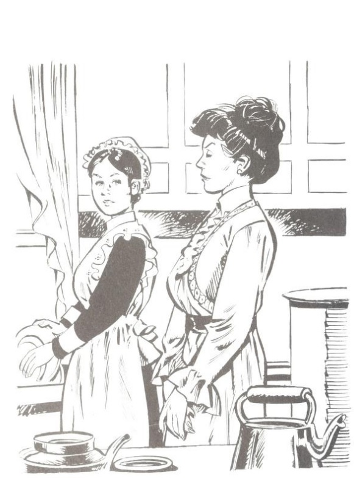

Extract from Chapter One: ‘Miss Polly’

Miss Polly Harrington entered her kitchen a little hurriedly this June morning. Miss Polly did not usually make hurried movements; she specially prided herself on her repose of manner. But to-day she was hurrying—actually hurrying.

Nancy, washing dishes at the sink, looked up in surprise. Nancy had been working in Miss Polly's kitchen only two months, but already she knew that her mistress did not usually hurry.

“Nancy!”

“Yes, ma'am.” Nancy answered cheerfully, but she still continued wiping the pitcher in her hand.

“Nancy,”—Miss Polly's voice was very stern now—“when I'm talking to you, I wish you to stop your work and listen to what I have to say.”

Nancy flushed miserably. She set the pitcher down at once, with the cloth still about it, thereby nearly tipping it over—which did not add to her composure.

“Yes, ma'am; I will, ma'am,” she stammered, righting the pitcher, and turning hastily. “I was only keepin' on with my work 'cause you specially told me this mornin' ter hurry with my dishes, ye know.”

Her mistress frowned.

“That will do, Nancy. I did not ask for explanations. I asked for your attention.”

“Yes, ma'am.” Nancy stifled a sigh. She was wondering if ever in any way she could please this woman. Nancy had never “worked out” before; but a sick mother suddenly widowed and left with three younger children besides Nancy herself, had forced the girl into doing something toward their support, and she had been so pleased when she found a place in the kitchen of the great house on the hill—Nancy had come from “The Corners,” six miles away, and she knew Miss Polly Harrington only as the mistress of the old Harrington homestead, and one of the wealthiest residents of the town. That was two months before. She knew Miss Polly now as a stern, severe-faced woman who frowned if a knife clattered to the floor, or if a door banged—but who never thought to smile even when knives and doors were still.

“When you've finished your morning work, Nancy,” Miss Polly was saying now, “you may clear the little room at the head of the stairs in the attic, and make up the cot bed. Sweep the room and clean it, of course, after you clear out the trunks and boxes.”

“Yes, ma'am. And where shall I put the things, please, that I take out?”

“In the front attic.” Miss Polly hesitated, then went on: “I suppose I may as well tell you now, Nancy. My niece, Miss Pollyanna Whittier, is coming to live with me. She is eleven years old, and will sleep in that room.”

“A little girl—coming here, Miss Harrington? Oh, won't that be nice!” cried Nancy, thinking of the sunshine her own little sisters made in the home at “The Corners.”

“Nice? Well, that isn't exactly the word I should use,” rejoined Miss Polly, stiffly. “However, I intend to make the best of it, of course. I am a good woman, I hope; and I know my duty.”

Nancy colored hotly.

“Of course, ma'am; it was only that I thought a little girl here might—might brighten things up for you,” she faltered.

“Thank you,” rejoined the lady, dryly. “I can't say, however, that I see any immediate need for that.”

“But, of course, you—you'd want her, your sister's child,” ventured Nancy, vaguely feeling that somehow she must prepare a welcome for this lonely little stranger.

Miss Polly lifted her chin haughtily.

“Well, really, Nancy, just because I happened to have a sister who was silly enough to marry and bring unnecessary children into a world that was already quite full enough, I can't see how I should particularly WANT to have the care of them myself. However, as I said before, I hope I know my duty. See that you clean the corners, Nancy,” she finished sharply, as she left the room.

“Yes, ma'am,” sighed Nancy, picking up the half-dried pitcher—now so cold it must be rinsed again.

Extract from Chapter Four: ‘The Little Attic Room’

Miss Polly Harrington did not rise to meet her niece. She looked up from her book, it is true, as Nancy and the little girl appeared in the sitting-room doorway, and she held out a hand with “duty” written large on every coldly extended finger.

“How do you do, Pollyanna? I—” She had no chance to say more. Pollyanna had fairly flown across the room and flung herself into her aunt's scandalized, unyielding lap.

“Oh, Aunt Polly, Aunt Polly, I don't know how to be glad enough that you let me come to live with you,” she was sobbing. “You don't know how perfectly lovely it is to have you and Nancy and all this after you've had just the Ladies' Aid!”

“Very likely—though I've not had the pleasure of the Ladies' Aid's acquaintance,” rejoined Miss Polly, stiffly, trying to unclasp the small, clinging fingers, and turning frowning eyes on Nancy in the doorway. “Nancy, that will do. You may go. Pollyanna, be good enough, please, to stand erect in a proper manner. I don't know yet what you look like.”

Pollyanna drew back at once, laughing a little hysterically.

“No, I suppose you don't; but you see I'm not very much to look at, anyway, on account of the freckles. Oh, and I ought to explain about the red gingham and the black velvet basque with white spots on the elbows. I told Nancy how father said—”

“Yes; well, never mind now what your father said,” interrupted Miss Polly, crisply. “You had a trunk, I presume?”

“Oh, yes, indeed, Aunt Polly. I've got a beautiful trunk that the Ladies' Aid gave me. I haven't got so very much in it—of my own, I mean. The barrels haven't had many clothes for little girls in them lately; but there were all father's books, and Mrs. White said she thought I ought to have those. You see, father—”

“Pollyanna,” interrupted her aunt again, sharply, “there is one thing that might just as well be understood right away at once; and that is, I do not care to have you keep talking of your father to me.”

The little girl drew in her breath tremulously.

“Why, Aunt Polly, you—you mean—” She hesitated, and her aunt filled the pause.

“We will go up-stairs to your room. Your trunk is already there, I presume. I told Timothy to take it up—if you had one. You may follow me, Pollyanna.”

Without speaking, Pollyanna turned and followed her aunt from the room. Her eyes were brimming with tears, but her chin was bravely high.

“After all, I—I reckon I'm glad she doesn't want me to talk about father,” Pollyanna was thinking. “It'll be easier, maybe—if I don't talk about him. Probably, anyhow, that is why she told me not to talk about him.” And Pollyanna, convinced anew of her aunt's “kindness,” blinked off the tears and looked eagerly about her.

She was on the stairway now. Just ahead, her aunt's black silk skirt rustled luxuriously. Behind her an open door allowed a glimpse of soft-tinted rugs and satin-covered chairs. Beneath her feet a marvellous carpet was like green moss to the tread. On every side the gilt of picture frames or the glint of sunlight through the filmy mesh of lace curtains flashed in her eyes.

“Oh, Aunt Polly, Aunt Polly,” breathed the little girl, rapturously; “what a perfectly lovely, lovely house! How awfully glad you must be you're so rich!”

“PollyANNA!” ejaculated her aunt, turning sharply about as she reached the head of the stairs. “I'm surprised at you—making a speech like that to me!”

“Why, Aunt Polly, AREN'T you?” queried Pollyanna, in frank wonder.

“Certainly not, Pollyanna. I hope I could not so far forget myself as to be sinfully proud of any gift the Lord has seen fit to bestow upon me,” declared the lady; “certainly not, of RICHES!”

Miss Polly turned and walked down the hall toward the attic stairway door. She was glad, now, that she had put the child in the attic room. Her idea at first had been to get her niece as far away as possible from herself, and at the same time place her where her childish heedlessness would not destroy valuable furnishings. Now—with this evident strain of vanity showing thus early—it was all the more fortunate that the room planned for her was plain and sensible, thought Miss Polly.

Eagerly Pollyanna's small feet pattered behind her aunt. Still more eagerly her big blue eyes tried to look in all directions at once, that no thing of beauty or interest in this wonderful house might be passed unseen. Most eagerly of all her mind turned to the wondrously exciting problem about to be solved: behind which of all these fascinating doors was waiting now her room—the dear, beautiful room full of curtains, rugs, and pictures, that was to be her very own? Then, abruptly, her aunt opened a door and ascended another stairway.

There was little to be seen here. A bare wall rose on either side. At the top of the stairs, wide reaches of shadowy space led to far corners where the roof came almost down to the floor, and where were stacked innumerable trunks and boxes. It was hot and stifling, too. Unconsciously Pollyanna lifted her head higher—it seemed so hard to breathe. Then she saw that her aunt had thrown open a door at the right.

“There, Pollyanna, here is your room, and your trunk is here, I see. Have you your key?”

Pollyanna nodded dumbly. Her eyes were a little wide and frightened.

Her aunt frowned.

“When I ask a question, Pollyanna, I prefer that you should answer aloud, not merely with your head.”

“Yes, Aunt Polly.”

“Thank you; that is better. I believe you have everything that you need here,” she added, glancing at the well-filled towel rack and water pitcher. “I will send Nancy up to help you unpack. Supper is at six o'clock,” she finished, as she left the room and swept down-stairs.

For a moment after she had gone Pollyanna stood quite still, looking after her. Then she turned her wide eyes to the bare wall, the bare floor, the bare windows. She turned them last to the little trunk that had stood not so long before in her own little room in the far-away Western home. The next moment she stumbled blindly toward it and fell on her knees at its side, covering her face with her hands.

Nancy found her there when she came up a few minutes later.

“There, there, you poor lamb,” she crooned, dropping to the floor and drawing the little girl into her arms. “I was just a-fearin’ I'd find you like this, like this.”

Pollyanna shook her head.

“But I'm bad and wicked, Nancy—awful wicked,” she sobbed. “I just can't make myself understand that God and the angels needed my father more than I did.”

“No more they did, neither,” declared Nancy, stoutly.

“Oh-h!—NANCY!” The burning horror in Pollyanna's eyes dried the tears.

Nancy gave a shamefaced smile and rubbed her own eyes vigorously.

“There, there, child, I didn't mean it, of course,” she cried briskly. “Come, let's have your key and we'll get inside this trunk and take out your dresses in no time, no time.”

Somewhat tearfully Pollyanna produced the key.

“There aren't very many there, anyway,” she faltered.

“Then they're all the sooner unpacked,” declared Nancy.

Pollyanna gave a sudden radiant smile.

“That's so! I can be glad of that, can't I?” she cried.

Nancy stared.

“Why, of—course,” she answered, a little uncertainly.

Nancy's capable hands made short work of unpacking the books, the patched undergarments, and the few pitifully unattractive dresses. Pollyanna, smiling bravely now, flew about, hanging the dresses in the closet, stacking the books on the table, and putting away the undergarments in the bureau drawers.

“I'm sure it—it's going to be a very nice room. Don't you think so?” she stammered, after a while.

There was no answer. Nancy was very busy, apparently, with her head in the trunk. Pollyanna, standing at the bureau, gazed a little wistfully at the bare wall above.

“And I can be glad there isn't any looking-glass here, too, 'cause where there ISN'T any glass, I can't see my freckles.”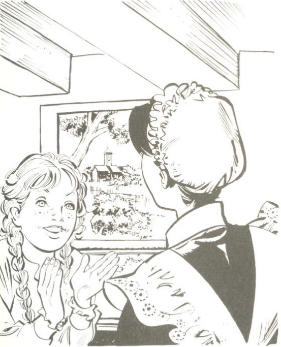

Nancy made a sudden queer little sound with her mouth—but when Pollyanna turned, her head was in the trunk again. At one of the windows, a few minutes later, Pollyanna gave a glad cry and clapped her hands joyously.

“Oh, Nancy, I hadn't seen this before,” she breathed. “Look—'way off there, with those trees and the houses and that lovely church spire, and the river shining just like silver. Why, Nancy, there doesn't anybody need any pictures with that to look at. Oh, I'm so glad now she let me have this room!”

To Pollyanna's surprise and dismay, Nancy burst into tears. Pollyanna hurriedly crossed to her side.

“Why, Nancy, Nancy—what is it?” she cried; then, fearfully: “This wasn't—YOUR room, was it?”

“My room!” stormed Nancy, hotly, choking back the tears. “If you ain't a little angel straight from Heaven, and if some folks don't eat dirt before—Oh, land! there's her bell!” After which amazing speech, Nancy sprang to her feet, dashed out of the room, and went clattering down the stairs.

Left alone, Pollyanna went back to her “picture,” as she mentally designated the beautiful view from the window. After a time she touched the sash tentatively. It seemed as if no longer could she endure the stifling heat. To her joy the sash moved under her fingers. The next moment the window was wide open, and Pollyanna was leaning far out, drinking in the fresh, sweet air.

Questions on Pollyanna (1913) by Eleanor H. Porter

1\. Miss Polly demands that Nancy stop drying the dish because:

A. Nancy does not pay enough attention to her.

B. Nancy needs to learn to obey orders better.

C. Miss Polly is capricious and tyrannical.

D. Nancy does not follow her instructions very well.

2\. When Pollyanna arrives, Miss Polly stays in her chair because:

A. She is cold and unwelcoming.

B. She is rather old and stiff.

C. She wants to get a better look at Pollyanna.

D. Pollyanna immediately embraces her.

3\. Pollyanna’s reaction to being shown her attic room is that:

A. She immediately finds its good qualities.

B. She is disappointed, but later finds reasons to be grateful.

C. She compares it resentfully to the luxury of the other rooms.

D. She hoped to be put in a beautiful room with pictures.

Nonfiction Writing

Write an article explaining why gratitude is so important to being happy.

You could use this structure:

## 54. The Railway Children (1905)

| Paragraph | Suggested Vocabulary |
| --- | --- |
| Introduction: Gratitude is one of the most important ingredients for a happy life.  | complain, resent, annoyed, cheerful, grateful, attitude, appreciation |
| Paragraph One: Gratitude can transform family life.  | brothers, sisters, parents, irritation, struggle, difficulties, good points |
| Paragraph Two: Gratitude can transform your studies.  | knowledge, gift, struggle, satisfaction, teachers, work, help, support |
| Paragraph Three: Gratitude can transform your friendships.  | arguments, difficulties, faults, broken, mended, qualities  |
| Conclusion: By applying the principle of gratitude, your life can be so much happier, and you can bring happiness to others. | goodness, joy, spread, example, inspiration |

The Railway Children (1905) by E. Nesbit (1858-1924)

This novel tells the story of a very happy family who suddenly lose their comfortable life when their father is mysteriously taken away. They have to leave their spacious house in London and move into a cramped cottage in the countryside. In their difficult circumstances, they become fascinated by the railway which runs near their house, and their new interest leads to some surprising results.

From Chapter One: ‘The Beginning of Things’

They were not railway children to begin with. I don't suppose they had ever thought about railways except as a means of getting to Maskelyne and Cook's, the Pantomime, Zoological Gardens, and Madame Tussaud's. They were just ordinary suburban children, and they lived with their Father and Mother in an ordinary red-brick-fronted villa, with coloured glass in the front door, a tiled passage that was called a hall, a bath-room with hot and cold water, electric bells, French windows, and a good deal of white paint, and 'every modern convenience', as the house-agents say.

There were three of them. Roberta was the eldest. Of course, Mothers never have favourites, but if their Mother HAD had a favourite, it might have been Roberta. Next came Peter, who wished to be an Engineer when he grew up; and the youngest was Phyllis, who meant extremely well.

Mother did not spend all her time in paying dull calls to dull ladies, and sitting dully at home waiting for dull ladies to pay calls to her. She was almost always there, ready to play with the children, and read to them, and help them to do their home-lessons. Besides this she used to write stories for them while they were at school, and read them aloud after tea, and she always made up funny pieces of poetry for their birthdays and for other great occasions, such as the christening of the new kittens, or the refurnishing of the doll's house, or the time when they were getting over the mumps.

These three lucky children always had everything they needed: pretty clothes, good fires, a lovely nursery with heaps of toys, and a Mother Goose wall-paper. They had a kind and merry nursemaid, and a dog who was called James, and who was their very own. They also had a Father who was just perfect—never cross, never unjust, and always ready for a game—at least, if at any time he was NOT ready, he always had an excellent reason for it, and explained the reason to the children so interestingly and funnily that they felt sure he couldn't help himself.

You will think that they ought to have been very happy. And so they were, but they did not know HOW happy till the pretty life in the Red Villa was over and done with, and they had to live a very different life indeed.

The dreadful change came quite suddenly.

Peter had a birthday—his tenth. Among his other presents was a model engine more perfect than you could ever have dreamed of. The other presents were full of charm, but the Engine was fuller of charm than any of the others were.

Its charm lasted in its full perfection for exactly three days. Then, owing either to Peter's inexperience or Phyllis's good intentions, which had been rather pressing, or to some other cause, the Engine suddenly went off with a bang. James was so frightened that he went out and did not come back all day. All the Noah's Ark people who were in the tender were broken to bits, but nothing else was hurt except the poor little engine and the feelings of Peter. The others said he cried over it—but of course boys of ten do not cry, however terrible the tragedies may be which darken their lot. He said that his eyes were red because he had a cold.

\[ . . . \]

Father had been away in the country for three or four days. All Peter's hopes for the curing of his afflicted Engine were now fixed on his Father, for Father was most wonderfully clever with his fingers. He could mend all sorts of things. He had often acted as veterinary surgeon to the wooden rocking-horse; once he had saved its life when all human aid was despaired of, and the poor creature was given up for lost, and even the carpenter said he didn't see his way to do anything. And it was Father who mended the doll's cradle when no one else could; and with a little glue and some bits of wood and a pen-knife made all the Noah's Ark beasts as strong on their pins as ever they were, if not stronger.

Peter, with heroic unselfishness, did not say anything about his Engine till after Father had had his dinner and his after-dinner cigar. The unselfishness was Mother's idea—but it was Peter who carried it out. And needed a good deal of patience, too.

At last Mother said to Father, “Now, dear, if you're quite rested, and quite comfy, we want to tell you about the great railway accident, and ask your advice.”

“All right,” said Father, “fire away!”

So then Peter told the sad tale, and fetched what was left of the Engine.

“Hum,” said Father, when he had looked the Engine over very carefully.

The children held their breaths.

“Is there NO hope?” said Peter, in a low, unsteady voice.

“Hope? Rather! Tons of it,” said Father, cheerfully; “but it'll want something besides hope—a bit of brazing say, or some solder, and a new valve. I think we'd better keep it for a rainy day. In other words, I'll give up Saturday afternoon to it, and you shall all help me.”

\[ . . . \]

Just then there was a knock at the front door.

“Who on earth!” said Father. “An Englishman's house is his castle, of course, but I do wish they built semi-detached villas with moats and drawbridges.”

Ruth—she was the parlour-maid and had red hair—came in and said that two gentlemen wanted to see the master.

“I've shown them into the Library, Sir,” said she.

“I expect it's the subscription to the Vicar's testimonial,” said Mother, “or else it's the choir holiday fund. Get rid of them quickly, dear. It does break up an evening so, and it's nearly the children's bedtime.”

But Father did not seem to be able to get rid of the gentlemen at all quickly.

“I wish we HAD got a moat and drawbridge,” said Roberta; “then, when we didn't want people, we could just pull up the drawbridge and no one else could get in. I expect Father will have forgotten about when he was a boy if they stay much longer.”

Mother tried to make the time pass by telling them a new fairy story about a Princess with green eyes, but it was difficult because they could hear the voices of Father and the gentlemen in the Library, and Father's voice sounded louder and different to the voice he generally used to people who came about testimonials and holiday funds.

Then the Library bell rang, and everyone heaved a breath of relief.

“They're going now,” said Phyllis; “he's rung to have them shown out.”

But instead of showing anybody out, Ruth showed herself in, and she looked queer, the children thought.

“Please'm,” she said, “the Master wants you to just step into the study. He looks like the dead, mum; I think he's had bad news. You'd best prepare yourself for the worst, 'm—p'raps it's a death in the family or a bank busted or—”

“That'll do, Ruth,” said Mother gently; “you can go.”

Then Mother went into the Library. There was more talking. Then the bell rang again, and Ruth fetched a cab. The children heard boots go out and down the steps. The cab drove away, and the front door shut. Then Mother came in. Her dear face was as white as her lace collar, and her eyes looked very big and shining. Her mouth looked like just a line of pale red—her lips were thin and not their proper shape at all.

“It's bedtime,” she said. “Ruth will put you to bed.”

“But you promised we should sit up late tonight because Father's come home,” said Phyllis.

“Father's been called away—on business,” said Mother. “Come, darlings, go at once.”

They kissed her and went. Roberta lingered to give Mother an extra hug and to whisper:

“It wasn't bad news, Mammy, was it? Is anyone dead—or—”

“Nobody's dead—no,” said Mother, and she almost seemed to push Roberta away. “I can't tell you anything tonight, my pet. Go, dear, go NOW.”

So Roberta went.

Ruth brushed the girls' hair and helped them to undress. (Mother almost always did this herself.) When she had turned down the gas and left them she found Peter, still dressed, waiting on the stairs.

“I say, Ruth, what's up?” he asked.

“Don't ask me no questions and I won't tell you no lies,” the red-headed Ruth replied. “You'll know soon enough.”

Late that night Mother came up and kissed all three children as they lay asleep. But Roberta was the only one whom the kiss woke, and she lay mousey-still, and said nothing.

“If Mother doesn't want us to know she's been crying,” she said to herself as she heard through the dark the catching of her Mother's breath, “we WON'T know it. That's all.”

When they came down to breakfast the next morning, Mother had already gone out.

“To London,” Ruth said, and left them to their breakfast.

“There's something awful the matter,” said Peter, breaking his egg. “Ruth told me last night we should know soon enough.”

“Did you ASK her?” said Roberta, with scorn.

“Yes, I did!” said Peter, angrily. “If you could go to bed without caring whether Mother was worried or not, I couldn't. So there.”

“I don't think we ought to ask the servants things Mother doesn't tell us,” said Roberta.

“That's right, Miss Goody-goody,” said Peter, “preach away.”

“I'M not goody,” said Phyllis, “but I think Bobbie's right this time.”

“Of course. She always is. In her own opinion,” said Peter.

“Oh, DON'T!” cried Roberta, putting down her egg-spoon; “don't let's be horrid to each other. I'm sure some dire calamity is happening. Don't let's make it worse!”

“Who began, I should like to know?” said Peter.

Roberta made an effort, and answered:—

“I did, I suppose, but—”

“Well, then,” said Peter, triumphantly. But before he went to school he thumped his sister between the shoulders and told her to cheer up.

The children came home to one o'clock dinner, but Mother was not there. And she was not there at tea-time.

It was nearly seven before she came in, looking so ill and tired that the children felt they could not ask her any questions. She sank into an arm-chair. Phyllis took the long pins out of her hat, while Roberta took off her gloves, and Peter unfastened her walking-shoes and fetched her soft velvety slippers for her.

When she had had a cup of tea, and Roberta had put eau-de-Cologne on her poor head that ached, Mother said:—

“Now, my darlings, I want to tell you something. Those men last night did bring very bad news, and Father will be away for some time. I am very worried about it, and I want you all to help me, and not to make things harder for me.”

“As if we would!” said Roberta, holding Mother's hand against her face.

“You can help me very much,” said Mother, “by being good and happy and not quarrelling when I'm away”—Roberta and Peter exchanged guilty glances—“for I shall have to be away a good deal.”

“We won't quarrel. Indeed we won't,” said everybody. And meant it, too.

“Then,” Mother went on, “I want you not to ask me any questions about this trouble; and not to ask anybody else any questions.”

Peter cringed and shuffled his boots on the carpet.

“You'll promise this, too, won't you?” said Mother.

“I did ask Ruth,” said Peter, suddenly. “I'm very sorry, but I did.”

“And what did she say?”

“She said I should know soon enough.”

“It isn't necessary for you to know anything about it,” said Mother; “it's about business, and you never do understand business, do you?”

“No,” said Roberta; “is it something to do with Government?” For Father was in a Government Office.

“Yes,” said Mother. “Now it's bed-time, my darlings. And don't YOU worry. It'll all come right in the end.”

“Then don't YOU worry either, Mother,” said Phyllis, “and we'll all be as good as gold.”

Mother sighed and kissed them.

“We'll begin being good the first thing tomorrow morning,” said Peter, as they went upstairs.

“Why not NOW?” said Roberta.

“There's nothing to be good ABOUT now, silly,” said Peter.

“We might begin to try to FEEL good,” said Phyllis, “and not call names.”

“Who's calling names?” said Peter. “Bobbie knows right enough that when I say 'silly', it's just the same as if I said Bobbie.”

“WELL,” said Roberta.

“No, I don't mean what you mean. I mean it's just a—what is it Father calls it?—a germ of endearment! Good night.”

The girls folded up their clothes with more than usual neatness—which was the only way of being good that they could think of.

“I say,” said Phyllis, smoothing out her pinafore, “you used to say it was so dull—nothing happening, like in books. Now something HAS happened.”

“I never wanted things to happen to make Mother unhappy,” said Roberta. “Everything's perfectly horrid.”

Everything continued to be perfectly horrid for some weeks.

\[ . . . \]

One day when Peter had made a booby trap over the bath-room door, and it had acted beautifully as Ruth passed through, that red-haired parlour-maid caught him and boxed his ears.

“You'll come to a bad end,” she said furiously, “you nasty little limb, you! If you don't mend your ways, you'll go where your precious Father's gone, so I tell you straight!”

Questions on The Railway Children (1905) by E. Nesbit (1858-1924)

1\. Peter feels ashamed of himself when speaking to his mother mainly because:

A. He called Roberta names.

B. He argued with his siblings.

C. He asked a servant about their father.

D. He was not able to mend his toy engine.

2\. When the children’s father goes away, their mother:

A. Explains to them what has happened to him.

B. Tries to avoid speaking about why he has gone.

C. Will not speak to the children at all.

D. Arranges everything so that they hardly notice his absence.

Fiction Writing

Write a story about a child or children who experience a sudden change of circumstances.

You could use this structure:

| Paragraph | Suggested Vocabulary |
| --- | --- |
| Paragraph One: The children had such a happy life. | caring, loving, attention, stories, games |
| Paragraph Two: Then one day, everything changed. | police, arrested, shock, fear, loneliness |
| Paragraph Three: John, the eldest, took charge of the situation. | relatives, distant, hope, letter, waiting, answer |
| Paragraph Four: They faced a difficult journey to reach their relatives. | train, station, crowded, policemen, anxious |
| Paragraph Five: They had finally found a refuge, but what of their parents? | strange, accents, landscape, unfamiliar |
| Paragraph Six: They had almost given up hope when the good news finally arrived. | released, joy, reunion, together |

## 55. ‘Ozymandias’ (1818)

‘Ozymandias’ (1818)

by Percy Bysshe Shelley (1792-1822)

I met a traveller from an antique land

Who said: Two vast and trunkless legs of stone

Stand in the desert. Near them on the sand,

Half sunk, a shatter’d visage lies, whose frown

And wrinkled lip and sneer of cold command            5

Tell that its sculptor well those passions read

Which yet survive, stamp’d on these lifeless things,

The hand that mock’d them and the heart that fed;

And on the pedestal these words appear:

‘My name is Ozymandias, king of kings:            10

Look on my works, ye Mighty, and despair!’

Nothing beside remains. Round the decay

Of that colossal wreck, boundless and bare,

The lone and level sands stretch far away.

Glossary

‘Ozymandias’ - a Greek version of the name of the Egyptian Pharaoh Ramesses II

‘antique’ - ancient

‘trunkless’ - missing the body (trunk)

‘visage’ - face

‘pedestal’ - statue base

Summary

The poet hears a description of a ruined statue that stands in the middle of a desert. The inscription underneath the statue, and the expression on its face, indicate the hubris (foolish pride) of the king it depicts. He evidently believed that his works would last forever, but now this ruined fragment is all that remains of them. The poem ends with a description of the emptiness which stretches around the ‘colossal wreck’.

## 56. ‘Storm on the Island’ (1966)

‘Storm on the Island’ (1966) by Seamus Heaney (1939-2013)

We are prepared: we build our houses squat,

Sink walls in rock and roof them with good slate.

This wizened earth has never troubled us

With hay, so as you see, there are no stacks

Or stooks that can be lost. Nor are there trees        5

Which might prove company when it blows full

Blast: you know what I mean - leaves and branches

Can raise a tragic chorus in a gale

So that you can listen to the thing you fear

Forgetting that it pummels your house too.            10

But there are no trees, no natural shelter.

You might think that the sea is company,

Exploding comfortably down on the cliffs

But no: when it begins, the flung spray hits

The very windows, spits like a tame cat            15

Turned savage. We just sit tight while wind dives

And strafes invisibly. Space is a salvo.

We are bombarded by the empty air.

Strange, it is a huge nothing that we fear.

Glossary

‘squat’ - low and solid

‘wizened’ - hard and weatherbeaten

‘stooks’ - bundled hay

‘strafes’ - sprays with bullets (here, this is metaphorical)

‘salvo’ - series of gunshots (again, this is metaphorical)

Summary

The speaker lives on an island which is frequently battered by storms. He describes how there is no natural shelter. Nature appears to be an opponent against whom the islanders must fight.

Context

The Irish writer Seamus Heaney was one of the greatest poets of recent times. He won the Nobel Prize for literature in 1995. This poem is taken from the collection Death of a Naturalist (1966), which focuses on the Northern Irish rural landscape where Heaney grew up. The violence of the natural world in this poem may be an allegory for the political violence which was going on in Northern Ireland at the time it was written. The ‘empty’ air which does so much damage could be a reference to the political ideas which inspire people to violent action.

Questions on ‘Ozymandias’ (1818) by Percy Bysshe Shelley (1792-1822)

1\. At the end of the poem, Shelley mainly focuses on how Ozymandias is:

A. Still standing proudly in the desert, despite the passing of time.

B. Ironically proclaiming the greatness of his works.

C. Commanding his slaves to build great monuments.

D. An Ancient Egyptian Pharaoh with huge power.

2\. The expression on the face of Ozymandias shows that the sculptor:

A. Was so afraid of Ozymandias that he did what he was ordered.

B. Did not understand Ozymandias’ real character.

C. Was able to use his skill to satirise Ozymandias.

D. Wanted to create the most impressive statue he could.

Question on ‘Storm on the Island’ (1966) by Seamus Heaney (1939-2013)

By the end of the poem, Heaney has mainly shown that the people on the island are:

A. Defeated by the power of the storm.

B. Aware that their island will be battered by violent storms.

C. Proud of the strong houses that they build.

D. Able to withstand the power of nature.

Nonfiction Writing

Write an article describing one or more ways in which you could leave a lasting legacy. Possibilities include: by raising children, by creating works of art, by living charitably.

You could structure your article like this:

| Paragraph | Suggested Vocabulary |
| --- | --- |
| Introduction: Set out your overall argument. When you reach old age, what do you think you will value most about your life? | house, possession, career, satisfied |
| Paragraph One: Give one example backing up your overall argument. Often people believe that they should focus entirely on their careers, but aren’t there more important things in life? | short, retired, money, relationships |
| Paragraph Two: Give another example backing up your overall argument. Is piling up money and property the best way of making a lasting impact on the world? | family, children, grandchildren, remembered |
| Paragraph Three: Give a third example backing up your overall argument. Life is more about what you give than what you get. | others, selfish, lonely, generosity |
| Conclusion: Sum up your argument. It’s time to rethink our priorities. | commercial, latest gadget, fleeting, lasting, future |

Example Article

True Happiness Comes from Living for Others

When you reach old age, what do you think you will value most about your life? Do you think that you will be satisfied with the money you piled up? With the house you bought? With the career that by then will be over? Will any of these things truly leave a lasting legacy?

Often people believe that they should focus entirely on their careers, but aren’t there more important things in life? Your career lasts a few decades, then it’s over, and you are retired. Did you make any lasting impact? Or was it just a convenient way of making money? Surely a far more important aspect of your life is the relationships that you have, especially those with your family. If you dedicated yourself to your career, but did not spend enough time with your children, you are likely to regret it when you reach old age.

Instead of focusing on piling up money and building up professional prestige, I would argue that the best use of your time would be to build a strong family, so that you can pass onto the next generation what you have received. Then, when you reach old age, you will be able to look on your children and your grandchildren, and know that you have created something that will go forward into the future. You will know that you will be remembered, not as a selfish person who only cared about your own honour, wealth and reputation, but as a generous person who wanted to give life and love to others.

Life is more about what you give than what you get. True happiness comes from a focus on others, because if you are generous to other people, especially to your family, you will create something much bigger than yourself. You will never suffer from loneliness. It is a terrible fact that many people in today’s selfish world end their lives lonely, and even die alone, their deaths unnoticed and unwept, because they devoted themselves purely to selfish goals. Don’t let this happen to you! Build for others, and focus on what you can give!

It’s time to rethink our priorities. The commercial world screams at us that we should ‘spoil ourselves’ and endlessly chase after the latest material possession - the latest car, the latest gadget, the most glamorous vacation destination. But these are all fleeting pleasures that will not bring lasting happiness, and will leave nothing behind for future generations. Live a life that you won’t regret - live a life for others.

Example from a Student

When you reach old age, what do you think you will value most about your life? I think making things that help people and make them happy will be of the most value.

For example, Thomas Edison invented the electric light. It is useful to do things at night and is safer than using a candle. He created something which has benefited countless people through the centuries.

Another example is the Nobel Prize which was created by Alfred Bernhard Nobel. He tried to make the world a better place by celebrating people's achievements. This has improved the world by encouraging scientists and artists to create beautiful and useful things, and politicians to work for peace.

It’s time to rethink our priorities. What if we thought about spreading happiness to people all around the world instead of only thinking of our personal happiness. That way, we could use our lives for something that would truly last.

## 57. The Wool-Pack (1951)

Extract from The Wool-Pack (1951) by Cynthia Harnett (1893-1981)

Note: published in the USA as Nicholas and the Wool-Pack, and later as The Merchant’s Mark

The hero of this novel is Nicholas Fetterlock, who is the son of a wool merchant in late fifteenth-century England. He lives in Burford, a town in the Cotswolds, which is a range of hills in western England. Although he is supposed to be training to be a merchant like his father, Nicholas spends as much time as he can out in the fields among the sheep.

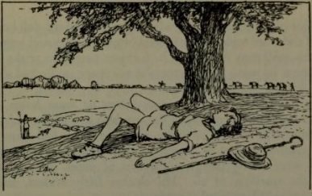

Chapter One: ‘Along the Skyline’

Nicholas Fetterlock lay on his back on the hill-side, gazing up into the young leaves of an oak-tree.

He was hot and dirty, and it was good to stretch his full length in the shade. All round him from hills far and near came the bleating of sheep—the high anxious cry of lambs and the deeper reassuring answer of the ewes. Farther away he could hear the voices of the village children. They were wool-gathering down near the river, collecting every fragment of fleece that the sheep had left caught on hedges and bushes. Presently they would take it home to their mothers who would wash it and spin it and make it into warm garments for the winter.

Since early morning Nicholas had been helping with the sheep-washing. It was fun pushing the silly sheep, one by one off the plank into the river and with long poles making them swim some way down stream before they were allowed to scramble out on to clean pasture. He liked working with the men, Giles the shepherd, and Colin, and Tom, and above all with Hal, the shepherd's son, who was his best friend.

At this moment however he was deliberately keeping out of sight. He had played truant from a lesson which he detested. He ought to have washed and dressed and presented himself at the office of his father's factor who taught him all the dull business side of the wool trade. But instead of going, clean and prepared, with his quill pens sharpened, he had just peeped in at the door, all dirty as he was. The factor was not there, so he had slipped away, back to the sheep again.

There would be trouble, too, when he went home. His mother would be angry when she saw him in a herdsman's tunic with bare legs, instead of in his proper doublet and hose. To make matters worse, he smelt; he was quite well aware of it. Sheep were smelly things at the best of times, but wet sheep were the smelliest of all. His clothes fairly reeked, and his mother would be bound to notice it.

It would make no difference to her that the sheep belonged to his father, who was one of the richest wool merchants in the Cotswolds. Did not his father keep a shepherd and endless labourers to do the dirty work? she would inquire. Then with an air of disgust, she would sniff at her perfume ball and send him away to change his clothes.

But, with any luck, the storm would not last. It would all be forgotten tomorrow when his father arrived home from Calais, where he had been attending a meeting of the Staple. The wool trade, England's most important industry, was governed by three hundred leading wool merchants, known as the Fellowship of Merchants of the Wool Staple, and it was at Calais that they had their headquarters. Nicholas was not sure what happened at these meetings, to which his father journeyed several times a year, but he knew that the Staple fixed all the prices of wool and made endless strict rules which had to be obeyed by everyone who took part in the trade. It was a fine thing to be a merchant of the Staple, and here in the Cotswolds, where everyone made a living out of sheep, his father was counted a very great man. He did not only buy and sell wool grown by other people, as many other wool traders did; but he kept large flocks of his own on the rolling hills. He had built a fine stone house on the outskirts of the little town of Burford, and some day Nicholas would follow in his footsteps and become a merchant of the Staple too.

Lying comfortably in the shade Nicholas was beginning to get drowsy when he was disturbed by the shrill notes of a reed pipe. That was Hal, giving orders to his dogs. Nicholas sat up and looked about him. The sheep had moved up the hill, and were now grazing quite nearby. Among them, facing the other way, stood Hal, busy with his shepherd's pipe.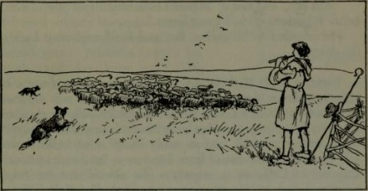

Nicholas hallooed through his hands. Hal looked round and started up the slope with his long rolling stride. He was a big lanky fellow, half a head taller than Nicholas, though there was only a month or two between them. His hood was pushed back, and his plain good-tempered face was burned to the colour of copper.

'I didn't know you were here, master,' he called. 'I thought you'd gone to your lesson with Master Leach.'

Nicholas frowned. It gave him a shock when Hal addressed him as 'master.' It was something quite new, evidently an order to Hal from his father the shepherd, and it was a reminder that they were both growing up. From babyhood they had been like brothers, for Hal's mother had been Nicholas's nurse.

'Master Leach was out,' said Nicholas briefly. 'I went to his counting-house, but he wasn't there. I didn't wait long, you can stake your life.’

Master Leach the factor—or wool-packer, as was his proper title—was a cold sour man, and both the boys, in common with everyone else, disliked him heartily.

Hal grinned. 'I saw him by the river an hour since,' he said, 'but he's gone back now. He went towards the town. It's lucky that you did not meet him.'

'I'll stay here,' Nicholas decided. 'He won't be likely to come this way. What are you doing? I heard you signal to the dogs "Go, seek, go seek".’

'I'm gathering the ewes,' Hal explained. 'I want to count them all tonight and pen them safely. Then they'll be ready for the washing in the morning. The sooner the washing's done, the sooner the shearing will begin. The shearing supper is going to be a grand one this year.' He smacked his lips, rolled his eyes, and rubbed his middle, to indicate the joys of the feast. Nicholas laughed. Hal made such comic faces; he ought to have been a mountebank at a fair. 'Shall I come and help?' he offered.

'Best not,' said Hal. 'Master Leach might spot you. You'd better stay there till he's gone home.'

He whistled to his collies, Fan and Rolf, and went back to the sheep.

Nothing loath, Nicholas lay down again. He was not a bit repentant about playing truant. All the stuff he was supposed to learn from Master Leach was so dreadfully dull. It consisted mostly of long lists, entered in ledgers, of so many bales of clipped wool, called 'sarplers', and so many sheep skins, called 'wool- fells', to be shipped abroad from London or Sandwich or Southampton, to Calais or to anywhere else abroad that the Staple permitted them to go. He was expected to know all the different grades of wool, their prices, and details of their packing.

These lessons were an extra, for he went every morning to the parson to study reading and writing and Latin grammar. He was willing enough to do that. He liked the parson; there were other boys in his class, and it was a condition of his remaining at home. Otherwise he would have been sent away as an apprentice to London, or else to school at some distant monastery. He was getting stiff, so he rolled over, and propping his chin on his hands, gazed up the hill.

The old drover's road ran along the ridge from Witney and Oxford in one direction, towards Northleach and far off Gloucester in the other. Against the sky he saw a long line of pack-horses pacing eastward, laden with bales of wool. Probably they were from Northleach, five miles away, where the big export merchants came to meet the local wool-men and bargain for the best of the famous 'fine Cotts'. Packhorses were the only means of carrying the wool, since the river Windrush was not suitable for barges; and this string of patient plodding animals might be going even as far as London.

Close at hand an old man with a stick goaded a reluctant ass up the grassy slope. That was hunch-back Hubert from Witney, a familiar figure who came every week to collect the yarn spun by the cottage women and carry it to the weavers to be made into blankets.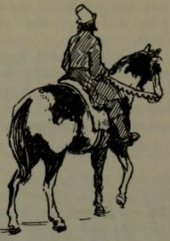

Suddenly, from behind a clump of trees, a solitary horseman came in sight—a tall figure mounted on a piebald horse. Nicholas caught his breath, and lay very still. The sunlight threw up so vividly the black and white patches on the horse that there could be no mistake. It was Master Simon Leach the wool-packer. Evidently he had given up any idea of Nicholas's lesson, locked his counting-house, and was going back to his home at Westwell a couple of miles away. Nicholas watched him as he crossed the road at the top of the hill and vanished down the other side. Then he gave a sigh of relief. As he had often been before, he was thankful for that piebald horse, so easily recognized from a distance. Now he could go home.

But as he sat up and stretched himself a distant gleam of light caught his eye. A little party of horsemen was approaching from the east. They were too far off for him to see what they were, but the glint could only come from the reflection of the sun on armour. There seemed to be about six of them, though only the last four were men-at-arms. Now who could be riding with an armed escort in these days? A few years ago, before the Wars of the Roses were ended, it would have been quite common to see soldiers in armour. But it was nearly eight years since the battle of Bosworth Field, where King Richard the Third had been killed, and King Henry Tudor had put on the crown, and nowadays everything was peaceful.

By this time the little procession was near enough to be seen clearly. In front rode two fine gentlemen, one tall and elegant on a big grey horse, the other small, dressed in black and slouched in the saddle. Behind them came four guards with steel caps and cuirasses, leading a laden baggage horse.

Nicholas decided that they were merchants, and wealthy ones, too. He noticed that a dog, a tall gazehound, trotted on leash beside the grey horse. They must certainly be people of importance to travel with such an array. He wondered for a moment who they were and where they were going.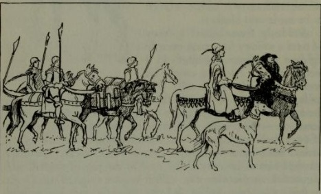

All at once, without a second's warning, chaos broke loose. The merchants' horses, which had been so quiet and well-behaved, suddenly reared. There was a stamping of hoofs, a jangle of harness, and sharp cries in a foreign tongue. Nicholas could not make out what had happened until he saw a small dark shadow come streaking like an arrow down the hill towards him. It was a hare, and after it, coursing with all the power of its supple body, came the merchant's gazehound.

Nicholas jumped to his feet, startling the hare. It doubled back, darted down the field and headed straight into the midst of the grazing flock, with the hound close behind it. Sheep stampeded in every direction. The hound lost sight of its quarry. It hesitated, and in the twinkling of an eye the collies were upon it, and all three dogs rolled over and over, biting and snarling in a savage fight.

Nicholas started to run towards them, but dodged just in time as, with a thunder of hoofs, the small man in black galloped by. Hal had rushed upon the scene, crook in hand, and now the horseman swept down upon them all, laying about him with his riding-whip. He lashed out savagely, raining blows indiscriminately, as much upon Hal as upon the dogs. Nicholas tore down the field shouting just as Hal darted out of range with the blood streaming down his face.

But the whip had done its work. The sheep dogs drew off and the gazehound freed itself; and, in obedience to the shrill note of a whistle, speeded back towards the top of the hill. Nicholas made a grab at Fan, who was yelping from the lash, while Rolf, starting after the hound but hopelessly outpaced, lay down panting.

The man on horseback trotted round in a circle and came back. His face was sallow and pock-marked, with little eyes that peered under heavy lids, and a large flabby mouth. A black fur-edged gown hung from his high shoulders, and he wore a wide black hat with a long feather.

He halted beside the boys, and looked from one to the other. 'Maybe your cur-dogs have learned a lesson,' he said in a clipped foreign voice. ‘Whose sheep are these that you are minding?'

Nicholas had gone white with anger. ‘They are my father's sheep,' he replied boldly, 'and my father is Master Thomas Fetterlock, of the Fellowship of the Staple, at your mastership's pleasure. Your dog attacked his sheep, and you have beaten his servant. He shall hear of it when he returns.'

Clearly the stranger was astonished. He looked the boy slowly up and down from head to foot, while Nicholas became more and more acutely aware that his face was dirty and his legs were bare. Then with an unpleasant leering smile, the man swept off his hat in a bow so exaggerated that Nicholas knew that it was done in mockery.

'I ask your pardon that I did not recognize your father's son,' he said pointedly. ‘The hound did but course a hare. It is unfortunate that he should have disturbed the sheep. But as it happens our meeting is apt. Let me present myself. On the hill yonder you see my lord Messer Antonio Bari of Florence, agent of the noble banking house of the Medici. I am his humble secretary. We are on our way to your worshipful father's house, to sup with him.'

Once again he bowed low, as though to someone of importance, and Nicholas, red to the roots of his hair, returned the bow with as much dignity as he could muster. He explained that his father was away on business of the Staple and was not expected home before the morrow.

The secretary smiled again.

‘You are behind the times, young sir,' he said. ‘Your father is but a few miles off. We met him in Oxford and were honoured with an invitation to sup and sleep at his house in Burford. A messenger has ridden ahead to tell your lady mother.'

Nicholas bowed again with tight shut lips. It was all news to him. He had never heard his father speak of these foreigners. If they were bankers he supposed that they must be Lombards. All bankers seemed to be Lombards.

The secretary, on the point of riding away, hesitated and came back.

'Could you of your goodness direct me to the house of one Master Simon Leach in this neighbourhood?' he asked.

That was easy. Glad to be able to assert himself, Nicholas said promptly that Master Leach was his father's packer, that he lived at Westwell, and had just gone home—only a short while ago. He turned to point out the direction when he noticed that the Lombard looked strangely taken aback.

'Your father's packer?' he repeated quickly. 'I did not know. I thank you for your courtesy, young sir.’

He wheeled his horse and with a polite reminder that they would meet again later, he rode swiftly away.

For one moment Nicholas watched him, wondering what had made him break off so abruptly, and what on earth a Lombard banker could want with Leach the packer.

Then he turned to look for Hal.

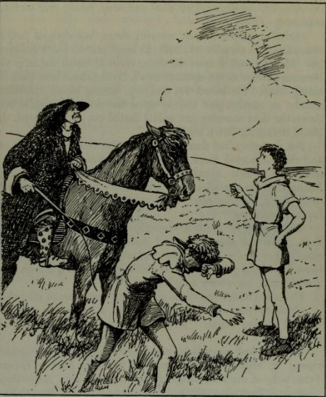

Questions on The Wool-Pack (1951) by Cynthia Harnett (1893-1981)

1\. Nicholas’ attitude to his work is best described as:

A. He wants to be a genteel merchant like his father.

B. He is proud of his father’s importance, but he also enjoys manual labour.

C. He hates his father’s packer and plays truant from his lessons.

D. He just wants to be a shepherd like his best friend Hal.

2\. Nicholas is rather worried about going home that day because:

A. He thinks his mother will discover that he has played truant.

B. His father is away on business at Calais.

C. His mother will tell him off for working with the sheep.

D. He has spent too long washing sheep that day.

3\. The impression made by Messer Antonio Bari’s secretary is best summarised as:

A. He is a cruel, proud and cold man.

B. He does not care about hurting other people.

C. He cares more about his dog than about Hal.

D. He mocks Nicholas by bowing low to him.

Fiction Writing

Write a story about someone who has to defend his friend from an injustice.

You could use the structure below.

| Paragraph | Suggested Vocabulary |
| --- | --- |
| Paragraph One: In medias res (in the middle of things) I listened in horror as the principal made his announcement. | expelled, gross misconduct, disgrace, reputation, shame |
| Paragraph Two: Flashback: how we got here I remembered the conversation of the previous day. | frame, troublemaker, cunning, deceitful, underhand |
| Paragraph Three: Jolt back to the present Now I knew that I had to do something. | witness, truth, protest, determination |
| Paragraph Four:  I walked nervously up to the principal’s door. | forbidding, stern, skeptical, refused, convinced, evidence |
| Paragraph Five: Struggle with danger or difficulty Walking into class the next day, I could feel my face burning. | jeers, comments, threats, muttered, hostile, atmosphere |
| Paragraph Six: Resolution of danger or difficulty (either happy or tragic) I was so glad that I had persevered with my plan. | friendship, loyalty, proof, justice, innocence |

## 58. The Last Battle (1956)

The Last Battle (1956) by C. S. Lewis (1898-1963)

Chapter Three: The Ape in Its Glory

Shift the Ape has dressed Puzzle the donkey in a lion skin and fooled the simple talking animals of Narnia into believing that he is Aslan. He has begun his programme of enslaving the free Narnians, pretending that it is all Aslan’s orders.

The last king of Narnia, Tirian, and his faithful friend, Jewel the unicorn, have just killed two Calormenes after realising that they were whipping talking horses and making them work at dragging away the talking trees that had been murdered. They attacked in a rage, without warning the two Calormenes.

"Master Horse, Master Horse," said Tirian as he hastily cut its traces, "how came these aliens to enslave you? Is Narnia conquered? Has there been a battle?"

"No, Sire," panted the horse. "Aslan is here. It is all by his orders. He has commanded——"

"'Ware danger, King," said Jewel. Tirian looked up and saw that Calormenes (mixed with a few Talking Beasts) were beginning to run towards them from every direction. The two dead men had died without a cry and so it had taken a moment before the rest of the crowd knew what had happened. But now they did. Most of them had naked scimitars in their hands.

"Quick. On my back," said Jewel.

The King flung himself astride of his old friend who turned and galloped away. He changed direction twice or thrice as soon as they were out of sight of their enemies, crossed a stream, and shouted without slackening his pace, "Whither away, Sire? To Cair Paravel?"

"Hold hard, friend," said Tirian. "Let me off." He slid off the Unicorn's back and faced him.

"Jewel," said the King. "We have done a dreadful deed."

"We were sorely provoked," said Jewel.

"But to leap on them unawares—without defying them—while they were unarmed—faugh! We are two murderers, Jewel. I am dishonoured forever."

Jewel drooped his head. He too was ashamed.

"And then," said the King, "the Horse said it was by Aslan's orders. The Rat said the same. They all say Aslan is here. But if it were true?"

"But, Sire, how could Aslan be commanding such dreadful things?"

"He is not a tame Lion," said Tirian. "How should we know what he would do? We, who are murderers. Jewel, I will go back. I will give up my sword and put myself in the hands of these Calormenes and ask that they bring me before Aslan. Let him do justice to me."

"You will go to your death, then," said Jewel.

"Do you think I care if Aslan dooms me to death?" said the King. "That would be nothing, nothing at all. Would it not be better to be dead than to have this horrible fear that Aslan has come and is not like the Aslan we have believed in and longed for? It is as if the sun rose one day and were a black sun."

"I know," said Jewel. "Or as if you drank water and it were dry water. You are in the right, Sire. This is the end of all things. Let us go and give ourselves up."

"There is no need for both of us to go."

"If ever we loved one another, let me go with you now," said the Unicorn. "If you are dead and if Aslan is not Aslan, what life is left for me?"

They turned and walked back together, shedding bitter tears.

As soon as they came to the place where the work was going on, the Calormenes raised a cry and came towards them with their weapons in hand. But the King held out his sword with the hilt towards them and said:

"I who was King of Narnia and am now a dishonoured knight give myself up to the justice of Aslan. Bring me before him."

"And I give myself up too," said Jewel.

Then the dark men came round them in a thick crowd, smelling of garlic and onions, their white eyes flashing dreadfully in their brown faces. They put a rope halter round Jewel's neck. They took the King's sword away and tied his hands behind his back. One of the Calormenes, who had a helmet instead of a turban and seemed to be in command, snatched the gold circlet off Tirian's head and hastily put it away somewhere among his clothes. They led the two prisoners uphill to a place where there was a big clearing. And this was what the prisoners saw.

At the centre of the clearing, which was also the highest point of the hill, there was a little hut like a stable, with a thatched roof. Its door was shut. On the grass in front of the door there sat an Ape. Tirian and Jewel, who had been expecting to see Aslan and had heard nothing about an Ape yet, were very bewildered when they saw it. The Ape was of course Shift himself, but he looked ten times uglier than when he lived by Caldron Pool, for he was now dressed up. He was wearing a scarlet jacket which did not fit him very well, having been made for a dwarf. He had jewelled slippers on his hind paws which would not stay on properly because, as you know, the hind paws of an Ape are really like hands. He wore what seemed to be a paper crown on his head. There was a great pile of nuts beside him and he kept cracking nuts with his jaws and spitting out the shells. And he also kept on pulling up the scarlet jacket to scratch himself. A great number of Talking Beasts stood facing him, and nearly every face in that crowd looked miserably worried and bewildered. When they saw who the prisoners were, they all groaned and whimpered.

"O Lord Shift, mouthpiece of Aslan," said the chief Calormene. "We bring you prisoners. By our skill and courage and by the permission of the great god Tash we have taken alive these two desperate murderers."

"Give me that man's sword," said the Ape. So they took the King's sword and handed it, with the sword-belt and all, to the monkey. And he hung it round his own neck: and it made him look sillier than ever.

"We'll see about those two later," said the Ape, spitting out a shell in the direction of the two prisoners. "I got some other business first. They can wait. Now listen to me, everyone. The first thing I want to say is about nuts. Where's that Head Squirrel got to?"

"Here, Sir," said a red squirrel, coming forward and making a nervous little bow.

"Oh you are, are you?" said the Ape with a nasty look. "Now attend to me. I want—I mean, Aslan wants—some more nuts. These you've brought aren't anything near enough. You must bring some more, do you hear? Twice as many. And they’ve got to be here by sunset tomorrow, and there mustn't be any bad ones or any small ones among them."

A murmur of dismay ran through the other squirrels, and the Head Squirrel plucked up courage to say:

"Please, would Aslan himself speak to us about it? If we might be allowed to see him——"

"Well you won't," said the Ape. "He may be very kind (though it's a lot more than most of you deserve) and come out for a few minutes tonight. Then you can all have a look at him. But he will not have you all crowding round him and pestering him with questions. Anything you want to say to him will be passed on through me: if I think it's worth bothering him about. In the meantime all you squirrels had better go and see about the nuts. And make sure they are here by tomorrow evening or, my word! you'll catch it."

The poor squirrels all scampered away as if a dog were after them. This new order was terrible news for them. The nuts they had carefully hoarded for the winter had nearly all been eaten by now; and of the few that were left they had already given the Ape far more than they could spare.

Then a deep voice—it belonged to a great tusked and shaggy Boar—spoke from another part of the crowd.

"But why can't we see Aslan properly and talk to him?" it said. "When he used to appear in Narnia in the old days everyone could talk to him face to face."

"Don't you believe it," said the Ape. "And even if it was true, times have changed. Aslan says he's been far too soft with you before, do you see? Well, he isn't going to be soft any more. He's going to lick you into shape this time. He'll teach you to think he's a tame lion!"

A low moaning and whimpering was heard among the Beasts; and, after that, a dead silence which was more miserable still.

"And now there's another thing you’ve got to learn," said the Ape. "I hear some of you are saying I'm an Ape. Well, I'm not. I'm a Man. If I look like an Ape, that's because I'm so very old: hundreds and hundreds of years old. And it's because I'm so old that I'm so wise. And it's because I'm so wise that I'm the only one Aslan is ever going to speak to. He can't be bothered talking to a lot of stupid animals. He'll tell me what you've got to do, and I'll tell the rest of you. And take my advice, and see you do it in double quick time, for He doesn't mean to stand any nonsense."

There was dead silence except for the noise of a very young badger crying and its mother trying to make it keep quiet.

"And now here's another thing," the Ape went on, fitting a fresh nut into its cheek. "I hear some of the horses are saying, Let's hurry up and get this job of carting timber over as quickly as we can, and then we'll be free again. Well, you can get that idea out of your heads at once. And not only the Horses either. Everybody who can work is going to be made to work in the future. Aslan has it all settled with the King of Calormen—The Tisroc, as our dark-faced friends, the Calormenes, call him. All you horses and bulls and donkeys are to be sent down into Calormen to work for your living—pulling and carrying the way horses and such do in other countries. And all you digging animals like moles and rabbits and Dwarfs are going down to work in the Tisroc's mines. And——"

"No, no, no," howled the Beasts. "It can't be true. Aslan would never sell us into slavery to the King of Calormen."

"None of that! Hold your noise!" said the Ape with a snarl. "Who said anything about slavery? You won't be slaves. You'll be paid—very good wages too. That is to say, your pay will be paid into Aslan's treasury and he will use it all for everybody's good." Then he glanced, and almost winked, at the chief Calormene. The Calormene bowed and replied, in the pompous Calormene way:

"Most sapient Mouthpiece of Aslan, the Tisroc (may he live forever) is wholly of one mind with your lordship in this judicious plan."

"There! You see!" said the Ape. "It's all arranged. And all for your own good. We'll be able, with the money you earn, to make Narnia a country worth living in. There'll be oranges and bananas pouring in—and roads and big cities and schools and offices and whips and muzzles and saddles and cages and kennels and prisons—Oh, everything."

"But we don't want all those things," said an old Bear. "We want to be free. And we want to hear Aslan speak himself."

"Now don't you start arguing," said the Ape, "for it's a thing I won't stand. I'm a Man: you're only a fat, stupid old Bear. What do you know about freedom? You think freedom means doing what you like. Well, you're wrong. That isn't true freedom. True freedom means doing what I tell you."

"H-n-n-h," grunted the Bear and scratched its head; it found this sort of thing hard to understand.

"Please, please," said the high voice of a woolly lamb, who was so young that everyone was surprised he dared to speak at all.

"What is it now?" said the Ape. "Be quick."

"Please," said the Lamb, "I can't understand. What have we to do with the Calormenes? We belong to Aslan. They belong to Tash. They have a god called Tash. They say he has four arms and the head of a vulture. They kill Men on his altar. I don't believe there's any such person as Tash. But if there was, how could Aslan be friends with him?"

All the animals cocked their heads sideways and all their bright eyes flashed towards the Ape. They knew it was the best question anyone had asked yet.

The Ape jumped up and spat at the Lamb.

"Baby!" he hissed. "Silly little bleater! Go home to your mother and drink milk. What do you understand of such things? But you others, listen. Tash is only another name for Aslan. All that old idea of us being right and the Calormenes wrong is silly. We know better now. The Calormenes use different words but we all mean the same thing. Tash and Aslan are only two different names for you know Who. That's why there can never be any quarrel between them. Get that into your heads, you stupid brutes. Tash is Aslan: Aslan is Tash."

You know how sad your own dog's face can look sometimes. Think of that and then think of all the faces of those Talking Beasts—all those honest, humble, bewildered birds, bears, badgers, rabbits, moles, and mice—all far sadder than that. Every tail was down, every whisker drooped. It would have broken your heart with very pity to see their faces. There was only one who did not look at all unhappy.

It was a ginger cat—a great big Tom in the prime of life—who sat bolt upright with his tail curled round his toes, in the very front row of all the Beasts. He had been staring hard at the Ape and the Calormene captain all the time and had never once blinked his eyes.

"Excuse me," said the Cat very politely, "but this interests me. Does your friend from Calormen say the same?"

"Assuredly," said the Calormene. "The enlightened Ape—Man, I mean—is in the right. Aslan means neither less nor more than Tash."

"Especially, Aslan means no more than Tash?" suggested the Cat.

"No more at all," said the Calormene, looking the Cat straight in the face.

"Is that good enough for you, Ginger?" said the Ape.

"Oh certainly," said Ginger coolly. "Thank you very much. I only wanted to be quite clear. I think I am beginning to understand."

Up till now the King and Jewel had said nothing: they were waiting until the Ape should bid them speak, for they thought it was no use interrupting. But now, as Tirian looked round on the miserable faces of the Narnians, and saw how they would all believe that Aslan and Tash were one and the same, he could bear it no longer.

"Ape," he cried with a great voice, "you lie. You lie damnably. You lie like a Calormene. You lie like an Ape."

He meant to go on and ask how the terrible god Tash who fed on the blood of his people could possibly be the same as the good Lion by whose blood all Narnia was saved. If he had been allowed to speak, the rule of the Ape might have ended that day; the Beasts might have seen the truth and thrown the Ape down. But before he could say another word two Calormenes struck him in the mouth with all their force, and a third, from behind, kicked his feet from under him. And as he fell, the Ape squealed in rage and terror:

"Take him away. Take him away. Take him where he cannot hear us, nor we hear him. There tie him to a tree. I will—I mean, Aslan will—do justice to him later."

Questions on The Last Battle (1956) by C. S. Lewis (1898-1963)

1\. Tirian and Jewel surrender to the Calormenes because:

A. They want to find out if Aslan has really come.

B. They realise that they cannot defeat them.

C. They are ashamed of how they killed the two Calormenes.

D. They are sad to hear that Aslan has been giving evil orders.

2\. The talking beasts listen to Shift the ape because:

A. They believe that he is speaking on behalf of Aslan.

B. Shift has Calormene soldiers to back him up.

C. Shift speaks with great authority and sternness.

D. They are too stupid to understand the situation properly.

3\. Tirian wants to make a speech to the talking beasts mainly because:

A. He realises that he should not have surrendered.

B. He wants to recruit them to fight against the ape.

C. He feels very sorry for them.

D. He wants to explain the truth about Aslan and Tash.

Analytical Writing

| Starting Sentence | Quotations | Vocabulary |
| --- | --- | --- |
| C. S. Lewis creates great sympathy for the talking beasts of Narnia. | ‘of the few that were left they had already given the Ape far more than they could spare.’ ‘Aslan would never sell us into slavery to the King of Calormen.’ ‘They kill Men on his altar.’ ‘How could Aslan be friends with him?’ ‘Silly little bleater’ ‘We know better now’ ‘Miserable faces’ ‘bewildered’ ‘He meant to go on and ask how the terrible god Tash who fed on the blood of his people could possibly be the same as the good Lion by whose blood all Narnia was saved.’ | exploited, enslave, Shift, Tisroc, deceived, Tash, cruelty, love, silenced, insults, violence |

Example Paragraph

C. S. Lewis creates great sympathy for the talking beasts of Narnia. He describes how they are being ruthlessly exploited by Shift when the talking squirrels are ordered to fetch more nuts, even though they have already given ‘far more than they can spare’. Even worse, he makes clear Shift’s plan to enslave them in the mines of the Tisroc, with their ‘wages’ obviously destined for his pocket. But the most poignant aspect of their situation is how they are duped into believing that all of this tyranny and exploitation comes from Aslan. The little lamb innocently makes the point that Tash must be different from Aslan, because ‘They kill Men on his altar’. Such cruelty and barbarism means that Aslan ‘could not be friends with him’. But the lamb is silenced and crushed by the ape’s lying assertion that Aslan and Tash are one. The ape offers no evidence for his claim, resorting instead to insults (‘Silly little bleater’) and the vague assertion that times have changed: ‘We know better now’. Tirian is wise enough to see through the false assertions of the ape, and the ‘miserable faces’ of his subjects inspire him to speak against the idea that ‘the terrible god Tash’ could be the same as ‘the good lion’ Aslan. However, he too is silenced, this time by mere violence. The Narnians are thus left entirely ‘bewildered’ and at the mercy of the lying imposter, the ape, and his Calormene allies.

## 59. To Kill a Mockingbird (1960)

Extract from To Kill a Mockingbird (1960) by Harper Lee (1926-2016)

The hero of this novel is six-year-old Jean Louise Finch, who goes by the nickname Scout. She lives in Maycomb, a fictional small town in Alabama, similar to Monroeville, where Harper Lee grew up in the 1930s. The novel deals with issues of social class and racism from the point of view of Scout and her brother, Jem. Their father, Atticus Finch, is a lawyer who bravely agrees to defend an African American man who has been falsely accused.

From Chapter Two: Scout Goes to School

Jem condescended to take me to school the first day, a job usually done by one's parents, but Atticus had said Jem would be delighted to show me where my room was. I think some money changed hands in this transaction, for as we trotted around the corner past the Radley Place I heard an unfamiliar jingle in Jem's pockets. When we slowed to a walk at the edge of the schoolyard, Jem was careful to explain that during school hours I was not to bother him, I was not to approach him with requests to enact a chapter of Tarzan and the Ant Men, to embarrass him with references to his private life, or tag along behind him at recess and noon. I was to stick with the first grade and he would stick with the fifth. In short, I was to leave him alone.

"You mean we can't play any more?" I asked.

"We'll do like we always do at home," he said, "but you'll see — school's different."

It certainly was. Before the first morning was over, Miss Caroline Fisher, our teacher, hauled me up to the front of the room and patted the palm of my hand with a ruler, then made me stand in the corner until noon.

Miss Caroline was no more than twenty-one. She had bright auburn hair, pink cheeks, and wore crimson fingernail polish. She also wore high-heeled pumps and a red-and-white-striped dress. She looked and smelled like a peppermint drop. She boarded across the street, one door down from us, in Miss Maudie Atkinson's upstairs front room, and when Miss Maudie introduced us to her, Jem was in a haze for days.

Miss Caroline printed her name on the blackboard and said, "This says I am Miss Caroline Fisher. I am from North Alabama, from Winston County." The class murmured apprehensively, should she prove to harbor her share of the peculiarities indigenous to that region. (When Alabama seceded from the Union on January 11, 1861, Winston County seceded from Alabama, and every child in Maycomb County knew it.) North Alabama was full of Liquor Interests, Big Mules, steel companies, Republicans, professors, and other persons of no background.

Miss Caroline began the day by reading us a story about cats. The cats had long conversations with one another, they wore cunning little clothes and lived in a warm house beneath a kitchen stove. By the time Mrs. Cat called the drugstore for an order of chocolate malted mice, the class was wriggling like a bucketful of catawba worms. Miss Caroline seemed unaware that the ragged, denim-shirted and floursack-skirted first grade, most of whom had chopped cotton and fed hogs from the time they were able to walk, were immune to imaginative literature. Miss Caroline came to the end of the story and said, "Oh, my, wasn't that nice?"

Then she went to the blackboard and printed the alphabet in enormous square capitals, turned to the class and asked, "Does anybody know what these are?"

Everybody did; most of the first grade had failed it last year. I suppose she chose me because she knew my name; as I read the alphabet a faint line appeared between her eyebrows, and after making me read most of My First Reader and the stock-market quotations from The Mobile Register aloud, she discovered that I was literate and looked at me with more than faint distaste. Miss Caroline told me to tell my father not to teach me any more, it would interfere with my reading.

"Teach me?" I said in surprise. "He hasn't taught me anything, Miss Caroline. Atticus ain't got time to teach me anything," I added, when Miss Caroline smiled and shook her head. "Why, he's so tired at night he just sits in the living room and reads."

"If he didn't teach you, who did?" Miss Caroline asked good-naturedly. "Somebody did. You weren't born reading The Mobile Register."

"Jem says I was. He read in a book where I was a Bullfinch instead of a Finch. Jem says my name's really Jean Louise Bullfinch, that I got swapped when I was born and I'm really a—"

Miss Caroline apparently thought I was lying. "Let's not let our imaginations run away with us, dear," she said. "Now you tell your father not to teach you any more. It's best to begin reading with a fresh mind. You tell him I'll take over from here and try to undo the damage—"

"Ma'am?"

"Your father does not know how to teach. You can have a seat now."

I mumbled that I was sorry and retired meditating upon my crime. I never deliberately learned to read, but somehow I had been wallowing illicitly in the daily papers. In the long hours of church — was it then I learned? I could not remember not being able to read hymns. Now that I was compelled to think about it, reading was something that just came to me, as learning to fasten the seat of my union suit without looking around, or achieving two bows from a snarl of shoelaces. I could not remember when the lines above Atticus's moving finger separated into words, but I had stared at them all the evenings in my memory, listening to the news of the day, Bills To Be Enacted into Laws, the diaries of Lorenzo Dow —  anything Atticus happened to be reading when I crawled into his lap every night. Until I feared I would lose it, I never loved to read. One does not love breathing.

I knew I had annoyed Miss Caroline, so I let well enough alone and stared out the window until recess when Jem cut me from the covey of first-graders in the schoolyard. He asked how I was getting along. I told him.

"If I didn't have to stay, I'd leave. Jem, that lady says Atticus's been teaching me to read and for him to stop it — "

"Don't worry, Scout," Jem comforted me. "Our teacher says Miss Caroline's introducing a new way of teaching. She learned about it in college. It'll be in all the grades soon. You don't have to learn much out of books that way — it's like if you wanta learn about cows, you go milk one, see?"

"Yeah Jem, but I don't wanta study cows, I — "

"Sure you do. You hafta know about cows, they're a big part of life in Maycomb County."

I contented myself with asking Jem if he'd lost his mind. "I'm just trying to tell you the new way they're teachin' the first grade, stubborn. It's the Dewey Decimal System."

Having never questioned Jem's pronouncements, I saw no reason to begin now. The Dewey Decimal System consisted, in part, of Miss Caroline waving cards at us on which were printed "the," "cat," "rat," "man," and "you." No comment seemed to be expected of us, and the class received these impressionistic revelations in silence. I was bored, so I began a letter to Dill. Miss Caroline caught me writing and told me to tell my father to stop teaching me. "Besides," she said. "We don't write in the first grade, we print. You won't learn to write until you're in the third grade."

Calpurnia was to blame for this. It kept me from driving her crazy on rainy days, I guess. She would set me a writing task by scrawling the alphabet firmly across the top of a tablet, then copying out a chapter of the Bible beneath. If I reproduced her penmanship satisfactorily, she rewarded me with an open-faced sandwich of bread and butter and sugar. In Calpurnia's teaching, there was no sentimentality: I seldom pleased her and she seldom rewarded me.

"Everybody who goes home to lunch hold up your hands," said Miss Caroline, breaking into my new grudge against Calpurnia. The town children did so, and she looked us over. "Everybody who brings his lunch put it on top of his desk." Molasses buckets appeared from nowhere, and the ceiling danced with metallic light. Miss Caroline walked up and down the rows peering and poking into lunch containers, nodding if the contents pleased her, frowning a little at others. She stopped at Walter Cunningham's desk. "Where's yours?" she asked.

Walter Cunningham's face told everybody in the first grade he had hookworms. His absence of shoes told us how he got them. People caught hookworms going barefooted in barnyards and hog wallows. If Walter had owned any shoes he would have worn them the first day of school and then discarded them until mid-winter. He did have on a clean shirt and neatly mended overalls.

"Did you forget your lunch this morning?" asked Miss Caroline.

Walter looked straight ahead. I saw a muscle jump in his skinny jaw.

"Did you forget it this morning?" asked Miss Caroline. Walter's jaw twitched again.

"Yeb'm," he finally mumbled.

Miss Caroline went to her desk and opened her purse. "Here's a quarter," she said to Walter. "Go and eat downtown today. You can pay me back tomorrow."

Walter shook his head. "Nome thank you ma'am," he drawled softly.

Impatience crept into Miss Caroline's voice: "Here Walter, come get it."

Walter shook his head again.

When Walter shook his head a third time someone whispered, "Go on and tell her, Scout."

I turned around and saw most of the town people and the entire bus delegation looking at me. Miss Caroline and I had conferred twice already, and they were looking at me in the innocent assurance that familiarity breeds understanding.

I rose graciously on Walter's behalf: "Ah — Miss Caroline?"

"What is it, Jean Louise?"

"Miss Caroline, he's a Cunningham."

I sat back down.

"What, Jean Louise?"

I thought I had made things sufficiently clear. It was clear enough to the rest of us: Walter Cunningham was sitting there lying his head off. He didn't forget his lunch, he didn't have any. He had none today nor would he have any tomorrow or the next day. He had probably never seen three quarters together at the same time in his life.

I tried again: "Walter's one of the Cunninghams, Miss Caroline."

"I beg your pardon, Jean Louise?"

"That's okay, ma'am, you'll get to know all the county folks after a while. The Cunninghams never took anything they can't pay back — no church baskets and no scrip stamps. They never took anything off of anybody, they get along on what they have. They don't have much, but they get along on it."

My special knowledge of the Cunningham tribe — one branch, that is — was gained from events of last winter. Walter's father was one of Atticus's clients. After a dreary conversation in our living room one night about his entailment, before Mr. Cunningham left he said, "Mr. Finch, I don't know when I'll ever be able to pay you." "Let that be the least of your worries, Walter," Atticus said. When I asked Jem what entailment was, and Jem described it as a condition of having your tail in a crack, I asked Atticus if Mr. Cunningham would ever pay us.

"Not in money," Atticus said, "but before the year's out I'll have been paid. You watch."

We watched. One morning Jem and I found a load of stovewood in the backyard. Later, a sack of hickory nuts appeared on the back steps. With Christmas came a crate of smilax and holly. That spring when we found a croker-sack full of turnip greens, Atticus said Mr. Cunningham had more than paid him.

"Why does he pay you like that?" I asked.

"Because that's the only way he can pay me. He has no money."

"Are we poor, Atticus?"

Atticus nodded. "We are indeed."

Jem's nose wrinkled. "Are we as poor as the Cunninghams?"

"Not exactly. The Cunninghams are country folks, farmers, and the crash hit them hardest."

Atticus said professional people were poor because the farmers were poor. As Maycomb County was farm country, nickels and dimes were hard to come by for doctors and dentists and lawyers. Entailment was only a part of Mr. Cunningham's vexations. The acres not entailed were mortgaged to the hilt, and the little cash he made went to interest. If he held his mouth right, Mr. Cunningham could get a WPA job, but his land would go to ruin if he left it, and he was willing to go hungry to keep his land and vote as he pleased. Mr. Cunningham, said Atticus, came from a set breed of men.

As the Cunninghams had no money to pay a lawyer, they simply paid us with what they had. "Did you know," said Atticus, "that Dr. Reynolds works the same way? He charges some folks a bushel of potatoes for delivery of a baby. Miss Scout, if you give me your attention I'll tell you what entailment is. Jem's definitions are very nearly accurate sometimes."

If I could have explained these things to Miss Caroline, I would have saved myself some inconvenience and Miss Caroline subsequent mortification, but it was beyond my ability to explain things as well as Atticus, so I said, "You're shamin' him, Miss Caroline. Walter hasn't got a quarter at home to bring you, and you can't use any stovewood."

Miss Caroline stood stock still, then grabbed me by the collar and hauled me back to her desk. "Jean Louise, I've had about enough of you this morning," she said. "You're starting off on the wrong foot in every way, my dear. Hold out your hand."

I thought she was going to spit in it, which was the only reason anybody in Maycomb held out his hand: it was a time-honored method of sealing oral contracts. Wondering what bargain we had made, I turned to the class for an answer, but the class looked back at me in puzzlement. Miss Caroline picked up her ruler, gave me half a dozen quick little pats, then told me to stand in the corner. A storm of laughter broke loose when it finally occurred to the class that Miss Caroline had whipped me.

When Miss Caroline threatened it with a similar fate, the first grade exploded again, becoming cold sober only when the shadow of Miss Blount fell over them. Miss Blount, a native Maycombian as yet uninitiated in the mysteries of the Decimal System, appeared at the door hands on hips and announced: "If I hear another sound from this room I'll burn up everybody in it. Miss Caroline, the sixth grade cannot concentrate on the pyramids for all this racket!"

My sojourn in the corner was a short one. Saved by the bell, Miss Caroline watched the class file out for lunch. As I was the last to leave, I saw her sink down into her chair and bury her head in her arms. Had her conduct been more friendly toward me, I would have felt sorry for her. She was a pretty little thing.

Questions on To Kill a Mockingbird (1960) by Harper Lee (1926-2016)

1\. Scout gets in trouble about reading and writing because:

A. Her father has taught her ineffectively.

B. She has read too many grown-up newspapers.

C. Her teacher is annoyed that she has already learned.

D. Her teacher uses useless and ridiculous methods.

2\. Walter Cunningham will not take Miss Caroline’s quarter because:

A. His health has suffered due to poverty.

B. His family never takes any charitable donations or loans.

C. His father is having legal trouble.

D. Miss Caroline does not understand the ways of Maycomb.

Nonfiction Writing: What Makes a Good Education?

Write an article explaining what you think makes a good education. You could use this structure:

## 60. ‘Walking Away’ (1956)

| Paragraph | Suggested Vocabulary |
| --- | --- |
| Introduction A good education includes many things. | happiness, knowledgeable, better person, successful, practical, moral, physical, mental, academic, health |
| Paragraph One Learning academic subjects well is certainly important. | horizons, others, mind, expand, professional, expertise, application, true, good, beautiful |
| Paragraph Two Physical education can also make a great contribution to a person’s happiness. | sport, variety, enjoyment, health, lifelong, experience, teamwork, cooperation |
| Paragraph Three We shouldn’t ignore the practical skills that are so important for daily life. | organised, chaotic, everyday, useful, cooking, cleaning, tidy, regular, maturing, independent, good habits, young age, sudden shock, preparation |
| Paragraph Four But the most important part of education is the moral dimension. | example, trained, considerate, kind, charitable, selfish, self-control, thoughtful, successful, relationships, marriage, employment |
| Conclusion In the end, education is about making you a better and a happier person. | virtue, goodness, kindness, family, parents, educators, responsibility |

‘Walking Away’ (1956) by Cecil Day-Lewis (1904-1972)

It is eighteen years ago, almost to the day –

A sunny day with leaves just turning,

The touch-lines new-ruled – since I watched you play

Your first game of football, then, like a satellite

Wrenched from its orbit, go drifting away            5

Behind a scatter of boys. I can see

You walking away from me towards the school

With the pathos of a half-fledged thing set free

Into a wilderness, the gait of one

Who finds no path where the path should be.        10

That hesitant figure, eddying away

Like a winged seed loosened from its parent stem,

Has something I never quite grasp to convey

About nature’s give-and-take – the small, the scorching

Ordeals which fire one’s irresolute clay.            15

I have had worse partings, but none that so

Gnaws at my mind still. Perhaps it is roughly

Saying what God alone could perfectly show –

How selfhood begins with a walking away,

And love is proved in the letting go.                20

Glossary

‘half-fledged’ - halfway to being able to fly (a ‘fledgling’ is a young bird which has just learned to fly)

‘gait’ - way of walking

‘eddying’ - moving in a circular way

‘irresolute’ - undecided / uncertain

Summary

The poet meditates on a powerful memory that has haunted him, of when he first watched his son play football. After the match, he watched him walking away with his friends towards the school, and he sensed that his son was leaving behind his father and setting out into the world. He concludes that love must involve giving the loved one freedom - letting them go.

Day-Lewis dedicated this poem to his son Sean, making clear that it is based upon personal experience.

## 61. ‘Mother, any distance’ (1993)

‘Mother, any distance’ (1993) by Simon Armitage (born 1963)

Mother, any distance greater than a single span

requires a second pair of hands.

You come to help me measure windows, pelmets, doors,

the acres of the walls, the prairies of the floors.

You at the zero-end, me with the spool of tape, recording        5

length, reporting metres, centimetres back to base, then leaving

up the stairs, the line still feeding out, unreeling

years between us. Anchor. Kite.

I space-walk through the empty bedrooms, climb

the ladder to the loft, to breaking point, where something        10

has to give;

two floors below your fingertips still pinch

the last one-hundredth of an inch ... I reach

towards a hatch that opens on an endless sky

to fall or fly.                                15

Glossary

‘pelmet’ - a curtain-holder above a window

‘prairies’ - large open spaces

‘zero-end’ - the beginning of the measuring tape

‘spool’ - the part of the tape that unrolls as you move further away from the beginning

Summary

The speaker describes the process of measuring an empty house with his mother. The house is presumably one he has bought for himself. The speaker gets further and further away from his mother as he ascends to the top of the house, but she still clings on to the other end of the measuring tape.

Questions on ‘Walking Away’ (1956) by Cecil Day-Lewis (1904-1972)

1\. When his son walks away from him, the poet mainly feels:

A. Happy about his son’s increasing independence.

B. Anxious about letting his son go.

C. Ready to allow his son to stretch his wings.

D. Confused about why his son is going away.

2\. The simile of a ‘winged seed’ suggests that:

A. The father is getting old and is preparing for death.

B. The son wants to get as far away from the father as he can.

C. The son needs space in order to thrive.

D. The son is definitely ready to fly away from the family nest.

Questions on ‘Mother, any distance’ (1993) by Simon Armitage (born 1963)

1\. The poet measures an empty house with his mother, which suggests that:

A. He is reluctant to leave his parents’ house.

B. He is not competent at measuring distances by himself.

C. He depends very much upon his mother.

D. He is halfway to leaving home, but not quite there yet.

2\. The mother keeps hold of her end of the measuring tape, suggesting that:

A. She is determined to make sure that the measurements are accurate.

B. She is determined to keep in touch with her son.

C. Her son wants to remain attached to his mother.

D. She is a very stubborn person.

Fiction Writing

Write a story about someone who leaves home.

You could use this structure:

| Paragraph | Suggested Vocabulary |
| --- | --- |
| Paragraph One: A hope for the future I was looking forward so much to the day when I would leave for college. | independence, freedom, rules, choices |
| Paragraph Two: A plan for success I had everything planned out for my new life. | accommodation, friends, studies, activities |
| Paragraph Three: A triumph My first week at college was so exciting. | new friends, knowledge, lectures, discovery |
| Paragraph Four: A setback But it wasn’t long before I realised that it would not all be plain sailing. | illness, loneliness, appreciation, love, care, security |
| Paragraph Five: A struggle I lay in bed with a fever, but I didn’t want to call home. | humiliating, surrender, helpless, help, kind, loving |
| Paragraph Six: Conclusion - happy or tragic I had learned an important lesson about independence. | parents, gratitude, help, support |
